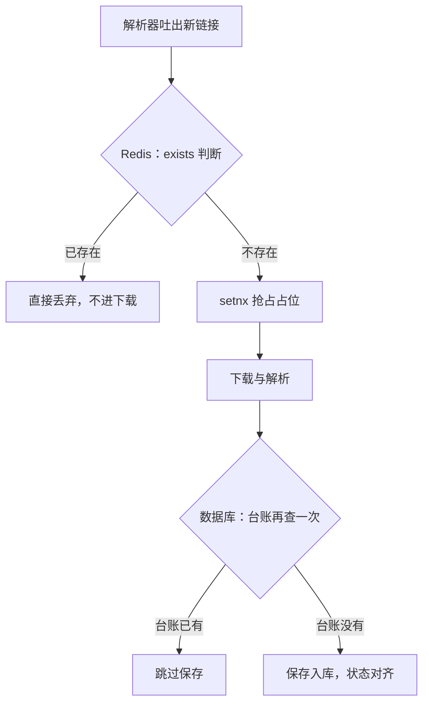

# 排重开场：Redis 进场，为「同一个 URL 只下载一次」铺路

> 🔒 安全提示：文中示例的口令/密钥均为课程教学环境演示口径，生产环境的安全要求见《安全与合规须知》。

保存准备四块齐了，爬虫进入下一个阶段：排重。讲义口径一句话，下载后的内容需要进行排重，一个 URL 不能重复下载，请求一次就不能再请求。这句话背后是钱与数据质量双重压力，这一讲把排重为什么做、做几层想清楚，然后把基础设施补上：爬虫工程还没有集成 Redis，排重的第一层要靠它。

## 先给结论

- 排重做两层：Redis 前置快速挡，数据库台账最终兜底，同一个 URL 在两处各查一次。
- 集成 Redis 三步走：common 模块放 `redis.properties`，`RedisConfiguration` 继承 `RedisAutoConfiguration` 引入模板 Bean，crawler 模块用 `RedisConfig` 组件扫描打通。
- `RedisAutoConfiguration` 的 `@Import` 与 `@Bean` 是模板进容器的关键，继承它等于直接获得 `redisTemplate` 与 `StringRedisTemplate`。
- 排重的 API 组合是 exists 判断加 setnx 抢占，数据结构可用 Set 或 Bitmap，具体代码下一讲收口。

## 为什么排重是爬虫的刹车

正向批次是定时任务，cron 到点就发起一轮，批次从初始化 URL 出发，沿着链接一路抓到文章页。没有排重的爬虫像没有刹车、只有油门的车：每一轮调度都把上一轮抓过的文章重新下载、重新解析、重新入库，`cl_news` 台账被同一篇文章塞满重复行。浪费有三重，请求额度是成本，目标站点的友好度是约束，重复数据是脏账。排重就是刹车，同一个 URL 只处理一次，处理过的直接挡在下载之前。

day10 开篇的目标课把排重规则设计成不对称的：正向同一个 URL 不能爬两次，反向允许反复爬取。正向是增量抓新，重复即脏数据；反向是回源刷新，重复是职责。这一讲铺的 Redis 排重服务于正向这条线，反向走的是台账的到期行查询，两不相扰。

## 两层排重的分工

讲义把排重明确拆成两步：先用 Redis 排重，再用数据库排重。两层不是重复劳动，而是分工：



**第一，Redis 层是快挡。** 它在下载之前，判断一个 URL 抓没抓过只要一次内存级查询，省下的是整个下载与解析的流程。Redis 的数据在内存里，快是它的本职；但它是易失的，进程重启、缓存淘汰都可能让记录消失，所以它只做前置，不做最终结论。

**第二，数据库层是兜底。** 保存之前在台账上再查一次，URL 唯一约束加状态字段，持久可靠。Redis 丢了记录，数据库还记得；数据库没有的，Redis 也不会凭空多出来。两层结论不一致时以数据库为准，Redis 只是让大多数请求根本走不到数据库那一步。

**第三，占位动作决定并发正确性。** 只是「查一下有没有」在并发下有竞态：两个线程同时查同一个 URL 都得到「没有」，于是都去下载。setnx 语义解决这个，set if not exists，谁设置成功谁拿到处理权，失败的那个直接放弃。这也是为什么判断与占位要合成一个原子动作，下一讲写排重代码时会围绕它展开。

## 集成 Redis 三步走

当前爬虫工程还没有 Redis，第一步是集成。集成的落位有讲究：连接配置与模板 Bean 放公共模块，使用方模块各自接上，这样后续任何模块要用 Redis 都不必重做一遍。

第一步，common 模块的 resources 下创建 `redis.properties`：

```properties
#redis config
spring.redis.host=127.0.0.1
spring.redis.port=6379
spring.redis.password=123456
spring.redis.timeout=90000
spring.redis.lettuce.pool.max-active=8
spring.redis.lettuce.pool.max-idle=8
spring.redis.lettuce.pool.min-idle=0
spring.redis.lettuce.pool.max-wait=-1
```

连接超时给到 90 秒，连接池按默认 8 个最大连接起步。密码在示例环境里明文可跑通，生产配置要进配置中心或加密存储，这一课先保证链路能通。

第二步，common 模块建 redis 包，配置类继承 Spring Boot 自带的自动配置类：

```java
package com.study.headline.common.redis;

import org.springframework.boot.autoconfigure.data.redis.RedisAutoConfiguration;
import org.springframework.boot.context.properties.ConfigurationProperties;
import org.springframework.context.annotation.Configuration;
import org.springframework.context.annotation.PropertySource;

@Configuration
@PropertySource("classpath:redis.properties")
@ConfigurationProperties(prefix = "spring.redis")
public class RedisConfiguration extends RedisAutoConfiguration {
}
```

这个类体是空的，价值全在继承与注解上。`@PropertySource` 把 properties 文件读进来，`@ConfigurationProperties(prefix = "spring.redis")` 按前缀把值绑到配置属性上；前缀沿用 Spring 默认的 `spring.redis`，不要随手改，改了绑定就断。继承 `RedisAutoConfiguration` 的意义要看父类源码：

```java
@Configuration
@Import({LettuceConnectionConfiguration.class, RedisConnectionConfiguration.class})
public class RedisAutoConfiguration {
    @Bean
    @ConditionalOnMissingBean(name = "redisTemplate")
    public RedisTemplate<Object, Object> redisTemplate(RedisConnectionFactory redisConnectionFactory) {
        RedisTemplate<Object, Object> template = new RedisTemplate<>();
        template.setConnectionFactory(redisConnectionFactory);
        return template;
    }
    // StringRedisTemplate 的 @Bean 同理，此处省略
}
```

父类 `@Import` 了两个连接配置类，连接工厂由此就位；`@Bean` 的 `redisTemplate` 与 `StringRedisTemplate` 随之进入 Spring 容器。子类继承之后什么都不用写，这些组件全部继承下来，工程里就有了可注入的 Redis 模板。Lettuce 是这里的底层客户端，Spring Boot 2.x 的默认选择，线程安全，配连接池使用。

第三步，使用方模块接上。headline-crawler 模块建一个配置类，把 common 的 redis 包扫进来：

```java
package com.study.headline.crawler.config;

import org.springframework.context.annotation.ComponentScan;
import org.springframework.context.annotation.Configuration;

@Configuration
@ComponentScan("com.study.headline.common.redis")
public class RedisConfig {
}
```

`@ComponentScan` 扫到 `RedisConfiguration`，Bean 链条从 properties 文件一路接通到模板对象，crawler 工程至此算集成了 Redis。三步的依赖关系是一条线：properties 文件供值，common 配置类造 Bean，crawler 扫描引入 Bean。中间任何一环断了，注入模板时就是 null，报错位置会倒推到断的那一环。

## 排重的 API 长什么样

集成完成后，排重代码要用的 API 组合是 exists 与 setnx。在 Spring Data Redis 里，它们对应 `hasKey` 与 `opsForValue().setIfAbsent`，用法示例按主流写法补全如下：

```java
// 排重 API 用法示例，按主流写法补全，收口封装在排重代码一讲展开
@Autowired
private StringRedisTemplate stringRedisTemplate;

private static final String CRAWLER_KEY = "crawler:url:";

/** 是否已抓取过，exists 语义 */
public boolean fetched(String url) {
    return Boolean.TRUE.equals(stringRedisTemplate.hasKey(CRAWLER_KEY + url));
}

/** 未抓取过则占位，setnx 语义，占到才算抢到处理权 */
public boolean markIfAbsent(String url) {
    return Boolean.TRUE.equals(
            stringRedisTemplate.opsForValue().setIfAbsent(CRAWLER_KEY + url, "1"));
}
```

键的设计值得留意：`crawler:url:` 前缀把爬虫的键空间与工程里其他用途隔开，避免不同业务互相覆盖。键的粒度是单个 URL，判断与占位各一次往返；并发场景下先 `setIfAbsent`，返回 true 才继续，把判断与占位合成一次原子调用，竞态窗口就不存在了。

模板的日常用法可以对照好客租房工程的真实现场，`materials/code/03/` 里 `RedisCacheInterceptor` 的两行核心代码是真实资料里的写法：

```java
@Autowired
private RedisTemplate<String, String> redisTemplate;

String redisKey = "WEB_DATA_" + DigestUtils.md5Hex(paramStr);
String data = this.redisTemplate.opsForValue().get(redisKey);
```

注入模板、拼业务键、`opsForValue()` 取值，三个动作与排重的形态完全一致，只是那边读缓存、这边判存在。数据规模再上一个量级后，Set 与 Bitmap 是更省内存的思路：Set 存抓过的 URL 集合，`sismember` 一次判断；Bitmap 按哈希位点标记，内存占用只有 URL 存储的零头，代价是要处理哈希冲突的误判。本课按键值对方案走通主干，Set 与 Bitmap 留作扩展方向。

## 常见误区

- **把 Redis 排重当成唯一防线。** 错例是 Redis 说没有就直接入库，重启后记录丢失，同一批文章重复入库。正解是数据库台账兜底，Redis 只做前置快挡，两层结论以台账为准。
- **先 exists 再 set 两步当一步用。** 错例是并发下两个线程都查到「不存在」，然后都去下载，排重形同虚设。正解是 `setIfAbsent` 一步完成判断与占位，占到处理权才继续。
- **键名不带业务前缀。** 错例是直接拿 URL 当键，与缓存、会话等其他用途的键混在一个空间，清理与排查都分不清归属。正解是统一前缀加 URL，键空间按业务隔离。
- **改掉配置前缀。** 错例是把 `spring.redis` 前缀改成自定义名字图省事，绑定失效后连接信息全空。正解是沿用默认前缀，properties 文件的键写法与前缀严格对应。

## 面试可能被问到的问题

1. 面试官追问：「排重为什么用 Redis 和数据库两层，一层不行吗？」
   答：一层各有短板。只靠数据库，每次判断都是一次查询，跑批场景下请求量级大，前置挡不住就是白耗；只靠 Redis，易失性让记录在重启或淘汰后消失，重复入库无法避免。两层分工，Redis 管速度，数据库管可靠性，结论以数据库为准。
2. 面试官追问：「exists 加 set 为什么会有竞态，怎么解决？」
   答：两个动作之间有时间窗，并发线程都能在窗口内得到「不存在」的结论，然后重复处理。setnx 把判断与占位合成一个原子命令，只有一个线程能设置成功，其余拿到失败结果自行放弃。分布式锁的实现思路与此同源，只是锁还要带过期与续期。
3. 面试官追问：「继承 RedisAutoConfiguration 是什么套路，为什么不自己写 Bean？」
   答：自动配置类里已经写好了连接工厂与模板的装配逻辑，继承等于复用这套逻辑，子类只需用注解把外部配置文件接进来。自己写 Bean 要重复处理序列化器、连接池这些细节，还容易与 Spring Boot 的默认行为冲突。复用框架既有装配，是集成类需求的省力解。
4. 面试官追问：「爬虫排重的键越积越多，Redis 内存怎么办？」
   答：三个方向。给键设过期时间，超过业务周期的记录允许失效，台账兜底不会漏；用 Set 或 Bitmap 替代逐 URL 的键，内存占用大幅下降；量级再大引入布隆过滤器，空间效率最高，代价是存在误判率，需要台账最终裁决。方案按数据规模递进选择。
5. 面试官追问：「Redis 排重对反向流程有影响吗？」
   答：没有影响，也不应该有。排重的语义是「这个 URL 处理过就不要再下载」，面向正向增量抓取；反向回源处理的是台账里的已有文章，本来就要重复抓取刷新数据，它走台账到期行查询，不经过正向的排重判断。两套规则按方向分治，Redis 键里可以带方向标记避免混用。

## 配套资料

- 代码：`materials/code/05/头条day10/` 资料目录为空，Redis 集成的配置类与 properties 文件按画面线整理、按本课写法补全（引用路径截至 `头条dayNN/` 层级，内层目录名含项目原名，不进入正文）；`hasKey` 与 `setIfAbsent` 的用法示例按主流写法补全。
- 参照：`materials/code/03/day07-完善前端功能以及WebSocket入门/day07-完善前端功能以及WebSocket入门/资料/RedisCacheInterceptor.java`，好客租房工程的 Redis 真实用法，模板注入与 `opsForValue` 读写出自它。
- 参照：`materials/code/05/头条day01/`，数据库规范设计说明书，台账 URL 唯一约束与状态字段口径出自它。
- 环境：课程集群 node01~node03，MySQL root/123456；Redis 以本机 127.0.0.1:6379 起步，端口与密码按 `redis.properties` 核对。
