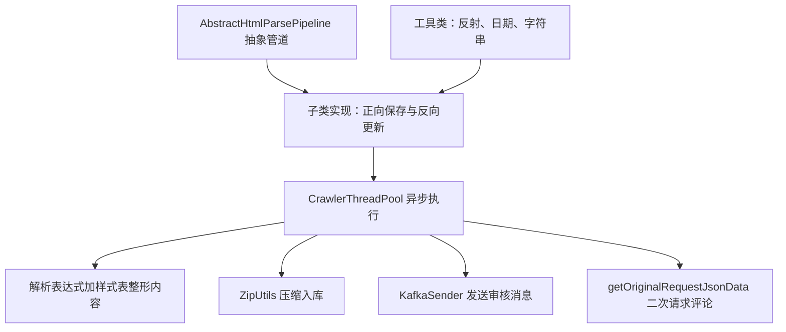

# 解析保存动工前的工具盘点：抽象管道收尾、线程池与请求通道就位

> 🔒 安全提示：文中示例的口令/密钥均为课程教学环境演示口径，生产环境的安全要求见《安全与合规须知》。

排重把重复 URL 挡在门外之后，解析保存正式进入施工段。真正动手写解析子类之前，还有一批公共设施要备齐：抽象解析管道自己还差两笔收尾，若干工具类要拷进工程，线程池与动态页请求通道也要就位。这一讲全是地基活，单独看每一块都不起眼，缺了哪一块，后面的保存文章、附加信息、评论入库都得停工。

## 先给结论

- 抽象管道补上解析结束日志（url、handleType、耗时），前置参数处理与数据入口两个抽象方法留给子类实现，文档类型不符直接记录日志返回。
- 解析表达式 `p,pre,h1,h2,h3,h4,h5` 与 h1 到 h3 的默认样式表是保存文章时的整形依据，标题样式入库后前端按块渲染不丢格式。
- 线程池操作类 `CrawlerThreadPool` 用 JUC 原生组件搭起来：核心线程 1、最大线程走配置、有界队列容量 10000，解析落库异步执行。
- 通用流程父类补上 `getOriginalRequestJsonData`：随机代理加 Cookie 加 Selenium 渲染加 JSON 校验，评论这类动态接口的抓取通道就位。
- ZipUtils、反射、日期、字符串四个工具类与 KafkaSender 消息组件各就各位，用到时不再临时找。

## 抽象管道的最后两笔

抽象解析管道在上一讲立起了模板骨架，收尾还差两笔。第一笔是解析结束日志，落库完成后把 url、handleType 与耗时一起打出来，跑批时排查哪篇文章慢、哪篇文章没走完，全靠这条日志定位：

```java
long startTime = System.currentTimeMillis();
// ... 解析与保存逻辑
log.info("解析结束, url: {}, handleType: {}, 耗时: {}ms",
        parseItem.getUrl(), parseItem.getHandleType(),
        System.currentTimeMillis() - startTime);
```

第二笔是把两个抽象方法正式挂出来，一个做前置参数处理（对抽取到的字段做数据清洗），一个做数据处理的真正入口（清洗并保存）。两个方法都不写实现，留给子类：

```java
/** 前置参数处理：对抽取结果做数据清洗，子类实现 */
protected abstract void handleProcessFlowData(ProcessFlowData processFlowData);

/** 数据处理入口：清洗并保存，子类实现 */
protected abstract void handleHtmlData(T parseItem);
```

入口处还有一道防护值得注意。抓取结果进来先判断文档类型，类型对不上说明这条数据不该由解析管道处理，记一条带上下文的日志然后直接返回：

```java
if (不符文档类型) {
    log.info("不符合文档类型, url: {}, documentType: {}, handleType: {}", url, documentType, handleType);
    return;
}
```

防护日志比静默返回多打了三个字段，正是这三个字段让后面排查「为什么某篇文章没入库」时不用翻代码。跑批系统里，被跳过的数据必须留下跳过的理由，否则就成了一批无声的黑洞。

## 解析表达式与默认样式表

管道里挂了两个配置方法，保存文章内容时要用。一个是解析表达式，声明正文里哪些标签参与抽取：

```java
public String getParseExpression() {
    return "p,pre,h1,h2,h3,h4,h5";
}
```

段落、引用块加五级标题，这是正文内容的基本盘。另一个是默认样式表，给标题标签配上字号与行高：

```java
public Map<String, HtmlStyle> getDefHtmlStyleMap() {
    Map<String, HtmlStyle> styleMap = new HashMap<>();
    HtmlStyle h1Style = new HtmlStyle();
    h1Style.addStyle("font-size", "22px");
    h1Style.addStyle("line-height", "24px");
    styleMap.put("h1", h1Style);
    HtmlStyle h2Style = new HtmlStyle();
    h2Style.addStyle("font-size", "18px");
    h2Style.addStyle("line-height", "20px");
    styleMap.put("h2", h2Style);
    // h3 按 16px/18px 同构配置
    return styleMap;
}
```

样式不是装饰。抓回来的 HTML 整形成固定格式后，标题块会带上 style 属性一起入库，前端详情页按块渲染时，标题的层级感靠的就是这份样式表。表达式与样式表都放在抽象类里以方法形式提供，子类有特殊需求可以重写，默认值覆盖绝大多数文章页。

## 线程池操作类：解析落库的异步底座

解析保存涉及落库、二次请求、发消息，全是慢操作；而管道入口方法跑在 WebMagic 的抓取线程上，同步做这些事会把整个抓取流程拖住。解法是把解析任务丢进独立线程池异步执行，`CrawlerThreadPool` 就是为这个目的拷进工程的：

```java
public class CrawlerThreadPool {

    private static final ArrayBlockingQueue<Runnable> queue = new ArrayBlockingQueue<>(10000);
    private static int threadNum = 10;

    private static final ExecutorService executorService =
            new ThreadPoolExecutor(1, threadNum, 60L, TimeUnit.SECONDS, queue);

    public static void submit(Runnable runnable) {
        log.info("线程池添加任务, queue.size(): {}, threadNum: {}", queue.size(), threadNum);
        executorService.execute(runnable);
    }
}
```

三个参数各有讲究。核心线程数给 1，数据库写入是串行瓶颈，多开线程只会加剧连接争抢；最大线程数 `threadNum` 走配置文件，压测后按机器能力调；队列容量 10000 是有界缓冲，高峰期任务先排队而不是把内存撑爆。`submit` 里先打一行队列积压量，跑批时盯着这条日志就能判断解析速度跟不跟得上下载速度。这套组件全部来自 JUC 包，没有引入任何新依赖。

## 通用流程父类补上动态页请求通道

文章正文走下载器的 HTTP 通道就够，评论数据不一样，评论接口是动态渲染的 JSON 页面，普通 HTTP 请求拿不到完整内容。通用流程父类 `AbstractProcessFlow` 里补上一个取数方法，把代理、Cookie、Selenium 渲染与 JSON 校验串成一趟：

```java
public String getOriginalRequestJsonData(String url, Map<String, String> parameterMap) {
    // 随机取一个可用代理
    CrawlerProxy proxy = crawlerProxyProvider.getRandomProxy();
    // 按域名取既有 Cookie，维持会话
    List<CrawlerCookie> cookieList = cookieHelper.getCookieEntityList(url, proxy);
    // Selenium 渲染动态页面，拿到接口返回的 JSON
    String jsonData = seleniumClient.getJsonData(url);
    if (isJson(jsonData)) {
        return jsonData;
    }
    return null;
}

private boolean isJson(String jsonData) {
    boolean isJson = false;
    try {
        isJson = JsonValidator.getJsonValidator().validate(jsonData);
    } catch (Exception e) {
        log.error("json validate error: {}", e.getMessage());
    }
    return isJson;
}
```

四个依赖都是现成的：代理来自 ip 代理池，Cookie 来自下载阶段维护的会话，Selenium 客户端负责渲染，校验器挡住非 JSON 的异常返回。方法挂在父类而不是子类，是因为正反两个方向的子类都可能要做二次请求，放父类一次拷贝处处可用。

## 工具类清单：位置与用途

这一讲还拷进了一批工具类，各司其职，用到时再展开细节：

- **ZipUtils**：gzip 压缩与解压，文章正文压缩入库、读取时还原，App 端文章详情接口已经在用同一套工具。
- **HTML 解析工具类**：按解析表达式把 HTML 内容解析成目标结构，下一讲保存文章的内容整形靠它当主力。
- **反射工具类**：核心是 `setProperty` 一类的方法，通过反射往对象里设置属性值，字段转换时省掉一排 set。
- **日期工具类**：字符串转 Date、时间加减小时，发布时间解析与下次更新时间计算都要用。
- **字符串工具类 `HmStrUtils`**：Object 到 String 的安全转换，爬回来的字段一律是 Object，直接强转容易翻车。
- **KafkaSender**：day07 就集成进 common 模块的消息发送组件，解析保存的最后一步要靠它把审核消息发给文章审核微服务。

把这一讲备好的设施与后续业务的支撑关系画出来：



关键路径是 A 到 C：抓取线程把数据交出去就返回，落库与二次请求全部在独立线程池里跑完，抓取与解析两条线互不拖累。

## 常见误区

- **把默认样式表当成完整的前端样式方案。** 错例是试图给所有标签配齐样式，结果样式表越写越长还漏标。正解是样式表只覆盖解析表达式命中的标签，解析什么保存什么，没进表达式的标签本来就不会出现在内容里。
- **线程池队列设成无界。** 错例是用默认的无界队列，下载速度远超落库速度时任务无限堆积，最终内存溢出。正解是有界队列加积压量日志，高峰期宁可排队等待，也要让问题显式暴露。
- **工具类提前逐个精读。** 错例是这一讲把每个工具类的实现都啃一遍，进度被拖住还记不住。正解是记位置与用途，具体行为等到真实调用点再对照讲，记忆效率高得多。
- **二次请求直接用 HttpClient 硬发。** 错例是评论接口也走静态下载通道，拿到的永远是空壳页面。正解是动态内容走 `getOriginalRequestJsonData`，代理、Cookie、渲染一次备齐。

## 面试可能被问到的问题

1. 面试官追问：「解析保存为什么要单独开线程池，同步做完不行吗？」
   答：管道入口跑在抓取线程上，落库、二次请求、发消息都是毫秒到秒级的慢操作，同步做会把下载流程整体拖慢，吞吐量直接塌掉。异步化之后抓取线程只负责递交任务，解析速度与抓取速度解耦，还能通过队列积压量分别观测两侧的负载。
2. 面试官追问：「队列满了之后提交的任务会怎样？」
   答：`ThreadPoolExecutor` 默认走 AbortPolicy，直接抛异常拒绝。解析场景里任务丢了就是文章丢了，所以队列容量要结合批次数评估，`submit` 里打积压量日志做预警；更稳妥的做法是显式配置 CallerRunsPolicy，让抓取线程自己执行任务，天然形成背压。
3. 面试官追问：「动态页和静态页为什么走两条请求通道？」
   答：静态页的正文在 HTML 源码里，HttpClient 拉下来直接解析，成本低速度快；动态页的内容由脚本渲染或接口异步返回，必须起浏览器渲染才有数据。评论接口属于后者，代理与 Cookie 的维护逻辑两边也不同，强行合并只会让简单场景背上复杂场景的成本。
4. 面试官追问：「标题样式为什么入库，不在前端写死？」
   答：内容是异构来源，不同站点同一级标题的呈现差异很大，整形成固定格式时把样式一起固化，前端渲染逻辑可以做到完全统一，不用为每个来源写适配。样式跟着内容走，内容到哪渲染到哪，这是内容中台化存储的常见取舍。

## 配套资料

- 代码：`materials/code/05/头条day10/` 资料目录为空，抽象管道收尾、线程池操作类与动态页请求通道按画面线整理、按本课写法补全（引用路径截至 `头条dayNN/` 层级，内层目录名含项目原名，不进入正文）。
- 参照：`materials/code/05/头条day07/`，kafka 封装的工具类目录下有 `KafkaSender.java` 与 `KafkaMessage.java` 真实实现，发送审核消息的组件基础出自它。
- 参照：`materials/code/05/头条day01/`，数据库规范设计说明书，内容压缩存储与台账字段口径出自它。
- 环境：课程集群 node01~node03，MySQL root/123456；线程池参数 `threadNum` 按部署机核数在配置文件中调整。
