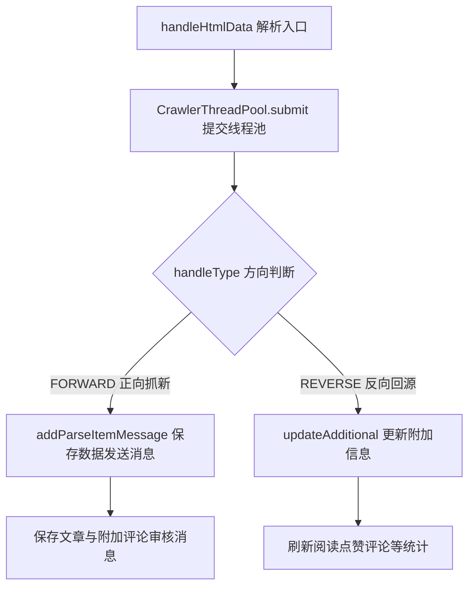

# 解析代码框架落地：一个子类接住所有页面，按方向分流

> 🔒 安全提示：文中示例的口令/密钥均为课程教学环境演示口径，生产环境的安全要求见《安全与合规须知》。

抽象管道与工具设施就位后，解析保存迎来了第一个具体实现类 `CrawlerHtmlParsePipeline`。它是整条链路里唯一需要写的管道子类：正向抓新与反向回源都从它的入口过，进入线程池后按 handleType 分流到各自的编排方法。这一讲只搭框架不填业务，四个编排方法的空壳先立起来，方法名与调用关系定死，后面几讲往里面填肉就不会散架。

## 先给结论

- 子类三件事定框架：`@Service` 交给容器、`getPriority` 报 1000 保证最后处理、数据入口按 handleType 分流 FORWARD 与 REVERSE 两个方向。
- 前置参数处理做一次数据清洗：阅读数原始值形如「阅读数 200」，切分出纯数字再写回抽取项，脏参数不进保存流程。
- `handleHtmlData` 本身不干活，打日志后把解析项提交线程池，真正的编排在线程池里跑。
- 正向方法 `addParseItemMessage` 与反向方法 `updateAdditional` 先立空壳，名字即语义，下一讲开始逐个填充。

## 子类骨架：三个重写方法定生死

子类落在 `process.parse.impl` 包下，继承抽象管道时把泛型钉死为 `CrawlerParseItem`，整条链路的数据载体从此确定：

```java
@Service
@Log4j2
@SuppressWarnings("all")
public class CrawlerHtmlParsePipeline extends AbstractHtmlParsePipeline<CrawlerParseItem> {

    @Override
    public int getPriority() {
        return 1000;
    }
}
```

`@Service` 让 Spring 容器接管这个管道，容器里其他组件（下载器、调度器、各辅助类）都能注入进来。`getPriority` 返回 1000 是框架里最有讲究的一个数字：解析保存是整条流程的最后一环，前面的组件把数据下载好、字段抽取好，管道才有完整的解析项可处理。工程约定 130 以内的优先级留给前置组件，1000 远超分界线，调度排序时它稳居队尾，一定是所有组件里最后动数据的那一个。取 10000 也行，关键是守住「大于 130」这条线。

## 前置参数处理：数据清洗的第一道关

前置参数处理方法负责清洗，这里洗的是阅读数。页面上抓回来的阅读数是「阅读数 200」这样的原始串，直接入库既没法参与统计也没法比对增量，先把它切出纯数字：

```java
@Override
public void handleProcessFlowData(ProcessFlowData processFlowData) {
    Item item = processFlowData.getItem();
    // 阅读数原始值形如「阅读数 200」，按空格切分取第二段
    String readCount = HmStrUtils.toString(item.get("readCount"));
    if (StringUtils.isNotEmpty(readCount)) {
        readCount = readCount.split(" ")[1];
    }
    if (StringUtils.isNotEmpty(readCount)) {
        // 清洗后的纯数字写回抽取项
        item.put("readCount", readCount);
    }
}
```

清洗两段判断各有含义。切分前判一次空，防止原始值缺失时数组越界；切分后再判一次空，防止「阅读数」后面是空串的残缺页面。两次都过了才写回 `item`，写回的键名与抽取规则里的字段名严格一致，后续转换方法按这个键取值。清洗放在前置而不是保存前，是因为脏数据越早拦截成本越低：这里洗一遍，后面附加信息、反向增量比对拿到的就都是干净数字。

## 数据入口：提交线程池后按方向分流

`handleHtmlData` 是模板方法留的空，子类把它填成两步：打日志、交线程池。分流逻辑在线程池任务里完成：

```java
@Override
public void handleHtmlData(CrawlerParseItem parseItem) {
    log.info("将数据加入线程池, url: {}, handleType: {}", parseItem.getUrl(), parseItem.getHandleType());
    crawlerThreadPool.submit(() -> {
        if (CrawlerEnum.HandleType.FORWARD.name.equals(parseItem.getHandleType())) {
            // 正向：保存文章、附加、评论并发送审核消息
            addParseItemMessage(parseItem);
        } else if (CrawlerEnum.HandleType.REVERSE.name.equals(parseItem.getHandleType())) {
            // 反向：更新文章附加信息
            updateAdditional(parseItem);
        }
    });
    log.info("处理文章数据结束, url: {}, handleType: {}, 耗时: {}ms",
            parseItem.getUrl(), parseItem.getHandleType(), System.currentTimeMillis());
}
```

方向判断用枚举名比对而不是 `switch`，是刻意的：`FORWARD.name()` 拿到的是常量串，与解析项里存的 handleType 做字符串相等判断，两个分支都显式列出来，读到代码就知道一共只有两种方向，第三种值会静默落下不处理，不会误入任何一条业务线。日志在这里打了两次，进入线程池前一次、结束后一次，跑批时两条日志一对就能看出每篇文章在解析环节的真实耗时。

正向与反向的分工对比如下：



关键路径在分流节点：一个入口、两条业务线，正向是「新增」，反向是「刷新」，语义完全不同却共用同一个解析入口，这正是上一讲把解析能力做成公共设施的红利。

## 两个空壳方法：先把名字立住

框架阶段两个编排方法只写注释与方法签名：

```java
/**
 * 正向：保存数据并发送消息
 * 编排四步：保存文章、保存附加信息、保存评论、发送审核消息
 */
private void addParseItemMessage(CrawlerParseItem parseItem) {
    // 下一讲填充
}

/**
 * 反向：更新文章附加信息
 * 回源刷新统计数据后写回台账
 */
private void updateAdditional(CrawlerParseItem parseItem) {
    // 后续填充
}
```

方法名在这一步就按最终语义取好，注释把编排步骤写死。框架先行的好处在这里兑现：调用关系、方向判断、线程池边界全部冻结，后面几讲填代码时只改方法体，不再动框架结构，测试与排查的坐标系始终稳定。验证安排在整章末尾的综合测试，链路通了框架自然验完，单测骨架不在此处单独铺开。

## 常见误区

- **把保存逻辑直接写进 `handleHtmlData`。** 错例是入口方法里塞满落库代码，正向反向混在一起，几百行的方法没人敢改。正解是入口只做分流，业务编排各归各的私有方法，方法名即目录。
- **方向判断漏写 else 分支。** 错例是只判断 FORWARD，反向数据静默丢失，统计数据永远不更新还不报错。正解是两个方向都显式列出，未知方向至少打一条日志，让异常数据可被发现。
- **优先级随手给个默认 0。** 错例是解析管道与其他前置组件同为 0，排序不确定时管道可能在数据备齐前就执行，拿到半成品解析项。正解是守住「大于 130 排队尾」的工程约定，1000 起步。
- **清洗逻辑放保存前一刻。** 错例是阅读数清洗写在附加信息组装里，反向更新路径再洗一遍，规则散落两处。正解是清洗统一收在前置参数处理，一处洗完处处干净。

## 面试可能被问到的问题

1. 面试官追问：「模板方法模式在这个框架里怎么体现的？」
   答：抽象管道的入口方法定死了流程骨架：校验文档类型、前置清洗、提交线程池、调用抽象的 `handleHtmlData`，骨架不变，变化点交给子类实现。子类只填数据处理入口这一个洞，流程控制权留在父类，新增一种页面类型时框架代码一行不动。
2. 面试官追问：「为什么用枚举名做字符串比对判断方向？」
   答：解析项里的 handleType 来自抽取结果，跨层传输时是字符串形态，与枚举 `name()` 比对保证两侧口径一致。显式列出 FORWARD 与 REVERSE 两个分支，代码即文档；比 switch 少了 default 分支的歧义，未知值自然跳过且能通过日志发现。
3. 面试官追问：「前置清洗和保存前校验有什么区别，为什么清洗要前置？」
   答：校验回答「这条数据能不能处理」，清洗回答「这份数据长什么样才可用」。清洗前置让所有下游（保存、统计、增量比对）拿到统一形态，规则只写一处；放在保存前则每个消费方都要自己洗，规则一多必然漂移。
4. 面试官追问：「框架先行的开发方式，好处和风险各是什么？」
   答：好处是结构先冻结，方法名与调用关系定死后，多人并行填代码不会长歪，评审时只看方法体。风险是空壳期链路跑不通，占位方法必须注释写清编排步骤，防止后续填充时偏离原设计；综合测试要安排在全部填充完成之后。

## 配套资料

- 代码：`materials/code/05/头条day10/` 资料目录为空，`CrawlerHtmlParsePipeline` 子类与清洗、分流代码按画面线整理、按本课写法补全（引用路径截至 `头条dayNN/` 层级，内层目录名含项目原名，不进入正文）。
- 参照：`materials/code/05/头条day01/`，数据库规范设计说明书，解析项字段与台账列的对应口径出自它。
- 环境：课程集群 node01~node03，MySQL root/123456；验证安排在本章末尾的综合测试，整链路一次跑通。
