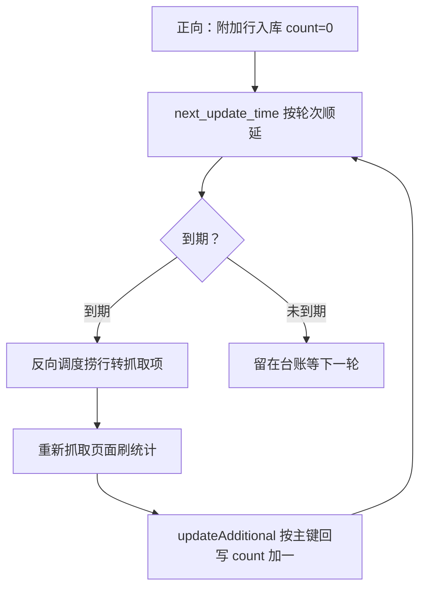

# 附加与评论挂载：统计数据一行、评论多行，全部围绕文章主键生长

> 🔒 安全提示：文中示例的口令/密钥均为课程教学环境演示口径，生产环境的安全要求见《安全与合规须知》。

文章主行落库拿到主键之后，一篇文章的「身外之物」开始挂载：统计数据是附加台账上的一行，评论是评论台账上的多行。这两块与主行的写入方式完全不同，附加数据在解析时已经抓到手，组装完直接写；评论数据压根不在文章页里，必须按模板拼出评论接口地址、发起第二次请求、解析返回的 JSON 才能拿到。这一讲把两条挂载路径写透，顺带把反向回源的调度种子 next_update_time 一起讲清。

## 先给结论

- 附加保存两步走：`toCNewsAdditional` 从解析项与文章实体组装附加行，`saveAdditional` 复用保存准备章节备好的八方法 Service 透传入库。
- `newsId` 关联的前提是主键回填：`cNews.getId()` 在 insert 之后才有值，这是附加与评论能挂上主行的隐含契约。
- 下次更新时间用指数退避策略：配置 `crawler.nextupdatehours=4,16,64,128,256` 按刷新轮次取间隔，缺省回退 2 的轮次次方，热文勤刷、冷文降频。
- 评论要二次抓取：构建评论 URL、父类 `getOriginalRequestJsonData` 拿 JSON、解析成 `List<CNewsComment>`，循环回填 newsId 后逐条入库。
- 评论 URL 是模板加占位符：配置里留 `{authorId}`、`{articleId}` 两个槽位，解析项转 Map 后逐占位符替换，换站点只改配置不改代码。

## 附加保存：转换与保存两步

编排层把附加排在文章之后，方法里先做双 null 守门，再走转换加保存：

```java
private void addAdditionalData(CrawlerParseItem parseItem, CNews cNews) {
    long currentMillis = System.currentTimeMillis();
    log.info("开始处理文章附加信息数据, url: {}", cNews.getUrl());
    if (null != parseItem && null != cNews) {
        // 组装附加行
        CNewsAdditional additional = toCNewsAdditional(parseItem, cNews);
        // 复用附加信息 Service 保存
        crawlerNewsAdditionalService.saveAdditional(additional);
    }
    log.info("文章附加数据处理完成, 耗时: {}ms", System.currentTimeMillis() - currentMillis);
}
```

双 null 判断不是重复劳动：`parseItem` 为 null 说明解析结果残缺，`cNews` 为 null 说明文章主行被判重跳过或落库失败，两种情况附加行都没有落库的意义。保存调用的是保存准备章节定义的八方法 Service，`insertSelective` 动态插入，非空才写列。

顺带回答一个结构性问题：统计数字为什么不直接塞进文章主表。两边的变化节奏完全不同，标题与正文抓一次就定型，生命周期以天计；阅读数与评论数随时在动，生命周期以分钟计。拆表之后主表稳定、附加表高频更新，反向刷新一行统计数据不会扰动主表的行锁与索引。还有一个务实的原因，不是每篇文章都有统计可抓，正文型页面可能连阅读数都不展示，独立成表让「有没有统计数据」成为可选事实，主表不必为缺数据的文章留一排空列。转换方法把字段逐个搬齐：

```java
private CNewsAdditional toCNewsAdditional(CrawlerParseItem parseItem, CNews cNews) {
    CNewsAdditional additional = new CNewsAdditional();
    // 文章主键，前置回填的结果在这里兑现
    additional.setNewsId(cNews.getId());
    // 阅读数，前置清洗已切成纯数字
    additional.setReadCount(HmStrUtils.toInt(parseItem.getReadCount()));
    // 回复数与点赞数
    additional.setComment(HmStrUtils.toInt(parseItem.getComment()));
    additional.setLikes(HmStrUtils.toInt(parseItem.getLikes()));
    // url 冗余列，反向回源只认它
    additional.setUrl(parseItem.getUrl());
    additional.setCreatedTime(new Date());
    additional.setUpdatedTime(new Date());
    // 刷新轮次从 0 起步
    additional.setCount(0);
    // 按当前轮次计算下次更新时间
    int nextUpdateHour = getNextUpdateHour(additional.getCount());
    additional.setNextUpdateTime(DateUtils.addHours(new Date(), nextUpdateHour));
    return additional;
}
```

字段各有来历。阅读数在前置参数处理里洗成纯数字，这里转 int 落库；评论数与点赞数是文章页顺手抽到的统计值，转不转得出数字都不影响主流程，转失败按 0 记，反向回源下一轮刷新会覆盖。`url` 是附加表的冗余列，看着与主行的 url 重复，实际是反向流程的生命线：回源任务只需要知道「去哪个地址重新抓」，台账行仅凭这一列就能还原成抓取项，一次联表都省。`count` 记录刷新轮次，新行从 0 起步，每刷新一轮加一，它同时是下次更新间隔的查表下标。

编排次序也有成本考量。附加保存在评论之前，因为附加的原料全在本地，纯落库操作毫秒级完成；评论涉及一次真实网络请求，慢且可能失败。把快的放前面，慢的放后面，编排方法里的耗时大头集中在评论一段，日志的耗时分布能直接反映出来。反过来放，评论失败抛异常还会连累附加丢失，风险面更大。

## next_update_time：指数退避的调度种子

`next_update_time` 是反向流程的调度依据：这一列到期的行，下一轮反向调度就会捞出来重新抓统计。间隔怎么定？写死一个值两头不讨好，热文刷新太慢数字失真，冷文刷新太勤浪费额度。课程用的是指数退避：

```properties
# 下次更新时间间隔（小时），按刷新轮次取值
crawler.nextupdatehours=4,16,64,128,256
```

```java
@Value("${crawler.nextupdatehours}")
private String nextUpdateHours;

private int getNextUpdateHour(Integer count) {
    if (StringUtils.isNotEmpty(nextUpdateHours)) {
        // 按逗号切分成间隔表
        String[] updateHourArray = nextUpdateHours.split(",");
        if (null != count && count < updateHourArray.length) {
            // 第 N 轮取第 N 个间隔
            return Integer.parseInt(updateHourArray[count].trim());
        }
        // 超出配置范围按指数退避兜底
        return (int) Math.pow(2, count);
    }
    // 配置缺失时的默认退避
    return (int) Math.pow(2, count);
}
```

策略的直觉是：一篇文章刚入库最热，4 小时后刷第一轮；热度不衰减就按 16、64、128、256 小时逐轮拉长，刷新成本以几何级数降下去；热度衰减的文章自然沉底，配置之外用 2 的 count 次方兜底，间隔照样指数增长，行不会丢，只是越睡越久。反向回源失败时这一列照常顺延，失败的任务自动错峰重试，不会原地反复空转。把两条路径画在一起：



闭环的关键在 F 到 B：回写的同时轮次加一、到期时间按新轮次顺延，调度种子自己生长，调度器只需要一条「捞到期行」的查询，不需要维护任何频率逻辑。

## 评论的特殊性：文章页里没有评论

文章正文、阅读数、点赞数都在文章页上，一次解析全能拿到；评论不一样，抓文章页时评论区往往还没渲染，或者藏在独立接口里。上一讲的编排里评论是条件执行，只有评论数大于 0 才走这条路，判断的依据就来自这些顺手抽到的统计值，现在轮到这条分支真正落地。评论的获取是一次独立的三步抓取：构建评论接口地址、发起请求拿 JSON、解析成评论实体列表。编排层的方法把三步串起来再逐条挂主键入库：

```java
private void addCommentData(CrawlerParseItem parseItem, CNews cNews) {
    long currentMillis = System.currentTimeMillis();
    log.info("开始获取文章评论数据, url: {}", parseItem.getUrl());
    // 三步：构建 URL、发请求、解析 JSON
    List<CNewsComment> commentList = getCommentData(parseItem);
    if (null != commentList && !commentList.isEmpty()) {
        // 注入的评论 Service 逐条保存，挂上文章主键
        for (CNewsComment cNewsComment : commentList) {
            cNewsComment.setNewsId(cNews.getId());
            crawlerNewsCommentService.saveNewsComment(cNewsComment);
        }
    }
    log.info("获取文章评论数据完成, 耗时: {}ms", System.currentTimeMillis() - currentMillis);
}

private List<CNewsComment> getCommentData(CrawlerParseItem parseItem) {
    // 第一步：构建评论接口地址
    String buildCommentUrl = buildCommentUrl(parseItem);
    // 第二步：复用父类通道发请求拿 JSON
    String jsonData = getOriginalRequestJsonData(buildCommentUrl, null);
    // 第三步：解析成评论实体列表
    return analysisCommentJsonData(jsonData);
}
```

`getOriginalRequestJsonData` 是抽象管道父类里的方法，随机代理、Cookie、Selenium 渲染、JSON 校验一次备齐。评论接口是动态返回的 JSON 页面，静态下载通道拿不到东西，两条通道在这里完成交接：正文走下载器，评论走父类的动态通道。

## 模板加占位符：评论地址的拼法

评论接口地址形如 `https://www.example.com/comment/list/{authorId}/{articleId}`，两个占位符一个代表作者空间，一个代表文章 id，这两个值在解析文章页时已经存进解析项。拼法是把解析项转成 Map，逐个占位符替换：

```java
@Value("${crawler.comment.url}")
private String commentUrlTemplate;

private String buildCommentUrl(CrawlerParseItem parseItem) {
    // 解析项字段转 Map，键是字段名
    Map<String, Object> valueMap = ReflectionUtils.toMap(parseItem);
    String commentUrl = commentUrlTemplate;
    for (Map.Entry<String, Object> entry : valueMap.entrySet()) {
        // 拼「{字段名}」形态的占位符
        String target = "{" + entry.getKey() + "}";
        Object value = entry.getValue();
        if (null != value && commentUrl.contains(target)) {
            commentUrl = commentUrl.replace(target, String.valueOf(value));
        }
    }
    return commentUrl;
}
```

模板化把「地址长什么样」挪进了配置文件，目标站点改版、接口换路径，改一行配置就完事，代码里没有任何硬编码的站点信息。反射工具把解析项变成 Map 后，替换逻辑对所有字段一视同仁，模板里想多留一个占位符（比如分页页码）也不用改代码。替换前先 `contains` 判断，模板里没有的占位符直接跳过，解析项里多出来的字段也不会误伤。

替换完成前后的对照一眼可见：

```text
模板：https://www.example.com/comment/list/{authorId}/{articleId}
解析项：authorId=10086, articleId=230001
结果：https://www.example.com/comment/list/10086/230001
```

评论解析出来要装进评论台账实体，字段不多但每个都对应台账列：

```java
/** 爬虫评论台账实体 */
@Data
public class CNewsComment {
    private Integer id;
    /** 所属文章的台账主键 */
    private Integer newsId;
    /** 评论内容 */
    private String content;
    /** 评论人名称 */
    private String userName;
    /** 评论时间 */
    private Date commentDate;
    private Date createdTime;
}
```

实体在保存准备章节随评论台账一起备好，这里的组装只填解析能拿到的四列，`newsId` 留给编排层循环里统一回填。

## 解析 JSON：层层剥开取字段

评论接口返回的 JSON 是嵌套结构，外层 data 里裹着 list，list 的每项里又套一个 info 对象，真正的评论内容、评论人与评论时间都在 info 里：

```json
{
  "data": {
    "list": [
      {
        "info": {
          "content": "写得透彻，收藏了。",
          "userName": "读者甲",
          "commentTime": "2024-03-01 10:21:35"
        }
      }
    ]
  }
}
```

解析方法按嵌套层级逐层剥：

```java
private List<CNewsComment> analysisCommentJsonData(String jsonData) {
    if (StringUtils.isEmpty(jsonData)) {
        return null;
    }
    List<CNewsComment> commentList = new ArrayList<>();
    // 外层解析成 JSON 对象
    JSONObject jsonObject = JSON.parseObject(jsonData);
    // data 节点转 Map
    Map<String, Object> map = jsonObject.getObject("data", Map.class);
    // list 节点强转成 JSON 数组
    JSONArray jsonArray = (JSONArray) map.get("list");
    if (null != jsonArray) {
        // 数组转成 Map 列表，方便逐项取值
        List<Map<String, Object>> dataInfoList = jsonArray.toJavaList(Map.class);
        for (Map<String, Object> dataInfo : dataInfoList) {
            // 每项里的 info 才是评论本体
            JSONObject infoObject = (JSONObject) dataInfo.get("info");
            Map<String, Object> infoMap = JSON.toJavaObject(infoObject, Map.class);
            CNewsComment comment = new CNewsComment();
            // 评论内容、评论人
            comment.setContent(HmStrUtils.toString(infoMap.get("content")));
            comment.setUserName(HmStrUtils.toString(infoMap.get("userName")));
            // 评论时间字符串转 Date
            comment.setCommentDate(
                    DateUtils.parse(HmStrUtils.toString(infoMap.get("commentTime"))));
            comment.setCreatedTime(new Date());
            commentList.add(comment);
        }
    }
    return commentList;
}
```

防御式解析的痕迹 everywhere：入参空串直接返回，null 不会往下游传；`list` 缺失不强转，空列表自然返回；字段取值全走 `HmStrUtils.toString` 的安全转换，接口返回里混进数字类型也不会抛 ClassCastException。时间字段单独处理，接口给的是字符串，`DateUtils.parse` 按统一格式转 Date，转不出来的残缺行宁可少一条评论也不能让整批解析崩掉。动手写解析前的第一件事是把接口返回粘进格式化工具看清嵌套层级，层级数决定剥的层数，拍脑袋猜结构是评论解析翻车的头号原因。

逐层转 Map 的写法值得和另一个方案对比。fastjson 支持把 JSON 直接反序列化成实体类，一行 `toJavaList(CNewsComment.class)` 看似更省事，但评论接口的外层结构（data 包 list、list 套 info）与台账实体字段对不上，直接映射要么再写一层中间 DTO，要么给实体加一堆界面字段。转 Map 逐层取值牺牲一点类型安全，换来对嵌套结构的显式控制：取哪些字段、缺了怎么办，全部写在明面上。接口返回结构不稳定是常态，Map 方案的容错改起来也最快。

## 入库口径：逐条插入与去重边界

评论保存是循环里逐条 `saveNewsComment`，与附加的一次性单行不同。逐条的好处是单条失败不影响其余评论，坏处是评论多的文章会产生一串 insert。量级上来之后的演进方向是把循环改成批量插入，`insert into ... values` 多值拼接或框架的批量保存一次提交，注明这是按主流写法的演进建议，本课口径以逐条插入跑通主干。

附加侧还有一个容易忽略的去重点。正向判重整篇跳过保护了附加行不重复，但补偿场景里单独补附加时没有文章级判重保护，此时应先走附加 Service 的按 URL 判存在方法，存在即更新、不存在才插入，一行数据永远只有一份。附加表把「按 URL 判存在」做成独立方法，正向编排与补偿脚本共用同一个判断口径，去重逻辑不因调用方不同而漂移。

去重的边界在文章级，不在评论级。正向编排里判重命中就整篇跳过，评论随文章一起不会被重复保存；评论自身不做独立去重，前提是文章级判重始终站在上游。两个特殊场景要心里有数：重跑时只补评论的补偿脚本需要按 `newsId` 先清后插，评论表按 newsId 关联后批量删除很轻；同一篇文章的评论分页拉取要按页循环拼 URL，本课只抓第一页做演示，分页参数同样走模板占位符。

日志口径在这两块保存里也要交代一句。附加与评论的方法都按老套路打了开始与完成两条日志，评论的循环里逐条入库没有单独打日志，评论量大的文章日志会膨胀，把逐条日志换成入库条数与失败条数的汇总更划算。所有日志都带 url，文章维度的对账从抓取、整形、落库到挂载一路能串起来，排查时一条 grep 就能拉全文章的处理轨迹。

## 反向视角：本讲的组件如何被回源复用

框架讲里立空壳的反向方法 `updateAdditional`，复用的正是这一讲备齐的组件。反向调度到期时，附加台账行转成抓取项交给下载器，抓回的页面重新解析出新的阅读数、点赞数与评论数，转换组装的过程与正向的 `toCNewsAdditional` 高度同构，差别只在落库动作：正向是 `saveAdditional` 插入新行，反向是按主键更新既有行。更新走 `updateByPrimaryKeySelective`，只写解析到手的新数字，没抓到的字段保留旧值，全字段更新会把 null 清进库。回写完成时 `count` 加一、`next_update_time` 按新轮次顺延，指数退避的种子再次生效。反向细节在后续章节展开，这里只需要记住本讲备的转换方法与间隔计算在两个方向各用一次，组件的复用价值在写完反向那一讲才算兑现。

## 常见误区

- **把附加保存当成主流程的无条件步骤。** 错例是不判 `cNews` 直接取 `getId()`，文章被跳过时附加行拿着 null 主键入库，成了孤儿行。正解是双 null 守门，主行没落成附加行就不该存在。
- **下次更新时间写死一个值。** 错例是统一 24 小时顺延，热文数字失真，冷文白白消耗抓取额度。正解是指数退避，间隔随轮次拉长，配置驱动可调。
- **评论地址硬编码在代码里。** 错例是把站点接口地址写死在方法体里，站点改版就得发版。正解是模板进配置，占位符替换，站点信息不进代码。
- **JSON 解析直接强转字段。** 错例是 `(String) infoMap.get("content")`，接口返回里混进数字或对象就抛异常，一条评论毁掉整篇解析。正解是安全转换工具逐字段取值，时间字段单独解析。

## 面试可能被问到的问题

1. 面试官追问：「附加行和评论行为什么用 newsId 关联，不用 url？」
   答：newsId 是主表主键，关联精确到行，索引与外键约束都围绕主键设计；url 是字符串，占空间、比较慢，还可能因为站点改版发生变化。url 在附加表里冗余一份是给反向回源用的，回源发起请求只需要地址，关联查询仍然走 newsId，两个键各管一条访问路径。
2. 面试官追问：「指数退避的间隔表为什么放配置文件，不放代码或数据库？」
   答：退避节奏是运营参数，随站点策略与抓取额度变化，改配置不用动代码也不用查库。运行时一次注入、按轮次查表，性能开销可以忽略；放数据库则每次计算都要一次查询，得不偿失。配置缺失时代码里有 2 的幂次兜底，参数治理不留死角。
3. 面试官追问：「评论抓取为什么复用父类的动态请求方法，不单独写？」
   答：评论接口是动态 JSON 页，代理、Cookie、渲染、校验四件事一件不能少，父类方法把这四件事串好了，子类只需传 URL。单独再写一套，代理池与 Cookie 的维护就会出现第二份状态，两边漂移是迟早的事。能力下沉到父类，子类保持薄，是这个框架的分工原则。
4. 面试官追问：「评论逐条插入，性能瓶颈怎么解决？」
   答：先看量级，单篇文章评论几十条时逐条插入的开销可接受，且单条失败不影响整批。量级上来后改成批量插入，多值 insert 或框架批量保存一次提交，网络往返从 N 次降到 1 次；再往上可以用队列削峰，评论抓取与入库分线程异步。演进的前提是先有监控数据，别一上来就过度设计。
5. 面试官追问：「评论不做独立去重，会不会出问题？」
   答：正常流程不会，文章级判重挡在上游，评论随文章只入库一次。会出问题的是补偿场景：单独补评论时没有文章级判重保护，所以要按 newsId 先清后插，或者给评论内容加时间维度做条件插入。去重边界的选择要和补偿方案配套设计，不是孤立决定。
6. 面试官追问：「反射转 Map 做占位符替换，有什么风险？」
   答：风险是替换面不可控，解析项字段一多，模板里的占位符可能被意料外的字段值命中。防护是替换前判断模板确实包含该占位符，替换只发生在配置声明过的槽位；解析项里敏感字段（比如内部主键）不进模板就不会出现在 URL 上。反射的性能开销在每次构造 URL 一次的频率下可以忽略。

## 配套资料

- 代码：`materials/code/05/头条day10/` 资料目录为空，附加保存、指数退避与评论解析代码按画面线整理、按本课写法补全（引用路径截至 `头条dayNN/` 层级，内层目录名含项目原名，不进入正文）；评论接口返回结构与批量插入演进示例按主流写法补全。
- 参照：`materials/code/05/头条day01/`，数据库规范设计说明书，附加表时间字段、冗余列与评论表字段口径出自它。
- 参照：`materials/code/05/头条day07/`，kafka 封装的工具类目录下 `KafkaSender.java` 真实实现，评论挂载完成后发送审核消息的组件基础出自它。
- 环境：课程集群 node01~node03，MySQL root/123456；示例站点一律以 example.com 占位，动手时替换为实际配置的目标站点。
