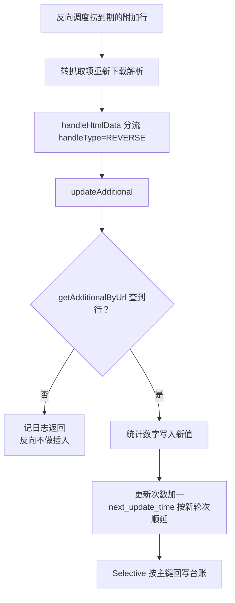

# 反向回源只动一张表：附加台账的统计数字怎么刷新

> 🔒 安全提示：文中示例的口令/密钥均为课程教学环境演示口径，生产环境的安全要求见《安全与合规须知》。

正向链路把新文章送进台账，反向链路的目标完全不同：文章早就在库里，重抓不是为了再存一遍，而是把会变的数字刷新。回源任务从附加台账里捞到到期行，转成抓取项重新下载解析，带着新统计数字回到编排层，handleType 是 REVERSE。骨架期立在这里的空壳方法 `updateAdditional`，本讲把它填成完整实现。写之前有两个困惑要先拆掉：为什么不复用正向的四步编排，而是单开一个方法只更新一张表？更新前为什么要先按 URL 查一次，直接按 URL 发 update 语句不行吗？两个答案都藏在 Selective 更新与「反向只更新」的口径里。

## 先给结论

- 反向与正向共用同一个入口分流：FORWARD 走 `addParseItemMessage` 四步编排，REVERSE 走 `updateAdditional` 单表更新，入口一个、分支两个。
- 反向只更新 `cl_news_additional`：阅读数、评论数、点赞数按新解析结果回写，主行与评论一行不碰，这是思路分析阶段就定死的口径。
- 更新前先按 URL 查行：查回来的行直接当更新实体，主键与身份列原值都在；查不到行说明正向还没落库或数据异常，记日志返回，反向永远不做插入。
- Selective 语义是安全网：null 字段不进 set 子句，没抓到的统计自动保留旧值；更新次数递增与下次更新时间顺延必须显式设置。
- 间隔计算与正向复用同一个 `getNextUpdateHour`，轮次推进一格，指数退避的种子在两个方向各生效一次。

## 分支复用：一个入口两个方向

反向解析项到达编排层的路径与正向完全一致，分流代码在框架阶段就写好了：

```java
// handleHtmlData 提交线程池后的方向分流，正向反向各对准一个方法
if (CrawlerEnum.HandleType.FORWARD.name.equals(parseItem.getHandleType())) {
    // 正向：保存文章、附加、评论并发审核消息
    addParseItemMessage(parseItem);
} else if (CrawlerEnum.HandleType.REVERSE.name.equals(parseItem.getHandleType())) {
    // 反向：只更新附加台账
    updateAdditional(parseItem);
}
```

正向四步的依赖关系决定了它不能被反向复用：存文章依赖判重拿主键，存附加与评论依赖主键挂靠，发消息依赖文章完整成形。反向时主键早已有、URL 早已在台账里、评论早已挂上，重走四步的唯一效果是在判重那一关被挡回去，原地返回，什么都没发生。所以反向不借正向的编排，直接对准唯一目标：附加表。方法骨架按编排的老套路来，开头记时间、结尾算耗时：

```java
/**
 * 反向回源：更新已入库文章的附加统计数据
 * @param parseItem 回源解析项，携带新抓到的统计数字
 */
private void updateAdditional(CrawlerParseItem parseItem) {
    long currentMillis = System.currentTimeMillis();
    log.info("开始更新文章附加数据, url: {}", parseItem.getUrl());
    if (null != parseItem) {
        // 按业务键 URL 捞出台账行，这一行就是更新实体
        CNewsAdditional cNewsAdditional =
                crawlerNewsAdditionalService.getAdditionalByUrl(parseItem.getUrl());
        if (null != cNewsAdditional) {
            fillAdditionalData(parseItem, cNewsAdditional);
        } else {
            // 反向的前提是文章已在库，查不到不做插入
            log.info("附加数据不存在, 无法更新, url: {}", parseItem.getUrl());
        }
    }
    log.info("更新文章附加数据完成, 耗时: {}ms",
            System.currentTimeMillis() - currentMillis);
}
```

回源到回写的整条路径画出来是这样，闭环在回写动作上：



关键路径在 E 节点：查得到才有后面的回写，查不到直接终止，反向的边界由这次查询划定。

## 先查后更：按 URL 捞出台账行

为什么不能省掉这次查询？三个理由层层递进。**第一，更新语句的 where 需要 id。** 台账行的更新按主键定位，`getAdditionalByUrl` 查回来的实体带着主键 id，Selective 更新才有定位依据；直接 new 一个实体塞统计数字去更新，id 是 null，update 语句匹配不到任何行，数据库返回影响行数 0，错误静默到没有任何痕迹。**第二，身份列的原值要在实体上。** 附加行的 `newsId` 与 `url` 是这行的身份，反向刷新动的是统计数字，身份列原值原样保留，Selective 写回时等于没改。**第三，查不到行是一种需要显式处置的异常。** 回源任务由附加台账自身产生，理论上查得到；查不到意味着正向流程半路夭折或数据被人动过，此时插入一条新附加行会把反向流程变成正向的赝品，台账里出现两条对不上的记录。记日志返回，让问题在监控里显形，才是守住「反向只更新」口径的做法。

查找键为什么是 URL 不是主键 id？因为回源任务的原料只有 URL。附加表把 `url` 冗余一份，正是为了这一步：回源调度只需要知道「去哪个地址重新抓」，台账行凭这一列就能还原成抓取项，发起下载、重新解析全靠它。0170 附加保存那一讲说过「反向回源只认它」，这里就是兑现点。

## 更新什么：统计数字与两枚种子

填充方法把要换的字段一次摆齐：

```java
private void fillAdditionalData(CrawlerParseItem parseItem, CNewsAdditional cNewsAdditional) {
    // 身份列原值带回，Selective 更新里这两列等于没动
    cNewsAdditional.setNewsId(cNewsAdditional.getNewsId());
    cNewsAdditional.setUrl(parseItem.getUrl());
    // 三个统计数字换成新解析结果
    cNewsAdditional.setReadCount(HmStrUtils.toInt(parseItem.getReadCount()));
    cNewsAdditional.setComment(HmStrUtils.toInt(parseItem.getComment()));
    cNewsAdditional.setLikes(HmStrUtils.toInt(parseItem.getLikes()));
    // 更新次数加一，讲解口径里这一列也叫 update_num，实体字段沿用保存时的 count
    cNewsAdditional.setCount(cNewsAdditional.getCount() + 1);
    // 更新时间与下次更新时间，间隔按新轮次查表
    cNewsAdditional.setUpdatedTime(new Date());
    int nextUpdateHour = getNextUpdateHour(cNewsAdditional.getCount());
    cNewsAdditional.setNextUpdateTime(DateUtils.addHours(new Date(), nextUpdateHour));
    // Selective 更新：非空才写列
    crawlerNewsAdditionalService.updateAdditional(cNewsAdditional);
}
```

字段各有讲究。统计数字三件套是回源的主角，阅读数、评论数、点赞数全部换成新解析结果；评论数变了还能顺带发现增量评论的线索，评论区是否需要补抓由统计驱动。`newsId` 与 `url` 两行看似多余的赋值，实为「这两个值你不能动」的代码化表达：实体从查询里来，原值本来就在，显式写一遍是防手滑的声明，谁改这两个值谁就要在代码评审里给出理由。更新次数与下次更新时间这两枚种子一起动，单独拆开说。

Selective 更新的 SQL 底座长这样，null 判断是安全网的来源：

```xml
<update id="updateByPrimaryKeySelective"
        parameterType="com.study.headline.model.crawler.pojos.CNewsAdditional">
    update cl_news_additional
    <set>
        <if test="newsId != null">news_id = #{newsId},</if>
        <if test="url != null">url = #{url},</if>
        <if test="readCount != null">read_count = #{readCount},</if>
        <if test="comment != null">comment = #{comment},</if>
        <if test="likes != null">likes = #{likes},</if>
        <if test="count != null">count = #{count},</if>
        <if test="updatedTime != null">updated_time = #{updatedTime},</if>
        <if test="nextUpdateTime != null">next_update_time = #{nextUpdateTime},</if>
    </set>
    where id = #{id}
</update>
```

「设置为 null 就是不修改」的机制本源在这里：字段为 null 时对应的 `<if>` 不成立，列根本不进 set 子句，数据库里保持原值。解析侧某个统计没抓到时置 null，更新自动跳过该列，旧值安全落地，Selective 与残缺解析天然互补。

## 轮次推进：递增与顺延的接力

更新次数这一列有两个身份。**对运营，它是台账的体检指标**：一行数据被刷过几轮，看这一列就知道，刷了很多轮说明文章持续有热度，刷了少数几轮说明早已沉底。**对程序，它是间隔查表的下标**：`getNextUpdateHour` 按它到配置的间隔表里取值，下一轮的刷新节奏由它决定。递增动作放在回写前，顺延动作跟着递增走，两次配合的节奏如下表：

| 更新次数（讲解口径 update_num） | 取到的间隔（小时） | 含义 |
|---|---|---|
| 0 | 4 | 入库后首轮刷新 |
| 1 | 16 | 第二轮拉开距离 |
| 2 | 64 | 热度衰减继续降频 |
| 3 | 128 | 长尾文章低频维护 |
| 4 及以上 | 2 的 n 次方兜底 | 超出配置仍指数增长，行不丢 |

`next_update_time` 用 `DateUtils.addHours(new Date(), nextUpdateHour)` 从当前时刻顺延，调度器只需要一条「捞到期行」的查询就能驱动整个循环。失败场景同样适用：回源失败时这一列照样顺延一个周期再写回，失败任务错峰重试，不与到期队列挤在同一时间窗，也不会原地反复撞同一个源站。

## 常见误区

- **反向也走四步编排。** 错例是回源结果塞回正向流程，判重命中整篇短路，忙了一圈什么都没更新，还白白多抓一次正文。正解是反向单开方法直对附加表，正向正向的、反向反向的。
- **查不到附加行就插入新行。** 错例是把反向更新写成存在即更新、不存在即插入，正向半路夭折的文章被反向流程补出一条缺主行关联的孤儿数据。正解是记日志返回，缺口等正向补偿流程来填，两个方向各守各的边界。
- **new 空实体直接调更新。** 错例是只塞统计数字不查库，主键为 null 的更新语句影响行数为 0，统计永远刷不上还不报错。正解是先查后更，更新实体必须是查回来的那一行。
- **解析失败的统计按 0 覆盖。** 错例是字符串转 int 失败记 0，页面临时改版时把真实的阅读数刷成 0。正解是转失败置 null，交给 Selective 跳过该列，旧值保留到下一轮抓到有效数字为止。

## 面试可能被问到的问题

1. 面试官追问：「反向为什么不复用正向的四步编排？」
   答：四步的次序由数据依赖决定，主行拿主键、关联行挂主键、消息在事实落定后发。反向时这些依赖全部消失，主键、URL、评论关联早已存在，重走四步只会在判重关被挡回去。反向的目标是刷新会变化的统计数字，落点只有附加表一张，单开方法让意图与代码一一对应，还避免了四步里判重、消息发送这些反向根本不需要的动作。
2. 面试官追问：「为什么更新前要先按 URL 查一次，直接 update 不行吗？」
   答：直接 update 需要自己构造 where 条件与全部 set 值，写死 SQL 就失去了 Selective 的灵活性。先查再改有三个收益：主键定位保证更新精确到行；身份列原值留在实体上，不会被误改；查不到行变成一个显式的业务信号，可以记日志报警，而不是让一条 update 静默地影响 0 行。代价是一次主键或索引查询，量级完全可接受。
3. 面试官追问：「Selective 更新的机制是什么，有什么风险？」
   答：MyBatis 的动态 SQL 在字段为 null 时不把该列放进 set 子句，数据库列保持原值，这就是 null 即不改的机制。风险是它把「置空」的语义偷换了：想把某列清成 null，Selective 更新做不到，得用全量 update 或专用语句。另一个风险是调用方误以为 null 字段被写成 null，排查时要先看映射文件再下结论，影响行数与实际列值才是证据。
4. 面试官追问：「更新次数与下次更新时间为什么要一起改，分开改行不行？」
   答：分开改会出现轮次与节奏错位：次数加一了、时间还按旧轮次顺延，下一轮取到的间隔比配置预期短一档，退避曲线整体前移。一起改让「这一行刷到第几轮」与「下一轮何时到来」永远成对出现，台账任意时刻读出来都是自洽的。写入原子性靠同一条 update 语句保证，两枚种子不存在中间态。
5. 面试官追问：「回源刷新和 Redis 排重是什么关系，反向会被排重挡住吗？」
   答：排重挡的是正向新文章的重复入库，键是 URL、目的是防重复落库；反向的 URL 本来就在台账里，目标是刷新既有行，两套机制管两件事。反向调度从台账捞到期行时不会经过 Redis 判重入口，工程里把两个入口分开，就是为了避免反向数据被排重逻辑误伤。边界清晰的前提是方向分流在入口处就完成。

## 配套资料

- 代码：`materials/code/05/头条day10/` 资料目录为空，反向更新方法、Selective 映射与轮次说明按画面线整理、按本课写法补全（引用路径截至 `头条dayNN/` 层级，内层目录名含项目原名，不进入正文）。
- 参照：`materials/code/05/头条day01/`，数据库规范设计说明书，`cl_news_additional` 的统计列、冗余 url 与 next_update_time 字段口径出自它。
- 参照：`materials/code/05/头条day07/`，kafka 封装的工具类目录，编排类注入的服务组件与日志口径与其同源（本讲反向分支不涉及发送动作）。
- 环境：课程集群 node01~node03，MySQL root/123456；回源验证在 day11 的定时调度接入后端到端跑通。
