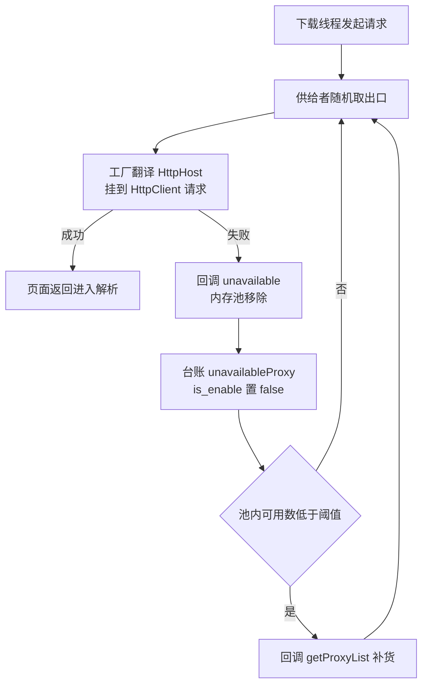

# 启用代理下载：把代理池台账接进下载链路

> 🔒 安全提示：文中示例的口令/密钥均为课程教学环境演示口径，生产环境的安全要求见《安全与合规须知》。

爬虫跑到现在，所有请求都是从本机网络直连目标站的，`crawler.properties` 里的代理开关一直停在关闭位。单出口 IP 高频抓取的结局可以预见：目标站认准这个 IP 拦截，重试越多封得越死。代理池的表、实体、Service 与三通道工厂在前面几讲已经备齐，账本有了，这一讲做的是接线：让下载链路每次发请求都从账本里取一个可用出口，请求失败还能把出口报回账本。

## 先给结论

- 开关是 `crawler.properties` 的 `proxy.isUsedProxy`，false 时走本机直连；验证代理链路之前必须先把它改成 true。
- 接线的位置在 `CrawlerConfig` 的 `@Bean` 装配方法：给 `CrawlerProxyProvider` 补上 `ProxyProviderCallBack` 回调，取代理与报失效两个动作从此有了着落。
- 取代理落到数据库：`getCrawlerProxyList` 构造 `ClipPool` 条件把耗时上限设为 5，`queryAvailableList` 只返回仍可用且响应够快的行，再逐行翻译成运行时抽象 `CrawlerProxy`。
- 报失效同样落回数据库：`unavailableProxy` 判空后委托 `CrawlerIpPoolService.unavailableProxy`，台账先查再改，失败原因写「自动禁用」。
- 下载器与供给者的分工不变：`ProxyHttpClientDownloader` 每次请求向供给者要一个出口，失败即报、即换下一个，HttpClient 为主、无头浏览器兜底的格局照旧。

## 开关与配置：一行 false 挡住了整条链路

配置文件里与代理直接相关的三行值得逐一看过（代理源与校验地址按占位示意）：

```properties
# 是否启用代理
proxy.isUsedProxy=false
# 动态代理拉取地址
proxy.get.url=http://proxy-source.example.com/get?num=50
# 代理可用性校验地址
proxy.validate.url=http://ip-check.example.com/
```

`proxy.isUsedProxy` 是总开关。它停在 false 的日子里，代码里所有代理相关的逻辑其实都在跑，只是供给者拿到开关值之后选择直连，代理池等于旁路状态。改成 true，下载组件的每个请求才会真正挂上代理出口。另外两个地址是代理池自我管理的两条输入线：`proxy.get.url` 负责从代理源拉新 IP，`proxy.validate.url` 负责验证池内存量代理还活着没有，两条线的代码在后面两讲展开，这里先把占位留好。

装配动作发生在 `CrawlerConfig`。供给者的 Bean 早就注册了，缺的是回调，这一讲把开关读取与回调装配一起补齐：

```java
@Value("${proxy.isUsedProxy}")
private Boolean isUsedProxyIp;

@Autowired
private CrawlerIpPoolService crawlerIpPoolService;

@Bean
public CrawlerProxyProvider getCrawlerProxyProvider() {
    CrawlerProxyProvider crawlerProxyProvider = new CrawlerProxyProvider();
    crawlerProxyProvider.setUsedProxyIp(isUsedProxyIp);
    //使用动态代理
    crawlerProxyProvider.setProxyProviderCallBack(new ProxyProviderCallBack() {
        @Override
        public List<CrawlerProxy> getProxyList() {
            return getCrawlerProxyList();
        }
        @Override
        public void unavailable(CrawlerProxy proxy) {
            unavailableProxy(proxy);
        }
    });
    return crawlerProxyProvider;
}
```

开关的读取方式有一个变化值得点出：早先供给者自己持有 `@Value` 直读配置，这一讲改为 `CrawlerConfig` 统一读出再经 `setUsedProxyIp` 喂进去。配置读取收敛到装配层，供给者保持纯逻辑，构造与装配的职责就此分开。

## 回调接口：两个方法就是代理池的两扇门

`ProxyProviderCallBack` 是 model 模块里定义的回调接口，一共两个方法：

```java
package com.study.headline.model.crawler.core.callback;

import com.study.headline.model.crawler.core.proxy.CrawlerProxy;
import java.util.List;

public interface ProxyProviderCallBack {
    /** 拉取代理列表，供供给者填充内存池 */
    public List<CrawlerProxy> getProxyList();

    /** 上报失效代理，由实现方写回台账 */
    public void unavailable(CrawlerProxy proxy);
}
```

两个方法对应代理池的两扇门。`getProxyList` 是进货门：供给者初始化与补货时调它，拿到一批可用代理灌进内存池；`unavailable` 是退货门：某个出口在真实请求里失败，供给者经它把坏代理退回。接口本身不碰数据库，碰不碰由实现方决定，这正是回调设计的意图：供给者的取用与淘汰逻辑保持通用，数据从哪来、坏账记到哪，全部留给装配层的匿名实现。

这一讲的实现把两扇门都接到 `CrawlerIpPoolService` 上，代理池从内存态升级成有台账的持久态。

## 取代理：从台账行到运行时抽象

```java
/**
 * 获取可用代理列表
 */
private List<CrawlerProxy> getCrawlerProxyList() {
    List<CrawlerProxy> crawlerProxyList = new ArrayList<>();
    ClipPool clipPool = new ClipPool();
    // 耗时阈值设为 5，只取响应足够快的代理
    clipPool.setDuration(5);
    List<ClipPool> clipPools = crawlerIpPoolService.queryAvailableList(clipPool);
    if (null != clipPools && !clipPools.isEmpty()) {
        for (ClipPool clipPool : clipPools) {
            crawlerProxyList.add(new CrawlerProxy(clipPool.getIp(), clipPool.getPort()));
        }
    }
    return crawlerProxyList;
}
```

方法三步：造条件、查台账、翻译。条件对象只设了 `duration` 一个字段，配合 `queryAvailableList` 的语义，SQL 层圈定的是「`is_enable` 为 true 且耗时不超过 5」的行，再按耗时升序排列。5 这个阈值的含义是响应时间的容忍上限，代理的响应越快 `duration` 越小，超过 5 秒才能给出响应的出口再可用也没有使用价值，查询阶段直接挡掉，升序又保证快出口排在列表头。

翻环节的动作看似平淡，实则是两个世界的翻译。台账里的 `ClipPool` 是记账实体，带主键、供应商、错误信息一整行档案；运行时需要的 `CrawlerProxy` 是轻量抽象，只有 host 与 port。`new CrawlerProxy(clipPool.getIp(), clipPool.getPort())` 一行完成身份搬运，下载链路拿到的对象干净利落，不带任何台账包袱；三通道工厂再按通道把它翻译成 `HttpHost`、WebMagic 的 `Proxy` 或无头浏览器的代理形态。

## 报失效：运行时的坏账写回台账

```java
/**
 * 代理不可用处理：让该代理失效
 */
private void unavailableProxy(CrawlerProxy crawlerProxy) {
    if (null != crawlerProxy) {
        crawlerIpPoolService.unavailableProxy(crawlerProxy, "自动禁用");
    }
}
```

方法体只有一次判空加一次委托，但两处细节都有讲究。判空挡的是极端情况：请求失败时代理对象已经不在供给者池中，回调再传 null 进来，直接拦截，不让空指针污染日志。委托的第二个参数写死「自动禁用」，这是失败现场的标准归因：这条代理不是人工下线的，是请求失败被系统自动降级的，四个字写进 `error` 列，人工复核台账时一眼分清自动与手动。`CrawlerIpPoolService.unavailableProxy` 内部先查再改的闭环在 Service 那一讲已经拆过，这里不再重复。

## 与下载器的关系：一条取用换代的循环

下载器、供给者、回调、台账四方的协作关系画成一张图：



循环的每一跳都有归属：取出口与换出口是供给者的内存操作，读锁护读、写锁护写；翻译与挂载是工厂的通道活；坏账落库是 Service 的先查再改；补货时机由阈值决定，补的货正是回调从台账拉来的可用列表。改造成 `ProxyHttpClientDownloader` 之后，HttpClient 通道的每次请求都走这一圈，被目标站拦下时代价只是一个出口的报废，下一个请求自动换新出口；真正需要 Cookie 场景的少数请求才落到无头浏览器兜底，与下载准备阶段的改造意图完全一致。

测试安排在代理池补货打通之后，眼下池子里还没有经过校验的新 IP，测了也只是空转；唯一要记牢的动作是测试前把 `proxy.isUsedProxy` 改回 true，开关不动，一切代理逻辑都不生效。

## 常见误区

- **开关忘改 true 就测代理。** 错例是接线写完直接跑测试，请求依旧本机直连，日志里找不到代理痕迹就怀疑代码写错。正解是先确认 `proxy.isUsedProxy` 已置 true，开关是整条链路的前置闸门。
- **回调实现里直连 Mapper。** 错例是把查询与更新 SQL 的细节写进匿名回调类，装配类膨胀成第二个 Service。正解是回调只做翻译，数据动作全部委托 `CrawlerIpPoolService`，台账口径保持单一入口。
- **取代理不带耗时条件。** 错例是 `queryAvailableList` 传空条件，5 秒才吐页面的慢代理与秒出的快代理一起进池，抓取吞吐被短板拖住。正解是 `duration` 阈值进条件，慢出口在查询阶段就沉底排除。
- **失效原因留空。** 错例是委托 `unavailableProxy` 时不传错误描述，台账 error 列全空，复核时分不清自动降级与人工下线。正解是「自动禁用」这类归因常量随委托传入，坏账记录自带现场。

## 面试可能被问到的问题

1. 面试官追问：「代理池为什么要设计成回调接口，供给者直接调 Service 不行吗？」
   答：回调把「代理从哪来」从供给者中剥离，供给者只管取用、淘汰与补货时机，数据来源完全由装配层决定。换成付费代理服务或本地静态列表，供给者一行不改，改的只是回调实现，这是依赖倒置在代理池上的落地。
2. 面试官追问：「下载请求怎么用上代理，失败后怎么换？」
   答：请求前经供给者随机取一个 `CrawlerProxy`，工厂按通道翻译成 HttpClient 的 `HttpHost` 挂到请求上；请求失败即回调 unavailable，坏出口从内存池移除并写回台账，下一次取用自动落到别的出口。取用、报坏、换新形成循环，池子低于阈值再触发补货。
3. 面试官追问：「台账实体和运行时抽象为什么要分成两个类？」
   答：`ClipPool` 是持久化档案，字段全，随表结构走；`CrawlerProxy` 是运行时通行证，只要 host 与 port。混用一个的代价是要么运行时对象背上无用字段，要么台账实体为迁就运行时削字段。两个类之间一次构造完成翻译，各自演进互不牵连。
4. 面试官追问：「耗时阈值 5 放在查询条件里，有什么好处？」
   答：慢代理在 SQL 层就被过滤，不占内存池名额，也不消耗下载线程的重试预算；阈值调整只改条件值，不改代码。配合耗时升序，快出口天然排前面，代理池「好代理先用」的意图在查询与排序两处同时兑现。
5. 面试官追问：「代理失败标记为什么由下载链路触发而不是定时校验触发？」
   答：两者都有且分工不同。下载链路触发的是真实业务请求的失败，报坏即时、代价低，一个出口坏了立刻淘汰；定时校验负责清理池内没被用到的存量。即时反馈保新鲜度，定期巡检保覆盖率，两头合起来池子里的数据才可信。

## 配套资料

- 代码：`materials/code/05/头条day11/` 资料包为空，配置类装配与回调实现按画面线整理、按本课写法补全（引用路径截至 `头条dayNN/` 层级，内层目录名含项目原名，不进入正文）。
- 参照：`materials/code/05/头条day01/` 的数据库规范设计说明书，`cl_ip_pool` 字段口径与注释规范出自它；代理三通道工厂与供给者的读写锁设计见 day08 下载准备阶段的两讲。
- 环境：课程集群 node01~node03，MySQL root/123456；验证代理下载前确认 `cl_ip_pool` 已有可用数据，且 `proxy.isUsedProxy` 已改为 true。
