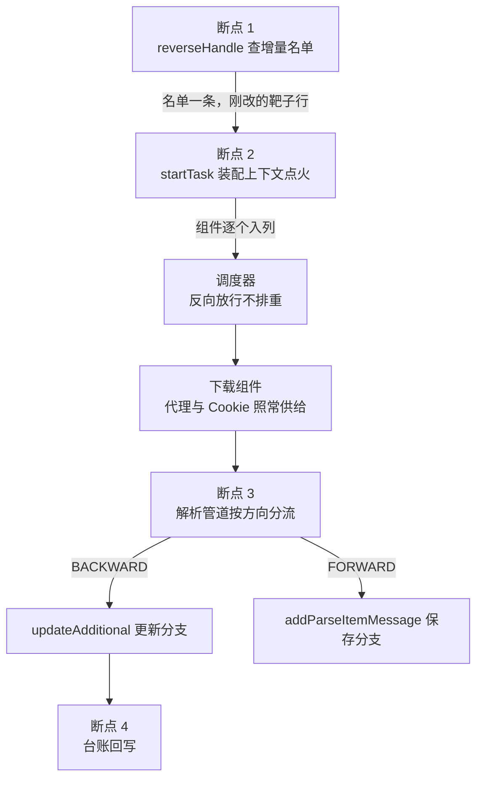
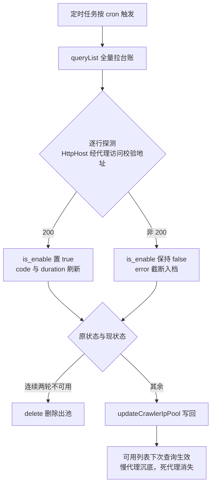

# 逆向抓取测试与代理巡检：反向链路端到端验证，池内 IP 定时体检

> 🔒 安全提示：文中示例的口令/密钥均为课程教学环境演示口径，生产环境的安全要求见《安全与合规须知》。

代码写完不测等于没写。反向入口 `reverseHandle` 与流程管理器的接线已经完成，这一讲先把它端到端跑通：从增量名单的构造，到调度器放行、下载、解析分流，最后落到附加台账的数字变化，每一跳都留了断点与日志可查。测试之后转场到代理池的自管理：池子里的 IP 从免费渠道拉来，质量参差不齐，谁还活着、谁已经死了，不能等业务请求失败才知道，`ProxyIpManager` 登场负责给池内每一个 IP 定时做体检。

## 先给结论

- 反向链路的测试方法从正向测试拷贝改名而来，前置条件三条：附加台账有数据、`next_update_time` 改到当前时间之前、Redis 与 Mycat 都启动。
- 断点走读的顺序是 `reverseHandle` 查名单、`startTask` 装配点火、解析管道按方向分流，反向数据进 `updateAdditional` 更新分支，正向数据进保存分支。
- 库里对账看两处：统计数字刷新，`next_update_time` 被顺延，后者是下一轮增量名单的来源，改了它反向流程才能滚动起来。
- 代理巡检收口在新类 `ProxyIpManager`，两个公开方法：`validateProxyIp` 校验存量、`updateProxyIp` 拉新灌池，交给定时任务按周期调用。
- 巡检逻辑是「先全量查台账，逐行探测，再按状态处置」：连续两轮都不可用的行直接删除，其余行把校验得到的最新状态与耗时写回。
- 单行探测经 `CrawlerProxyFactory` 把代理翻译成 HttpClient 的 `HttpHost`，向校验地址发请求，状态码 200 才算可用，非 200 一律按不可用记账。

## 逆向抓取的端到端测试

### 测试方法与三条前置条件

测试类沿用整合测试的骨架，拷贝正向的方法改名 `reverse`，调用点换成反向入口：

```java
@Test
public void reverse() {
    processingFlowManager.reverseHandle();
    try {
        Thread.sleep(Integer.MAX_VALUE);
    } catch (InterruptedException e) {
        e.printStackTrace();
    }
}
```

挂主线程的那行 sleep 一行都不能省，道理与正向整合测试相同：JUnit 以测试方法返回为用例结束标志，方法一返回容器销毁，Spider 的抓取线程跟着陪葬，抓取半路夭折。反向流程从查名单到回写台账全程异步，主线程必须一直挂住，验证完手动停掉用例即可。

方法体与正向的整合测试逐行同构，差别只有调用点：正向调 `handle`，反向调 `reverseHandle`。这种拷贝改名式的写法不是偷懒，而是引擎共享的自然结果：两个入口共用同一套流程环节、下载组件与解析设施，引擎内部的行为已经被正向测试锤过一遍，反向测试不必重复覆盖，断点只需要钉在反向独有的节点上，真正要验证的只有入口自身的三步编排，名单查得对不对、方向设得对不对、点火时机对不对。测试用例的形状与代码结构保持同构，读到用例就能还原被测链路的分层。

跑用例之前把三件事备齐。**第一，附加台账里要有数据。** 反向名单从 `cl_news_additional` 里查，表是空的，`queryIncrementParseItem` 返回空列表，日志打出「增量数据为空」，用例等于白跑。**第二，把某一行的 `next_update_time` 改到当前时间之前。** 增量名单的放行线是「到期时间小于等于现在」，没到点的行再热门也不会进名单；手工把一条的到期时间改到过去，这条就是本轮的测试靶子。**第三，Redis 与 Mycat 都要启动。** Redis 挡在排重与调度前面，Mycat 挡在 MySQL 前面，爬虫的连接走分库分表中间件，任何一个不在线，链路都会在各自的位置断掉，报错形态还不一样，先起服务再跑用例能省掉一轮无谓的排查。

### 断点走读：从名单到分流

打上断点逐步放行，观察窗口有四个，顺序如下：



断点一停在 `reverseHandle`：`queryIncrementParseItem` 返回的名单里是一条数据，正是刚把到期时间改到过去的靶子行，名单大小与手工准备的靶子数对上，增量查询这一环即告成立。放行进 `startTask`，上下文对象里装着 BACKWARD 与条目清单，流程环节逐个加入，与正向整合测试看到的组件清单一模一样，反向复用同一套设施在这里得到实证。

断点二之后链路交给异步线程，日志成了主要观察手段。调度器打出「反向爬取，不进行url排重」，排重闸门对反向放行的规则在真实运行里兑现；接着「开始进行数据逆向更新，增量数据数量为：1」把本轮规模报出来，两条日志成对出现，反向链路的身份一路没有丢失。

断点三停在解析管道的分流处，这是反向测试最有看头的一跳。同一个入口按方向分两条业务线：正向数据走 `addParseItemMessage`，保存文章、附加、评论并发审核消息；反向数据走 `updateAdditional`，直接进更新分支。靶子行带着 BACKWARD 进来，稳稳落在更新分支，说明条目上标的方向一路传到了管道，中途没有被任何环节改写或丢失。

### 库里对账：数字变了，时间顺延了

放行跑完后到库里查附加台账，两处变化就是本轮测试的验收单。**统计数字刷新了。** 靶子行的点赞、评论等字段从旧值变成了从目标页重新解析出的新值，比如点赞数从 13 变成 28，页面上的真实数字被回刷进了库，`updateAdditional` 按主键选择性回写的落库动作成立。**到期时间改了。** 回写完成时该行的 `next_update_time` 按热度档位重新顺延，`update_num` 计数加一，这条数据退出了本轮名单，等下一个档位到期才会再次回源。每次回源都改写到期时间，反向流程才有自驱的节拍，这是对账时最容易被忽略、却最不能缺的一列。

测试到此闭环：名单查得准、方向传得对、分支走得上、台账写得回，四个断点加两处对账，反向链路从入口到落库全部实证。

对账还有一处隐形收益值得点出：回源次数与到期时间的联动让名单具备自我收缩能力。`update_num` 随每次回源加一，超过上限的行自动退出增量名单，源页失效的文章不再消耗下载与解析额度；`next_update_time` 按热度档位顺延，热度衰减的文章回访间隔自动拉长。两个调度字段配合，反向流程的规模随数据价值自然收敛，不需要人工摘除任何一条名单，这正是把调度状态做成台账字段而非内存变量的用意：进程重启、任务换机，节拍都不丢。

## 代理巡检：ProxyIpManager 登场

### 类骨架与两个入口方法

反向链路跑通之后转场代理池。池里的 IP 是从免费渠道抓来的，死得快是常态，台账里躺着的不代表能用，能用不代表好用。巡检的思路很朴素：定时把池内全部代理逐个探测一遍，活着的更新档案，彻底死的删掉出池。承载这件事的新类建在爬虫模块的 proxy 包下：

```java
package com.study.headline.crawler.proxy;

import com.study.headline.crawler.service.CrawlerIpPoolService;
import com.study.headline.model.crawler.core.proxy.ProxyValidate;
import com.study.headline.model.crawler.pojos.ClipPool;
import lombok.extern.log4j.Log4j2;
import org.springframework.beans.factory.annotation.Autowired;
import org.springframework.stereotype.Component;
import java.util.List;

/**
 * 动态代理 IP 管理类
 */
@Component
@Log4j2
public class ProxyIpManager {

    @Autowired
    private CrawlerIpPoolService crawlerIpPoolService;

    @Autowired
    private SeleniumClient seleniumClient;

    /** 校验池内代理 IP 的可用性 */
    public void validateProxyIp() {
        //逐行探测存量代理
    }

    /** 更新动态代理 IP：从代理源拉新灌池 */
    public void updateProxyIp() {
        //拉新、校验、入库
    }
}
```

类挂 `@Component` 交给容器，`@Log4j2` 备好日志，注入的两个依赖各管一摊：`CrawlerIpPoolService` 是台账的唯一入口，查、删、改全走它；`SeleniumClient` 是无头浏览器客户端，拉新 IP 时对付代理源站的反爬要用它，下一讲展开。两个公开方法对应巡检的两条线：`validateProxyIp` 管存量，`updateProxyIp` 管增量。它们不靠人手动触发，调用方是一个定时任务，按 cron 周期分别调度两个方法，巡检的节奏与抓取低峰错开，代理源与目标站的压力都不叠加。定时任务的落地放在稍后的作业里，这里先把管理类的能力备齐。

调度参数的设计口径可以先行给出。巡检与拉新各自独立一个 cron，写法沿用项目里 Quartz 任务的表达式风格：巡检压在每天凌晨的低峰时段做一次全量扫描，一次换一整天的可信排序；拉新按池子的消耗速度分档，比如工作时段每两小时一轮、深夜拉长到六小时一轮，具体数值以巡检日志里的删除与翻转数量为依据回调。表达式只改配置不改代码，节奏调整的试错成本极低，cron 表达式的基本功在爬虫概念那一讲已经练过，这里直接兑现。

### 全量巡检的外层循环

```java
public void validateProxyIp() {
    //空条件查询，捞出池内全部代理
    List<ClipPool> clpPoolList = crawlerIpPoolService.queryList(new ClipPool());
    if (null == clpPoolList || clpPoolList.isEmpty()) {
        return;
    }
    for (ClipPool clpPool : clpPoolList) {
        //记录校验前的台账状态
        Boolean old = clpPool.getIsEnable();
        //逐行探测
        validateProxyIp(clpPool);
        //原始状态与校验后的状态都不可用，判定为废除代理，删除
        if (!old && !clpPool.getIsEnable()) {
            crawlerIpPoolService.delete(clpPool);
            log.info("删除代理 ip: {}, port: {}", clpPool.getIp(), clpPool.getPort());
        } else {
            //仍可用或状态有翻转，把校验结果写回台账
            crawlerIpPoolService.updateCrawlerIpPool(clpPool);
            log.info("更新代理 ip: {}, port: {}", clpPool.getIp(), clpPool.getPort());
        }
    }
}
```

外层循环四步，处置逻辑是这段代码的灵魂。探测前先记下台账里的原状态 `old`，它是判断「这行代理已经死过多久」的依据。探测后实体上的可用状态被刷新，两个状态一对照，处置分两路：原状态 false 且探测后仍 false，说明这行代理上一轮已经被判过死刑，本轮复查依然救不回来，连续两轮不可用即判定废除，直接删除出池，台账不再为它保留位置；其余情况一律走更新，写回探测得到的最新状态。更新这一路其实覆盖了三种剧情：原来可用、探测后仍可用，状态稳定，耗时刷新；原来可用、探测后不可用，本轮降级，`is_enable` 置 false 加错误原因入档；原来不可用、探测后活了，状态翻转复活。一个更新分支管三种变化，删除分支只收最坏情况，台账的处置规则就此收敛成两条。

### 单行体检：ProxyValidate 与 HttpHost 探测

探测动作委托给一个私有重载，先认识探测结果的载体：

```java
/**
 * 代理校验结果载体
 */
public class ProxyValidate {
    /** 主机 */
    private String host;
    /** 端口号 */
    private int port;
    /** 状态码，200 视为可用 */
    private int returnCode;
    /** 错误信息 */
    private String error;
    /** 本次探测耗时 */
    private long duration;

    public ProxyValidate() {
    }

    public ProxyValidate(String host, int port) {
        this.host = host;
        this.port = port;
    }
}
```

五个字段正好是体检报告的五个栏目：身份两项（host 加 port）、结论一项（returnCode）、佐证两项（error 加 duration）。台账实体 `ClipPool` 里对应着 `code`、`error`、`duration` 三个量化字段，探测结果原样对号入座。

```java
/**
 * 校验单个代理是否可用
 */
private void validateProxyIp(ClipPool clpPool) {
    //先默认不可用，校验通过再置回来
    clpPool.setIsEnable(false);
    ProxyValidate proxyValidate = new ProxyValidate(clpPool.getIp(), clpPool.getPort());
    try {
        ProxyIpUtils.validateProxy(proxyValidate);
    } catch (Exception e) {
        log.error(e.getMessage());
    }
    if (proxyValidate.getReturnCode() == 200) {
        //探测通过，代理可用，量化指标一并写回
        clpPool.setIsEnable(true);
        clpPool.setCode(proxyValidate.getReturnCode());
        clpPool.setDuration(proxyValidate.getDuration());
    } else {
        //失败现场写进 error，超长截断到 70 字符再入档
        clpPool.setError(getFixedLengthString(proxyValidate.getError(), 70));
    }
}

/** 字符串超长截断，防止 error 超出列宽导致更新失败 */
private String getFixedLengthString(String source, int length) {
    if (StringUtils.isEmpty(source) || source.length() <= length) {
        return source;
    }
    return source.substring(0, length);
}
```

方法开头先置 `isEnable` 为 false 是「疑罪从有」的写法：默认这行代理不可用，探测通过才翻回 true。先降级再验证，保证任何异常路径下台账都不会把一个没验证过的代理当活货；探测本身包在 try 里，工具类抛出的异常只记日志，实体保持不可用状态，外层循环拿到的永远是可判定的结论。

探测的实现在 `ProxyIpUtils` 里，一句话讲清原理：拿这个代理当出口，向校验地址发一个 HTTP 请求，状态码 200 就证明出口活着，不是 200 一律算死。校验地址是配置文件里 `proxy.validate.url` 指向的回显服务，专门用于返回请求方的出口信息，是代理池自我管理的第二条输入线：

```java
public class ProxyIpUtils {

    /** 校验地址，从 crawler.properties 的 proxy.validate.url 读入，按占位示意 */
    private static final String reqUrl = "http://ip-check.example.com/";

    public static void validateProxy(ProxyValidate proxyValidate) {
        log.info("开始校验代理IP: {} : {}", proxyValidate.getHost(), proxyValidate.getPort());
        long currentTime = System.currentTimeMillis();
        String errorMessage = null;
        //默认 404，探测异常时代理按不可用处理
        int resultCode = 404;
        try {
            //经工厂把抽象代理翻译成 HttpClient 的 HttpHost，向校验地址发请求
            resultCode = processRequest(CrawlerProxyFactory.getHttpHostProxy(
                    new CrawlerProxy(proxyValidate.getHost(), proxyValidate.getPort())));
        } catch (IOException e) {
            errorMessage = e.getMessage();
        }
        proxyValidate.setReturnCode(resultCode);
        proxyValidate.setError(errorMessage);
        proxyValidate.setDuration(System.currentTimeMillis() - currentTime);
    }
}
```

三个细节撑起探测的可信度。**第一，代理经工厂翻译。** `CrawlerProxyFactory.getHttpHostProxy` 把 host 加 port 的抽象代理翻成 HttpClient 认的 `HttpHost`，请求经这个出口发往校验地址，测的才是代理的真实通路，而不是本机网络。三通道工厂在这里又一次复用，校验走 HttpClient 通道，快且轻，与下载主链路的选择一致。**第二，状态码是唯一裁决。** 结果码默认 404，请求抛异常保持默认值，只有响应状态行返回 200 才覆盖成可用，非 200 统一按不可用记账，不存在模糊地带。**第三，耗时就地测量。** 探测前后各取一次毫秒时间戳，差值写进 `duration`，这个数字回填台账后立刻生效：可用列表按耗时升序取用，巡检越勤，排序越贴近代理的真实速度。毫秒是它与台账耗时阈值共享的单位，取用侧「5 秒以内才算可用」的门槛，正是建立在巡检回填的这列数据上，两个环节共用一个度量衡，阈值才有现实的锚点。

## 检验任务的设计账



巡检与运行时报坏是台账的两条写入线，分工值得算清楚。下载请求失败走的是 `CrawlerIpPoolService.unavailableProxy`，先查再改，手里的运行时抽象只有 host 与 port，所以要查出台账行再降级；巡检失败走的是 `updateCrawlerIpPool`，探测前刚从台账查回完整实体，直接全量写回。两条线写同一张表，语义一致：`is_enable` 表状态，`error` 记原因，`duration` 记速度。区别只在触发时机，运行时报坏即时，巡检验证定期，一个保新鲜度，一个保覆盖率。

巡检的周期设计还有两笔账。频率上，免费代理的半衰期以小时计，巡检周期定得太长，池子里挤满死 IP，取用方重试成本飙升；定得太短，探测流量本身就会引起代理源与校验服务的注意。按池子规模与失效率估一个量级，让每轮巡检的删除与翻转数量保持稳定即可，节奏对了数字会自己说话。时点上，巡检与抓取窗口错开，探测请求都带着代理出口去访问校验地址，与业务抓取叠加会把低峰期撑成高峰，cron 的分针刻意避开抓取任务的整点。

全量扫描的规模账也算得清。台账千行量级时，一轮巡检就是一千次轻量 GET，串行跑也不过几分钟；台账上万行时再考虑分批与并发，探测线程数压在校验服务的承受线之下，宁可拉长一轮的时长，也不把巡检做成对校验服务的压测。规模上去了，扫描策略可以继续演进，接口与台账口径不动，这是把巡检收口成独立方法留下的扩展余地。

## 常见误区

- **删除与更新的条件写反。** 错例是探测失败就删，代理只是偶发抖动一下就被移出池子，免费池的淘汰速度远超补充速度。正解是连续两轮不可用才删，单轮失败先降级观察，给状态翻转留一条复活通道。
- **探测结果不回填量化字段。** 错例是只改 `is_enable`，`code`、`duration`、`error` 原地不动，可用列表的耗时排序失去数据来源，快代理沉底慢代理排前。正解是探测通过即刷新三项量化指标，台账的速度档案与真实速度同步。
- **error 直接写库不截断。** 错例是异常堆栈整串塞进 error 列，超出列宽的更新语句直接报错，整轮巡检中断。正解是入库前按列宽截断，70 个字符足够保留异常类型与关键信息。
- **巡检与抓取同时段全量跑。** 错例是定时任务压在抓取高峰，探测流量与业务流量叠加，代理出口与校验服务两头吃紧。正解是错峰排 cron，巡检独占自己的时间窗。

## 面试可能被问到的问题

1. 面试官追问：「代理巡检为什么不用业务请求的结果代替，非要主动探测？」
   答：业务请求只覆盖被取用到的代理，池子里大量代理长期没人用，坏了也没人知道，等取用到时业务请求已经付出失败代价。主动探测覆盖全量，把死 IP 在被取用之前清出去，业务请求的成功率才有保障。两条线并行，一个保即时性，一个保覆盖率。
2. 面试官追问：「连续两轮不可用才删除，这个设计怎么来的？」
   答：免费代理的失败经常是抖动，网络瞬断、代理源限流都会造成单次探测失败，一票否决会误杀还能活的代理。两轮确认把偶发抖动与真死分开：第一轮失败降级出可用列表，第二轮复查仍失败才删除，误杀率显著下降，代价只是多保留一轮死代理的台账行。
3. 面试官追问：「探测为什么选 200 作为唯一可用标准？」
   答：校验地址是中立的回显服务，不设任何访问门槛，经代理能拿到 200 就证明 TCP 连通、代理转发、响应返回三个环节全部正常。非 200 的原因五花八门，代理认证失败、目标站拦截、网络超时都有可能，逐类区分的成本高且对处置没有影响，反正都要降级，统一按不可用记账最省。
4. 面试官追问：「巡检测得的 duration 有什么用？」
   答：台账的可用列表查询按 duration 升序排序，取用方从列表头拿代理，响应快的出口优先被用上。探测数据回填后，排序随每次巡检刷新，越贴近真实速度。没有这个字段，排序只能靠主键或入库时间，与代理质量毫无关系。
5. 面试官追问：「巡检频率怎么定，定错了会怎样？」
   答：按池子规模与失效率估量级，观察每轮巡检的删除与翻转数量：数量持续偏高说明周期太长，死 IP 在池里停留过久；数量接近零要么池子健康要么周期太短浪费探测额度。定错的两个极端是池子被死 IP 占满、或探测流量本身成为负担，节奏以数字稳定为准。

## 配套资料

- 代码：`materials/code/05/头条day11/` 资料包为空，`ProxyIpManager`、`ProxyValidate`、`ProxyIpUtils` 与反向测试类按画面线整理、按本课写法补全（引用路径截至 `头条dayNN/` 层级，内层目录名含项目原名，不进入正文）。
- 参照：`materials/code/05/头条day01/` 的数据库规范设计说明书，台账量化字段的注释口径出自它；`materials/code/05/头条day02/` 的 Mycat 相关资料对应测试前置里分库分表中间件的启动依赖。
- 环境：课程集群 node01~node03，MySQL root/123456；跑反向测试前确认 Redis 与 Mycat 在线、附加台账里已备好到期的靶子行；代理巡检验证前确认 `proxy.validate.url` 配置可达。
