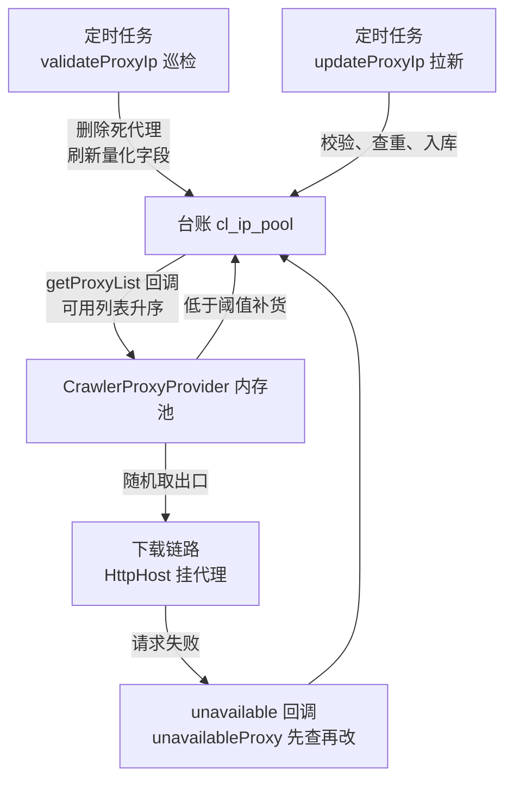

# 更新动态 IP：拉新灌池，代理池管理闭环成型

> 🔒 安全提示：文中示例的口令/密钥均为课程教学环境演示口径，生产环境的安全要求见《安全与合规须知》。

巡检把池内存量代理管住了，但免费代理死得快，只出不进的话池子迟早见底。补货这一环补上之后，代理池的四条线才算齐：存量有巡检、来源有拉新、消费有取用、坏账有回写。这一讲写 `ProxyIpManager` 的第二个公开方法 `updateProxyIp`，从代理源拉新 IP、逐个校验、查重入库，顺带把整个代理池管理的闭环盘一遍。

## 先给结论

- 拉新的完整链路是四步：无头浏览器取代理源页面、正则解析出 IP 加端口、逐个走校验、查重后入库，每一步都复用已有设施。
- 代理源页面要过 Cookie 校验，HttpClient 拿到的是空壳页，所以取页走 `SeleniumClient`，Cookie 键名从浏览器 Application 面板查得后写成常量传入。
- 入池前 `checkExist` 按加 port 查重，池子里已有的代理不再插入，免费源批次之间大量重叠，查重是省台账也是省巡检成本。
- 新行只有 ip、port、来源与创建时间四个字段，可用性与速度指标全靠入库后的巡检与真实请求逐步补齐。
- 数量阈值与刷新周期分两级：供给者内存池低于阈值即时补货，台账层由定时任务按周期拉新与巡检，代理池管理闭环就此成型。

## updateProxyIp：拉新、校验、查重、入库

免费动态代理的站点网上有很多，课程选了一家作示例，配置里的拉取地址按占位示意写成 `proxy.get.url=http://proxy-source.example.com/get?num=50`。方法主体是一个四步漏斗：

```java
/**
 * 更新动态代理 IP：拉新、校验、查重、入库
 */
public void updateProxyIp() {
    List<ClipPool> clpPoolList = getGrabClipPoolList();
    if (null != clpPoolList && !clpPoolList.isEmpty()) {
        for (ClipPool clipPool : clpPoolList) {
            //抓回来的 IP 先过一遍校验
            validateProxyIp(clipPool);
            if (clipPool.getIsEnable()) {
                //入池前按 host 加 port 查重
                boolean exist = crawlerIpPoolService.checkExist(clipPool.getIp(), clipPool.getPort());
                if (!exist) {
                    crawlerIpPoolService.saveCrawlerIpPool(clipPool);
                    log.info("插入代理 ip: {}, port: {}", clipPool.getIp(), clipPool.getPort());
                }
            }
        }
    }
}
```

漏斗每收窄一层，质量就升一级。第一层校验直接复用巡检那讲的私有方法：新 IP 建成 `ClipPool` 后送进 `validateProxyIp`，经 `HttpHost` 向校验地址发一次探测，200 才把 `isEnable` 翻回 true。校验不合格的行根本走不到入库那一步，坏货在池外就被拦下。第二层是 `getIsEnable` 判断，只有探测通过的候选才继续往下走，判断读的就是校验方法写回实体的状态，两个方法之间靠实体传递结论。第三层查重，`checkExist` 是 Service 七方法里早就备好的能力，host 加 port 是代理的最小身份，池子里已有的不再插第二遍。第四层入库，`saveCrawlerIpPool` 走 `insertSelective`，没赋值的列留数据库默认值，自增主键回填实体。

查重这一步的价值在免费源上格外突出：不同批次、甚至同一天的不同时刻，拉回来的名单高度重叠，不查重的池子很快被同一批代理的重复行塞满，台账膨胀，巡检的探测额度也跟着翻倍。查重的判断与占位语义在排重那一讲已经细拆过，这里只是换了个调用方。

## getGrabClipPoolList：取页与解析

拉新的第一步是拿到代理源页面的内容，这个页面有自己的脾气：访问要过一道 Cookie 校验，IP 数据由页面脚本动态写入，HttpClient 直接请求拿到的多半是空壳。取页因此走无头浏览器通道：

```java
/** 代理源站的 Cookie 键名，页面脚本写入，键名从浏览器 Application 面板查得 */
private static final String PROXY_SOURCE_COOKIE_NAME = "yd_cookie";

@Value("${proxy.get.url}")
private String proxyGetUrl;

@Autowired
private CrawlerProxyProvider crawlerProxyProvider;

@Autowired
private SeleniumClient seleniumClient;

/**
 * 获取抓取的动态代理 IP
 */
private List<ClipPool> getGrabClipPoolList() {
    List<ClipPool> clipPoolList = new ArrayList<>();
    CrawlerHtml crawlerHtml = seleniumClient.getCrawlerHtml(
            proxyGetUrl, crawlerProxyProvider.getRandomProxy(), PROXY_SOURCE_COOKIE_NAME);
    if (null != crawlerHtml && StringUtils.isNotBlank(crawlerHtml.getHtml())) {
        //预编译的 IP 加端口模式，对整页源码反复匹配
        Matcher matcher = proxyIpPattern.matcher(crawlerHtml.getHtml());
        while (matcher.find()) {
            String ip = matcher.group(1);
            String port = matcher.group(2);
            ClipPool clipPool = new ClipPool();
            clipPool.setIp(ip);
            clipPool.setPort(Integer.parseInt(port));
            clipPool.setCreatedTime(new Date());
            //来源写成通用示例，supplier 字段给多供应商对比留口
            clipPool.setSupplier("示例代理源");
            clipPoolList.add(clipPool);
        }
    }
    return clipPoolList;
}
```

`getCrawlerHtml` 的三个参数各有来路。第一个是拉取地址，`@Value` 从配置读入，换代理源改配置不改代码。第二个是代理出口，`crawlerProxyProvider.getRandomProxy()` 从供给者随机取一个：拉新任务的访问频率不低，固定出口很快会被代理源盯上，让取页流量也挂上池内代理轮换，抓别人数据的人自己也躲在代理后面。第三个是 Cookie 键名常量，代理源站的关键 Cookie 由页面脚本写入，键名没有配置项可查，用浏览器开发者的 Application 面板看一眼请求就能拿到，这类键名只在调试阶段查一次、写成常量长期使用。

解析用正则，模式预编译成类的成员常量，避免每次调用重新编译：

```java
//IP 加端口：四段数字以三个点分隔，冒号后接端口号
Pattern proxyIpPattern = Pattern.compile("(\\d{1,3}\\.\\d{1,3}\\.\\d{1,3}\\.\\d{1,3}):(\\d{1,5})");
```

模式的读法拆开看：`\d{1,3}` 匹配一到三位数字，`\.` 匹配点本身，四段数字三个点就是 IPv4 的形态，冒号之后 `\d{1,5}` 是端口号。两个括号把 IP 与端口各圈成一个分组，`group(1)` 取 IP，`group(2)` 取端口，端口是字符串还要 `Integer.parseInt` 一转。代理源页面把 IP 串嵌在整页源码里，正则扫描比结构化解析更能扛页面排版变化，匹配到多少算多少，漏几条下一批补。

新行的字段故意只填四个：ip、port、来源、创建时间。`code`、`duration`、`error` 留给巡检与真实请求去填，可用状态在校验通过时已经置好。台账行从最小档案起步，随使用逐步长全，这正是前面设计表结构时把量化字段全部允许为空的用意。

## 数量阈值与刷新周期

拉新与巡检都是台账层的动作，消费侧还有一层内存池，两级各有一套节奏控制。供给者那一讲立过阈值：池内可用代理数量低于 10 就触发补货，补货回调 `getProxyList` 到台账里查可用列表灌池，取用与补货在内存层即时循环。台账层的节奏交给定时任务，`validateProxyIp` 与 `updateProxyIp` 各配一个 cron，拉新周期跟着池子的消耗速度走：免费代理失效率高，池子掉得快，拉新就得勤；巡检周期跟着代理的半衰期走，半天到一天一轮是常见量级。两个任务与抓取窗口错峰，探测与拉新的流量不与业务抓取叠加。



这张图就是代理池管理的全部家底。来源线（B）拉新灌台账，保鲜线（A）巡检清死账，消费线（E）取用挂代理，回写线（F）报坏降级；内存池夹在台账与下载之间，阈值触发补货，读写锁护住并发。四条线各有一个入口方法或回调，全部落在已经写过的类上，没有新增概念。

## 代理池管理闭环总结

从 day10 的建表到这一讲，代理池的完整清单值得点一遍名：表 `cl_ip_pool` 与实体 `ClipPool` 定档案，Mapper 与 Service 七方法定读写口径，`CrawlerProxy` 与三通道工厂定运行时翻译，供给者定内存池与补货阈值，回调装配把台账与供给者接通，巡检与拉新两个定时任务保台账鲜活，下载链路的失败回调闭环报坏。数据在台账、内存池、真实请求三个层面循环，状态全部由数据表达：代理质量的起伏不触发任何代码改动，变的只是巡检与拉新的节奏。

这套设计的可迁移性也在闭环里：把拉新回调换成付费代理服务的接口，台账结构一字不改；把校验地址换成自建的探测服务，巡检逻辑原样保留。代理池作为独立组件的边界，就在这几个类与一张表之间。

## 常见误区

- **拉新不校验直接入库。** 错例是抓回来的 IP 一股脑插进台账，坏货入池后要等巡检才能清走，池子的可用率被源头污染。正解是入库前先过 `validateProxyIp`，校验不过不入池。
- **入池不查重。** 错例是每个批次全量插入，同一代理在台账里重复成片，巡检探测额度成倍浪费。正解是 `checkExist` 按 host 加 port 拦住重复行，免费源的重叠批次全靠这道闸。
- **端口不做类型转换。** 错例是正则取出的端口字符串直接 set 进 Integer 字段，编译期就报错。正解是 `Integer.parseInt` 转型后再赋值，顺手留意超大端口值的解析异常。
- **拉新周期照抄巡检周期。** 错例是两个任务共用一个 cron，拉新的节奏本该跟着池子消耗速度走，巡检跟着代理半衰期走，绑在一起必然一头空转一头不足。正解是两个周期分开配置，按各自的数据反馈调整。

## 面试可能被问到的问题

1. 面试官追问：「为什么取代理源页面要用无头浏览器，HttpClient 不行吗？」
   答：代理源站与目标站一样有反爬，关键 Cookie 由页面脚本计算写入，HttpClient 拿到的是没有数据的空壳页。无头浏览器能执行脚本、等 Cookie 就位再取源码，取页成功率才有保障。代价是进程重、慢，所以只用在取页这一个环节。
2. 面试官追问：「拉新任务为什么也挂代理出口？」
   答：拉新的访问频率不低，固定本机出口会被代理源限流或封禁，拉新与巡检双双失效。让取页流量也随机挂池内代理轮换，抓取方自己遵守自己立的规矩，来源线的稳定性才与消费线同级。
3. 面试官追问：「IP 解析为什么用正则而不是按页面结构解析？」
   答：代理源页面的排版随时会改，结构化解析绑死在标签层级上，改版即失效；IP 加端口是格式高度固定的字符串，正则只认「四段数字加冒号加端口」的形态，页面怎么换皮都能匹配。模式预编译成常量，扫描成本也可控。
4. 面试官追问：「内存池阈值补货和定时拉新，两级会不会打架？」
   答：不会，两级补的是不同层的库存。阈值补货是内存动作，从台账把可用行灌进供给者，秒级完成；定时拉新是磁盘动作，从代理源抓新行入库，小时级周期。台账永远是唯一事实源，内存池只是缓存，两级节奏独立，缓存与数据源各守各的 freshness。
5. 面试官追问：「把免费代理源换成付费服务，这套代码要改多少？」
   答：改动收敛在拉新环节：取页与正则换成调服务接口，返回的 IP 列表组装成 `ClipPool` 即可，supplier 字段换来源名。台账结构、Service、巡检、供给者、下载链路全部不动，这正是状态由数据表达、来源由配置表达的收益。

## 配套资料

- 代码：`materials/code/05/头条day11/` 资料包为空，`updateProxyIp` 与 `getGrabClipPoolList` 按画面线整理、按本课写法补全（引用路径截至 `头条dayNN/` 层级，内层目录名含项目原名，不进入正文）。
- 参照：`materials/code/05/头条day01/` 的数据库规范设计说明书，`cl_ip_pool` 的 supplier 与量化字段口径出自它；代理三通道工厂与供给者阈值设计见 day08 下载准备阶段的两讲。
- 环境：课程集群 node01~node03，MySQL root/123456；验证拉新前确认 `proxy.get.url` 与 `proxy.validate.url` 配置可达，无头浏览器驱动路径已配置。
