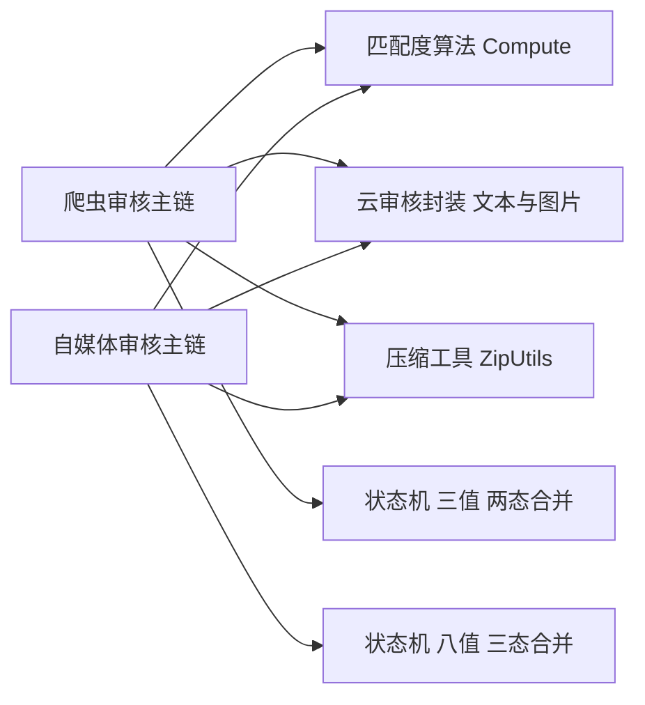

# 审核服务开工：补齐标签关联表的数据层，立起三重载的接口

> 🔒 安全提示：文中示例的口令/密钥均为课程教学环境演示口径，生产环境的安全要求见《安全与合规须知》。

流程图摊开之后，编码从两件基础工作开始。数据访问层还差一块拼图：`ap_article_label` 这张表早就建好了，实体类与 Mapper 却一直缺位，审核通过落库时它必须就位。业务层要立起爬虫审核服务的接口骨架，三个重载方法的签名决定后面所有调用的形态，接口立错了，两个入口跟着返工。这一讲不写审核逻辑，先把地基打平。

## 先给结论

- `ap_article_label` 四列：id、article_id、label_id、ord（排序），实体放 model 模块的 article pojos 包，与 `ApArticle` 系列住在一起。
- Mapper 四个方法：insert、insertSelective、updateByPrimaryKeySelective、selectByArticleId，XML 落在 resources 的 `mybatis/app` 目录，namespace 与接口全限定名严格一致。
- 审核服务 `ReviewCrawlerArticleService` 落在 admin 端，三个重载：无参给定时任务、Integer 给消息监听、CNews 版本装核心逻辑。
- 跨模块复用的切面画在工具层：匹配度算法、云审核封装、压缩工具直接复用，主链不复用，因为状态机与落库清单完全不同。
- 实现类先立骨架：@Service 注册、注入 `CNewsMapper`，三个空方法，逻辑下一讲填。

## 把 ap_article_label 的实体与 Mapper 补齐

先看表。`ap_article_label` 是 App 端文章与标签的关联表，结构极简：

| 列 | 含义 |
|---|---|
| id | 主键，自增 |
| article_id | App 端文章主键 |
| label_id | 标签主键 |
| ord | 排序值，决定标签展示次序 |

这张表为什么直到现在才建实体？自媒体链用不到它：发文表单里的标签从系统已有标签里挑，标签 id 串冗余在主表 `ap_article` 的 labels 列就够。爬虫链不一样：源站定义的标签系统里可能没有，解析侧动态补建了标签记录，文章与标签的关联必须逐条落行，审核通过那一刻这张表就要接活。所以实体与 Mapper 是审核编码的第一件事，别等到落库那天才发现表在库里、类不在工程里。

实体放进 model 模块的 article pojos 包：

```java
/** App 端文章与标签的关联实体 */
public class ApArticleLabel {

    private Integer id;
    /** App 端文章主键 */
    private Integer articleId;
    /** 标签主键 */
    private Integer labelId;
    /** 排序值，决定标签展示次序 */
    private Integer ord;
    // getter 与 setter 省略
}
```

Mapper 接口四个方法，两个插入、一个更新、一个查询，放在 mappers.app 包：

```java
public interface ApArticleLabelMapper {

    int insert(ApArticleLabel record);

    int insertSelective(ApArticleLabel record);

    int updateByPrimaryKeySelective(ApArticleLabel record);

    List<ApArticleLabel> selectByArticleId(Integer articleId);
}
```

XML 落在 resources 的 `mybatis/app` 目录下，namespace 指向接口全限定名，与工程里其他 App 端 Mapper 的摆放纪律一致：

```xml
<mapper namespace="com.study.headline.model.mappers.app.ApArticleLabelMapper">

    <insert id="insert">
        insert into ap_article_label (article_id, label_id, ord)
        values (#{articleId}, #{labelId}, #{ord})
    </insert>

    <insert id="insertSelective">
        insert into ap_article_label
        <trim prefix="(" suffix=")" suffixOverrides=",">
            <if test="articleId != null">article_id,</if>
            <if test="labelId != null">label_id,</if>
            <if test="ord != null">ord,</if>
        </trim>
        <trim prefix="values (" suffix=")" suffixOverrides=",">
            <if test="articleId != null">#{articleId},</if>
            <if test="labelId != null">#{labelId},</if>
            <if test="ord != null">#{ord},</if>
        </trim>
    </insert>

    <select id="selectByArticleId"
            resultType="com.study.headline.model.article.pojos.ApArticleLabel">
        select id, article_id, label_id, ord
        from ap_article_label
        where article_id = #{articleId}
    </select>
</mapper>
```

`updateByPrimaryKeySelective` 与工程里其他 selective 更新同款，按主键定位、null 字段不进 set 子句，不再整段贴出。放错位置的代价要心里有数：namespace 手写错一个字母或 XML 放错目录，启动不报错，调用瞬间抛 BindingException，这种延迟引爆的错误排查起来最费时间。落盘前对着接口全限定名逐字符核对一遍 namespace，成本只有一分钟。

## 接口三个重载与实现类骨架

审核服务照旧落 admin 端，理由与自媒体审核那课时相同：App 端落库、人工排查、索引建立都归管理侧管，爬虫模块只负责抓取与发消息。接口三个重载一次定义齐：

```java
public interface ReviewCrawlerArticleService {

    /** 定时兜底入口：扫描状态 1 的待审爬虫文章批量审核 */
    void autoReviewArticleByCrawler() throws Exception;

    /** 消息单篇入口：按文章 id 回查台账并审核 */
    void autoReviewArticleByCrawler(Integer clNewsId) throws Exception;

    /** 核心实现：拿着台账实体走三道审核关 */
    void autoReviewArticleByCrawler(CNews cNews) throws Exception;
}
```

三个重载不是凑数，是三类调用方各自最顺手的入参形态。无参版本给定时任务，调度器手里没有任何上下文，方法自己去库里捞活；Integer 版本给消息监听，消息里只有文章 id；CNews 版本才是核心，前两个最终都会带着实体走到它身上。三个方法都声明 `throws Exception`：审核链路里有压缩解压、JSON 解析、云接口调用三类受检异常，一路往上传，由两个入口统一兜住记日志，核心方法内部不再层层吞异常。

实现类一步到位立起骨架：

```java
@Service
public class ReviewCrawlerArticleServiceImpl implements ReviewCrawlerArticleService {

    @Autowired
    private CNewsMapper cNewsMapper;

    @Override
    public void autoReviewArticleByCrawler() throws Exception {
        // 下一讲填充：扫描状态 1 批量审核
    }

    @Override
    public void autoReviewArticleByCrawler(Integer clNewsId) throws Exception {
        // 下一讲填充：主键加状态双条件查单行
    }

    @Override
    public void autoReviewArticleByCrawler(CNews cNews) throws Exception {
        // 核心实现，稍后填三道审核关
    }
}
```

先把 `CNewsMapper` 注进去，它是台账的读写门面，三个重载全都要用；日志注解随着方法填充一起补上。

## 复用还是另写：切面画在工具层

两条审核主链摆在一起，复用与否的判断可以先画图：



关键路径在分叉处：两条主链共享的是无状态的纯工具，各自拥有的是状态机与落库编排。

**复用清单**：`Compute.SimilarDegree` 匹配度算法、`AliyunTextScanRequest` 与 `AliyunImageScanRequest` 云审核封装、`ZipUtils` 压缩工具。三个都是无状态纯工具，没有一行业务分支，跨模块引用零风险。

**另写清单**：状态分流、失败处理、落库编排。自媒体链的 `autoReviewArticleByMedia` 按八个状态分流，爬虫链只有三个值；自媒体链审核通过要查无则插作者档案，爬虫链要拆标签串落关联表，两边的「审核通过之后」完全是两套动作。

把三道审核关抽成一个公共组件的方案也评估过：状态机要参数化、失败处理要按链路注入回调，抽象的复杂度超过两份相似代码的维护成本。判断标准看变化频率：工具层的变化两条链同步受益，主链的变化各自独立，切面画在工具层，两边都稳。

## 常见误区

- **实体放错模块。** 错例是把 `ApArticleLabel` 塞进 crawler 模块，admin 端审核落库引用时跨模块绕远路，依赖方向也乱。正解是它属于 App 端文章家族，进 model 模块的 article pojos 包。
- **XML 与接口对不上。** 错例是 namespace 手写错或 XML 放错目录，启动不报错、调用时抛 BindingException。正解是 namespace 与接口全限定名逐字符一致，XML 落在 `mybatis/app` 下与包约定对应。
- **接口只定义核心方法。** 错例是只留 CNews 版本，消息监听与定时任务各自拼查询逻辑，准入判断散落两处迟早分叉。正解是三个重载收口在一个接口里，入口只做适配。
- **复用整条自媒体主链。** 错例是直接调 `autoReviewArticleByMedia`，状态机、发布决策、作者档案的处理全对不上，爬虫文章被当成自媒体稿件处理。正解是复用无状态工具，主链按爬虫语义另写。

## 面试可能被问到的问题

1. 面试官追问：「三个重载方法会不会显得冗余，为什么不合并成一个？」
   答：三个重载对应三类调用方：定时任务无上下文、消息监听只有 id、内部实现持有实体。合并成一个带实体参数的版本，消息监听就要先查库再调用，定时任务也要自己封装循环，适配逻辑散到调用方。入口适配、核心收敛的漏斗结构让准入判断只写一遍。
2. 面试官追问：「ap_article_label 为什么不继续用主表的 labels 冗余列？」
   答：冗余列解决「文章有哪些标签」的展示问题，解决不了按标签聚合文章的反向查询。爬虫文章的标签是动态补建的，关联关系是新的业务事实，落行才有索引可建、才有聚合查询可用。冗余列与关联表并存，各服务各的查询形态。
3. 面试官追问：「审核接口声明 throws Exception 合理吗？」
   答：审核链路横跨解压、JSON 解析、云接口调用，异常种类多且都不可在单点处置，受检异常一路上传到入口统一记日志，比层层 try-catch 吞异常清晰。代价是调用方必须显式处理，对异步入口来说这不是负担而是提醒。更细的异常分层可以下沉到云审核封装里做，让上层拿到的已是收敛后的结论。
4. 面试官追问：「跨模块复用的切面为什么画在工具层？」
   答：工具无状态、无业务语义，复用零耦合；主链带着各自的状态机与落库清单，强行抽公共组件要把状态机参数化、失败处理回调化，抽象成本超过重复代码的维护成本。判断标准是变化频率：工具层的变化两条链同步受益，主链的变化各自独立，切面画在这里两边都稳。

## 配套资料

- 代码：`materials/code/05/头条day11/`。该日资料包目前为空，实体、Mapper、XML 与服务接口按画面线整理、按本课写法补全为可编译示例，包名统一为 `com.study.headline`；`ap_article_label` 的列清单按画面线与口播整理（排序列 ord），查询方法名按工程惯例补全；引用路径截至 `头条dayNN/` 层级，内层目录名含项目原名，不进入正文。
- 参照：`materials/code/05/头条day01/`，数据库规范设计说明书，建表规约与列注释口径出自它。
- 环境：课程集群 node01~node03，MySQL root/123456。
