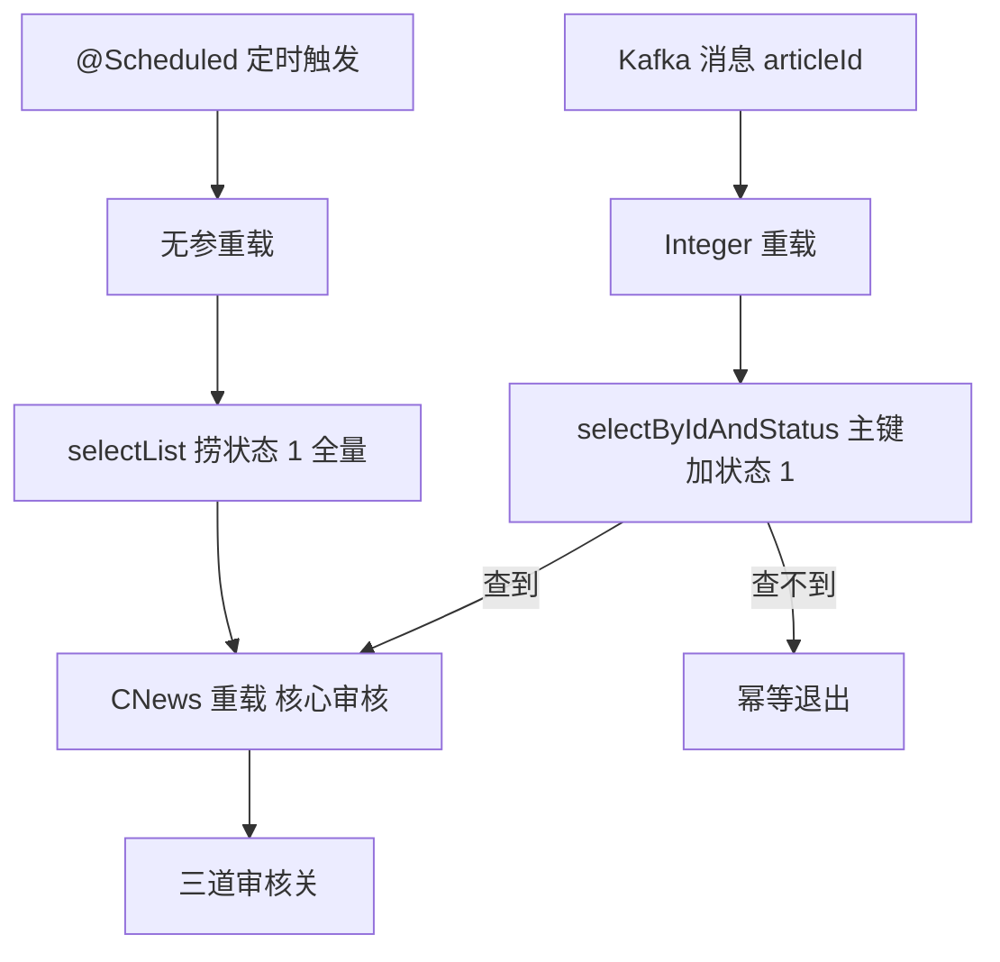

# 定时兜底与消息主路：三个重载的分工与批量重入

> 🔒 安全提示：文中示例的口令/密钥均为课程教学环境演示口径，生产环境的安全要求见《安全与合规须知》。

接口骨架立好了，这一讲把前两个重载填上。消息入口是主路，但异步链路永远要回答一个问题：消息没送到怎么办？台账对账补发的思路在保存收尾那一讲说过，这里是它的兑现：无参方法扫出状态 1 的全量台账逐篇重审，丢过的消息由数据库里的状态兜住。填完之后顺手把定时调度挂上，再看两个入口同时开动时怎么防重复审核。

## 先给结论

- Integer 重载是消息入口：主键加状态 1 双条件查单行，查不到直接返回，准入判断下推到 SQL，天然幂等。
- 无参重载是定时兜底入口：new 一个只带状态 1 的条件实体调 `selectList` 捞全量，逐篇调核心重载。
- 核心重载收 `CNews` 实体，三个方法形成「入口适配、单篇精审」的漏斗，准入语义只写一遍。
- 定时调度用 @Scheduled 挂 cron，示例按本课写法补全；课程实现全量捞取，抓取放量后演进为限量分批。
- 并发重复审核的两道防线：状态机准入是课程实现，按文章 id 的分布式锁是增强项，课程代码未做。

## 三个重载的分工

实现类先把台账的读写门面注进去，然后按「定时、消息、核心」的顺序填肉：

```java
@Service
@Log4j2
public class ReviewCrawlerArticleServiceImpl implements ReviewCrawlerArticleService {

    @Autowired
    private CNewsMapper cNewsMapper;

    /** 定时兜底入口：扫状态 1 的全量台账，逐篇审核 */
    @Override
    public void autoReviewArticleByCrawler() throws Exception {
        // 条件实体只带状态，捞出来的全是待审行
        CNews cNews = new CNews();
        cNews.setStatus((byte) 1);
        List<CNews> cNewsList = cNewsMapper.selectList(cNews);
        if (null != cNewsList && !cNewsList.isEmpty()) {
            log.info("定时任务自动审核剩余未审核数量：{}", cNewsList.size());
            for (CNews news : cNewsList) {
                autoReviewArticleByCrawler(news);
            }
        } else {
            log.info("定时任务自动审核未检索出数据");
        }
    }

    /** 消息单篇入口：主键加状态双条件查单行，查到才审 */
    @Override
    public void autoReviewArticleByCrawler(Integer clNewsId) throws Exception {
        CNews cNews = new CNews();
        cNews.setId(clNewsId);
        // 状态 1 是准入条件，下推到 SQL
        cNews.setStatus((byte) 1);
        CNews cNews1 = cNewsMapper.selectByIdAndStatus(cNews);
        if (null != cNews1) {
            autoReviewArticleByCrawler(cNews1);
        }
    }

    @Override
    public void autoReviewArticleByCrawler(CNews cNews) throws Exception {
        // 核心实现：三道审核关，下一讲展开
    }
}
```

状态字段的类型是 byte，条件实体里 `(byte) 1` 的强转不能省。两个入口共用一个核心方法，漏斗结构在代码里看得清清楚楚。

**消息入口的精髓在双条件查询。** 只传 id 查回来的是台账行，审核前还得再判一次状态；把状态 1 一起塞进条件对象，SQL 层就完成了准入判断。查不到行意味着文章已经离开待审核态，审过了、失败了或被人处理过，方法直接返回，什么都不做。这个写法把幂等做进了数据访问层：消息重投一次，第二次查询拿到 null，静默退出。

**定时入口的精髓在条件实体。** `new CNews()` 只设 status 一个字段，`selectList` 按非空字段拼 where 条件，捞回来的就是全量待审。数量日志是运维的眼睛：积压多少、这轮清了多少，两个数字一对比就知道主路消息的健康度。循环体里直接调核心重载，一篇审完状态就离开 1；即便循环中途抛异常，已审完的成果不回退，下一轮定时任务从剩余的待审行继续，天然断点续跑。

两个入口与核心方法的汇流关系画出来是这样：



关键路径在两个入口的查询动作上：消息入口查单行、定时入口捞列表，汇流之后走的是同一个核心重载，审核口径不分叉。

## 挂上定时调度

无参方法就是调度器要调的活，配上注解定时器就转起来。调度配置按本课写法补全：

```java
@Component
public class CrawlerArticleReviewTask {

    @Autowired
    private ReviewCrawlerArticleService reviewCrawlerArticleService;

    /** 兜底扫描待审核爬虫文章，示例按本课写法补全 */
    @Scheduled(cron = "0 0/30 * * * ?")
    public void reviewPendingNews() throws Exception {
        reviewCrawlerArticleService.autoReviewArticleByCrawler();
    }
}
```

启动类加 `@EnableScheduling` 开启调度。cron 定成半小时一轮是权衡的结果：主路是消息，正常情况下待审行进库几秒内就被消费掉，定时任务只做扫尾；轮次太密会与消息主路抢活，太疏则消息丢失场景下的补审延迟拉长。定 cron 的依据是「消息丢失的容忍时长」，不是处理能力。

**批次大小是这段代码最值得改进的地方。** 课程实现一次捞全量，课程的文章量级下没有问题；抓取放量后，一次积压几万篇时全量捞取会把云审核的调用洪峰一次打出去，配额与费用都吃不消。演进方向是限量分批：mapper 加带 limit 的查询方法，service 层循环分批拉取，单轮数量与间隔做成配置项。条件实体与 `selectList` 的调用形态不动，改的全在 mapper 层，这也是入口适配、核心收敛结构的好处。

## 重复审核的防护

两个入口同时开动，同一篇文章被两边同时捞到的场景真实存在：消息刚投递，定时任务恰好在扫全量，两边都查到状态 1 的行，各自走一遍三道关。后果分层看。

**结果层面无脏数据。** 审核是纯状态迁移，同一篇文章审两遍与一遍的结论一致，云审核结论不变、落库决策不变，后写覆盖先写也是同一个值。数据不会坏。

**成本层面白花一次调用。** 云审核按次计费，重复审核就是重复花钱，量大了这笔浪费不可忽略。

课程实现的两道防线：双条件查询挡住「已离开状态 1」的重复，单线程循环挡住批内重复（同一轮 for 循环里一篇文章只出现一次）。跨线程的并发窗口，两个入口在同一时刻都查到同一行，课程代码没有防护。增强方案有两个：一是 Redis 分布式锁，按文章 id 抢 `setnx review:cnews:{id}`、带过期时间、审完释放，抢不到直接跳过；二是数据库抢占，审核前把状态从 1 原子更新成一个「审核中」的中间态，更新行数为零即放弃，代价是状态字典要扩一个值。爬虫字典刻意收窄到三个值，引入中间态与收窄的初衷相悖，工程上更倾向锁方案，外加的、有过期时间的、不进状态机的东西，出了边界自动失效。这两段属于按主流写法的增强建议，课程代码里没有。

## 常见误区

- **消息入口只按 id 查。** 错例是 `selectByPrimaryKey` 查回实体直接审，已经置 9 的文章还会再走一遍三道关。正解是主键加状态 1 双条件，准入判断下推到 SQL。
- **定时任务全量捞取不设上限。** 错例是积压几万篇时一轮全打出去，云审核配额被打爆、费用飙升。正解是限量分批，单轮数量做成配置。
- **循环里一篇失败整轮终止。** 错例是解析异常直接往上抛，本轮剩余的待审行全部滞留。正解是单篇异常单独捕获记日志继续下一篇，或者依赖状态断点等下一轮续跑。
- **防重复只靠锁。** 错例是加了分布式锁就高枕无忧，锁过期后的边界窗口没有状态准入兜底。正解是状态机准入做底、锁做增强，两层各管一段。

## 面试可能被问到的问题

1. 面试官追问：「消息入口和定时入口并存，怎么保证一篇只审一遍？」
   答：分层防护。数据层的状态准入（主键加状态 1 双条件）挡住已完成的重复，定时任务单线程循环挡住批内重复，跨线程并发窗口用按文章 id 的分布式锁串行化。审核本身是纯状态迁移，重复执行结果一致，防护的重点是省掉重复的云审核调用费，而不是怕数据写坏。
2. 面试官追问：「兜底任务为什么扫状态 1，不扫某个时间戳？」
   答：状态 1 就是「还没处理完」的全部含义，扫它等于扫所有未决事实。时间戳方案（按提交时间超过 N 分钟）还要处理「审到一半」的语义，复杂且容易漏。状态列是台账自己维护的事实标记，围绕它建兜底查询是最短路径。
3. 面试官追问：「定时任务的 cron 怎么定？」
   答：按消息丢失的容忍时长定，不按处理能力定。主路是消息，正常流量下待审行秒级被消费掉，定时任务只处理丢失与异常的尾巴，半小时到一小时一轮足够。轮次过密与主路抢活，过疏则补审延迟拉长，两头都是权衡。
4. 面试官追问：「全量捞取改分批，改动落在哪里？」
   答：mapper 层。条件实体与 selectList 的调用形态不动，给 mapper 加带 limit 的查询方法，service 层循环分批拉取，单轮数量与间隔做成配置项。入口与核心方法完全不用动，入口适配、核心收敛的结构把改动圈在了数据访问层。
5. 面试官追问：「为什么倾向分布式锁而不是加一个审核中状态？」
   答：爬虫状态字典刻意收窄到三个值，每多一个值就多一类边界分支；审核中状态会带来「卡在中间态怎么处理」的新问题，兜底扫描还得识别它。锁是外加的、带过期时间的、不进状态机的，出了边界自动失效，对既有状态机零侵入。

## 配套资料

- 代码：`materials/code/05/头条day11/`。该日资料包目前为空，三个重载的实现按画面线抄录整理（录屏画面中方法名出现过 Reivew 与 Review 两种拼法，正文按工程统一拼法写作 `autoReviewArticleByCrawler`；@Scheduled 调度、限量分批与分布式锁为按主流写法补全的示例，文中已注明），包名统一为 `com.study.headline`；引用路径截至 `头条dayNN/` 层级，内层目录名含项目原名，不进入正文。
- 参照：`materials/code/05/头条day07/`，kafka 封装的工具类目录，消息监听入口与 `KafkaListener` 封装接口的形态出自它。
- 参照：`materials/code/05/头条day01/`，数据库规范设计说明书，`cl_news` 状态列与 reason 列的口径出自它。
- 环境：课程集群 node01~node03，MySQL root/123456。
