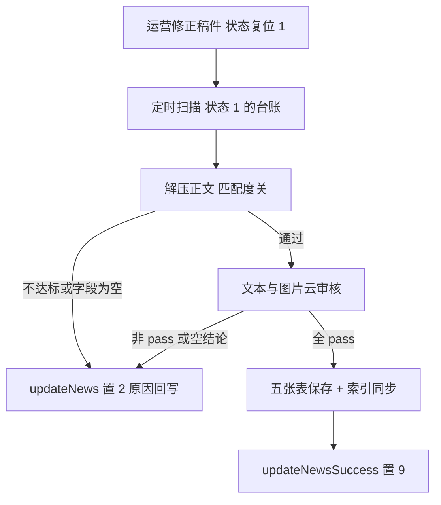

# 审核成功的状态收尾：台账置 9 与爬虫审核链路的收官

> 🔒 安全提示：文中示例的口令/密钥均为课程教学环境演示口径，生产环境的安全要求见《安全与合规须知》。

保存链与索引同步都跑完，爬虫文章在 App 端已经可见、可搜，最后一步是给爬虫台账 `cl_news` 一个交代：状态推进到 9，审核流程宣告结束。这个收官方法只有三行代码，但它是整条状态机的最后一个节点，前面所有分支的终态都要与它对齐；状态机为什么只有三档、失败与成功两个出口怎么分工、端到端怎么对账，都值得在这一步说清楚。

## 先给结论

- 收官方法 `updateNewsSuccess` 三行完成：状态置 9、按主键更新台账、返回前打一行耗时日志，计时起点在审核入口进链的那一刻。
- 爬虫链路的状态机只有三档：1 待审核进链、2 审核失败出链、9 审核成功出链，没有待人工复审与待发布两个中间态，每条路都有明确终态。
- 两个回写方法各管一个出口：失败走 `updateNews`（状态 2 加原因），成功走 `updateStatus`（只推进状态），成功不需要原因，失败必须留原因。
- 状态回写放在保存与索引之后：App 端数据先落稳，台账再宣告成功，顺序反了会出现「台账已发布、App 端查无此文」的倒挂。
- 端到端验证靠逐表对账：App 端主表与内容表、台账状态、检索索引逐一核对，链路走通的标准是对账一致而不是控制台没报错。

## 收官方法：三行代码与一行日志

计时在审核入口就开始了：方法进来先取当前时间戳，日志打出「开始自动审核流程」，所有分支的耗时都从这一刻算起。走完匹配度、文本、图片三道关，跑完五张表的保存与索引同步，最后抵达收官方法：

```java
/** 审核成功：台账状态推进为 9，审核流程结束 */
private void updateNewsSuccess(ClNews clNews) {
    clNews.setStatus((byte) 9);
    clNewsMapper.updateStatus(clNews);
    // 耗时从入口进链那一刻算起，覆盖全部审核与落库动作
    log.info("审核流程结束，耗时：{} ms",
            System.currentTimeMillis() - currentTimeMillis);
}
```

对应 mapper 只推进状态一列，与失败回写的按需更新各管各的：

```xml
<update id="updateStatus">
    update cl_news
    set status = #{status}
    where id = #{id}
</update>
```

成功分支不写原因列，不是遗漏而是语义：`message` 是失败原因的容器，成功状态下它没有内容可装，强行塞一句「审核成功」反而让按原因统计的查询多一层过滤。状态与原因各自有明确的职责边界，回写方法就分成了两个，谁也不替谁办事。

耗时日志看着不起眼，实际是链路健康度的第一手观测点。云审核两次远程调用占了耗时大头，落库与索引是毫秒级动作；日常盯住这条日志的分布，云接口变慢、连接池紧张这些退化会先在耗时上现形，比等报错早得多。

## 状态机收官：三档字典与出口矩阵

爬虫链路的状态字典在流程分析阶段就定过：1 待审核、2 审核失败、9 审核成功。自媒体文章那条链路里的待人工复审（review 结论转人工）、待发布（发布时间未到先挂起）两个中间态，在爬虫链路里都被裁掉了。裁掉的依据是场景：爬虫文章无人值守，review 的结论没有人来复审，发布时间在源站已经发生，两个中间态只会让数据永久滞留。三档状态对应一张干净的出口矩阵：

| 入口状态 | 分支走向 | 终态 |
|---|---|---|
| 1 待审核 | 内容或标题为空 | 2 审核失败，原因回写 |
| 1 待审核 | 匹配度不达标 | 2 审核失败，原因回写 |
| 1 待审核 | 文本或图片非 pass（含空结论） | 2 审核失败，原因回写 |
| 1 待审核 | 三道关全过，保存与索引完成 | 9 审核成功 |
| 非 1 | 不进链，直接返回 | 原状态不变 |

云审核的三态 suggestion 在这里收敛成两态处理：`pass` 放行，`review` 与 `block` 一样判失败回写原因。机器拿不准的结论没有人工接手，宁可误杀走修正复位重审的回流，也不让存疑内容上线，这与爬虫场景「无人值守、批量吞吐」的特性是自洽的。整条状态机画出来是这样：



关键路径在两个出口：失败出口统一走 `updateNews`，成功出口统一走 `updateNewsSuccess`，全部终态都有明确状态值，没有一条路是「走完了但什么都没改」。运营修正复位把失败出口重新接回入口，闭环不留死数据。

## 成功回写的位置与台账的挂接

状态回写放在保存与索引之后，顺序有讲究。台账的 9 是对外的宣告：管理端看到 9 就认为文章已发布，运营会按已发布口径去 App 端核对内容。如果状态先推进、保存后执行，保存一失败就是「台账已发布、App 端查无此文」的倒挂，排查时两头都指向对方。让 App 端数据先落稳、索引先同步，最后才置 9，宣告与事实永远同向。

与自媒体链路相比，爬虫台账少了一个动作：自媒体稿件审核通过后会回填 App 端文章主键，让稿件与发布结果精确挂接；爬虫台账的课程实现只推进状态，文章的对应关系靠来源地址与标题即可反查。要精确映射也不难，台账加一列文章主键、在收官方法里顺手回填即可，属于可选增强；核心是状态推进必须落在保存与索引之后，这个顺序两条链路完全一致。

## 端到端对账：逐表核对才叫走通

代码写完不等于链路能用，整体测试把全链路真跑一遍，每一站查库对账。App 端主表按标题与作者筛出新行，频道、布局、发布时间各就各位：

```sql
-- App 端主表：爬虫文章落库核对
select id, title, channel_id, channel_name, author_name,
       publish_time, images
from ap_article
where author_name = '示例源站作者' and created_time >= curdate();

-- 内容表：一行压缩正文，length 明显小于明文体积
select article_id, length(content)
from ap_article_content
where article_id = 6112;

-- 台账：状态推进到 9
select id, status, message from cl_news where id = 35181;
```

三组结果各自落位，主表有行、内容有压缩正文、台账状态是 9，落库侧才算对上。检索侧在 Kibana 里补一枪：

```json
GET app_info_article/_search
{
  "query": { "match": { "title": "示例标题" } }
}
```

搜得到刚发布的标题，说明索引同步健康。对账过程中有一个坑被当场抓出来：内容表落的是明文而不是压缩文，读侧解压必然出错，对照自媒体链路补上压缩后重跑通过对。测试用的台账记录每轮跑前复位状态，用例之间互不残留，这是链路测试的基本功。

跑通这一条主干，爬虫文章审核的 day11 就收官了：从源站抓取入库，到定时扫描送审，到三道关判定，到五张表落库、索引同步、状态收官，一条完整的内容供应链在两条审核链路上都立了起来。爬虫链路比自媒体链路状态少、环节简，但骨架同构，掌握了自媒体那条链路的人，读这条链路只需要盯差异。

## 常见误区

- **状态先置 9 再做保存。** 错例是收官动作提到保存链之前，保存一失败台账却已是已发布，事实与宣告倒挂。正解是 App 端数据与索引先落稳，状态回写放最后一跳。
- **成功也回写原因。** 错例是两个分支共用同一个回写方法，成功时塞一句「审核成功」进原因列，按原因统计失败的查询被污染。正解是成功与失败分成两个方法，各有各的更新列。
- **耗时日志随手丢。** 错例是只在报错时打日志，正常链路没有任何观测点，云接口退化无从察觉。正解是入口计时、收官打耗时，分布异常时按段补日志定位。
- **对账只看控制台。** 错例是测试跑完没报错就算通过，压缩漏了、状态没推这类问题全被漏掉。正解是逐表对账加检索核对，用数据终态证明链路正确。

## 面试可能被问到的问题

1. 面试官追问：「爬虫文章审核的状态机为什么只有三个状态？」
   答：状态是为场景服务的。爬虫文章无人值守，人工复审队列没有消费者，review 中间态只会积压；源站发布时间已经发生，待发布态也没有存在意义。三档状态保证每条数据都有终态出口，误杀的稿件靠修正复位重审回流，状态机简单且无死锁。
2. 面试官追问：「云审核返回 review 你们直接判失败，会不会误杀率太高？」
   答：会有误杀，这是无人值守场景下的主动取舍。判失败把存疑内容挡在门外，原因回写让运营能按图索骥，修正复位后可重审，误杀代价可控；反过来放行存疑内容，风险内容上线的代价由全体读者承担。两害相权，风险侧从严。
3. 面试官追问：「状态回写放在落库之后，那状态回写本身失败怎么办？」
   答：文章已发布、台账还停在待审核，属于可自愈的中间态。台账侧的定时扫描按状态 1 取数会重新送审，重入的保存链按映射判重跳过落库，直接补齐索引与状态收尾；工程化落地时给台账加文章主键回填列，重入路径的幂等性更有保障。
4. 面试官追问：「两条审核链路的回写为什么不共用一个状态字段口径？」
   答：两条链路的数据主体不同，自媒体稿件挂在自媒体用户体系下，有转人工与定时发布的中间态；爬虫台账只有机器终态。字段同名但字典不同是业务事实，强行统一字典会让两边的分支逻辑互相牵制。共用的是回写骨架与设计纪律（状态与原因分工、宣告后置、逐表对账），字典各自维护。
5. 面试官追问：「整条审核链路怎么验证它是通的？」
   答：主干用例加出口矩阵，每条终态至少踩一遍；每轮跑前复位测试数据；验证靠逐表对账而不是控制台无报错，App 端主表、内容表、台账状态、检索索引逐一核对，内容表的压缩长度也是核对项。链路里任何一步的契约（压缩、回填、刷新）只有终态能证明。

## 配套资料

- 代码：`materials/code/05/头条day11/`。该日资料包目前为空（仅含解压元信息文件），收官方法与对账 SQL 未随包提供，文中代码按画面线抄录整理并按本课写法补全为可编译示例，包名统一改写为 `com.study.headline`；成功状态值 9 与失败状态值 2 按口播与整体测试口径整理，出口矩阵按流程分析课的字典与分支整理，台账挂接文章主键的增强方案为按工程口径补全的讨论并已注明；引用路径截至 `头条dayNN/` 层级，内层目录冠以项目原名，正文统一以「头条类资讯项目」指代。
- 代码：`materials/code/05/头条day07/`，Kafka 封装工具类（KafkaSender、KafkaConsumerConfig 等），爬虫端发送审核消息与 admin 端监听的共用封装。
- 代码：`materials/code/05/头条day01/`，内层资料目录含数据库规范设计说明书与项目原型，`cl_news` 台账状态字典可对照核对。
- 环境：课程集群 node01~node03，MySQL root/123456；Elasticsearch 与 Kibana 装在本机开发环境（`localhost:9200`），用于索引核对。
