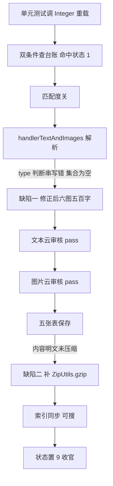

# 爬虫文章审核的整体测试：一次全链路走查与两个当场现形的缺陷

> 🔒 安全提示：文中示例的口令/密钥均为课程教学环境演示口径，生产环境的安全要求见《安全与合规须知》。

三道审核关、五张表落库、索引同步、状态收官，代码逐段写完之后每一段单看都成立。但审核链是十几个方法串成的一条流水线，方法与方法之间压着不少「两边都守约才成立」的契约：落库要压缩、读侧才解压，索引要喂明文、分词器才认账。这类跨方法的约定，任何一种单方法测试都照不到，只有把整条链真跑一遍才现形。这一讲把爬虫审核从环境准备到逐表对账完整走一遍，走查过程里确实揪出了两个藏着的问题。

## 先给结论

- 测试前环境两项必须先起：mycat（App 端文章库的分片入口）与 Elasticsearch（索引同步的落点），缺一个链路就在半路断掉。
- 测试入口选 Integer 重载：与消息主路完全同形态，主键加状态双条件进链，走查覆盖的就是线上路径。
- debug 全程走查当场抓出两个缺陷：正文 JSON 解析的 type 判断串写错，图片与文本全解析成空；内容落库漏了压缩，读侧解压必然出错。
- 走通的标准是逐表对账：App 端主表有行、内容表是压缩正文、台账状态置 9、检索索引搜得到，控制台无报错不算数。
- 云审核的 review 存疑按失败处置，爬虫链没有待人工中间态，这是两态合并的既定口径；失败态用例要单独构造单独验。

## 测试前的环境清单

**第一项，mycat。** App 端文章表 `ap_article` 早已切到分片环境，写入要经过 mycat 的路由才落到正确的分片上。审核链的保存环节要插主表、配置表、内容表、标签关联表，mycat 不在线，保存一步直接报连接失败。

**第二项，Elasticsearch。** 审核通过后的索引同步要连本机的 `localhost:9200`，ES 不在线，创建索引的请求级异常当场抛出。这条链路做了降级设计：索引失败记日志不回滚落库，但验证阶段索引缺文档，检索对账就不完整，测试前必须把它起起来。云审核依赖的密钥与外网连通性也顺手确认一遍，三道关里两道要走云接口。

测试数据从台账里挑，状态 1、标题正文图片齐全的行最合适：

```sql
-- 挑测试数据：状态 1 且字段齐全的行，主键记下来
select id, title, status, length(content)
from cl_news
where status = 1
limit 10;
```

单元测试复用自媒体审核那次的测试类，往里加一个方法，直接调 Integer 重载：

```java
@Autowired
private ReviewCrawlerArticleService reviewCrawlerArticleService;

@Test
public void testReviewCrawler() throws Exception {
    // 主键按挑好的测试数据取，与消息主路同形态进链
    reviewCrawlerArticleService.autoReviewArticleByCrawler(35181);
}
```

断点打在核心重载 `autoReviewArticleByCrawler(CNews)` 的入口，单步往下跟。

## 走查路上的两个当场现形

**第一个缺陷卡在正文解析。** 匹配度一关顺利通过，进入文本与图片审核前要先从正文 JSON 里拆出图片列表与纯文本。断点展开一看，images 是空集合，拼文本的 StringBuilder 也是零长度，而台账的 content 里明明有货。排查到 `handlerTextAndImages`，for 循环里判断节点类型的字符串常量写错了，与正文 JSON 约定的 type 取值对不上，text 与 image 两个分支一个都没命中。把判断串改成与解析侧同一份取值，重跑断点，六张图片、五百多字的正文全部拆了出来：

```java
/** 从正文 JSON 数组里拆出图片与纯文本 */
private void handlerTextAndImages(List<String> images, StringBuilder sb,
                                  JSONArray jsonArray) {
    for (Object obj : jsonArray) {
        JSONObject jsonObject = (JSONObject) obj;
        String type = (String) jsonObject.get("type");
        // type 取值必须与正文 JSON 的约定严格一致
        if ("image".equals(type)) {
            images.add((String) jsonObject.get("value"));
        }
        if ("text".equals(type)) {
            sb.append((String) jsonObject.get("value"));
        }
    }
}
```

这类错误的隐蔽性在于编译器完全无感：字符串常量写错只是「永远匹配不上」，不报错不抛异常，链路照样往下走，只是带着空集合。文本审核拿空串去审、图片审核拿空列表去审，云接口还会正常返回 pass，最终文章照发，正文里却什么都看不到。字符串约定类的缺陷，只有真实数据走一遍才暴露。

**第二个缺陷卡在内容落库。** 三道关全过，保存序列走到内容表这一步出了问题，落进去的是明文 JSON 而不是压缩文。读侧详情接口的约定是先解压再返回，明文进了 `ap_article_content`，读出来必然乱码。修法有现成参照：自媒体审核链路同位置的方法早就做过压缩，对照着把 `ZipUtils.gzip` 补上：

```java
private void saveArticleContent(String content, ApArticle apArticle) {
    ApArticleContent apArticleContent = new ApArticleContent();
    apArticleContent.setArticleId(apArticle.getId());
    // 富文本先压缩再入库，与读侧解压约定成对
    apArticleContent.setContent(ZipUtils.gzip(content));
    apArticleContentMapper.insert(apArticleContent);
}
```

重跑前还有一步纪律动作：上一轮已经插进 App 端主表的残留行要删掉，课程实现没有做落库判重，直接重跑会多出一篇同标题文章。删掉残留、断点收窄到保存内容这一行再放行，内容表里落进的就是压缩正文，长度一查便知。

整条走查路径与两个缺陷的位置画出来是这样：



关键路径在 D 与 H 两处：解析缺陷挡在审核动作之前，压缩缺陷藏在保存链中间，两处都只有带真实数据的全链走查才能照到。

## 三态验证与两侧对账

爬虫链的状态机只有三个值，整体测试按出口矩阵逐态验。

**成功态是主干用例。** 走查放行后逐表核对，App 端主表按时间筛出新行，标题、频道、发布时间各就各位；内容表一行压缩正文；台账状态推进到 9：

```sql
-- App 端主表：新文章落库
select id, title, channel_name, author_name, publish_time
from ap_article
where created_time >= curdate();

-- 内容表：压缩正文，length 明显小于明文体积
select article_id, length(content)
from ap_article_content;

-- 台账：状态收官
select id, status from cl_news where id = 35181;
```

检索侧在 Kibana 里查一次，标题搜得出来，索引同步才算验完：

```json
GET app_info_article/_search
{
  "query": { "match": { "title": "公司公告" } }
}
```

**失败态要主动构造。** 把测试行的标题改成与正文毫无关系的一句，重跑一轮，匹配度关当场拦下，台账置 2，reason 列写上「文章和标题不匹配」。把云审核的密钥配置改错、或者正文塞一段注定命中风险的文本，文本关同样按失败处置置 2 写原因。失败原因逐条核对，这是排查与统计的唯一抓手。

**待人工这一态在爬虫链上不存在。** 云审核返回 review 存疑结论时，爬虫链按两态合并处理：非 pass 一律判失败。理由在流程分析与状态收官两讲都交代过，无人值守场景下存疑内容宁可误杀走复位重审，也不设一个没有消费者的中间态。测试里如果看到 review 结论把文章置 2，那不是缺陷，是既定口径。

每轮用例之间复位测试数据：台账状态拨回 1，App 端与索引的残留清干净，用例互不污染，这是链路测试的基本功。

## 常见报错的定位顺序

报错先看日志断在哪一段。**mycat 未启动**，报的是保存环节连接失败，App 端几张表一行都进不去，台账还停在 1，把 mycat 起起来重跑即可。**ES 未启动**，落库与状态都正常，日志里多一条创建索引失败的 error，检索对账缺文档，补建靠把状态复位重审一次或走索引重建。**云审核调用异常**，链路按失败处置置 2 写原因，reason 列是定位的第一现场。**数据残留**，表现是 App 端出现重复文章或者标签计数异常膨胀，每轮跑前复位一遍就能避免。

## 常见误区

- **控制台没报错就算通过。** 错例是测试放行完看一眼日志就收工，明文落库、状态没推、索引缺文档全被漏掉。正解是逐表对账加检索核对，用数据终态证明链路。
- **字符串约定类的错不当事。** 错例是觉得 type 判断串写错「反正会抛异常」，实际它不抛异常只静默失配，带着空集合走完全程。正解是解析结果当场断点验证数量，六张图、几百字对得上再往下走。
- **重跑不清理残留。** 错例是修完缺陷直接再跑一轮，App 端多出重复文章，标签关联的计数被反复加一。正解是每轮跑前清 App 端残留、复位台账状态。
- **把 review 存疑当缺陷报。** 错例是看到云审核 review 结论把文章置 2，以为是状态机写错。正解是两态合并是爬虫链的既定口径，存疑按失败处置走复位重审。

## 面试可能被问到的问题

1. 面试官追问：「审核链路的测试为什么强调逐表对账，单测覆盖不够吗？」
   答：单测的视野是单个方法，验证不了跨方法的契约。压缩与解压、明文与分词、状态与宣告，这些约定两边各写各的，任何一边失约都不会在单测里报错，只会在对端现形。链路测试用真实数据把整条流水线跑一遍，用每张表的终态证明契约成立，这是单测覆盖不了的。
2. 面试官追问：「你们测试时怎么构造审核失败的用例？」
   答：按出口矩阵逐关构造。匹配度关用标题与正文无关的行，文本关塞注定命中风险的文本或改错云审核密钥，图片关可以换成非法图片地址。每条失败路径验两件事：状态置 2，reason 写清是哪一关拦的。失败原因留痕是失败路径最重要的验收项。
3. 面试官追问：「整体测试发现过什么典型问题？」
   答：两类。一类是解析层的字符串约定错，type 判断串与正文 JSON 取值对不上，不报错但集合全空，靠断点看集合数量抓出来。一类是存储契约错，内容漏压缩直接落明文，写入不报错、读侧解压必乱，靠对照自媒体链路同位置代码补上。两类共同点都是编译器无感、单方法无感。
4. 面试官追问：「测试数据为什么要每轮复位？」
   答：审核链是状态迁移，跑一轮状态就离开待审核，不复位下一轮连链都进不去。App 端落库没有判重，残留不清会越跑越多。复位让每个用例从同一起点出发，结果可复现，排查缺陷时才不会把上一轮的残留当成这一轮的问题。
5. 面试官追问：「索引同步失败但落库成功，这种半成品怎么处理？」
   答：落库是权威，索引是可重建副本。单篇场景把台账状态复位重审一次，重入路径补齐索引；量级大了走索引重建脚本从库里重灌。降级设计的原则是远程副本的失败不回滚权威存储，但必须有对应的补建手段，缺文档的窗口期要能监控到。

## 配套资料

- 代码：`materials/code/05/头条day11/`。该日资料包目前为空（仅含解压元信息文件），测试用例、解析方法与修复代码未随包提供，文中代码按画面线抄录整理并按本课写法补全为可编译示例，包名统一改写为 `com.study.headline`；type 判断串的具体错值屏幕画面未能辨识，文中按缺陷形态描述并给出修正后代码；引用路径截至 `头条dayNN/` 层级，内层目录冠以项目原名，正文统一以「头条类资讯项目」指代。
- 代码：`materials/code/05/头条day02/`，mycat 配置四件套（schema.xml、rule.xml 等），`ap_article` 分片路由与环境启动口径出自它。
- 代码：`materials/code/05/头条day01/`，内层资料目录含数据库规范设计说明书与项目原型，`cl_news` 状态字典可对照核对。
- 环境：课程集群 node01~node03，MySQL root/123456；mycat 管理的分片库与 Elasticsearch、Kibana（`localhost:9200`）需在测试前启动。
