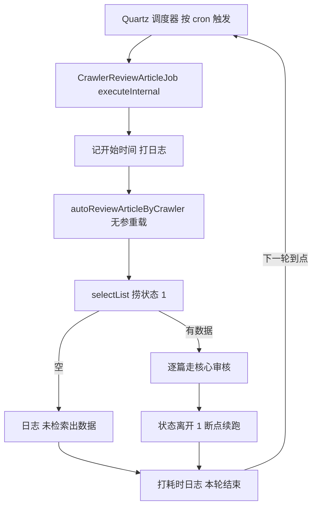

# 定时扫描未审核文章：Quartz 兜底任务从集成到跑批验证

> 🔒 安全提示：文中示例的口令/密钥均为课程教学环境演示口径，生产环境的安全要求见《安全与合规须知》。

消息主路验完，链路上还差最后一道保险。爬虫文章保存收尾会发审核消息，admin 端消费后置 9 或置 2，理论上每条台账都会离开状态 1。但消息会丢：发送侧网络抖动、消费侧重试超限、admin 宕机窗口里进来的行，都可能让台账长期停在待审核。对账的思路是把「该走没走」的行定期扫出来重审，这道兜底在 admin 端用 Quartz 挂载，是爬虫审核链的最后一个动作。

## 先给结论

- 兜底审核零新业务代码：复用无参重载 `autoReviewArticleByCrawler()`，扫描条件只有状态 1，扫到即审，审完状态离开 1，重复扫不会重复审。
- admin 端集成 Quartz：quartz 封装包挂进 InitConfig 的扫描清单，且必须排在 mysql 之后，Quartz 的 JDBC 存储依赖数据源，顺序错了启动就缺 bean。
- 任务类继承 AbstractJob：triggerCron 报节奏、getDescription 报描述、executeInternal 调兜底入口并计耗时，@DisallowConcurrentExecution 挡住同任务并发重入。
- cron 按兜底语义定：真实节奏是每晚 23:30 低谷期执行，演示期改成每分钟一轮方便观察，定轮次的依据是消息丢失的容忍时长。
- 跑批验证看三个点：调度触发日志、扫描命中数量、单轮耗时；第二轮空扫打出「未检索出数据」就是兜底收敛的样子。

## 扫描条件与漏扫、重复扫的边界

无参重载在定时任务那一讲已经填好，它就是兜底的全部业务逻辑，这里再对着边界看一遍：

```java
@Override
public void autoReviewArticleByCrawler() throws Exception {
    // 条件实体只带状态 1，捞出来的全是待审行
    CNews cNews = new CNews();
    cNews.setStatus((byte) 1);
    List<CNews> cNewsList = cNewsMapper.selectList(cNews);
    if (null != cNewsList && !cNewsList.isEmpty()) {
        log.info("定时任务自动审核剩余未审核数量：{}", cNewsList.size());
        for (CNews news : cNewsList) {
            autoReviewArticleByCrawler(news);
        }
    } else {
        log.info("定时任务自动审核未检索出数据");
    }
}
```

**扫描条件只有状态 1。** 状态 1 是「还没处理完」的全部含义，扫它等于扫所有未决事实；置 9 与置 2 的行都有终态，扫进来只会重复审核白花云接口的钱。漏扫与重复扫的边界因此很清晰：漏扫只可能发生在「扫描时刻还没进状态 1」的行上，下一轮自然会捞到，状态列就是断点续跑的标记；重复扫被状态准入挡住，核心重载进链前主键加状态 1 双条件查库，已离开待审核态的行在 SQL 层就被拒了。循环里单线程逐篇审，一篇审完状态立即离开 1，同一行不会在批内被处理两次。

**数量日志是兜底的健康指标。** 这一轮扫出多少、上一轮扫出多少，两个数字连起来看：正常情况趋近于零，突然放大说明消息主路出了问题，兜底量的走势反过来监控主路的健康度。

## admin 端集成 Quartz

无参入口在定时任务那一讲已经备好，当时用注解式调度做过示意；admin 端工程里真正的挂载方式是 Quartz，看中的是它的运行时管理能力：任务有 JDBC 存储、有触发记录、有并发禁令，这些都是兜底任务长期运行需要的东西。集成做两件事。

依赖上引入工程内部的 quartz 封装模块，封装里带着任务基类 AbstractJob 与注册配置 JobConfig，任务怎么注册进调度器、调度参数怎么注入，封装都已经收口。配置上把 quartz 包挂进 admin 端的初始化配置：

```java
@Configuration
// 扫描顺序有讲究：mysql 在前，quartz 在后
@ComponentScan({
        "com.study.headline.common.mysql.core",
        "com.study.headline.common.init",
        "com.study.headline.common.quartz"})
@MapperScan("com.study.headline.admin.dao")
@EnableScheduling
@Import(JobConfig.class)
public class InitConfig {
}
```

**顺序是硬约束。** Quartz 的 JDBC 存储要把调度记录落在 MySQL 的 qrtz_ 前缀表里，建表与读写都依赖 mysql 配置产出的数据源；扫描顺序一乱，调度器启动时拿不到数据源，bean 缺失直接报错。这也是 quartz 不单独写一份配置类、并进 InitConfig 的原因：单独的配置类无法保证加载次序，并进来之后顺序写在同一组注解里，一眼可查。`@EnableScheduling` 是给工程里注解式定时器留的开关，与 Quartz 各管各的机制。

Quartz 的运行时表在测试前清一遍旧记录，上一次运行的触发痕迹留着，会把这一轮的观察搅乱。

## 任务类：三个方法与一条禁令

```java
@Component
@DisallowConcurrentExecution
@Log4j2
public class CrawlerReviewArticleJob extends AbstractJob {

    @Autowired
    private ReviewCrawlerArticleService reviewCrawlerArticleService;

    @Override
    public String[] triggerCron() {
        // 演示期每分钟一轮；真实节奏是每晚 23:30：0 30 23 * * ?
        return new String[]{"0 0/1 * * * ?"};
    }

    @Override
    protected void executeInternal(JobExecutionContext jobExecutionContext)
            throws JobExecutionException {
        long currentTime = System.currentTimeMillis();
        log.info("开始定时任务执行");
        try {
            reviewCrawlerArticleService.autoReviewArticleByCrawler();
        } catch (Exception e) {
            log.error("定时扫描审核异常", e);
        }
        log.info("定时任务结束，耗时：{} ms", System.currentTimeMillis() - currentTime);
    }

    @Override
    public String getDescription() {
        return "定时任务：扫描爬虫未审核文章，每天晚上 23:30 执行";
    }
}
```

**@DisallowConcurrentExecution 挡的是同一任务的并发重入。** 单轮跑批耗时超过触发间隔时，下一轮到点不会另起线程并发跑，而是等这一轮结束后补触发。兜底任务的用意是扫尾而不是抢跑，并发重入除了让两轮扫描互相纠缠没有收益。这条禁令只约束同一个 JobDetail，不同任务之间互不影响。

**异常在任务内收口。** executeInternal 里 try-catch 兜住审核链抛上来的异常，记日志后正常返回。审核链声明了 throws Exception，单篇解析失败、云接口抖动都会往上抛；兜底任务的立场是扫尾，一篇失败不打断本轮，更不能把异常抛给调度器留下一条失败的执行记录，没审完的行下一轮自然会重扫到。

**cron 的真实节奏是每晚 23:30。** 夜里是抓取与消息流量的低谷，低谷期跑批对主路干扰最小；演示期改成每分钟一轮，为的是等几十秒就能看到调度触发。定轮次的依据始终是「消息丢失的容忍时长」：兜底补审的延迟上限就是一个轮次周期，这个周期定多长，取决于停在状态 1 的文章能容忍多久不上线。

整条调度链画出来是这样：



关键路径在 E 节点与右侧闭环：扫描条件单一、审完即离开条件集，循环天然收敛；调度器只负责到点叫人，业务节奏由状态列自己决定。

## 跑批验证与监控

验证按四步走。测试数据复位：台账里留一条状态 1 的行，其余终态行不动；Quartz 运行时表清旧记录。启动 admin 工程，调度器随容器起来，qrtz_ 前缀表里出现调度记录说明任务注册成功。等触发点到了，日志依次打出：开始定时任务执行、定时任务自动审核剩余未审核数量：1、审核流程结束、定时任务结束，耗时若干毫秒。第二轮触发再扫，台账里已经没有状态 1 的行，打出「未检索出数据」，空跑一轮几十毫秒，兜底到此收敛：

```sql
-- 验证台账收敛：终态行不再被扫描
select status, count(*) from cl_news group by status;
```

监控口径沿用两个日志点：数量日志反映积压存量，耗时日志反映单轮成本。积压量长期为零说明消息主路健康；积压量持续增长，问题不在兜底任务，去查消息链路；耗时突增多半是云接口变慢或积压量放大，两个数字对照着看，定位方向一目了然。

## 常见误区

- **扫描条件带错状态。** 错例是顺手把条件写成扫全表或扫 2，已发布的行被重新审核一遍，App 端多出重复文章。正解是条件只认状态 1，终态行永远不进扫描集。
- **漏掉 @DisallowConcurrentExecution。** 错例是单轮跑批超时后下一轮并发重入，两轮扫描交错，云审核调用翻倍。正解是禁令加上，宁可排队不可并发。
- **任务方法把异常抛给调度器。** 错例是 executeInternal 直接往上抛，单篇失败变成整轮失败记录，日志里只剩调度器的报错。正解是任务内 catch 收口记日志，依赖下一轮重扫补位。
- **cron 按处理能力定而不是按容忍时长定。** 错例是把轮次压到几分钟一次求安心，兜底与消息主路抢活，云审核费用白涨。正解是按「停在状态 1 的文章能容忍多久」定周期，放在低谷期执行。

## 面试可能被问到的问题

1. 面试官追问：「为什么用 Quartz 不用 Spring 的 @Scheduled？」
   答：@Scheduled 是进程内调度，任务状态在内存里，多实例部署时每个节点都会到点触发，还得自己加分布式锁去重；Quartz 的 JDBC 存储把调度记录落在库里，集群天然互斥，配 DisallowConcurrentExecution 防并发重入，misfire 策略、运行记录、监控都有现成口径。单机 demo 用 @Scheduled 足够，兜底任务要长期运行、要可观测，Quartz 更稳。
2. 面试官追问：「兜底任务和消息主路同时开，怎么保证一篇只审一遍？」
   答：状态准入是底线，核心重载进链前主键加状态 1 双条件查库，已离开待审核态的重复在 SQL 层直接挡掉；审核本身是纯状态迁移，重复执行结果一致。跨线程并发窗口按文章 id 加分布式锁增强。防护的重点是省掉重复的云审核调用费，数据层面不会写坏。
3. 面试官追问：「服务停了一天，期间的待审文章会漏吗？」
   答：不会。停机窗口里进库的行状态停在 1，恢复后第一轮扫描全部捞到，状态列就是断点续跑的标记。漏扫只可能出现在「把状态以外的条件当扫描依据」的设计里，比如按时间窗扫，窗外的行就永久漏掉。围绕状态列建兜底查询是最短路径。
4. 面试官追问：「单轮积压几万篇，这段代码要怎么演进？」
   答：限量分批。mapper 加带 limit 的查询方法，任务里循环分批拉取，单轮数量与批间隔做成配置项，避免把云审核调用洪峰一次打出去。无参入口的条件实体与调用形态不动，改动收敛在 mapper 与任务循环里，入口适配、核心收敛的结构把影响圈住。
5. 面试官追问：「为什么挑深夜 23:30 跑兜底？」
   答：低谷期跑批干扰最小：抓取与消息流量低，审核链抢资源少；云审核按次计费，批量跑在夜间也便于按日对账。更本质的依据是容忍时长：兜底补审的延迟上限就是一个轮次周期，把周期定在夜间，白天的积压靠消息主路秒级消化，夜里补一次尾巴，两头都划算。

## 配套资料

- 代码：`materials/code/05/头条day11/`。该日资料包目前为空（仅含解压元信息文件），Quartz 集成配置与任务类未随包提供，文中代码按画面线抄录整理并按本课写法补全为可编译示例，包名统一改写为 `com.study.headline`；AbstractJob 基类与 JobConfig 的注册细节画面未展开，按主流写法补全并已注明；引用路径截至 `头条dayNN/` 层级，内层目录冠以项目原名，正文统一以「头条类资讯项目」指代。
- 代码：`materials/code/05/头条day01/`，内层资料目录含数据库规范设计说明书与项目原型，`cl_news` 状态字典可对照核对。
- 参照：`materials/code/05/头条day07/`，kafka 封装的工具类目录，消息主路的收发封装出自它，定时兜底与消息主路互补成双入口。
- 环境：课程集群 node01~node03，MySQL root/123456；Quartz 的 JDBC 存储落在 admin 库，测试前清一遍 qrtz_ 前缀表的旧记录。
