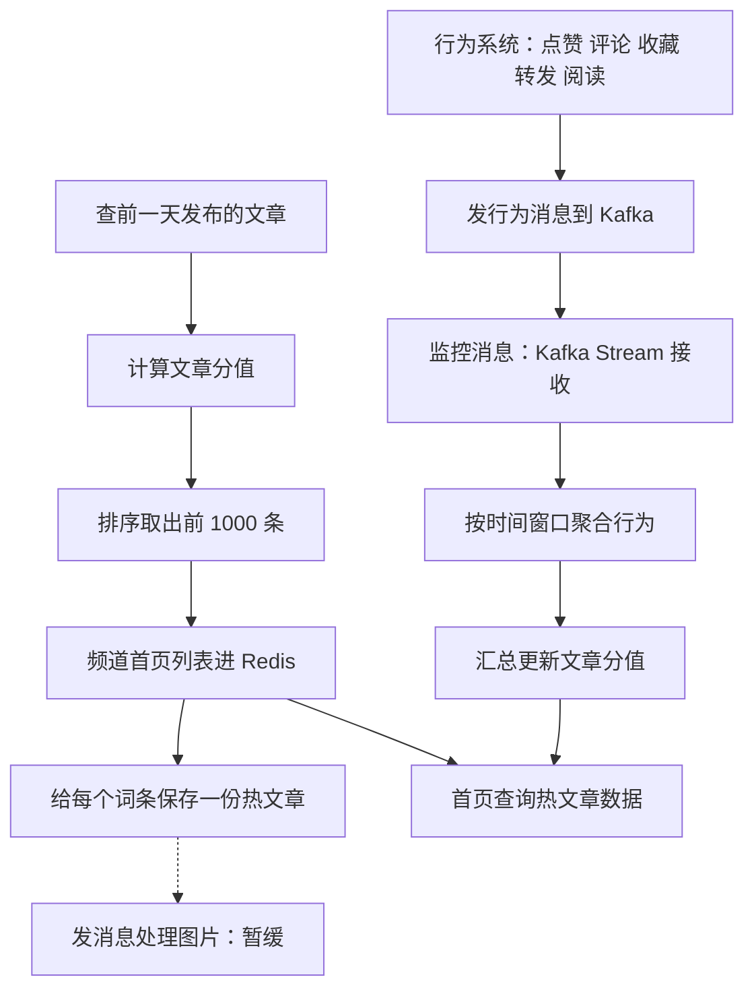

# 热文章怎么算：需求拆解与定时批算、实时流两条通道

> 🔒 安全提示：文中示例的口令/密钥均为课程教学环境演示口径，生产环境的安全要求见《安全与合规须知》。

功能清单上写着「热文章计算」五个字，真正动手时会发现它横跨了好几个已经学过的部件：定时任务、MyBatis、Redis、Kafka，还有 day09 埋下的 Kafka Stream。需求及思路分析这一课用一张流程图把两条计算通道讲清，5 分钟的课值得反复看图，因为后面几讲的每一行代码都能在图上找到位置。

## 先给结论

- 需求原文两个维度：从数据库直接查、直接算分值，是定时批算；从流实时接收、按时间窗口计算，是实时增量，结果都存起来供首页查询。
- 定时通道的节拍：每天凌晨 0 点 05 分执行，查询前一天发布的文章，按行为计数算分，排序取前 1000 条作为热点文章。
- 实时通道的数据源是行为系统：点赞、评论、收藏、转发、阅读等行为发成消息，Kafka Stream 监控消息并聚合，最终更新文章分值。
- 计算结果的去向：热文章数据存数据库，频道首页列表进 Redis；图片缓存先挂起，留到最后一天改造。
- 「给每个用户保存一份热文章」是暂时性设计：没有集成大数据与用户画像之前，所有用户看到的榜单一样。

## 需求原文拆成两句

课件上的一句话值得逐段拆开读：为了更好地把文章提供给用户，推出热文章计算功能，主要从两个维度计算热文章数据，第一是从数据库直接查询计算分值，第二是从流实时接收按照时间窗口计算，计算结果存储到数据库供首页查询。

前半句说的是批处理：数据已经在库里了，挑一个时间点批量算一遍。后半句说的是流处理：用户行为不断产生，随到随算。两种范式对应两种数据特征，静态的历史文章适合批算，持续产生的行为事件适合流算，需求本身就把技术选型指了出来。

把课件流程图按依赖关系重画一遍，两条通道与两个去向一目了然：



图的上面一横是定时通道，从左到右一次跑完；下面一条是实时通道，行为消息进来就流转一次。右侧的落点相同：首页查询读的都是算好的结果，查询侧永远不现场算分。

## 定时通道：从 0 点 05 分到前 1000 条

定时通道的第一问是查哪些文章。文章有两个来源，自媒体发布与爬虫抓取，两边的成文都落在 `ap_article`。课程把执行时间定在凌晨 0 点 05 分，查询条件取前一天发布的新文章，理由很朴素：凌晨流量低谷，批算不影响线上；只算前一天，单次数据量可控，分值也只反映近期内容。

第二问是分值怎么算。文章表上已有阅读、点赞、评论、收藏这些行为计数列，把一篇文章的这些计数汇总成一个 score，分值越高的文章排在最前面的几率越大，排最前面的就是热点文章。公式本身当天讲得很朴素，先跑通「计数变分值」的链路，权重与衰减属于后续可调的参数空间。

第三问是算出多少条。爬虫一天可能抓几万条，自媒体也可能高产，全部算热点没有意义，课程口径取分值最高的 1000 条。1000 这个数字就是热点榜单的容量上限，后面的缓存与逐词条落库都基于这 1000 条展开。

还有两个挂在链路上的动作。一是「给每个用户保存一份热文章」，课程明说这是暂时性的做法：当前没有集成大数据，也没有做用户画像，所有用户拿到的榜单内容相同，等后面接了大数据能力再按用户推荐不同的文章，这份按词条复制的数据正好是过渡期的落点。二是「发消息处理图片」，指文章图片走 Redis 缓存的改造，当天明确不做，留到最后一天统一处理，因为图片量大，直接回源效率不高。

## 实时通道：行为消息到分值增量

实时通道的源头是行为系统。用户对文章的点赞、评论、收藏、转发、阅读都发生在行为服务里，这些行为都指向某篇文章，文章被互动得越多，热度理应越高。思路是把行为发成消息，交给 Kafka Stream 监控与聚合，再把聚合结果汇总回文章分值。

课程点名了 Kafka Stream 的两个关键能力：可以分组，也可以按时间窗口汇总数据。行为消息不是一条一条孤立地算，而是切进时间窗里批量聚合，窗口内同一个文章的行为合并成一次增量更新，避免每来一条消息就打一次库。day09 的性能课已经把 Kafka 生产者与消费者封装进 common 工程了，当天资料包再补上 Kafka Stream 的封装，发送侧与接收侧都有现成件，业务代码只写处理逻辑。接收侧的扩展点是一个三方法的监听接口（真实随包文件，包名按工程口径改写）：

```java
/**
 * 流数据监听接口：实现类由工厂自动扫描并注册为流消费端
 * 泛型可以是 KStream 或 KTable
 */
public interface KafkaStreamListener<T> {

    String listenerTopic();   // 监听的 topic

    String sendTopic();       // 处理结果发送的 topic

    T getService(T stream);   // 流处理逻辑
}
```

业务侧当天只做一件事：实现这个接口，`getService` 里写窗口聚合逻辑，topic 名从封装的配置常量里取。注册过程由封装的工厂类在容器启动后自动完成，业务代码不碰 `StreamsBuilder` 的装配细节。

两条通道在「更新文章分值」上汇合：批算给的是初始分，流算给的是增量，分值变化后再按时间查询文章时，分值高的自然排前面，热点文章的榜单就动态起来了。

## 常见误区

- **把「每个用户一份」理解成个性化推荐已经实现。** 错例是以为不同用户的热点榜单已经不同。正解是当前没有用户画像与大数据推荐，逐词条保存是为后续推荐预留的数据结构，现阶段各词条内容相同。
- **认为热点计算要全量文章都算。** 错例是把几万条文章全部算分全部入库。正解是只算前一天发布的文章，再取前 1000 条，榜单是「近期内容的 Top 榜」，不是全站总榜。
- **把图片缓存当成当天任务。** 错例是在热文章链路里顺手做图片的 Redis 缓存。正解是课件明确该步暂缓，图片量大人多，单独留到最后一天做成图片服务，当天只留接口位置。
- **实时通道理解成一条行为更新一次分值。** 错例是收到一条点赞消息就立即改一次库。正解是 Kafka Stream 按时间窗口聚合后再更新，窗口合并了同文章的多条行为，写入次数大幅下降。

## 面试可能被问到的问题

1. 面试官追问：「热文章计算为什么选凌晨 0 点 05 分跑批？」
   答：凌晨是流量低谷，批算的库压力与 CPU 消耗对线上无感；0 点刚过查「前一天发布」的文章，自然日窗口完整，数据不会因为跨天截断。具体到分值计算与缓存刷新，一次跑完当天的基线榜单就固定下来，实时链路在其上做增量。
2. 面试官追问：「为什么只取前 1000 条热点文章？」
   答：热点是相对概念，榜单容量必须封顶才有意义；一天数万篇文章里真正有热度的是少数，取分值最高的 1000 条既满足首页与推荐的数据量需求，又把落库、缓存的写入量控制在可接受范围，容量参数后续可按业务调。
3. 面试官追问：「定时批算和实时流计算的数据一致性怎么保证？」
   答：两者写同一份分值账，批算每天重算基线可以纠正流算累计的误差，属于以天为周期的最终一致；流算的增量更新落在消息聚合之后，写入频次低，冲突概率小。真要严格一致就要上分布式锁或版本号，课程场景里按天纠偏已经够用。
4. 面试官追问：「行为消息为什么用 Kafka Stream 聚合而不是消费后直接累加？」
   答：直接累加是每条消息一次数据库更新，行为洪峰时库扛不住；Kafka Stream 在内存里按 key 与时间窗口先聚合，窗口关闭时一次写库，写入次数从消息量级降到文章量级，还天然获得了分组与窗口语义，这是选流处理而不是裸消费的核心原因。

## 配套资料

- 代码：`materials/code/05/头条day12/`，资料目录里的 Kafka Stream 封装（`KafkaStreamConfig` 配置、`KafkaStreamListener` 监听接口、注册工厂、流处理器、JSON 序列化器）为真实随包文件，实时通道的接收端直接复用它，包名按工程口径改写；定时通道的流程图与功能需求出自课件画面，对应 Service、Mapper 代码未随资料包提供，后续几讲示例为按画面线与课程写法补全（引用路径截至 `头条dayNN/` 层级，内层目录名含项目原名，不进入正文）。
- 环境：课程集群 node01~node03，MySQL root/123456，`ap_article` 行为计数列与 `ap_hot_articles` 表在导入脚本生成的库里查验。
