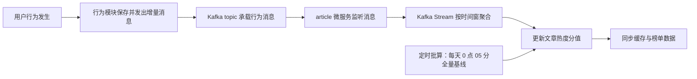
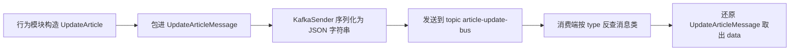
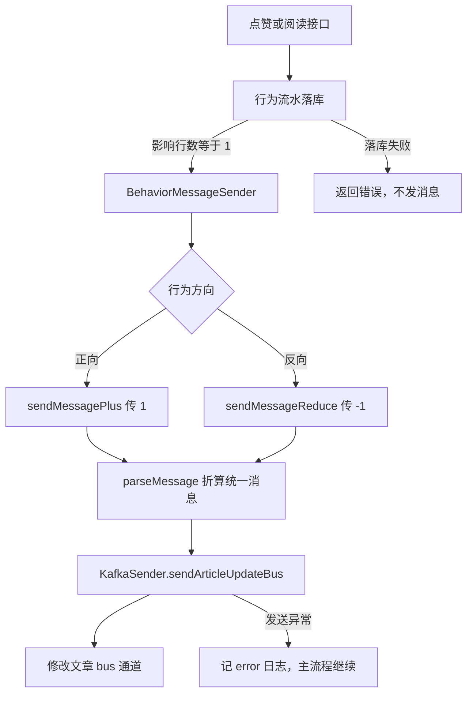
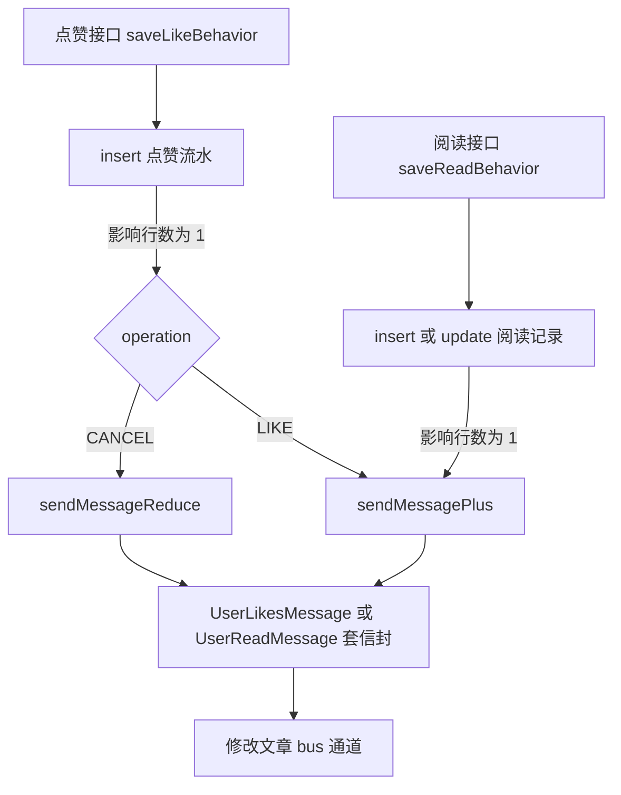
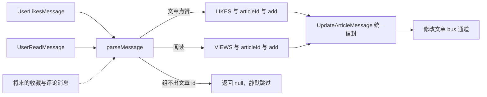
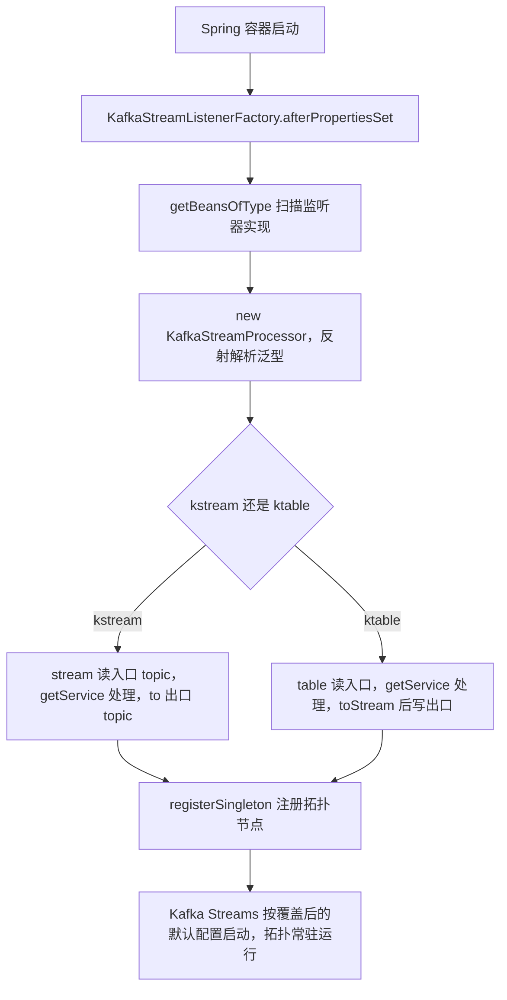
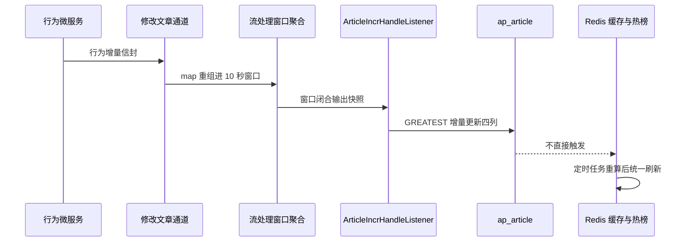
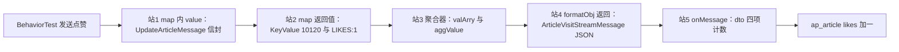

# 热文章计算实时计算全链路：行为消息发送、Kafka Stream 窗口聚合与增量落库

> 🔒 安全提示：文中示例的口令/密钥均为课程教学环境演示口径，生产环境的安全要求见《安全与合规须知》。

## 先给结论

- 系列定位：热文章计算此前只有定时批算一条腿，本系列补上实时计算这条腿，行为发生即入流，聚合后更新热度，与定时计算互为补充、更新同一份热度数据。
- 链路分四段：行为端变化即发消息进 Kafka，article 微服务监听消息，Kafka Stream 按时间窗聚合行为增量，聚合结果更新文章的四个行为计数。
- 发消息侧四讲：topic 走环境、common、配置类三层透传，UpdateArticle 五字段统一载荷，KafkaSender 扩通道、BehaviorMessageSender 收拢加一减一语义，点赞与阅读接口在落库成功之后埋点发送。
- 转换收口在发送端：parseMessage 把点赞、阅读等五花八门的行为消息折成一种修改文章消息，消费端只认一种信封，组不出文章 id 就静默跳过。
- 收消息侧先吃透随包提供的封装四件：配置覆盖、监听接口、流处理器与注册工厂，业务类实现接口即可上拓扑。
- 聚合主链六步：map 信封还原重组、groupByKey 分组、windowedBy 开十秒窗口、aggregate 按字符串协议累加、toStream 转流、formatObj 封装成消息发往输出 topic。
- 落库环节用 GREATEST 包 IFNULL 的增量 SQL：null 归零防加法污染，下限兜住不出负数，目标列是 ap_article 的四个行为计数，热文章表的分值留给下一轮批算吸收。
- 测试与容错是压舱石：一条点赞消息断点巡五站，库里 80 到 81 严格对账，信封解析失败、增量字段缺失、未知行为类型三条容错路径全部验证。
- 本系列跑通后，文章热度的新鲜度从天级压缩到秒级，而代码量极小：业务侧只有一个监听器加一个 Service 方法，重活全在封装与协议设计上。

## 第1部分：实时计算开篇：行为发生即入流，聚合后更新热度

天级批算收口之后，短板摆在明面上：一篇早上发布、中午爆掉的文章，最迟要等到第二天 0 点 05 分才进榜单，热点榜单要的新鲜度完全给不了。需求图的下半部分早有伏笔：收集用户行为发送消息，用 Kafka Stream 按时间段聚合，再更新分值。这一讲先把这条链路的思路完整摊开，后面几讲再逐段落地。

### 从需求图到链路图

思路上把「行为怎么来」和「分值怎么算」拆成两段。行为端复用之前做完的行为模块：保存收藏、点赞、阅读这些数据的地方，只要行为发生变化，就顺手往 MQ 发一条消息。文章微服务端监听消息，拿到行为增量后不做逐条落库，而是交给 Kafka Stream 按时间段聚合，窗口里攒齐一批再更新分值。整条链路画出来是这样：



左半边是事件流，行为发生的瞬间消息就上路了；右下角那条定时支路是新角色定位：批算不再独扛榜单，而是每天做一次全量纠偏，把实时链路积累的误差一次抹平。两条线在「更新文章热度分值」处汇合，这是理解整套设计的枢轴。

### 行为端：什么时机发消息

行为模块此前已经落地了阅读、点赞、收藏三类行为的保存，评论的行为采集没有做。发消息的时机就绑在行为保存之后：用户点赞了，点赞数变化，发一条增量消息；取消点赞，再发一条负增量。消息里带的是「这次行为变了多少」而不是「现在总数多少」，这个增量语义是后面窗口聚合能做加法的前提，具体的消息实体下一讲定义。

采集范围有一个容易想歪的点：**枚举是四个，当天能发的是三类。** 消息类型把收藏、评论、点赞、阅读全部预留进枚举，评论的位置先占住；行为端没有实现评论采集，不代表链路不支持，等行为功能补上评论，发消息的代码加一行就接入。设计时把类型定义全，实现按进度推进，这是枚举先行的好处。

### article 端：为什么用 Kafka Stream 聚合

有人会问：监听到消息直接 update 文章计数不行吗？高频行为场景下不行。点赞、阅读是高并发行为，一条消息一次 update，数据库写入压力线性上涨；两个请求并发读到同一个旧值再各自加一，还会互相覆盖丢更新。流式聚合把问题换了个解法：窗口内的增量先在流里攒着，窗口触发时算一次总和，一次落库。数据库的写入频率从「与行为同频」降到「与窗口同频」，并发覆盖也被聚合的合并语义化解。

课程为此准备了一套通用封装，随资料包真实提供。监听接口只约定三个方法：

```java
/**
 * 流数据的监听消费者实现的接口类，系统自动通过
 * KafkaStreamListenerFactory 扫描实现类并注册为流数据的消费端。
 * 泛型可以是 KStream 或 KTable。
 */
public interface KafkaStreamListener<T> {

    // 监听的类型
    String listenerTopic();

    // 处理结果发送的类
    String sendTopic();

    // 对象处理逻辑
    T getService(T stream);
}
```

业务方实现这个接口，声明从哪个 topic 读、处理完发到哪个 topic、中间怎么变换。注册工厂在容器启动后扫描全部实现类，按泛型是 KStream 还是 KTable 自动装配对应的流处理器，把 `stream(listenerTopic)` 到 `to(sendTopic)` 的管道搭好。配置类则负责流处理的底层参数：

```java
// 精简自资料包的 KafkaStreamConfig，保留关键项
@Bean(name = KafkaStreamsDefaultConfiguration.DEFAULT_STREAMS_CONFIG_BEAN_NAME)
public KafkaStreamsConfiguration defaultKafkaStreamsConfig() {
    Map<String, Object> props = new HashMap<>();
    props.put(StreamsConfig.BOOTSTRAP_SERVERS_CONFIG, this.getHosts());
    props.put(StreamsConfig.APPLICATION_ID_CONFIG, this.getGroup() + "_stream_aid");
    props.put(StreamsConfig.DEFAULT_KEY_SERDE_CLASS_CONFIG, Serdes.String().getClass());
    props.put(StreamsConfig.DEFAULT_VALUE_SERDE_CLASS_CONFIG, Serdes.String().getClass());
    props.put(ConsumerConfig.AUTO_OFFSET_RESET_CONFIG, "earliest");
    return new KafkaStreamsConfiguration(props);
}
```

应用 id 以消费组名加后缀拼出，键值默认都用 String 序列化，消息体走 JSON 字符串。业务方写的每个监听器最终长成同一个形状：进 topic、变换、出 topic，下几讲的聚合逻辑就填在 `getService` 的实现里。

### 消息主题规划

topic 的规划只有一个：app 产生的更新文章数据消息，配置键定为 `kafka.topic.article-update-bus`，取值形如 `headline.topic.app.article.update.bus`，环境后缀随 profile 切换。四类行为不拆四个 topic，理由有两层。**处理逻辑同构。** 四类行为的消息形状一样，聚合与更新的骨架相同，只是字段不同，一个 topic 加类型字段最省事。**分区保序。** 发送时以文章 id 做 key，同一篇文章的行为落在同一分区，Kafka 保证分区内有序，聚合窗口里对同一篇文章的增量就不会乱序。topic 数量收敛后，监听器、分区、运维监控都跟着收敛。

配置的读取路径与项目里其他 Kafka 配置一致：环境 properties 给真实取值，common 的 kafka.properties 用占位符透传，`KafkaTopicConfig` 加一个字段绑定进容器，三层各管一段，下一讲动手写。

### 与定时计算的互补关系

两条线各管一段，边界要刻在心里：

| 维度 | 定时批算 | 实时计算 |
|---|---|---|
| 触发方式 | Quartz 每天 0 点 05 分 | 行为发生即触发 |
| 数据形态 | 昨天全量文章的快照 | 行为增量流 |
| 更新粒度 | 整个榜单重算 | 单篇文章分值增量 |
| 职责 | 基线与兜底纠偏 | 新鲜度与热点响应 |

实时链路更新分值，批算全量重算，两者写同一份数据，冲突的答案靠时间维度化解：批算每天一次把窗口期内的累计误差抹平，实时增量在两次批算之间维持分钟级的新鲜度。这条互补关系也决定了实时侧的更新必须收敛、可累加，任何绝对值覆盖式的写法都会被批算之外的并发写坏账。

## 第2部分：行为增量消息的定义：topic 常量与消息实体设计

实时链路的思路定了：行为变化即发消息。发消息之前要把三样东西先钉死，消息发到哪（topic 名字）、消息长什么样（行为增量实体）、消息怎么打包（消息封套类）。这一讲不动任何业务逻辑，专做这三样定义，定义落定之后行为端才有东西可发，消费端才有据可收。

### topic 名字：三层配置各管一段

消息名在两处 properties 里先后登记。环境层给真实取值，maven-test.properties 里新增一行：

```properties
# app 产生的更新文章数据消息
kafka.topic.article-update-bus=headline.topic.app.article.update.bus.test
```

common 层的 kafka.properties 里用占位符透传，真实值由构建时选中的 profile 注入：

```properties
# app 产生的更新文章数据消息
kafka.topic.article-update-bus=${kafka.topic.article-update-bus}
```

代码层在 `KafkaTopicConfig` 里加一个字段，启动时绑定读取：

```java
@Data
@Configuration
@ConfigurationProperties(prefix = "kafka.topic")
@PropertySource("classpath:kafka.properties")
public class KafkaTopicConfig {
    private String submitArticleAuth;    // 文章提交审核
    private String articleAuditSuccess;  // 审核通过
    private String articleUpdateBus;     // 行为增量消息，本讲新增
}
```

绑定规则值得一提：前缀是 `kafka.topic`，配置键 `kafka.topic.article-update-bus` 通过松散绑定落到驼峰字段 `articleUpdateBus`，连字符转驼峰由 Spring Boot 自动完成，字段名与配置尾段对得上即可。三层各管一段的好处是换环境不动代码：test 与 prod 的取值差异留在 properties 里，代码里的引用永远是 `kafkaTopicConfig.getArticleUpdateBus()`。

### 消息实体 UpdateArticle：五个字段一个枚举

实体定义在 model 模块的消息包下，五份资料里这个类已随包给出（按画面线整理如下）：

```java
public class UpdateArticle implements Serializable {

    private static final long serialVersionUID = 392496820765182165L;

    // 修改文章的字段类型
    private UpdateArticleType type;
    // 文章 id
    private Integer articleId;
    // 修改数据的增量，可为正负：点赞加一，取消点赞减一
    private Integer add;
    // 行为发起者，对应词条 id
    private Integer applierId;
    // 行为记录 id
    private Integer behaviorId;

    public enum UpdateArticleType {
        COLLECTION, COMMENT, LIKES, VIEWS
    }
}
```

字段逐个说清楚。**type 是行为的类型。** 枚举四值：收藏、评论、点赞、阅读；评论行为采集虽然没实现，枚举位置先占住，消费端类型分发一次写全。**articleId 定位文章。** 聚合与更新都围绕它展开，发送时它还兼任消息的 key，保证同文章消息进同分区保序。**add 是增量，这是全类最关键的字段。** 点赞加一传 1，取消点赞减一传 -1，正负语义让窗口聚合只需要做加法；如果传的是行为总数，窗口里攒的数就没法直接相加，还得先算差值，语义立刻复杂化。**applierId 与 behaviorId 是行为溯源。** 前者是行为发起者的词条 id，后者是行为记录的 id，消费端做已读标记更新或幂等去重时都要靠它们回查行为明细。



这张图是消息的一生：业务对象在行为端构造，套上封套变成 KafkaMessage，序列化成字符串进 topic，消费端靠 type 字符串反查出对应的类再解开。设计消息格式时把这张图倒着走一遍，就能验证字段够不够用。

### 消息封套 UpdateArticleMessage

封套继承 common 里的 `KafkaMessage`，基类随资料包真实提供，长这样：

```java
public abstract class KafkaMessage<T> {
    @Getter int retry;                                // 尝试次数
    @Getter long time = System.currentTimeMillis();   // 生成时间
    String type;                                      // 消息类型
    @Setter @Getter T data;                           // 消息实体数据

    public KafkaMessage() {}
    public KafkaMessage(T data) { this.data = data; }

    public void addRetry() { this.retry++; }

    // 获取消息类型
    protected abstract String getType();
}
```

基类已经把信封该有的都备好了：重试计数、生成时间、类型字符串、泛型载荷。子类只需要声明载荷类型并回答「我是什么消息」：

```java
public class UpdateArticleMessage extends KafkaMessage<UpdateArticle> {

    public UpdateArticleMessage() {
    }

    public UpdateArticleMessage(UpdateArticle data) {
        super(data);
    }

    @Override
    protected String getType() {
        return "update-article";
    }
}
```

两个构造器加一个方法，缺一不可，原因藏在启动机制里。common 的 `MessagesRegister` 在容器启动后扫描全部 `KafkaMessage` 子类，用反射实例化一个临时对象读取 `getType()`，把类型字符串到类的映射注册成路由表：

```java
// 精简自 MessagesRegister：按消息类型建注册表
Set<Class<? extends KafkaMessage>> ms = reflections.getSubTypesOf(KafkaMessage.class);
// 反射实例化（缺省构造器或按第一个构造器补默认值），读取类型
String type = mess.getType();
messages.put(type, cla);
```

消费端收到 JSON 后，解析出 type 字符串，用 `findClassByType` 反查类，再反序列化成具体消息。所以 `getType()` 返回的字符串必须全局唯一且稳定，它就是消息世界的类名；无参构造器按惯例保留，反射实例化不必依赖构造器数组的顺序，少踩一坑。

### 序列化的四个注意

**第一，走 JSON 字符串而不是 Java 原生序列化。** common 的 `KafkaSender` 用 Jackson 的 `ObjectMapper` 把整个消息对象写成字符串，生产端的 `KafkaProducerConfig` 里键值序列化器都是 StringSerializer；字符串消息跨语言可读、排查时肉眼可见，体积换来了通用性，生产配置还开了 lz4 压缩对冲。

**第二，枚举按名字序列化。** `UpdateArticleType.COLLECTION` 落到 JSON 里就是字符串 `COLLECTION`，新增枚举值要两端同步；消费端遇到不认识的枚举名会抛异常，类型分发处要留兜底分支。

**第三，字段演进要兼容旧消息。** 消息一旦进了 Kafka 就有留存期，生产端加了新字段而消费端的类没跟上，Jackson 默认对未知字段抛异常，要么两端同步升级，要么给 ObjectMapper 配置忽略未知属性；实体上的 `serialVersionUID` 保证极端情况下的 Java 序列化兼容，声明了就别再改。

**第四，数值字段用有符号类型。** add 承载正负增量，`Integer` 天然支持负数；建模时顺手用了无符号心态（负值当异常丢弃），取消点赞、取消收藏这类回退行为就再也表达不出来。

## 第3部分：行为消息怎么发出去：KafkaSender 扩展修改文章通道与 BehaviorMessageSender 门面

热文章的实时通道要从行为系统取数：用户点了赞、读了文章，这些动作得变成消息流进 Kafka，后面的流计算才有原料。发送侧的公共件早就齐了，Kafka 封装一课的九个工具类把 topic、序列化、重试、失败回滚全管了起来，但它们离业务还差一层：`KafkaSender` 只认 topic、key、消息对象三个裸参数，至于点赞该走哪个 topic、消息体怎么组装、Kafka 挂了要不要拖累点赞接口，公共层一概不知。这一课把这一层补上，让行为接口面对的只是一个语义化的「发送加一消息」「发送减一消息」。

### 在公共件与业务之间再补一层

`KafkaSender.sendMesssage(topic, key, message)` 什么都能发，也就什么都不懂。业务调用点每次都要自己回答三个问题：topic 叫什么、key 给什么、消息装什么。行为场景的调用点不止一个，点赞、取消点赞、阅读都会发消息，这些答案如果不统一，散到各个 service 里迟早口径漂移。做法是在行为工程立一个专职发送器，把「发行为消息」的全部知识收进一个门面类。

位置有讲究：它不属于公共层，公共层不该知道行为的存在；也不属于某一个 service，点赞和阅读要用同一套口径。落在 behavior 工程自己的 kafka 包里，标 `@Component` 交给 Spring 管理：

```java
package com.study.headline.behavior.kafka;

import com.study.headline.common.kafka.KafkaMessage;
import com.study.headline.common.kafka.KafkaSender;
import org.springframework.beans.factory.annotation.Autowired;
import org.springframework.stereotype.Component;

@Component
public class BehaviorMessageSender {

    @Autowired
    private KafkaSender kafkaSender;

    /** 发送加一的消息：点赞、阅读等正向行为 */
    public void sendMessagePlus(KafkaMessage message, Long apUserId, boolean isSendToArticle) {
        UpdateArticleMessage temp = parseMessage(message, apUserId, 1);
        kafkaSender.sendArticleUpdateBus(temp);
    }

    /** 发送减一的消息：取消点赞等反向行为 */
    public void sendMessageReduce(KafkaMessage message, Long apUserId, boolean isSendToArticle) {
        UpdateArticleMessage temp = parseMessage(message, apUserId, -1);
        kafkaSender.sendArticleUpdateBus(temp);
    }
}
```

`parseMessage` 本课先占位，下一环节补实现；这里先把调用骨架立稳，两个方法的分工已经能读出来：加一与减一。`UpdateArticleMessage` 与修改文章通道的 topic 常量在消息名与实体定义的环节已经补进公共工程，直接拿来用。行为工程要编译过这行代码，pom 里得有 common 模块的依赖，没有就补上：

```xml
<dependency>
    <groupId>com.study</groupId>
    <artifactId>headline-common</artifactId>
    <version>1.0-SNAPSHOT</version>
</dependency>
```

### 修改文章通道：KafkaSender 的新出口

公共发送器这边只加一个薄方法。topic 不写字符串，从 `KafkaTopicConfig` 取；`KafkaSender` 在封装一课就注入了这个配置类，顺手就能用：

```java
/**
 * 发送修改文章请求消息
 * @param message
 */
public void sendArticleUpdateBus(KafkaMessage message) {
    this.sendMesssage(kafkaTopicConfig.getArticleUpdateBus(),
            UUID.randomUUID().toString(), message);
}
```

三个参数各有说法。topic 取自配置类，`kafka.topic` 前缀的宽松绑定把 properties 里的条目映射成字段，多环境切换时消息通道跟着环境走，代码里没有硬编码的份。key 用 UUID 随机串，值是「不指定业务键」的声明：热度增量到了消费端是按时间窗口聚合的，单条消息的先后顺序无关紧要，与其按文章 id 做 key 把同一文章的消息压进同一分区，不如用 UUID 把负载均匀打散到各个分区，吞吐优先。消息本体是 `KafkaMessage` 信封，`sendMesssage` 里统一用 ObjectMapper 序列化成 JSON，异常被 try-catch 吞掉记 error 日志，这条降级路径后面专门说。方法名里的 `sendMesssage` 三个 s 是资料原样拼写，沿用即可，别顺手改。

通道名以 bus 结尾也符合命名约束：single 结尾是单消息通道，bus 结尾是业务消息通道，修改文章消息属于后者，一条消息带动一次分值重算，是标准的业务广播。

### 加一与减一：把方向收进封装

为什么拆成两个方法，而不是让调用方传一个增减值？看两种写法的调用点就明白。传数字的写法是 `sender.send(msg, userId, 1)` 和 `sender.send(msg, userId, -1)`，1 和 -1 散落在业务代码里，读代码的人要停下来想这个数字是干嘛的；语义化的写法是 `sendMessagePlus` 与 `sendMessageReduce`，点赞接口里出现哪个方法名，分值方向一眼可读。正负号这类只有封装自己关心的细节，收进去，调用方永远面对业务语言。

参数三个，各有职责。`message` 是原始行为消息，点赞的、阅读的，内容各异，这正是需要 `parseMessage` 折算的原因：修改文章通道只认统一的信封格式，不认五花八门的行为载荷。`apUserId` 是行为发起人 id，热度计算要区分是登录用户的真实行为还是设备行为。`isSendToArticle` 是一个开关，含义是「这条行为要不要推给文章热度通道」，目前恒传 true，因为现阶段所有行为都指向文章热度；开关的价值在扩展时显现，将来出现不影响热度的行为类型，调用点改一个布尔值就行，封装内部不用动。

### 发送时机与失败降级

时机只有一句话：落库成功之后。行为流水表是账本，文章热度是账本派生出来的视图，账没记上就先广播，视图会领先于账本，之后没有任何机制能把这次虚增拉回来。所以发送动作排在 `insert` 影响行数等于 1 的分支里，落库失败直接返回错误，消息一个字都不发。顺序反过来（先发消息再落库）看似只差一瞬，故障场景下就是数据不一致。

降级靠公共层的既有设计。`sendMesssage` 内部 try-catch 全包，Kafka 不可用时发送静默失败，只落 error 日志，异常不会冒泡到行为接口。这笔账算下来是划算的：丢一条热度增量的后果，是文章的热度少加一分，而且定时通道的全量重算会把分值拉平；而把异常抛给前端，用户看到的是点赞转圈甚至报错，为了一个衍生视图伤害核心交互，方向就反了。实时增量在这套设计里是加速器，不是唯一真相源，真相永远在数据库的流水里。

整条链路画出来是这样：



图的关键路径是「落库成功才向右走」：落库失败的分叉直接终止，发送异常的分叉不影响主流程返回，两条边把时机与降级都圈在了正确的一侧。

## 第4部分：点赞与阅读的行为消息埋点：两个消息实体与落库后的发送时机

发送骨架立好之后还剩一个悬而未决的问题：谁在调用这些方法、传进去的消息长什么样。这一课给出答案：点赞接口与阅读接口在落库成功后埋下发送动作，点赞的载荷装进 `UserLikesMessage`，阅读的装进 `UserReadMessage`，两个消息类都套在公共信封里发往修改文章通道。收藏与转发暂未实现，通道先给这两类行为铺路，测试也顺带好测。

### 两个消息实体：信封按业务分家

有人会问：能不能只做一个通用行为消息，字段放一起？不行，原因在载荷的异构性上。点赞流水带 `operation` 方向位，阅读记录带阅读次数与时长，结构没有交集；而公共信封的机制是靠 `type` 字符串反查实体类完成反序列化的，一个通用类意味着接收端拿到的是一坨大量字段为 null 的对象，字段语义还要靠约定维系。按业务分家，每个消息类的泛型把载荷类型固定死，`data` 字段取出即是强类型实体：

```java
package com.study.headline.common.kafka.messages.behavior;

import com.study.headline.common.kafka.KafkaMessage;
import com.study.headline.model.behavior.pojos.ApLikesBehavior;

public class UserLikesMessage extends KafkaMessage<ApLikesBehavior> {

    public UserLikesMessage() {}

    public UserLikesMessage(ApLikesBehavior data) {
        super(data);
    }

    @Override
    public String getType() {
        return "user-likes";
    }
}
```

```java
public class UserReadMessage extends KafkaMessage<ApReadBehavior> {

    public UserReadMessage() {}

    public UserReadMessage(ApReadBehavior data) {
        super(data);
    }

    @Override
    public String getType() {
        return "user-read";
    }
}
```

类放在公共工程的消息包下的 behavior 子包里，与行为域一一对应。两个构造器各有用途：无参构造给反序列化用，接收端按 type 反查出类后先实例化再填字段；有参构造给发送方用，一行 `new UserLikesMessage(alb)` 把整条流水装进信封。`getType` 返回的字符串是消息类型标识，启动时由注册器扫描收进映射表，消费端凭它还原成 `ApLikesBehavior` 或 `ApReadBehavior`。

### 点赞接口埋点：operation 决定方向

点赞接口的骨架与落库在点赞接口开发那一课已经完成，本课只在其后追加发送段。完整的调用点长这样：

```java
//2. 组装点赞流水并保存（两道闸门与字段组装见点赞接口开发一课）
ApLikesBehavior alb = new ApLikesBehavior();
alb.setId(sequences.sequenceApLikesBehavior());
alb.setBehaviorEntryId(apBehaviorEntry.getId());
alb.setEntryId(dto.getEntryId());
alb.setType(dto.getType());
alb.setOperation(dto.getOperation());
alb.setCreatedTime(new Date());
alb.setBurst(BurstUtils.groupOne(alb.getId(), apBehaviorEntry.getId()));
int insert = apLikesBehaviorMapper.insert(alb);
if (insert == 1) {
    // 落库成功才发消息：点赞加一，取消点赞减一
    if (alb.getOperation() == ApLikesBehavior.Operation.LIKE.getCode()) {
        behaviorMessageSender.sendMessagePlus(new UserLikesMessage(alb), userId, true);
    } else if (alb.getOperation() == ApLikesBehavior.Operation.CANCEL.getCode()) {
        behaviorMessageSender.sendMessageReduce(new UserLikesMessage(alb), userId, true);
    }
}
return ResponseResult.okResult(insert);
```

四个细节值得逐个看。**判断依据是影响行数。** `insert` 返回 1 表示新流水写入成功，这是发送消息的前置条件，账本先行，上一课立的规矩在这里兑现。**方向判断用枚举码。** `Operation.LIKE` 是 0、`Operation.CANCEL` 是 1，走 `getCode()` 而不是裸数字，方向写反这类错误编译期看不出来，枚举至少让代码可读可查。**整条流水进信封。** `new UserLikesMessage(alb)` 把 `ApLikesBehavior` 整个装进 `data`，文章 id、行为实体 id、方向位都在里面，消费端要什么自己去取，发送端不做裁剪，省得以后加字段来回改。**userId 是行为发起人。** 从登录态取出透传给发送器，热度计算要靠它区分真人行为与设备行为。

### 阅读接口埋点：只有加一的方向

阅读接口是先查后写的合并账：同一主体对同一篇文章只保一行，查不到走 insert，查到走 update 覆盖。发送段挂在两条路径的共同出口上：

```java
//4. insert 或 update 落库（先查后写的合并账见阅读接口一课）
int count = isInsert
        ? apReadBehaviorMapper.insert(apReadBehavior)
        : apReadBehaviorMapper.update(apReadBehavior);
if (count == 1) {
    // 阅读只有加一：没有「取消阅读」这个动作
    behaviorMessageSender.sendMessagePlus(new UserReadMessage(apReadBehavior), userId, true);
}
return ResponseResult.okResult(count);
```

update 分支发不发消息，是个容易犹豫的点。答案是发。update 命中说明这是一次复读，复读同样是阅读行为，阅读量参与热度计算，一条都不能少。点赞那边取消有减一，阅读这边没有「取消阅读」的动作，用户读没读是客观事实，方向永远朝上，所以阅读接口只出现 `sendMessagePlus`，减一的方法在这里没有调用点。

### 消息字段核对与发送验证

两个消息实体的载荷字段名差异不小，映射关系列成表才不容易装反：

| 消费端要的信息 | 点赞流水 ApLikesBehavior | 阅读记录 ApReadBehavior |
|---|---|---|
| 文章 id | `entryId`（点赞表 entry_id 装文章 id） | `articleId` |
| 行为实体 id | `behaviorEntryId` | `entryId` |
| 方向 | `operation`：LIKE 加一、CANCEL 减一 | 恒为加一 |

点赞这张表的 `entry_id` 装文章、`behavior_entry_id` 装主体，与阅读表恰好相反，这是行为域的老错位点，转换环节取字段时照这张表来就不会翻车。

验证发送最直接的办法是开一个控制台消费者盯住通道，用 MockMvc 或页面触发一次点赞，观察消息 JSON 是否到达。命令按主流写法补全，topic 名以 `kafka.properties` 中对应条目为准：

```bash
kafka-console-consumer.sh --bootstrap-server node01:9092 \
  --topic headline.topic.article-update.bus \
  --from-beginning
```

触达之后控制台能看到类似这样的信封 JSON：

```json
{"retry":0,"time":1762200000000,"type":"user-likes","data":{"id":1024,"entryId":86,"behaviorEntryId":15,"operation":0,"type":0}}
```

`type` 是消息类型标识，`data` 里是点赞流水的原样字段，`operation` 为 0 表示点赞方向。看到这条 JSON，说明从行为接口到 Kafka 通道的整条发送链路已经打通；消费侧怎么接，是后面流计算环节的事。



这张图讲的是两类行为接口在发送环节的汇流：点赞按方向分叉后在消息实体处汇合，阅读单方向直进，最终共用同一条修改文章通道。

## 第5部分：把五花八门的行为消息折成一种：parseMessage 的统一信封转换

点赞消息、阅读消息已经能发往修改文章通道了，但它们目前还是原始载荷：点赞里带着方向位，阅读里带着次数时长。消费端（后面的流计算）要的却只有三件事：哪篇文章、哪种热度、加多少。让消费端自己去理解每一种行为消息，聚合拓扑里就得写 N 套解析；更优的位置是在发送端把转换一次做完，`parseMessage` 就是这一课的主角：把所有行为消息统一折算成修改文章消息，通道里从此只流动一种格式。

### 为什么转换放在发送端

判断转换该放哪一端，标准是看哪种设计让变更更便宜。转换放消费端，每来一种新行为消息，聚合拓扑加一个解析分支，消费端代码永远在追赶业务；转换放发送端，收敛发生在消息进通道之前，消费端面对的永远是同一种格式，新增行为对它不可见。收发两端的职责边界由此清晰：发送端懂业务，负责把业务语言折算成计算语言；消费端懂计算，只处理归一化增量。

统一载荷就是折算的目标格式。`UpdateArticle` 五个字段各有分工：`type` 是热度类型，枚举取值 LIKES、VIEWS，COLLECTION 与 COMMENT 为收藏、评论预留；`articleId` 指明热度落在哪篇文章上；`add` 是增减值，本课口径只传正负 1，一次行为一次增量，聚合端自己求和；`userId` 记行为发起人，`behaviorId` 记行为实体 id，两者为后续按用户维度的分析留了钩子。而 `UpdateArticleMessage` 只是这五个字段外面套的信封，信封里 retry、time 等元数据由公共层管理，业务字段与元数据互不掺和。

### parseMessage 逐段拆

方法本体不长，信息密度却不低：

```java
private UpdateArticleMessage parseMessage(KafkaMessage message, Long apUserId, int step) {
    UpdateArticle ua = new UpdateArticle();
    if (apUserId != null) {
        ua.setUserId(apUserId.intValue());
    }
    if (message instanceof UserLikesMessage) {
        UserLikesMessage likeMessage = (UserLikesMessage) message;
        // 只处理文章点赞：动态、评论的点赞不参与文章热度
        if (likeMessage.getData().getType() == ApLikesBehavior.Type.ARTICLE.getCode()) {
            ua.setType(UpdateArticleType.LIKES);
            ua.setAdd(step);
            ua.setArticleId(likeMessage.getData().getEntryId());
            ua.setBehaviorId(likeMessage.getData().getBehaviorEntryId());
        }
    } else if (message instanceof UserReadMessage) {
        UserReadMessage readMessage = (UserReadMessage) message;
        ua.setType(UpdateArticleType.VIEWS);
        ua.setAdd(step);
        ua.setArticleId(readMessage.getData().getArticleId());
        ua.setBehaviorId(readMessage.getData().getEntryId());
    }
    if (ua.getArticleId() == null) {
        return null;   // 组不出文章 id 就不发消息
    }
    return new UpdateArticleMessage(ua);
}
```

**先认型，再取数。** `instanceof` 判断消息属于哪种行为，强转之后 `getData()` 取出载荷实体。这里的强转是安全的，instanceof 保证类型正确；取字段则要严格照着上一课那张映射表来。**点赞分支多一道目标类型的闸门。** 点赞流水里 `type` 字段表示点赞对象，0 文章、1 动态、2 评论，文章热度只认文章点赞，动态与评论的点赞折算不出文章 id，硬塞进来只会污染数据。闸门放在折算之前，不参与热度的行为在这里被无声拦下。**文章 id 的来源两个分支不同。** 点赞流水没有 articleId 字段，文章 id 在 `entryId` 里，这是点赞表列名错位的老结论在消息侧的延续；阅读记录就有 `articleId`，直接取。写反了要么编译报错，要么取出 null 被最后一段拦下。**`setAdd(step)` 接住方向。** step 就是 `sendMessagePlus` 传的 1 与 `sendMessageReduce` 传的 -1，增减语义从调用点一路穿到消息字段，全程没有裸数字出现。

### 判空与开关：不参与热度就静默

parseMessage 返回 null 之后，调用侧必须接得住：

```java
/** 发送加一的消息：点赞、阅读等正向行为 */
public void sendMessagePlus(KafkaMessage message, Long apUserId, boolean isSendToArticle) {
    if (isSendToArticle) {
        UpdateArticleMessage temp = parseMessage(message, apUserId, 1);
        if (temp != null) {
            kafkaSender.sendArticleUpdateBus(temp);
        }
    }
}

/** 发送减一的消息：取消点赞等反向行为 */
public void sendMessageReduce(KafkaMessage message, Long apUserId, boolean isSendToArticle) {
    if (isSendToArticle) {
        UpdateArticleMessage temp = parseMessage(message, apUserId, -1);
        if (temp != null) {
            kafkaSender.sendArticleUpdateBus(temp);
        }
    }
}
```

两层把关的语义要说准。`isSendToArticle` 是调用方声明的路由意图，决定要不要往文章热度通道发；null 是 parseMessage 给出的折算结果，含义是「这条行为折不出有效增量」。null 信封如果照发不误，ObjectMapper 序列化出来的是一串字面量 `null`，消费端反序列化直接报错，还会白白占用一次重试与回滚的闭环；判空之后这条消息就像没发生过一样，行为流水照记，热度不动。

### 信封稳定之后：扩展与兼容

统一信封的价值要放到演进里看。将来接入收藏、评论、转发，动作清单是固定的三步：新增对应的消息类并声明新的 type 标识、`parseMessage` 加一个折算分支、`UpdateArticleType` 枚举补一个取值。三步全在发送端，消费端的聚合拓扑一行不改；已经在线上流动的旧消息也不受影响，因为旧消息的 type 与格式没有任何变化。

序列化这条线也顺带收拢。信封在公共 `sendMesssage` 里被 ObjectMapper 序列化成 JSON 字符串进通道，接收端凭 type 反查实体类（注册器在启动时建好的映射表）反序列化还原。兼容策略遵循只加不改：type 取值不复用不回收，载荷字段只增不删，Jackson 对未知字段默认宽容，旧消息在新代码下照样能还原。这套约束保证消息格式的演进不伴随上下游同时发版。

转换全貌画出来是这样：



这张图讲的是发送端最后一道收敛：多种行为消息进同一个转换口，出来的要么是标准增量信封，要么是静默丢弃，通道里只存在一种格式。虚线一侧是留给未来的扩展位，接进来不需要动通道与消费端。

## 第6部分：Kafka Stream 收消息的封装四件：配置覆盖、监听接口、处理器与自动注册

发送侧的活干完了，行为消息已经在修改文章通道里流动。文章微服务这一侧换成流的方式收：Kafka Stream 的拓扑嵌在应用进程里，消息一到就进计算，还能按时间窗口把 10 秒内的行为攒成一批统一处理，下一个 10 秒再算下一批，实时性与批量开销就这么同时拿到。这一课拆的是资料包里现成的 Kafka Stream 封装，位置在 `materials/code/05/头条day12/`，四个类加三个序列化器，先看清它们各自管什么，下一环节的窗口聚合才能写进正确的位置。

### 流式接收凭什么实时

先纠正一个常见想象：Kafka Stream 不是一个要单独部署的集群，它是一个 Java 库。拓扑跑在应用进程内部，随应用启动而启动，随应用扩容而扩容，没有第三套运维对象。流计算与普通消费者收消息的本质区别在于能力集：消费者只能逐条处理，Stream 提供 KStream、KTable 这组声明式的算子，分组、聚合、窗口都是现成的，热文章需要的「每 10 秒把同一篇文章的行为增量汇总一次」用窗口算子几行就能表达。

收消息的全景是：行为消息从修改文章通道进来，按窗口聚合出每篇文章的热度增量，再汇总回文章分值。聚合的写法是下一环节的事，本课先把「收」的基础设施立稳，资料包里的四个类正好按 配置、接口、处理器、注册 的层次叠放，逐个看。

### KafkaStreamConfig：一把覆盖默认配置的钥匙

使用姿势从拷贝开始：把资料包里的封装类拷进 common 工程新建的 kafkastream 包，删掉工程里不存在的依赖导致的报错 import，再把包加进组件扫描，封装即可生效。配置类是整个封装的地基：

```java
/**
 * 通过重新注册 KafkaStreamsConfiguration 对象，设置自定义配置参数
 */
@Data
@Configuration
@EnableKafkaStreams
@ConfigurationProperties(prefix = "kafka")
@PropertySource("classpath:kafka.properties")
public class KafkaStreamConfig {

    private static final int MAX_MESSAGE_SIZE = 16 * 1024 * 1024;
    @Autowired
    KafkaTopicConfig kafkaTopicConfig;
    private String hosts;
    private String group;

    /**
     * 重新定义默认的 KafkaStreams 配置属性，包括：
     * 1、服务器地址 2、应用 ID 3、流消息的副本数等配置
     */
    @Bean(name = KafkaStreamsDefaultConfiguration.DEFAULT_STREAMS_CONFIG_BEAN_NAME)
    public KafkaStreamsConfiguration defaultKafkaStreamsConfig() {
        Map<String, Object> props = new HashMap<>();
        props.put(StreamsConfig.BOOTSTRAP_SERVERS_CONFIG, this.getHosts());
        props.put(StreamsConfig.APPLICATION_ID_CONFIG, this.getGroup() + "_stream_aid");
        props.put(StreamsConfig.CLIENT_ID_CONFIG, this.getGroup() + "_stream_cid");
        props.put(StreamsConfig.RETRIES_CONFIG, 10);
        props.put(StreamsConfig.DEFAULT_KEY_SERDE_CLASS_CONFIG, Serdes.String().getClass());
        props.put(StreamsConfig.DEFAULT_VALUE_SERDE_CLASS_CONFIG, Serdes.String().getClass());
        // 消息副本数量
        props.put(StreamsConfig.REPLICATION_FACTOR_CONFIG, 1);
        props.put(StreamsConfig.RETRY_BACKOFF_MS_CONFIG, 5_000);
        props.put(StreamsConfig.SEND_BUFFER_CONFIG, 3 * MAX_MESSAGE_SIZE);
        props.put(ConsumerConfig.AUTO_OFFSET_RESET_CONFIG,
                Topology.AutoOffsetReset.EARLIEST.name().toLowerCase());
        return new KafkaStreamsConfiguration(props);
    }
}
```

**最关键的一行是 bean 的名字。** `KafkaStreamsDefaultConfiguration.DEFAULT_STREAMS_CONFIG_BEAN_NAME` 是 Spring Kafka 预留的默认配置 bean 名，@EnableKafkaStreams 工作时按这个名字取配置；同名 bean 覆盖注册之后，框架拿到的就是这份自定义参数，而不是它自己拼的默认值。没有这一手，@PropertySource 读进来的 hosts、group 根本插不进 Stream 的装配流程。**application id 一词两义。** 在 Stream 语义下它既是消费组 id，也是内部主题（repartition、changelog）的前缀，拼上 `kafka.properties` 里的组名（组名本身已拼环境与应用名），多环境多服务的状态存储互不干扰。**serde 定 String 与消息格式对齐。** 通道里的消息是 JSON 字符串，流处理第一站拿到的就是字符串，后续要按实体操作再显式反序列化。AUTO_OFFSET_RESET 给 earliest，无位移时从头读，保证首次上线不漏数据。

### KafkaStreamListener：三个方法说清一份流处理

监听接口把一份流处理拆成三要素：从哪读、往哪写、怎么处理：

```java
/**
 * 流数据的监听消费者实现的接口类，系统自动会通过
 * KafkaStreamListenerFactory 类扫描项目中实现该接口的类，
 * 并注册为流数据的消费端。
 *
 * 其中泛型可以是 KStream 或 KTable
 * @param <T>
 */
public interface KafkaStreamListener<T> {

    // 监听的类型
    String listenerTopic();
    // 处理结果发送的类
    String sendTopic();
    // 对象处理逻辑
    T getService(T stream);

}
```

泛型 T 有 KStream 与 KTable 两种形态：KStream 是逐条记录的流，KTable 是按 key 不断更新的表。行为消息是一条一条到达的事件，按窗口聚合也是逐批处理记录流，本项目全部用 KStream。三方法的约定很省心：业务监听器实现接口，返回入口 topic 与出口 topic 的名字，处理逻辑写在 `getService` 里，注册、建容器这类脏活交给后面两件封装。

### KafkaStreamProcessor：泛型决定流还是表

处理器是接口与 Kafka Stream API 之间的转接头，核心是把「监听器声明的三要素」翻译成一张可运行的拓扑：

```java
/**
 * KafkaStream 自动处理包装类
 */
public class KafkaStreamProcessor {

    // 流构建器
    StreamsBuilder streamsBuilder;
    private String type;
    KafkaStreamListener listener;

    public KafkaStreamProcessor(StreamsBuilder streamsBuilder, KafkaStreamListener kafkaStreamListener) {
        this.streamsBuilder = streamsBuilder;
        this.listener = kafkaStreamListener;
        this.parseType();
        Assert.notNull(this.type,
                "Kafka Stream 监听器只支持kstream、ktable,当前类型是" + this.type);
    }

    /**
     * 通过泛型类型自动注册对应类型的流处理器对象
     * 支持KStream、KTable
     * @return
     */
    public Object doAction() {
        if ("kstream".equals(this.type)) {
            KStream<?, ?> stream = streamsBuilder.stream(listener.listenerTopic(),
                    Consumed.with(Topology.AutoOffsetReset.LATEST));
            stream = (KStream) listener.getService(stream);
            stream.to(listener.sendTopic());
            return stream;
        } else {
            KTable<?, ?> table = streamsBuilder.table(listener.listenerTopic(),
                    Consumed.with(Topology.AutoOffsetReset.LATEST));
            table = (KTable) listener.getService(table);
            table.toStream().to(listener.sendTopic());
            return table;
        }
    }

    /**
     * 解析传入listener类的泛型类
     */
    private void parseType() {
        Type[] types = listener.getClass().getGenericInterfaces();
        if (types != null) {
            for (int i = 0; i < types.length; i++) {
                if (types[i] instanceof ParameterizedType) {
                    ParameterizedType t = (ParameterizedType) types[i];
                    String name = t.getActualTypeArguments()[0].getTypeName().toLowerCase();
                    if (name.contains("org.apache.kafka.streams.kstream.kstream")
                            || name.contains("org.apache.kafka.streams.kstream.ktable")) {
                        this.type = name.substring(0, name.indexOf('<'))
                                .replace("org.apache.kafka.streams.kstream.", "").trim();
                        break;
                    }
                }
            }
        }
    }
}
```

`parseType` 用反射读监听器接口上的泛型实参，泛型写的 KStream 就得 kstream 分支，写的 KTable 就得 ktable 分支，判不出来直接 Assert 拦下，错误在启动期暴露而不是在消息处理期。`doAction` 的三步读、处理、写值得对着源码念一遍：`stream(listenerTopic())` 从入口 topic 建 source，`Consumed.with(LATEST)` 在 source 级覆盖全局的 earliest，实时计算从最新消息开始算，历史回填不归这条拓扑管；`getService(stream)` 把流交给业务逻辑，窗口聚合将来就写在这；`to(sendTopic)` 把结果写回出口。KTable 分支结尾多了个 `toStream()`，原因是 KTable 是按 key 的更新流，不是逐条记录流，直接 to 出口在 API 上不成立，先转成变更流再写下游。

### KafkaStreamListenerFactory：启动时自动上拓扑

注册工厂与 Kafka 封装一课的监听器工厂是同一个模式：InitializingBean 时机加 getBeansOfType 扫描加 registerSingleton 注册：

```java
/**
 * KafkaStreamListener扫描和实例化成KafkaStreamProcessor.doAction的返回类，完成监听器实际注册的过程
 */
@Component
public class KafkaStreamListenerFactory implements InitializingBean {

    Logger logger = LoggerFactory.getLogger(KafkaStreamListenerFactory.class);

    @Autowired
    DefaultListableBeanFactory defaultListableBeanFactory;

    /**
     * 初始化完成后自动调用
     */
    @Override
    public void afterPropertiesSet() {
        Map<String, KafkaStreamListener> map =
                defaultListableBeanFactory.getBeansOfType(KafkaStreamListener.class);
        for (String key : map.keySet()) {
            KafkaStreamListener k = map.get(key);
            KafkaStreamProcessor processor = new KafkaStreamProcessor(
                    defaultListableBeanFactory.getBean(StreamsBuilder.class), k);
            String beanName = k.getClass().getSimpleName() + "AutoProcessor";
            defaultListableBeanFactory.registerSingleton(beanName, processor.doAction());
            logger.info("add kafka stream auto listener [{}]", beanName);
        }
    }
}
```

容器启动、工厂初始化完成的那一刻，所有实现过 `KafkaStreamListener` 的 bean 被逐个捞出，包上处理器执行 `doAction`，返回的流对象以「类名加 AutoProcessor」为名单例注册进容器，拓扑定义同时挂上了 StreamsBuilder，Spring Kafka 启动 Stream 实例后按拓扑常驻运行。业务侧新增一个流处理的成本由此压到最低：实现接口、写三个方法，别的一概不管。

窗口聚合还需要最后一块拼图：聚合时的键与值得有 serde。serializer 目录下的三个真实文件就是干这个的，`JsonSerializer` 与 `JsonDeserializer` 基于公共 ObjectMapper 在字节数组与对象之间转换，`SerdeSerializer` 把两者组装成 Kafka 认的 Serde：

```java
public class SerdeSerializer<T> {

    JsonSerializer<T> serializer;
    JsonDeserializer<T> deserializer;

    public SerdeSerializer(Class<T> tClass) {
        this.serializer = new JsonSerializer<>(tClass);
        this.deserializer = new JsonDeserializer<>(tClass);
    }

    public Serde<T> serdes() {
        return Serdes.serdeFrom(this.serializer, this.deserializer);
    }
}
```

配置里的默认 serde 是 String，分JSON对象参与分组聚合时，用 `new SerdeSerializer<>(SomeClass.class).serdes()` 现场造一个传给算子即可，下一环节的窗口聚合会用到这手。整套封装的协作关系如图：



图的关键路径从容器启动一路到拓扑常驻：业务类全程只出现在「实现接口」一处，其余步骤全部由封装代办，这正是这套工具类的价值所在。

## 第7部分：把行为消息算成窗口增量：收消息监听与 10 秒窗口聚合全链

发送侧的活已经干完：五花八门的行为消息在发送端统一折算成修改文章信封，`article-update-bus` 通道里只流动一种格式。文章微服务这一侧要接手了，四讲连起来干一件事：把通道里的消息接进流处理，按文章分组、按 10 秒窗口聚合，再把聚合结果封装成新消息发往下一个通道，交给普通消费者落库。主线只有一条：行为消息进来时是零散增量，出去时是按文章归好类、按窗口攒好的计数快照。

### 通道再添一条：输出 topic 与配置绑定

流监听接口的三方法在工具类一讲已经见过：`listenerTopic` 声明从哪读，`sendTopic` 声明往哪写，`getService` 承载处理逻辑。入口 topic 在发消息一讲登记为 `article-update-bus`，出口却是新的。道理在流程图上：流处理拿到行为增量后要聚合成批次结果，聚合结果本身也是消息，得有一条自己的通道送出去，落库的消费者才能与流处理解耦。于是配置侧照旧三层登记，环境层给真实取值：

```properties
# 文章增量聚合结果消息，流处理拓扑的出口
kafka.topic.article-incr-handle=headline.topic.article.incr.handle.test
```

common 层的 `kafka.properties` 用占位符透传，真实值由构建时选中的 profile 注入：

```properties
kafka.topic.article-incr-handle=${kafka.topic.article-incr-handle}
```

代码层在 `KafkaTopicConfig` 里补一个字段，启动时由 Spring 的松散绑定把连字符配置键落到驼峰字段上：

```java
@Data
@Configuration
@ConfigurationProperties(prefix = "kafka.topic")
@PropertySource("classpath:kafka.properties")
public class KafkaTopicConfig {
    private String submitArticleAuth;    // 文章提交审核
    private String articleAuditSuccess;  // 审核通过
    private String articleUpdateBus;     // 行为增量消息，修改文章通道
    private String articleIncrHandle;    // 增量聚合结果消息，本讲新增
}
```

三层各管一段的收益与发消息一讲相同：换环境不动代码，代码里永远引用 `kafkaTopicConfig.getArticleIncrHandle()`。新增一条通道的动作至此收敛成「一处 properties、一个字段」，后面两个监听器都从这个配置类取名字。

### 两个消息类：聚合结果的载体

聚合结果不能直接复用发消息侧的 `UpdateArticle`。`UpdateArticle` 描述的是单条行为增量：一种行为类型、一个正负增量，一条消息只回答「某文章的某项热度加了几」。聚合产出的是另一回事：一篇文章在一个窗口内四类计数的快照，四种行为各自累计了多少。载荷结构与语义都变了，硬塞进旧类，消费端就得靠 type 字段猜格式，序列化表也会跟着乱。为聚合结果单独建一类，通道两端各自有一个明确的格式契约。

DTO 定义在 model 模块的消息包下，五个字段对齐聚合产出的结构：

```java
@Data
public class ArticleVisitStreamDto {
    private Integer articleId;   // 文章 id
    private Long view;           // 阅读计数
    private Long collect;        // 收藏计数
    private Long comment;        // 评论计数
    private Long like;           // 点赞计数
}
```

四项计数用 `Long` 而不是 `Integer`：窗口聚合是累加操作，阅读这类高频行为的窗口值没有封顶压力，宽类型给演进留余量。`articleId` 保持 `Integer`，与文章表主键类型一致。

消息封套继承 common 的 `KafkaMessage`，把 DTO 装进泛型载荷：

```java
public class ArticleVisitStreamMessage extends KafkaMessage<ArticleVisitStreamDto> {

    public ArticleVisitStreamMessage() {
    }

    public ArticleVisitStreamMessage(ArticleVisitStreamDto data) {
        super(data);
    }

    @Override
    public String getType() {
        return "article-visit-stream";
    }
}
```

套路与 `UpdateArticleMessage` 完全一致：无参构造给框架，有参构造给业务，`getType()` 返回的字符串是消息世界的类名。common 的 `MessagesRegister` 在容器启动后扫描全部 `KafkaMessage` 子类，反射实例化读取 `getType()`，把类型字符串到类的映射注册成路由表；下游消费者拿到 JSON 后先解析出 `article-visit-stream`，反查到这个类再二次反序列化。类型字符串定义之后就不许改名，改了等于把下游的路由表作废。

把两个信封放回一张图里看生命周期会更清楚：行为端构造 `UpdateArticle` 套上 `UpdateArticleMessage`，信封 type 为 `update-article`，流经修改文章通道进流处理；聚合窗口闭合后，快照装进 `ArticleVisitStreamMessage`，type 换成 `article-visit-stream`，流经聚合结果通道去落库。一次用户行为在链路上要过两道信封，两道信封各服务一段旅程：前一道描述增量本身，后一道描述窗口快照，type 字符串就是每段旅程的路由凭证。若把两段旅程合并成一个消息类，信封里就得同时装增量与快照两套字段，哪个字段在哪段有效全靠猜，消息契约从此糊涂。

### 监听器一对：流处理与普通消费各就各位

收消息侧要建两个监听器，职责不同，落在两个包里。流监听器建在 article 微服务的 stream 包，实现 kafkastream 封装里的 `KafkaStreamListener`，泛型写 `KStream<String, String>`，注册工厂据此反射判定走流分支：

```java
@Component
public class HotArticleStreamHandler implements KafkaStreamListener<KStream<String, String>> {

    @Autowired
    private KafkaTopicConfig kafkaTopicConfig;

    @Override
    public String listenerTopic() {
        // 入口：行为模块发来的修改文章通道
        return kafkaTopicConfig.getArticleUpdateBus();
    }

    @Override
    public String sendTopic() {
        // 出口：本讲登记的聚合结果通道
        return kafkaTopicConfig.getArticleIncrHandle();
    }

    @Override
    public KStream<String, String> getService(KStream<String, String> stream) {
        // 处理链在后面三步逐段搭建
        return null;
    }
}
```

类加上 `@Component` 交给 Spring 管理即可，注册、建拓扑由 `KafkaStreamListenerFactory` 在容器就绪时代办，启动日志里会出现对应的 `add kafka stream auto listener` 行，见到这行才算真的上了拓扑。`getService` 先返回 null 占位，处理链是后面三讲的主菜。

普通监听器建在 article 微服务的 listen 包，实现 day07 Kafka 封装里的 `KafkaListener` 接口：

```java
@Component
@Log4j2
public class ArticleIncrHandleListener implements KafkaListener<String, String> {

    @Autowired
    private KafkaTopicConfig kafkaTopicConfig;

    @Override
    public String topic() {
        return kafkaTopicConfig.getArticleIncrHandle();
    }

    @Override
    public void onMessage(ConsumerRecord<String, String> consumerRecord, Consumer<?, ?> consumer) {
        // 聚合结果落库逻辑在更新文章增量一讲填充
    }
}
```

为什么落库侧不继续用流处理？流的价值在聚合阶段已经兑现完：通道 `article-incr-handle` 里流动的是窗口闭合后的批次结果，量级从「每条行为一条消息」降到「每文章每窗口一条消息」，普通消费者逐条处理绰绰有余，代码也简单得多。收发分层的意义就在这，重计算交给流，轻处理交给普通消费。

装配上还有一处容易漏：article 微服务的组件扫描要把 common 的 kafkastream 包带进来，与 quartz、kafka 两个包并列声明，kafkastream 的依赖也要在 article 模块引入。少扫一个包，工厂类不实例化，两个监听器都成了摆设。整条链路的全景如图：


图的入口在左上，行为信封进修改文章通道；中间六格是流监听器 `getService` 里的处理链，一步一个算子；右端聚合结果进自己的通道，普通监听器接住落库。链路上每个格子都能单独断点验证，后面三步就按图的顺序拆开讲。

### 处理链第一步 map：信封还原与消息重组

map 算子对流上每条记录做一次转换。进来的 value 是修改文章信封的 JSON 字符串，先还原成对象：

```java
private UpdateArticleMessage format(String val) {
    UpdateArticleMessage msg = null;
    try {
        msg = mapper.readValue(val, UpdateArticleMessage.class);
    } catch (IOException e) {
        e.printStackTrace();
    }
    return msg;
}
```

`ObjectMapper` 由容器注入，与发送侧共用同一套 JSON 口径。拿到信封后，map 把每条消息重组：key 换成文章 id，value 折成 `LIKES:1` 这种「行为类型加冒号加增量」的短串：

```java
@Override
public KStream<String, String> getService(KStream<String, String> stream) {
    return stream.map((key, val) -> {
        // 还原统一信封
        UpdateArticleMessage value = format(val);
        // 重组：key 换成文章 id，value 折成 行为类型:增量
        return new KeyValue<>(value.getData().getArticleId().toString(),
                value.getData().getType().name() + ":" + value.getData().getAdd());
    });
}
```

重组的两处动机要说透。**key 换成文章 id 是分组的需要。** 发送侧把 key 设成 UUID，那是给分区器打散用的，同一篇文章的两条行为 key 不同，`groupByKey` 按它分组等于没分；聚合要按文章累计，key 必须是文章 id。**value 折成短串是聚合的需要。** 聚合器要对窗口内每条增量做加法，输入越简单越好，`LIKES:1` 这样的串让聚合逻辑退化成字符串拆分加整数累加，不需要为聚合状态配对象序列化器。工具类一讲备下的 `SerdeSerializer` 是对象 serde 的另一条路，课程选了字符串协议，状态存储里存的是可读文本，排查窗口状态时肉眼可读。

写到这里可以先断点验证一把。article 服务启动后拓扑常驻监听，behavior 端建一个测试类直接保存点赞行为，行为保存的内部已经带了消息发送：

```java
@Test
public void testLikesSave() {
    AppUser user = new AppUser();
    user.setId(1L);
    // 行为操作依赖当前用户上下文，必须先设置
    AppBehaviorUtils.setUser(user);
    LikesBehaviorDto dto = new LikesBehaviorDto();
    dto.setArticleId(10120);
    dto.setOperation((short) 1);   // 1 点赞
    dto.setType((short) 0);        // 0 文章点赞，只有文章点赞参与热度
    appLikesBehaviorService.saveLikesBehavior(dto);
}
```

在 map 的 lambda 里打断点，测试一跑断点即中：`val` 是信封的 JSON 串，`format` 还原后 `value.getData()` 里 articleId 为 10120、add 为 1、type 为 likes。声音线里教师翻出的调试视图与这个描述一致：信封最外层是 type、retry、time，业务字段全在 data 里。断点放行，消息走完 map，等窗口闭合后进聚合。

### 处理链第二步 窗口聚合：groupByKey、windowedBy 与 aggregate

map 出来的流继续往下接三个算子，先看整段骨架：

```java
return stream.map((key, val) -> {
            UpdateArticleMessage value = format(val);
            //likes:1
            return new KeyValue<>(value.getData().getArticleId().toString(),
                    value.getData().getType().name() + ":" + value.getData().getAdd());
        }).groupByKey()
          .windowedBy(TimeWindows.of(10000))
          .aggregate(new Initializer<String>() {
              @Override
              public String apply() {
                  return "COLLECTION:0,COMMENT:0,LIKES:0,VIEWS:0";
              }
          }, new Aggregator<String, String, String>() {
              // 聚合体见下
          });
```

`groupByKey` 按 key 重新分组：map 重组后的 key 是文章 id，同 key 的消息进入同一分组；分组本身可能触发 repartition 内部主题，这是 0202 讲过的 application id 兼任内部主题前缀的落点。`windowedBy(TimeWindows.of(10000))` 开 10 秒的滚动时间窗口，单位毫秒；同 key 同窗的消息汇进同一个聚合器，窗口闭合并输出一次。新版本 Kafka 的 API 把这个方法改名 `ofSizeAndGrace` 并支持宽限时长，课程用的老签名语义相同，读源码时认得即可。

`aggregate` 带两个对象。`Initializer` 给每个新窗口发初值，窗口的第一条消息到来时从 `COLLECTION:0,COMMENT:0,LIKES:0,VIEWS:0` 起步，四种行为计数全部归零，这就是窗口的状态存根。`Aggregator` 才是累计逻辑，apply 的三个参数与流的位置一一对应：

```java
@Override
public String apply(String aggKey, String value, String aggValue) {
    // aggKey 是文章 id，value 是本次增量（形如 LIKES:1），aggValue 是窗口累计串
    String[] valArry = value.split(":");
    if ("null".equals(valArry[1])) {
        // 拆不出有效增量，累计值原样返回
        return aggValue;
    }
    // 把固定格式的累计串拆回四个计数
    String[] aggArr = aggValue.split(",");
    int col = 0, com = 0, lik = 0, vie = 0;
    for (String item : aggArr) {
        String[] temp = item.split(":");
        if ("COLLECTION".equalsIgnoreCase(temp[0])) {
            col = Integer.valueOf(temp[1]);
        } else if ("COMMENT".equalsIgnoreCase(temp[0])) {
            com = Integer.valueOf(temp[1]);
        } else if ("LIKES".equalsIgnoreCase(temp[0])) {
            lik = Integer.valueOf(temp[1]);
        } else if ("VIEWS".equalsIgnoreCase(temp[0])) {
            vie = Integer.valueOf(temp[1]);
        }
    }
    // 按本次行为类型追加增量
    if ("LIKES".equalsIgnoreCase(valArry[0])) {
        lik += Integer.valueOf(valArry[1]);
    }
    if ("COLLECTION".equalsIgnoreCase(valArry[0])) {
        col += Integer.valueOf(valArry[1]);
    }
    if ("COMMENT".equalsIgnoreCase(valArry[0])) {
        com += Integer.valueOf(valArry[1]);
    }
    if ("VIEWS".equalsIgnoreCase(valArry[0])) {
        vie += Integer.valueOf(valArry[1]);
    }
    // 拼回固定格式，作为窗口的新累计值
    return String.format("COLLECTION:%d,COMMENT:%d,LIKES:%d,VIEWS:%d", col, com, lik, vie);
}
```

聚合体的工作分三拍：还原、追加、拼回。还原把累计串拆回四个整数变量；追加按本次增量的类型给对应变量加上增量值，类型比较用 `equalsIgnoreCase`，未知类型一个 if 都不命中，天然静默跳过；拼回用 `String.format` 把四个变量按固定格式写回字符串，作为窗口状态交给下一轮。窗口内的第二条点赞到达时，aggValue 已经是 `LIKES:1` 的版本，追加后变 `LIKES:2`，一百条点赞汇成 `LIKES:100`，落库侧等到的就是一次加一百的更新，而不是一百次加一。这个字符串协议两端各有一半：聚合器负责写，formatObj 负责读，格式常量一旦定下两边同步改。

窗口语义再补两句。滚动窗口按时间轴切份，每 10 秒一份，一条消息落在哪个窗口由它的时间戳决定，跨窗的两条点赞各自进各自的窗，各窗独立累计互不掺和；窗口闭合后状态才输出，输出的东西是一条「窗口结果记录」。削峰的效果就产生在这：行为洪峰被窗口在内存里吸收，写库频次从消息量级降到「文章数乘窗口数」的量级。

还有一处设计细节藏在初值串里：四个段即使计数为零也原样保留，因为累计串是窗口状态的唯一存根，聚合器靠它还原上一轮的四个计数，段缺失还原就缺一角。格式里带零看似冗余，实为状态协议的完整性买单；同理，`String.format` 的段序一旦定下就不能再动，那是还原与追加两段逻辑共同依赖的坐标。

### 处理链第三步 toStream 与 formatObj：聚合结果变消息

`aggregate` 的返回值不是流而是表：窗口聚合产出 `KTable<Windowed<String>, String>`，KTable 是按 key 的更新视图，同 key 新值覆盖旧值。处理器一讲埋过这个知识点，KTable 不能直接 `to` 出口，必须先 `toStream()` 转成变更流，业务链在这里正好用上：

```java
.toStream()
.map((key, value) -> new KeyValue<>(key.key().toString(),
        formatObj(key.key().toString(), value)));
```

窗口流的 key 类型是 `Windowed<String>`，包裹着原始 key 与窗口的起止信息，文章 id 要用 `key.key()` 取出来。窗口起止信息本可以带上，但落库侧只需要知道「哪篇文章加多少」，窗口号对它没有意义，map 里顺手剥掉，出口流退化成 `KStream<String, String>`，处理器接着把它写进 `article-incr-handle`。

value 还是 `COLLECTION:0,COMMENT:0,LIKES:1,VIEWS:0` 这样的累计串，formatObj 负责把它变成真正的消息：

```java
private String formatObj(String articleId, String value) {
    String ret = "";
    ArticleVisitStreamMessage temp = new ArticleVisitStreamMessage();
    ArticleVisitStreamDto dto = new ArticleVisitStreamDto();
    // 从固定格式串提取四个计数，括号分组与段顺序一一对应
    String regex = "COLLECTION:(\\d+),COMMENT:(\\d+),LIKES:(\\d+),VIEWS:(\\d+)";
    Pattern pat = Pattern.compile(regex);
    Matcher mat = pat.matcher(value);
    if (mat.find()) {
        dto.setCollect(Long.valueOf(mat.group(1)));
        dto.setComment(Long.valueOf(mat.group(2)));
        dto.setLike(Long.valueOf(mat.group(3)));
        dto.setView(Long.valueOf(mat.group(4)));
    } else {
        // 串不合规就四项归零，别把脏数据送下游
        dto.setCollect(0L);
        dto.setComment(0L);
        dto.setLike(0L);
        dto.setView(0L);
    }
    dto.setArticleId(Integer.valueOf(articleId));
    temp.setData(dto);
    try {
        ret = mapper.writeValueAsString(temp);
    } catch (JsonProcessingException e) {
        e.printStackTrace();
    }
    return ret;
}
```

正则里四个括号分组与累计串的四段顺序严格对应，`mat.group(1)` 到 `group(4)` 依次取出收藏、评论、点赞、阅读的数值，取错序号数据就静默串位，这是这段代码最阴的坑。`mat.find()` 不命中时四项归零兜底，宁可让下游做一次加零的无用功，也不把解析失败的脏串送出去。DTO 装进 `ArticleVisitStreamMessage` 后由 `ObjectMapper` 序列化，返回的 JSON 字符串就是出口流的 value，下游凭信封里的 type 字符串反查类反序列化，全程对象进出，只有窗口状态这一段以字符串形态存在。

到这里 `getService` 全部写完，收消息侧的「算」也闭环了：信封进流，快照出流。剩下的「用」，由普通监听器把快照更新回文章表，那是下一讲的活。

## 第8部分：聚合快照落库：GREATEST 增量更新文章的四个行为计数

流处理算好的窗口快照已经躺进 `article-incr-handle` 通道，`ArticleIncrHandleListener` 的 `onMessage` 还是空壳。这一讲把它填满：反序列化信封、取出快照 DTO、调 Service，最后由 Mapper 里一条增量 SQL 把阅读、收藏、评论、点赞四个计数更新回 `ap_article`。实时链路算出的热度，到这一步才真正变成库里的账。

### 消费端填空：onMessage 的三步

通道里的消息量已经很低：一个文章一个窗口一条，内容是 `ArticleVisitStreamMessage` 的 JSON。普通消费者逐条处理正合适：

```java
@Override
public void onMessage(ConsumerRecord<String, String> consumerRecord, Consumer<?, ?> consumer) {
    String value = consumerRecord.value();
    log.info("接收到的消息为: {}", value);
    try {
        // 还原信封，快照 DTO 在 data 里
        ArticleVisitStreamMessage message =
                mapper.readValue(value, ArticleVisitStreamMessage.class);
        ArticleVisitStreamDto dto = message.getData();
        appArticleService.updateArticleView(dto);
    } catch (IOException e) {
        log.error("聚合结果消息解析失败: {}", value, e);
    }
}
```

三步各有讲究。**日志打在解析之前。** value 是通道里的原文，解析失败时日志里还有现场可查，日志打在解析之后，坏消息连原文都找不到。**反序列化目标是信封类而不是 DTO。** 信封里带着 type、retry、time 这些传输元数据，直接反序列化成 DTO 会把信封字段全丢，将来加重试、超时判断时得改消息格式或重新解析，一次到位。**try-catch 圈住的是解析这一段。** JSON 不合规抛 IOException，捕获后记日志放行，消费位移照常提交，一条坏消息不至于卡死整个分区；如果让它抛出去，重试机制会反复投递这条永远解析不了的消息，消费就停在那了。

### Service 与 Mapper：一次增量更新的三层

Service 接口按画面口径起名 `updateArticleView`，名字里虽然只有 view，实际四类计数都在更新，方法注释里把口径写清楚：

```java
/**
 * 更新文章的行为计数：阅读、收藏、评论、点赞
 * 入参为窗口聚合快照
 */
ResponseResult updateArticleView(ArticleVisitStreamDto dto);
```

实现类把 DTO 拆成五个参数传给 Mapper，影响行数包进统一响应：

```java
@Autowired
private ApArticleMapper apArticleMapper;

@Override
public ResponseResult updateArticleView(ArticleVisitStreamDto dto) {
    int rows = apArticleMapper.updateArticleView(dto.getArticleId(), dto.getView(),
            dto.getCollect(), dto.getComment(), dto.getLike());
    return ResponseResult.okResult(rows);
}
```

Mapper 接口五个参数都带 `@Param`，XML 里 `#{}` 按名字取值：

```java
int updateArticleView(@Param("articleId") Integer articleId,
                      @Param("viewCount") Long viewCount,
                      @Param("collectCount") Long collectCount,
                      @Param("commentCount") Long commentCount,
                      @Param("likeCount") Long likeCount);
```

SQL 是全链路真正改账的一行：

```xml
<update id="updateArticleView">
    UPDATE ap_article SET
    views = GREATEST(IFNULL(views,0) + #{viewCount}, #{viewCount}),
    collection = GREATEST(IFNULL(collection,0) + #{collectCount}, #{collectCount}),
    comment = GREATEST(IFNULL(comment,0) + #{commentCount}, #{commentCount}),
    likes = GREATEST(IFNULL(likes,0) + #{likeCount}, #{likeCount})
    WHERE id = #{articleId}
</update>
```

一条 update 同时改四列，四个写法完全同构，弄懂一列就懂了全部。

### GREATEST 与 IFNULL：增量 SQL 的两道保险

**IFNULL 管 null 污染。** SQL 的加法有个与 Java 不同的脾气：任何值加 null 得 null。文章的行为计数列允许为 null，新发布的文章从没人点过赞，likes 就是 null，此时 `likes + 1` 得到的不是 1 而是 null，null 一旦写进去，后面所有加法全军覆没。`IFNULL(likes,0)` 在参与加法前把 null 换成 0，把列拉回数值世界。这与批算侧 `computeScore` 逐项判空是同一类防御，只是从 Java 挪到了 SQL。

**GREATEST 管结果下限。** `GREATEST(a, b)` 取两值中较大的一个，`GREATEST(IFNULL(likes,0) + #{likeCount}, #{likeCount})` 的含义是：正常情况下取「旧值加增量」，异常情况下保底「增量本身」。什么情况会走到保底？列里被塞过负数脏数据时，旧值加增量可能还是比增量小，取 GREATEST 直接跳回正值；旧值为 null 被 IFNULL 换成 0 时，0 加增量正好等于增量，两值相等取哪个都对。这道保险把「计数永远不会因为一次更新变负、变空」写进了 SQL 层，应用层写错增量也不至于把账改穿。

**为什么不用先查后改。** 另一种写法是先 select 出旧值，Java 里加好再 update 整数值。两次数据库往返不说，关键是丢更新：两个窗口的结果并发落库，读到的都是旧值，后写的覆盖先写的，中间那次增量凭空蒸发。单条 `SET 列 = 列 + 增量` 的自增写法把加法下推到数据库一行内完成，MySQL 对同一行的 update 串行执行，天然无丢失。聚合削峰之后写频次已经很低，但低频不等于不并发，多实例部署时两个消费实例同时落库的场景真实存在。

### 缓存刷新联动：库里加了，缓存什么时候动

增量更新只碰了 `ap_article`，Redis 里的频道首页缓存（`hot_article_first_page_` 前缀那些 key）与 `ap_hot_articles` 的榜单此时都没动。联动关系画出来是这样：



图的后半段是刻意的留白：数据库与缓存之间没有箭头。实时增量改的是行为计数，首页缓存里存的是按 score 排好的榜单，score 要等下一轮批算把新计数累进去才变化，所以缓存的刷新天然滞后到定时任务的节拍上。这是一致性窗口的取舍：用户首页看到的榜单允许滞后若干分钟甚至到次日，换来的是缓存写入频次恒定、榜单口径稳定；如果业务要求热度实时反映到首页，就得在落库后追加一次单频道的缓存增量刷新，成本是缓存写频次跟着行为洪峰走。课程口径选了前者，把「最终一致」的边界钉在批算侧。

## 第9部分：实时链路联调：从一条点赞消息到库里的 likes 加一

发消息、流聚合、落库三段代码各自写完，链路通没通只有跑一遍才知道。这一讲把 behavior 与 article 两个服务拉起来，用一条点赞消息从头走到尾：断点在五个站点逐个核对数据形态，数据库里的 likes 从 80 变 81 收尾。途中课程现场还抓出两处真 bug，正好当容错与调试的活教材。

### 测试前的三个准备

**topic 名称与笔记对齐。** 老师开测前专门强调了一件事：`article-incr-handle` 这类名字是自己起的，叫什么都行，只要不重复，但既然笔记里定了名，代码就照笔记写，前后端对不上的排查成本比记名字高得多。开测前把环境 properties、`kafka.properties`、`KafkaTopicConfig` 三处的键名扫一眼，值能取到就行。

**article 服务用 debug 启动。** 流拓扑随应用常驻，debug 模式启动后监听已生效，断点随消息触发，这是流式接收与普通拉取在测试体感上的最大差别：不需要先写消费代码再跑，服务起来就在听。

**behavior 端备一个发送测试类：**

```java
@Test
public void testLikesSave() {
    AppUser user = new AppUser();
    user.setId(1L);
    // 行为保存依赖当前用户上下文，必须先设置
    AppBehaviorUtils.setUser(user);
    LikesBehaviorDto dto = new LikesBehaviorDto();
    dto.setArticleId(10120);
    dto.setOperation((short) 1);   // 1 点赞
    dto.setType((short) 0);        // 0 文章点赞
    appLikesBehaviorService.saveLikesBehavior(dto);
}
```

文章 id 取库中已有的一篇（10120），操作与类型各占一位短整型。保存动作内部会把点赞行为折算成修改文章信封发往 `article-update-bus`，这正是发消息侧那几讲的成果在测试里的兑现。

### 断点巡站：一条消息的五站旅程



图上五个站点对应五次断点，逐站核对的内容如下。**站 1 看 value。** map 的 lambda 里，`val` 是通道原文 JSON，`format` 还原后 `value.getData()` 展开为 type 等于 likes、add 等于 1、articleId 等于 10120，信封外层还有 retry 与 time。**站 2 看重组。** map 返回的 KeyValue 里 key 是字符串 10120，value 是 `LIKES:1`，UUID 已被换掉。**站 3 看聚合器变量。** 初次触发时 aggValue 是初值串 `COLLECTION:0,COMMENT:0,LIKES:0,VIEWS:0`，`value.split(":")` 得到的 valArry 是 `["LIKES", "1"]`，累计后 LIKE 段变 1。**站 4 看封装结果。** formatObj 返回的 JSON 里 data 为 articleId 10120、like 1、其余三项 0，type 为 `article-visit-stream`。**站 5 看落库入参。** `ArticleIncrHandleListener.onMessage` 里 DTO 四项计数与站 4 一致，`updateArticleView` 透传给 Mapper。

五站的数据形态一路是「信封对象、键值短串、窗口累计串、快照对象、DTO」，同一条业务数据换了五种外衣，每种外衣都是那一层协议的直观展示。哪一站断了，问题就锁定在哪一层的协议上：站 2 不到是发送侧没折算，站 3 不到是窗口没闭合或分组错，站 5 不到是出口 topic 配错。

### 库里的账：80 到 81

断点全放行后，用一条 SQL 对账：

```sql
-- 处理前后各查一次，likes 应恰好加一
SELECT id, likes, views, collection, comment
FROM ap_article
WHERE id = 10120;
```

课程现场发送前 likes 是 80，处理完刷新成 81。这个 1 必须与消息里的 add 严格相等：多了说明有重复消费或残留消息，少了说明窗口聚合丢增量，对不上就回到五个断点站重走。顺手把 views、collection、comment 三列也扫一眼，本次只发了点赞，三列不该有任何变化，没变化本身就是一种验证。

### 窗口边界：两次发送分两批

窗口行为在测试里能直接观察。10 秒窗口把时间轴切成 10 秒一份，10 秒内连发的多条点赞汇进同一个聚合器，LIKE 段一路累加，窗口闭合时一次输出累计值；间隔超过 10 秒的两条消息落进不同窗口，各自从初值串起步，各自输出各自的快照。落库侧因此可能收到两条同文章的快照消息，`GREATEST` 增量 SQL 各加各的，账最终对得上。想看边界就把测试跑两遍，两遍之间隔 10 秒以上，站 3 的断点会两次从 `LIKES:0` 起步。

还有一类现象要心里有数：服务一启动，之前测试发过却没处理完的残留消息会先涌进来，断点触发的第一条可能不是本次发送的。这不是 bug，通道里的消息本来就有留存期，无位移时从头读的兜底策略也会让初启实例补读历史。测试前清一下通道或把残留消息放行完，账才干净。

### 课程现场的一次重构：switch 漏 break

聚合器初版用 for 循环加 switch 实现，测试时断点里发现值串味，当场定位到两处毛病。**switch 各 case 忘写 break**，命中 LIKES 后一路贯穿到 VIEWS，四个变量全被改；**解析累计串的循环嵌错了位置**，本该在追加增量前先跑完还原，却与追加逻辑缠在一起。改造后的终版把每个类型拆成独立 if，类型比较用 `equalsIgnoreCase`：

```java
// 终版：逐类型 if 链，命中一个改一个，互不贯穿
if ("LIKES".equalsIgnoreCase(valArry[0])) {
    lik += Integer.valueOf(valArry[1]);
}
if ("COLLECTION".equalsIgnoreCase(valArry[0])) {
    col += Integer.valueOf(valArry[1]);
}
if ("COMMENT".equalsIgnoreCase(valArry[0])) {
    com += Integer.valueOf(valArry[1]);
}
if ("VIEWS".equalsIgnoreCase(valArry[0])) {
    vie += Integer.valueOf(valArry[1]);
}
```

这版比 switch 多几行，换来两个特性：分支天然互斥，不存在漏 break 的贯穿；未知的类型字符串一个 if 都不命中，静默跳过而不是抛 IllegalArgumentException。课程老师留了一句经验：初版循环加 switch 的写法稍麻烦，终版直白但效果更好，同一份逻辑多掌握一种写法，联调时才有替换的余地。switch 累计没有原罪，配上 break 与 default 分支同样正确，要害是写的人知道自己埋了什么。

### 异常消息容错：三类脏消息的去向

链路对脏消息的容忍在测试里顺带验了。**增量字段为 null 的信封**：value 拆出的第二段是字面量 `null`，聚合器开头 `if ("null".equals(valArry[1])) return aggValue;` 直接原样返回累计值，等于这条消息没发生过。**未知的行为类型**：if 链全不命中，四个计数不动，累计串原样返回，不会像 `UpdateArticleType.valueOf` 那样抛异常打断拓扑。**解析失败的 JSON**：format 的 try-catch 兜住 IOException，落库监听器同样兜住，日志留下原文，消费位移照常提交。三类脏消息的去向各不相同，共同点是拓扑不停、账不脏，这是流处理长期常驻运行的底气。

## 常见误区

- **把实时链路理解成逐条 update。** 错例是监听一条消息就更新一次数据库，高并发行为把库打挂，并发覆盖还丢更新。正解是 Kafka Stream 窗口聚合，窗口触发才落库，写入频率与窗口对齐。
- **以为评论没做就是枚举只有三类。** 错例是定义枚举时随手漏掉 COMMENT，后面补评论行为时消息格式破坏性变更。正解是类型定义一步到位，实现按进度推进，占位不占工。
- **认为实时上线后定时批算可以下线。** 错例是看到实时链路生效就砍掉批算，流处理丢消息、重启恢复的空窗全靠它兜底。正解是批算保留纠偏职责，两条线互为保险。
- **一类行为拆一个 topic。** 错例是点赞一个 topic、收藏一个 topic，监听器与分区数量成倍膨胀，聚合逻辑还得各写一份。正解是一个业务 topic 加消息类型字段，发送按文章 id 做 key 保序。
- **type 字符串写错或后改。** 错例是生产端写 `update_article`、消费端按 `update-article` 查路由，`findClassByType` 返回 null，消费直接失败。正解是类型字符串当常量对待，定义后不改名，两端引用同一处定义。
- **只写有参构造。** 错例是图省事只留 `UpdateArticleMessage(UpdateArticle data)`，框架反射实例化读类型时路径变窄，依赖构造器顺序的行为不可控。正解是无参与有参构造成对出现，无参的给框架，有参的给业务。
- **把 add 做成绝对值覆盖。** 错例是消息里传「当前总点赞数」，窗口聚合的加法失去意义，并发下覆盖丢更新。正解是传增量，正负表达行为方向，聚合只做累加。
- **三处配置名对不上。** 错例是 properties 里写 `article-update-bus`，KafkaTopicConfig 字段叫 `articleUpdateBuss`，松散绑定失败，字段注入 null，发消息时 topic 为空报错。正解是配置键尾段与字段驼峰严格对应，启动后打印一次配置值自检。
- **在行为接口里直接注入 `KafkaSender` 发消息。** topic、key、消息组装全部散落到调用点，口径漂移只是时间问题；门面类就是用来挡这个的，业务层只认 `sendMessagePlus` 与 `sendMessageReduce`。
- **落库之前发消息。** 先广播后记账，一旦落库失败，热度视图已经虚增，流水里却没有对应记录，两边对不上账。
- **把发送失败当异常抛给前端。** 公共层已经吞异常记日志，调用侧再包一层 try-catch 往外抛，等于把衍生功能的故障升级成核心功能的故障。
- **用文章 id 当 key 求保序。** 同一文章的消息确实进了同一分区，但热点文章会把该分区打成瓶颈；热度增量按窗口聚合，本就不依赖单条顺序，UUID 打散是更优解。
- **方向判断写成 `operation == 1` 当点赞。** LIKE 是 0、CANCEL 是 1，裸数字一反整个热度的加减全反；用枚举 `getCode()`，代码即文档。
- **把消息发送塞进落库的同一个 try 里等事务。** Kafka 发送不参与数据库事务，事务回滚消息也收不回来；顺序必须是落库成功之后再发，两步各管各的成败。
- **阅读接口只在 insert 分支发消息。** 先查后写的合并账里 update 才是高频路径，漏掉它复读的热度全丢；发送要挂在 insert 与 update 的共同出口。
- **业务层自己拼 JSON 字符串发消息。** 序列化收在公共 `sendMesssage` 里，业务层只 `new` 消息对象；手拼 JSON 会绕过信封的 retry 与 time 元数据，失败回滚机制直接失效。
- **把 instanceof 判断搬到消费端。** 消费端再判一遍行为类型，等于转换没做彻底，两端各养一套解析逻辑，口径迟早漂移；消费端只认统一的修改文章信封。
- **点赞消息直接取 `getArticleId`。** 点赞流水没有这个字段，文章 id 在 `entryId` 里；这个错位不核对清楚，要么编译不过，要么静默取出 null。
- **漏掉目标类型闸门。** 动态、评论的点赞同样会发 `user-likes` 消息，不筛 ARTICLE 就会把非文章行为折算进文章热度，数据悄悄失真且难排查。
- **parseMessage 返回 null 后照发不误。** null 序列化成字面量 `null`，消费端反序列化报错并进入重试回滚循环；调用侧判空跳过是硬性动作，不是可选优化。
- **把 Kafka Stream 当独立集群去部署。** 它是库不是服务，拓扑随应用进程启动；扩容就是扩应用实例，分区数决定了并行度上限，实例开再多也超不过分区。
- **随意更换 application id。** 它兼消费组 id 与内部主题前缀，改一次，repartition 与 changelog 全部重建，聚合中间状态清零，重启后的第一轮窗口算出来是空值；这个值定好就别动。
- **KTable 结果直接调 to 写出口。** KTable 是更新流，直接 to 在 API 上不成立，先 `toStream()` 转成变更流再写；报错信息绕，原因就这一个。
- **在 getService 里写阻塞 IO。** 流处理线程被卡住，整个拓扑的吞吐跟着塌；重活要么拆给下游通道异步做，要么控制聚合后再批量落库。
- **监听器写了却没人扫。** 错例是类加了 `@Component` 就等着消息进来，组件扫描没带 `com.study.headline.common.kafkastream` 包或依赖没引，工厂类根本没实例化，启动日志里没有 `add kafka stream auto listener` 行。正解是核对扫描包与依赖，以启动日志确认拓扑注册。
- **map 里对 format 的返回值直接 getData。** 错例是反序列化失败返回 null 后继续 `value.getData()`，拓扑在运行期抛 NPE，流处理线程异常退出。正解是 format 后判空，null 直接原样返回上游 key，或统一在入口做死信处理。
- **聚合串格式与正则两端不同步。** 错例是有人把聚合串段序改成 `LIKES:%d,COLLECTION:%d...`，formatObj 的分组序号没跟着改，四个计数静默串位，库里的阅读数长在点赞列上。正解是把格式常量与正则写在一处或用测试锁死。
- **增量串不判长不判值直接拆。** 错例是 `value.split(":")` 后直接 `Integer.valueOf(valArry[1])`，value 缺冒号或缺增量值就抛 ArrayIndexOutOfBoundsException 或 NumberFormatException。正解是长度与 `null` 字面量都检查，不合规增量原样返回累计值。
- **SQL 加法漏了 IFNULL。** 错例是直接 `likes = likes + #{likeCount}`，null 计数的文章一次更新后 likes 变成 null，之后所有计数更新全部失效且难排查。正解是四个列都套 IFNULL 归零再相加。
- **把更新目标写成 `ap_hot_articles`。** 错例是以为实时增量该直接加热文章表的 score，实际上 score 的公式（四类计数等权累加）在批算侧定义，热文章表由批算写入。正解是增量更新 `ap_article` 的计数列，榜单让批算重算，职责各归各位。
- **onMessage 不捕异常。** 错例是解析代码裸奔，一条坏 JSON 让消费线程反复重试同一消息，分区消费停摆。正解是 try-catch 圈住解析，失败记日志放行，必要时配死信通道人工排查。
- **Service 方法只改阅读数。** 错例是被方法名 `updateArticleView` 带偏，实现里只更新 views 一列，收藏、评论、点赞的增量悄悄丢掉。正解是四列同构更新，方法名与实际口径的差异用注释钉死。
- **断点打在 lambda 里却等不到触发。** 错例是以为服务启动即代表拓扑就绪，组件扫描漏了 kafkastream 包时监听器根本没注册，断点永远不中。正解是先看启动日志的 `add kafka stream auto listener` 行，再发消息。
- **把残留消息当成新消息对账。** 错例是发送前不记库值，处理完发现 likes 加了不止 1 就怀疑聚合出错，实际是历史消息补读。正解是每次测试前记录库值并放行完残留，增量对账才有意义。
- **switch 累计各 case 漏 break。** 错例是命中一个类型后贯穿修改四个变量，聚合值全面串味且无报错。正解是每 case 配 break 或改用互斥的 if 链，联调用单类型消息验证单项变化。
- **窗口边界没观察就下结论。** 错例是两次发送间隔超过 10 秒，收到两条快照消息就当成重复消费。正解是按窗口节拍解释输出批次，跨窗各自累计属正常行为，对账以增量和为准。

## 面试可能被问到的问题

1. 面试官追问：「为什么选 Kafka Stream 做实时热度，而不是直接消费消息逐条更新？」
   答：逐条更新的写入频率与行为同频，热点文章的高并发行为会压垮数据库，并发读改写还会丢更新。Kafka Stream 在流内按时间窗聚合，窗口触发才批量落库，写入频率降到窗口级，聚合的合并语义天然化解并发覆盖。代价是引入流处理的状态管理与窗口延迟，对榜单场景完全可接受。
2. 面试官追问：「KStream 和 KTable 在这套封装里怎么选？」
   答：KStream 是事件流，每条消息独立处理，适合行为增量这种逐条累加的场景；KTable 是按 key 的最新状态视图，适合读取当前值。封装按监听器泛型自动装配，行为聚合用 KStream，把增量在窗口里汇总后发往下游。
3. 面试官追问：「同一篇文章的消息怎么保证不乱序？」
   答：发送时以文章 id 做 key，Kafka 按 key 哈希分区，同一篇文章的消息固定落在同一分区，分区内严格有序。聚合端按分区消费，增量加法天然与顺序无关，即便恢复重放也只是重复累加的幂等问题，由幂等更新兜住。
4. 面试官追问：「实时链路和定时批算写同一份数据，冲突怎么处理？」
   答：让两者在时间维度上分工：实时做增量、批算做全量，批算每天一次用全量重算覆盖实时积累的误差，实时增量只需在两次批算之间保持收敛。任何一侧都避免绝对值覆盖写，增量语义让并发写可交换，最终一致由批算兜底。
5. 面试官追问：「消息类型枚举了四类但只实现三类，这样设计合理吗？」
   答：合理。消息契约一次定义全，消费端的类型分发逻辑写完就不用再动；生产行为按功能进度逐步接入，补评论时只是行为端多发一种类型，整条链路无感扩展。反过来先只定义三类，后面追加就是破坏性变更，消费端旧代码遇到新类型直接失败。
6. 面试官追问：「消息为什么要套一层 KafkaMessage 封套，直接发业务对象不行吗？」
   答：封套承载传输层的公共字段：重试次数、生成时间、类型字符串。失败重投要累加 retry，超时丢弃要比较 time，消费端多态分发要靠 type，这些与业务无关的横切字段放封套里，业务实体保持纯净，新增消息类型只需实现一个 getType。
7. 面试官追问：「消费端收到一串 JSON，怎么知道该反序列化成哪个类？」
   答：启动时 MessagesRegister 扫描全部 KafkaMessage 子类，实例化后读取 getType() 注册类型路由表；消费端先解析 JSON 拿到 type 字符串，反查得到具体类，再二次反序列化。type 是唯一路由键，定义后不可改名。
8. 面试官追问：「为什么 add 设计成可为负的增量？」
   答：行为有正向也有回退，点赞与取消点赞、收藏与取消收藏；增量语义让流式聚合只需做加法，正负抵消自动正确，乱序与重复也便于用幂等累加兜住。绝对值覆盖会把聚合变复杂，还放大并发覆盖丢更新。
9. 面试官追问：「Kafka 消息用 JSON 字符串而不用原生序列化或 Avro，怎么权衡？」
   答：JSON 跨语言、可读、调试直观，配合 StringSerializer 两端实现最简单；代价是体积大、无 schema 校验，靠 lz4 压缩与字段演进纪律弥补。原生序列化绑死 Java 且有安全问题，Avro 有 schema 演进能力但要引入注册中心，中小规模项目 JSON 是性价比最高的选择。
10. 面试官追问：「topic 配置为什么绕三层，直接写死在代码里不行吗？」
   答：topic 名随环境变化，test 与 prod 的命名带环境后缀；三层结构里环境 properties 管取值，common 的 kafka.properties 管透传，KafkaTopicConfig 管绑定，换环境零代码改动。写死会让多环境部署改成代码发布，还容易在配置回滚时丢 topic。
11. 面试官追问：「消息实体实现 Serializable 有什么用？消息不是走 JSON 吗？」
   答：主链路确实走 JSON，实现 Serializable 与声明 serialVersionUID 是给 Java 序列化路径兜底：对象缓存、本地调试工具链等场景仍可能触达。声明版本号后字段演进有版本锚点，未声明时 JVM 按类结构自动计算，任何字段变更都会导致旧数据反序列化失败。
12. 面试官追问：「为什么在业务层再封一个 BehaviorMessageSender，而不是直接用公共的 KafkaSender？」
   答：`KafkaSender` 是纯技术件，只管把信封序列化后发到指定 topic；业务层需要统一的是 topic 选择、消息组装、方向语义这些领域知识。门面类把这些收口到一处，调用点只出现业务语言，新增行为类型时口径不会漂移，也方便在唯一入口上加监控与降级。
13. 面试官追问：「发送时机为什么定在落库成功之后，落库成功但发送失败怎么办？」
   答：行为流水是账本，热度是派生视图，账本先行才能保证视图可追溯。发送失败被公共层吞掉记日志，代价是少一条增量；热度分值另有定时任务做全量重算，丢掉的增量在下一次重算中被拉平，实时通道只负责时效性，不负责最终一致性。
14. 面试官追问：「key 为什么用 UUID 而不是文章 id？」
   答：用文章 id 能让同一文章的消息落在同一分区保序，但热门文章会把该分区打成热点，分区并行度被破坏。热度增量在消费端按时间窗口聚合，聚合天然容忍乱序，单条保序没有收益，UUID 把负载均匀打散换吞吐更划算。
15. 面试官追问：「isSendToArticle 这个参数目前恒传 true，是不是多余设计？」
   答：不是。它是发送目标的开关位，把「哪些行为参与热度」的决策留在调用点而不是埋进封装内部。将来出现只记录不影响热度的行为，改一个布尔值就能接入同一套消息链路，扩展成本接近于零。
16. 面试官追问：「修改文章通道的 topic 为什么以 bus 结尾？」
   答：这是项目的通道命名约定，single 结尾表示单消息通道，bus 结尾表示业务消息通道。修改文章消息是典型的业务广播，一条消息触发一次分值重算，归属 bus 类通道；命名约定让运维与排查时看名字就知道通道的用途与体量预期。
17. 面试官追问：「点赞和阅读为什么要两个消息类，用一个通用行为消息不行吗？」
   答：两类载荷结构异构，点赞有方向位，阅读有次数与时长，通用类会让大量字段长期为 null，语义靠约定维系。分家后泛型把载荷类型固定，接收端按 type 反查还原成强类型实体，新增字段互不干扰，这是用类的边界换消息的可维护性。
18. 面试官追问：「为什么影响行数为 1 才发消息？」
   答：行为流水是账本，热度是账本派生的视图。落库失败还发消息，视图就领先账本虚增，没有机制拉回；落库成功发送失败则只是丢一条增量，定时全量重算会补平。两害相权，账本先行的顺序不能动。
19. 面试官追问：「取消点赞可以重复上报，每次都发减一消息，热度不会扣多吗？」
   答：流水表允许重复取消，减一消息确实可能多发。实时增量的定位是快速逼近，不是精确终值，消费端聚合加幂等去重能挡掉一部分，剩余偏差由定时全量重算拉平；如果要在这里做严格精确，就得在发送前查最近一条流水判状态翻转，代价是发送路径上多一次查询。
20. 面试官追问：「阅读接口 update 命中时为什么还要发加一消息？」
   答：update 是复读场景，复读同样是阅读行为，阅读量参与热度。先查后写控制的是表行数，不是行为次数；表里一行快照，消息里一次事件，两个维度的账不能混。
21. 面试官追问：「消息里为什么装整条流水对象，不裁剪成只装文章 id？」
   答：发送端裁剪等于替消费端做需求预测，今天只要文章 id，明天加用户画像就要重发。整条流水进信封，消费端按需取用，加字段不用动发送链路；JSON 体积的增长在这个量级下远不是瓶颈。
22. 面试官追问：「为什么在发送端做消息统一转换，而不是让消费端处理各种行为消息？」
   答：变更成本决定位置。发送端收敛后，消费端只处理一种归一化格式，新增行为类型不影响聚合拓扑；转换逻辑跟着业务走，发送端本就了解业务语义，折算成计算语言是它天然的职责。消费端保持简单，吞吐与正确性都好验证。
23. 面试官追问：「UpdateArticle 的 add 为什么只传正负 1，不直接传行为次数？」
   答：单条消息表达单次增量，聚合端对窗口内增量求和，语义最简单也最不容易错。权重要调的时候改聚合端一处系数即可；如果消息里携带不同量纲的次数，权重复制到各个发送点，调整就是一场全链路排查。
24. 面试官追问：「点赞的文章 id 为什么要从 entryId 取？」
   答：点赞表的列名与语义是错位的，entry_id 装文章 id、behavior_entry_id 装行为实体 id，这是表设计时定下的口径。消息侧沿用实体的字段名，所以文章 id 在 entryId 里；这种错位必须靠映射表与注释固化，靠直觉写一定取反。
25. 面试官追问：「parseMessage 返回 null 代表什么，调用侧怎么处理？」
   答：代表这条行为折不出有效文章增量，典型是动态或评论的点赞。调用侧判空后跳过发送，行为流水照常落库，热度不动。null 不许进通道，否则消费端反序列化失败还会占用重试与回滚资源。
26. 面试官追问：「消息格式将来怎么演进，怎么保证新旧消息兼容？」
   答：信封的 type 与元数据字段稳定不动，扩展只走新增：新行为加新消息类与新 type，载荷字段只增不删，Jackson 对未知字段默认宽容。旧消息在新代码下仍能反序列化，新字段对旧消费端不可见，上下游不需要捆绑发版。
27. 面试官追问：「转换逻辑里 instanceof 加强转，为什么不用多态让消息自己折算？」
   答：多态会让折算知识分散进每一个消息类，折算要依赖的目标类型与公共工具也得注入到消息层，层次被打破。集中在一个转换方法里，所有行为的映射关系一屏看完，加分支的改动点唯一，代价只是几个 instanceof，这个交换在消息类型有限的场景下是划算的。
28. 面试官追问：「Kafka Stream 和普通消费者收消息有什么区别，热文章计算为什么选 Stream？」
   答：消费者逐条处理，Stream 提供声明式算子，分组、聚合、窗口开箱即用，且拓扑嵌在应用进程内不需要额外集群。热文章要按时间窗口把行为增量聚合成批再更新分值，逐条写库扛不住行为洪峰，窗口聚合天然削峰，这是选 Stream 的直接理由。
29. 面试官追问：「DEFAULT_STREAMS_CONFIG_BEAN_NAME 覆盖默认配置是什么原理？」
   答：Spring Kafka 的 @EnableKafkaStreams 按这个固定 bean 名查找 KafkaStreamsConfiguration，同类型同名 bean 后注册者生效，自定义配置类用这个名字声明 bean，框架装配时拿到的就是自定义参数，hosts、组名这些业务属性由此接入 Stream，不需要碰框架内部类。
30. 面试官追问：「application id 起什么作用，为什么拼上组名？」
   答：Stream 语义下它既是消费组 id 又是内部主题（repartition、changelog）前缀，决定消费组隔离与状态存储归属。拼上已含环境与应用名的组名后，多套环境、多个服务的状态存储互不串扰，重名覆盖与错位消费都被命名挡在前面。
31. 面试官追问：「KStream 与 KTable 的区别是什么，项目里为什么用 KStream？」
   答：KStream 是逐条记录的事件流，每条消息独立；KTable 是按 key 的更新视图，同 key 新值覆盖旧值。行为消息是事件语义，点赞、阅读各自独立计数，按窗口聚合事件批次，KStream 贴合；只有需要按 key 取最新状态时才用 KTable，且出口要先 toStream 转变更流。
32. 面试官追问：「这套监听器的自动注册和之前 Kafka 监听器的注册有什么共同点？」
   答：同一模式：实现 InitializingBean 在容器就绪时机触发，getBeansOfType 从 BeanFactory 扫出全部实现类，逐个包装成可运行对象后 registerSingleton。区别在包装物，前者建消息监听容器，这里建 Stream 拓扑节点。统一模式的收益是新增收发点的动作完全一致：实现接口、声明方法、交给工厂。
33. 面试官追问：「消息是 JSON 字符串，流处理里要用对象，序列化怎么解决？」
   答：两层。通道层默认 serde 是 String，流的第一站拿到的就是 JSON 字符串；需要实体参与分组聚合时，用封装里的 SerdeSerializer 按目标类现场生成 Serde，内部走公共 ObjectMapper 做 JSON 与对象的互转，类型安全与通道格式解耦。
34. 面试官追问：「聚合前为什么要把消息 key 从 UUID 换成文章 id？」
   答：groupByKey 按 key 分组，发送侧的 UUID 是给分区打散用的，同一篇文章的行为 key 各不相同，按它分组等于没分。map 重组把 key 换成文章 id 后，同文章消息进同一分组，窗口聚合才有「每篇文章一个累计器」的效果。key 的语义随处理阶段变化是流处理的常态，每个算子前想清楚当前 key 是什么。
35. 面试官追问：「TimeWindows.of(10000) 的窗口是怎么工作的，窗口内的状态存哪里？」
   答：10 秒的滚动时间窗口按时间轴切份，消息按时间戳落窗，同 key 同窗进同一聚合器。窗口状态在聚合器里累计，存在 Kafka Stream 的本地状态存储中，同时以 changelog 主题写回 Kafka，实例崩溃后靠 changelog 恢复状态；窗口闭合时输出结果记录，输出频率由此从消息量级降到窗口量级。
36. 面试官追问：「aggregate 为什么需要 Initializer，和 reduce 有什么区别？」
   答：Initializer 给每个新窗口发聚合初值，让第一个增量有东西可加，本项目用四种行为全零的串起步。aggregate 的中间值类型可以与输入不同，初值自定义；reduce 只能把同类型的两条记录合并成一条，没有独立初值。需要「从状态起步逐条累加」的语义时用 aggregate，纯合并用 reduce。
37. 面试官追问：「窗口聚合的结果为什么还要 toStream？」
   答：windowedBy 加 aggregate 的返回是 KTable，按 key 的更新视图，同 key 新值覆盖旧值，不是逐条记录流；KStreamProcessor 的出口写法要求 KStream，KTable 直接调 to 在 API 上不成立。toStream 把更新转成变更流，每条变更携带窗口化的 key，map 里用 key.key() 取回文章 id 再封装消息。
38. 面试官追问：「聚合值用字符串协议而不是对象 serde，怎么权衡？」
   答：字符串协议让窗口状态在状态存储与 changelog 里可读，聚合器只做拆串加拼接，不用为状态配置对象 Serde，调试时肉眼可见；代价是格式靠约定维持，两端要用测试锁死。对象 serde 类型安全但要引入 SerdeSerializer 与泛型配置，窗口状态的变更字段时还要兼容旧状态。课程数据结构固定、字段少，字符串协议是复杂度最低的选择。
39. 面试官追问：「这条链路的削峰削在哪一步，为什么不在消费者里逐条更新数据库？」
   答：削峰在窗口聚合这一步，10 秒窗口把同文章的行为增量在内存里合并成一次计数快照，写库频次从消息量级降到文章数乘窗口数的量级。逐条更新数据库时每条行为一次 update，行为洪峰下连接池与行锁都会成为瓶颈，聚合后的批次更新让数据库只承受低频批量写，这是引入流计算的核心收益。
40. 面试官追问：「聚合快照落库为什么更新 ap_article 而不是直接更新热文章表？」
   答：热文章表的 score 由批算侧按公式计算写入，公式收在批算的 computeScore 一处；实时链路只负责把增量如实记到 ap_article 的行为计数列，下一轮批算重算时这些增量自动进入 score。职责分离后，调热度公式只改批算一处，实时链路不感知公式变化。
41. 面试官追问：「GREATEST 在这条 SQL 里起什么作用，去掉会怎样？」
   答：它给每列的更新结果兜住下限，正常路径取旧值加增量，异常路径保底增量本身。去掉后，列里若存在 null 或负数脏数据，一次更新可能把计数推成 null 或负值，后续加法连锁失效。它是数据库层的最后防线，与应用层判空互为补充。
42. 面试官追问：「为什么不先查出计数再加完写回？」
   答：先查后改是两次往返加一次竞态，两个实例并发落库时都读到旧值，后写覆盖先写，增量丢失且无报错。SET 列 = 列 + 增量把加法下推到数据库单行内，同一行的 update 由 MySQL 串行执行，原子自增不丢更新，这也是所有计数器类字段的标准写法。
43. 面试官追问：「消费端解析失败的消息怎么处理，会不会丢？」
   答：捕获 IOException 记日志后放行，位移继续提交，这条消息不再重投，严格说是主动放弃而不是丢。换来的好处是坏消息不阻塞分区；要更严谨就配死信主题，把原文与异常落进去，人工或离线任务回放。容忍丢弃与死信兜底按业务对消息丢失的容忍度选。
44. 面试官追问：「实时增量更新了计数，用户首页什么时候能看到热度变化？」
   答：首页缓存与热榜由定时任务按天重算刷新，实时增量先积累在 ap_article 计数里，下一轮批算把它们累进 score 并重建缓存，属于以天为周期的最终一致。若产品要求分钟级反映，需要在落库后追加单频道的缓存增量刷新，并把批算周期缩短，代价是缓存写入频次与复杂度同步上升。
45. 面试官追问：「这条实时链路怎么测试，断点为什么能直接打在流处理 lambda 里？」
   答：Kafka Stream 的拓扑嵌在应用进程内，服务 debug 启动后拓扑常驻监听，消息一到断点即中，不需要独立部署计算集群。测试从 behavior 端保存一条点赞行为入手，行为保存内部自动发消息，链路上在 map、KeyValue、聚合器、formatObj、落库监听器五个位置设站，逐站核对数据形态，最后用数据库增量对账收尾。
46. 面试官追问：「测试发现 likes 加了 2 而消息只发了 1，你怎么排查？」
   答：先查通道是否堆积了之前测试的残留消息，无位移实例启动会补读历史；再确认窗口边界，间隔超过 10 秒的两次发送会输出两条快照、落库两次各加 1；都不是再回断点站，看聚合器 LIKE 段是否被贯穿修改或重复追加。对账永远以增量和与消息增量列表一致为准。
47. 面试官追问：「switch 累计行为类型漏写 break 会出什么问题，为什么终版改成 if 链？」
   答：命中某个 case 后贯穿执行后面所有 case，四个计数变量全被同一条增量改写，聚合值串味且无异常报错，只能靠断点发现。终版 if 链分支天然互斥、未知类型静默跳过，代价是多几行；switch 配齐 break 与 default 也可用，关键在分支互斥性要么由语法保证要么由纪律保证。
48. 面试官追问：「聚合器遇到增量为 null 的消息怎么办，为什么这样处理？」
   答：拆串后第二段是字面量 null 时直接返回当前累计值，等价于丢弃这条消息。发送侧折算不出文章 id 的行为本就不该发消息，null 增量属于异常残留，聚合器不能为它中断：返回原值保证窗口状态连续，拓扑不崩，正常消息继续累计。丢弃的同时应在日志留痕，方便回溯发送侧的漏网逻辑。
49. 面试官追问：「窗口闭合输出的快照消息，落库侧可能乱序或重复到达吗，怎么兜底？」
   答：同分区内同 key 有序，跨分区不保证全局有序；消费重试与实例再均衡会带来重复。落库侧的增量 SQL 是自增语义，重复消息会重复累加，所以严格场景要靠幂等兜底，比如消息带窗口标识做去重表，或接受短期误差靠批算按天纠偏。课程场景选了后者，聚合削峰后的写频次低，误差窗口有限。

## 配套资料

- 代码：`materials/code/05/头条day12/`，资料目录里真实随包提供 Kafka Stream 封装：`KafkaStreamConfig`（流配置）、`KafkaStreamListener`（监听接口）、`KafkaStreamListenerFactory`（扫描注册工厂）、`KafkaStreamProcessor`（流处理器）、serializer 包下的 JSON 序列化器，文中的接口与配置代码即摘自这批文件；行为端发消息代码与 topic 配置未随资料包提供，文中示例为按画面线（PPT 链路图与 properties 配置截图出自课件画面）整理补全（引用路径截至 `头条dayNN/` 层级，内层目录名含项目原名，不进入正文）。
- 环境：课程集群 node01~node03，Kafka 部署在集群节点上，topic 与消费组可在 Kafka 服务端核查。
- 代码：`materials/code/05/头条day07/`，资料目录里真实随包提供 Kafka 通用封装：`KafkaMessage`（消息基类）、`KafkaSender`（发送与 JSON 序列化）、`KafkaTopicConfig`（topic 绑定）、`MessagesRegister`（类型路由注册）、生产与消费者配置，文中的基类与注册逻辑即摘自这批文件；`materials/code/05/头条day12/` 另有 Kafka Stream 封装供消费端使用；`UpdateArticle` 与 `UpdateArticleMessage` 未随资料包提供，文中示例为按画面线（PPT 字段说明与 IDE 截图出自课件画面）整理补全（引用路径截至 `头条dayNN/` 层级，内层目录名含项目原名，不进入正文）。
- 环境：课程集群 node01~node03，Kafka 地址配置在 kafka.properties 中，消息发送效果可在下一讲接入行为模块后联调验证。
- 代码：`materials/code/05/头条day07/`。内层资料目录含 Kafka 封装工具类九个真实文件，本课复用并扩展的 `KafkaSender`、`KafkaMessage`、`KafkaTopicConfig` 可在其中核对（`KafkaSender` 已注入 `KafkaTopicConfig`，`sendMesssage` 的三个 s 为资料原样）；源码包名为机构前缀，正文统一改写为 `com.study.headline.common.kafka`，引用路径截至 `头条dayNN/` 层级。
- 说明：`BehaviorMessageSender`、`sendArticleUpdateBus` 方法与 pom 依赖片段按画面线整理，day12 资料包未含行为工程源码，示例按工程既有风格补全为可运行版本。
- 环境：课程集群 node01~node03，MySQL root/123456；`kafka.hosts` 按所在环境指向真实 broker 地址。
- 代码：`materials/code/05/头条day07/`。内层资料目录含 Kafka 封装工具类九个真实文件，本课消息类继承的信封 `KafkaMessage`、发送用的 `KafkaSender`、类型注册的 `MessagesRegister` 均可在其中核对；源码包名为机构前缀，正文统一改写为 `com.study.headline`，引用路径截至 `头条dayNN/` 层级。
- 说明：`UserLikesMessage`、`UserReadMessage` 与点赞、阅读接口的发送埋点按画面线整理，day12 资料包未含行为工程源码，示例按点赞接口开发一课的工程风格补全为可运行版本；联调命令为主流写法示例。
- 环境：课程集群 node01~node03，MySQL root/123456。
- 代码：`materials/code/05/头条day07/`。内层资料目录含 Kafka 封装工具类九个真实文件，本课涉及的信封 `KafkaMessage`、类型注册 `MessagesRegister`、发送器 `KafkaSender` 可在其中核对；源码包名为机构前缀，正文统一改写为 `com.study.headline.common.kafka`，引用路径截至 `头条dayNN/` 层级。
- 说明：`parseMessage`、`UpdateArticle` 与 `UpdateArticleType` 的完整实现按画面线整理，day12 资料包未含行为工程源码，示例按工程既有风格补全为可运行版本。
- 代码：`materials/code/05/头条day12/`。内层资料目录的 kafkastream 封装为真实文件：KafkaStreamConfig、KafkaStreamListener、KafkaStreamListenerFactory、KafkaStreamProcessor，及 serializer 目录下 JsonSerializer、JsonDeserializer、SerdeSerializer；源码包名为机构前缀，正文统一改写为 `com.study.headline.common.kafkastream`，引用路径截至 `头条dayNN/` 层级。
- 代码：`materials/code/05/头条day07/`，Kafka 封装工具类九件，本课配置类读取的 `kafka.properties`（hosts 与 group）与信封 `KafkaMessage` 与之共用同一套口径。
- 代码：`materials/code/05/头条day12/`。内层资料目录的 kafkastream 封装为真实文件：KafkaStreamConfig、KafkaStreamListener、KafkaStreamListenerFactory、KafkaStreamProcessor 及 serializer 三件，两个监听器的实现与注册流程直接落在这些类上；HotArticleStreamHandler、ArticleIncrHandleListener、ArticleVisitStreamDto、ArticleVisitStreamMessage 与聚合处理链未随资料包提供，文中示例为按画面线（PPT 3.2.3 定义消息处理的实体类、3.2.4 定义监听类与 IDE 截图）整理补全；源码包名为机构前缀，正文统一改写为 `com.study.headline`，引用路径截至 `头条dayNN/` 层级，内层目录名含项目原名，不进入正文。
- 代码：`materials/code/05/头条day07/`，Kafka 通用封装九件：普通监听器实现的 `KafkaListener` 接口、消息信封 `KafkaMessage`、类型路由 `MessagesRegister` 与 `KafkaTopicConfig` 均可在其中核对，`kafka.properties` 的透传键与其共用同一套口径。
- 环境：课程集群 node01~node03，MySQL root/123456；联调需 behavior 与 article 两个微服务同启，topic 取值在环境 properties 中核对。
- 代码：`materials/code/05/头条day12/`。内层资料目录的 kafkastream 封装为真实文件，供上游流处理使用；本讲的 `ArticleIncrHandleListener.onMessage` 实现、`AppArticleService.updateArticleView` 与 `updateArticleView` 的 XML 增量 SQL 未随资料包提供，文中示例为按画面线（PPT 3.2.5 更新文章增量数据的 mapper 与 service 截图、IDE 代码画面）整理补全（引用路径截至 `头条dayNN/` 层级，内层目录名含项目原名，不进入正文）。
- 代码：`materials/code/05/头条day07/`，`KafkaListener` 接口与 `KafkaTopicConfig` 在其中核对，本讲消费器的 topic 绑定与其共用同一套口径。
- 环境：课程集群 node01~node03，MySQL root/123456；`ap_article` 的 views、collection、comment、likes 四列在导入脚本生成的库里查验，更新前后可用 select 对账。
- 代码：`materials/code/05/头条day12/`。内层资料目录的 kafkastream 封装（监听接口、处理器、注册工厂）为真实文件，联调的对象正是这些类构建出的拓扑；`BehaviorTest`、聚合器 if 链终版与断点观测代码未随资料包提供，文中示例为按画面线（IDE 调试视图与 PPT 3.2.6 综合测试截图）整理补全（引用路径截至 `头条dayNN/` 层级，内层目录名含项目原名，不进入正文）。
- 代码：`materials/code/05/头条day07/`，`KafkaListener` 接口与消息信封在其中核对，落库监听器与其共用同一套口径。
- 环境：课程集群 node01~node03，MySQL root/123456；对账 SQL 在导入脚本生成的库里执行，behavior 与 article 两个微服务需同启。
