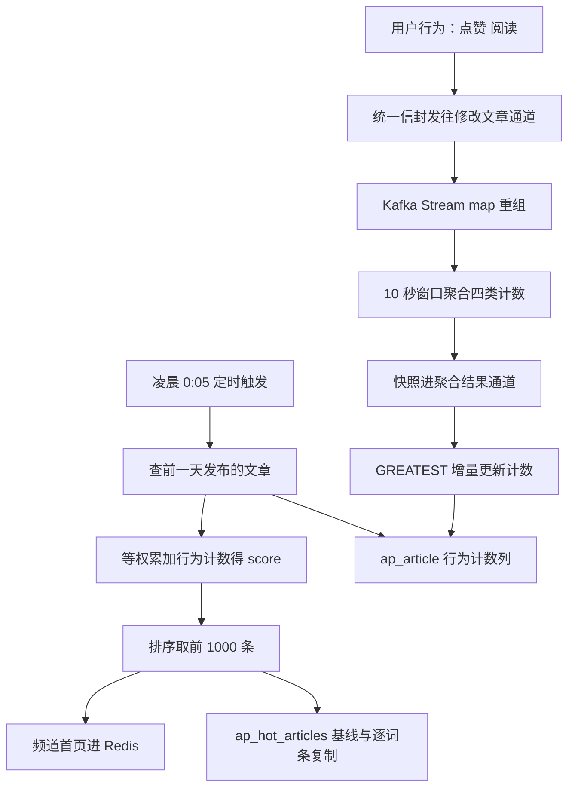

# day12 复盘：热文章的两条计算链路与它们的汇合点

> 🔒 安全提示：文中示例的口令/密钥均为课程教学环境演示口径，生产环境的安全要求见《安全与合规须知》。

一天的热文章计算全部讲完，收束时值得把两条链路放回同一张图里对齐：定时批算负责把历史文章折算成榜单，实时流算负责把新鲜行为增量记进账本，两条链路在文章行为计数这一列汇合。复盘的意义不在复述代码，而在看清每个部件为什么放在那个位置，以及哪些设计是暂时的、明天会被谁替换。

## 先给结论

- 全天两条链路：定时批算每天 0 点 05 分查前一天文章、等权累加行为计数出 score、排序取前 1000、频道首页进 Redis、热文章表基线加逐词条复制；实时流算把行为消息按 10 秒窗口聚合，增量更新 `ap_article` 的四类计数。
- 两条链路的汇合点是 `ap_article` 的行为计数列：批算从这里取原料算分，流算往这里写增量，榜单的动态性由这个闭环提供。
- 新知识点只有一个：Kafka Stream，按时间窗口实时汇总行为数据；配套的封装四件与序列化三件全部来自随包真实代码。
- 遗留三件事：热文章还没被查询侧用起来、图片缓存明确挂起、逐词条复制是过渡设计。
- day13 的清单：图片缓存微服务、文章首页接口改造（热文章的真正用武之地）、联想词优化、接口安全。

## 双链全景：一张图收束全天



图的上半是批算链路，下半是流算链路，中间的 `ap_article` 计数列是两条链路共用的账本：批算把账折算成 score 与榜单，流算把新账记进去，下一轮批算再来取。这个闭环是全天设计的骨架，单个方法再精巧，离开这张图都说不清自己服务谁。

批算链路的五步骨架浓缩起来是这样一个方法：

```java
// 定时链路：computeHotArticle 的五步骨架
public void computeHotArticle() {
    // 1. 查询前一天发布的新文章
    List<ApArticle> articleList = apArticleMapper.loadLastArticleForHot(lastDay);
    // 2. 行为计数等权累加出 score，排序取前 1000
    List<ApHotArticles> hotArticlesList = computeHotArticle(articleList);
    // 3. 频道首页列表进 Redis，key 前缀 hot_article_first_page_
    cacheTagRedis(hotArticlesList);
    // 4. ap_hot_articles 先插 entry_id 为 0 的基线，再逐词条复制
    saveHotArticleForEntryList(hotArticlesList);
    // 5. 图片缓存：暂缓，day13 抽图片微服务统一处理
}
```

流算链路的骨架是流监听器里那条处理链：

```java
// 实时链路：getService 的处理链骨架
return stream.map((key, val) -> {
            UpdateArticleMessage value = format(val);
            return new KeyValue<>(value.getData().getArticleId().toString(),
                    value.getData().getType().name() + ":" + value.getData().getAdd());
        }).groupByKey()
          .windowedBy(TimeWindows.of(10000))
          .aggregate(new Initializer<String>() { /* 初值串 */ },
                     new Aggregator<String, String, String>() { /* 还原、追加、拼回 */ })
          .toStream()
          .map((key2, value2) -> new KeyValue<>(key2.key().toString(),
                  formatObj(key2.key().toString(), value2)));
```

两个骨架并排看，气质完全不同：批算是「一次查全、一次算完、一次写完」的批处理节奏，流算是「随到随组、攒批输出」的流水线节奏。节奏差异来自数据形态差异，这正是需求原文里「从数据库直接查询计算」与「从流实时接收按时间窗口计算」两个维度落到代码上的样子。

## 两条链路的对比与分工

| 维度 | 定时批算 | 实时流算 |
|---|---|---|
| 触发方式 | Quartz 定时，每天 0 点 05 分 | 行为消息驱动，随到随算 |
| 数据特征 | 静态历史文章，前一天窗口 | 持续产生的行为事件流 |
| 计算方式 | 全量查库，内存算分排序 | 按文章分组，10 秒窗口聚合 |
| 写入目标 | `ap_hot_articles` 与 Redis 首页缓存 | `ap_article` 四个行为计数列 |
| 写入频次 | 每天一批 | 每文章每窗口最多一次 |
| 故障影响 | 次日榜单缺失，可重跑补算 | 增量丢失，等批算纠偏 |

分工的边界要咬准：流算不刷新榜单，它只把行为增量如实记到计数列；批算不碰行为明细，它从计数列取现成原料。课程反复强调这套东西横跨多个系统（行为服务、文章服务、Kafka、Redis、MySQL），动手前先把大流程理清，再按小点逐个写代码，联调才不会陷在中间某一格出不来。这个方法论今天被验证了两次：实时链路的联调正是按「发消息、聚合、落库」三段分别验证再串起来的。

## 今日收获清单

- **Kafka Stream 的完整使用姿势。** 封装四件（KafkaStreamConfig、KafkaStreamListener、KafkaStreamProcessor、KafkaStreamListenerFactory）加序列化三件全部来自随包真实代码，业务侧只需实现三方法接口，拓扑注册全自动。
- **窗口聚合与字符串状态协议。** map 重组、groupByKey、windowedBy 开 10 秒窗口、aggregate 用初值串与「还原、追加、拼回」三拍累计，状态存储里躺着可读文本，联调时肉眼可查。
- **统一信封与类型路由。** 修改文章信封把五花八门的行为消息折成一种格式，type 字符串是两端的消息契约，注册表启动时建好路由。
- **GREATEST 增量 SQL。** `GREATEST(IFNULL(列,0) + 增量, 增量)` 两道保险把 null 污染与脏数据兜死在数据库层，自增语义天然防丢更新。
- **对账意识。** 链路通了不算完，库值增量与消息增量严格相等才算交付，残留消息、窗口边界都会干扰对账，测前记库值是标准动作。

## 遗留问题与 day13 预告

遗留清单按影响面排序。**热文章还没被用起来。** 榜单算好、缓存备好、逐词条复制完成，但首页与搜索的查询侧还按老路走，day13 的「文章首页接口改造」就是把这些数据接进用户视野，热文章的功能价值要到那时才兑现。**图片缓存挂起。** 需求分析时就明确留到最后一天，day13 开头八讲专门做图片微服务与缓存链路。**热度公式是过渡态。** 等权累加先跑通链路，权重与时间衰减是参数空间，批算侧收在一个方法里随时可调。**逐词条复制是暂时设计。** 没有用户画像与大数据推荐之前，各词条榜单内容相同，等推荐能力接入，这份冗余结构正好是落点。

day13 的预告按课程编排依次是：图片缓存（需求分析、article 端发消息、图片微服务、热文章图片处理、消息接收与测试、图片访问接口）、文章首页接口改造（后端 service 与 controller、前端联调）、联想词优化、接口安全（加密算法、密码验证、登录验证）。今天所有「算好了但没用上」的数据，明天都会找到自己的消费方。

## 常见误区

- **把实时链路当成榜单的实时刷新。** 错例是以为一条点赞消息会让首页热榜立刻变化。正解是流算只更新 `ap_article` 计数，榜单与缓存由批算按天重算，热度变化到用户可见隔着批算节拍这个一致性窗口。
- **把逐词条复制当成已实现的个性化推荐。** 错例是复盘时把「每个用户一份热文章」说成千人千面。正解是当前各词条榜单内容相同，这是给未来推荐预留的数据结构，能力尚未接入。
- **只记 API 不记协议。** 错例是背得下 aggregate 三参数却说不清聚合串格式与信封 type 的两端契约。正解是每个协议两端一起记：聚合串格式连着 formatObj 的正则，信封 type 连着注册表路由，改一端必须同步另一端。
- **联调不先理思路。** 错例是代码写完直接连跑，报错后从中间某格开始盲查。正解是按全景图从入口到出口分段验证，每段有各自的观测点，哪段断查哪段。

## 面试可能被问到的问题

1. 面试官追问：「热文章计算为什么两条链路并存，只留一条行不行？」
   答：只留批算，榜单一天一动，白天爆款的反馈周期最长一整天；只留流算，历史文章没有初始分，冷启动内容永远没机会上榜。批算给基线、流算给增量，两者合成既稳定又动态的榜单。两条链路的数据形态不同，批算适合静态全量，流算适合持续增量，谁也替代不了谁。
2. 面试官追问：「两条链路写同一份账，一致性怎么保证？」
   答：流算把增量写到 ap_article 计数列，批算每天全量重算榜单，重算天然覆盖流算期间的一切误差，属于以天为周期的最终一致。流算侧的增量 SQL 是单行自增，并发不丢更新；批算侧重跑用先删后插或 upsert 幂等。真要分钟级一致就得加缓存增量刷新与分布式协调，成本另算。
3. 面试官追问：「这一天的设计里你觉得最有价值的是哪一处？」
   答：窗口聚合加字符串状态协议这一段。10 秒窗口把行为洪峰在内存里合并成计数快照，写库频次从消息量级降到窗口量级，这是流计算的核心收益；字符串协议让窗口状态可读可查，聚合器只做拆串与拼接，实现与排查成本都低。配合统一信封，新增行为类型不需要改消费端拓扑。
4. 面试官追问：「如果行为量涨一百倍，这套链路哪里先出问题，怎么演进？」
   答：先出问题的是逐词条复制的批算写入量，一千条榜单乘百万词条级的词条数直接击穿单表，演进方向是榜单只存基线、词条维度改懒加载或交给推荐服务召回。流算侧窗口聚合本身有削峰缓冲，分区数决定并行上限，扩实例加分区即可撑住。计数列的自增更新在高频下会变成热点行，可引入缓冲计数定期合并。
5. 面试官追问：「横跨多个系统的功能，你按什么顺序开发和验证？」
   答：先画全景图钉死数据流与各系统的边界，再把链路切成互不相干的小段，每段单独实现并用自己的观测点验证，全段通过后从入口到出口串一次整体联调，最后以数据库增量对账收尾。热点文章这条链就是按发消息、窗口聚合、落库三段推进的，中间任何一段出问题都能立刻定位归属。

## 配套资料

- 代码：`materials/code/05/头条day12/`。内层资料目录的 kafkastream 封装为真实文件：KafkaStreamConfig、KafkaStreamListener、KafkaStreamListenerFactory、KafkaStreamProcessor 及 serializer 目录下 JsonSerializer、JsonDeserializer、SerdeSerializer，实时链路的全部基础设施都落在这批类上；两条链路的业务代码（computeHotArticle 五步、getService 处理链、增量 SQL）未随资料包提供，文中骨架为按画面线与课程写法整理补全（引用路径截至 `头条dayNN/` 层级，内层目录名含项目原名，不进入正文）。
- 代码：`materials/code/05/头条day07/`，Kafka 通用封装九件，统一信封 KafkaMessage、发送器 KafkaSender、类型路由 MessagesRegister 与 topic 绑定在其中核对。
- 环境：课程集群 node01~node03，MySQL root/123456；`ap_article` 计数列与 `ap_hot_articles` 榜单在导入脚本生成的库里对账。
