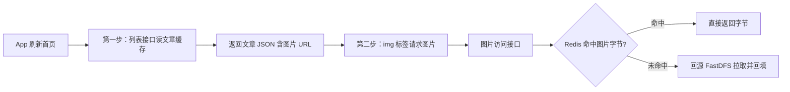

# 图片缓存需求分析：把热文章图片从 FastDFS 挪进 Redis

> 🔒 安全提示：文中示例的口令/密钥均为课程教学环境演示口径，生产环境的安全要求见《安全与合规须知》。

App 首页的加载速度此前已经优化过一轮：频道首页列表进了 Redis，热文章数据进了缓存与热文章表，接口不再每次回库。可用户感知的「快」不止是文字列表出来得快，还有页面里的图加载得快。文章的正文配图与封面图从自媒体上传那天起就存在 FastDFS 里，热文章被集中打开时，每一张图都是一次对文件服务器的真实请求，带宽与磁盘 IO 一起扛。这一课把图片缓存的需求摊开分析：压力从哪来、缓存什么、怎么与已有的文章缓存接力、哪些图片明确不缓存。

## 先给结论

- 需求一句话：随着热文章的访问越来越频繁，文章内图片频繁访问图片服务器，对图片服务器造成很大压力，因此决定把热文章相关图片缓存到 Redis。
- 开发功能只有一条：监听热文章消息缓存图片。文章侧只负责发消息，图片的下载与缓存交给一个专门处理图片的微服务。
- 缓存对象按画面线是图片二进制本身：缓存接口返回 `byte[]`，命中后连 FastDFS 都不触达；不是存一层 URL 映射。
- 范围圈定：只缓存 FastDFS 里的图片；爬虫系统抓来的网络图片不缓存也不下载到本地，访问端直接读网络图。
- 与文章缓存是两层接力：文章数据缓存解决「列表快」，图片缓存解决「渲染快」，后者消化的正是前者剩下的最大一块流量。

## 压力从哪来：现状链路复盘

图片的存储与回显早就有一套既定口径。自媒体上传素材时，文件经 FastDFS 客户端封装传到存储节点，库里只存返回的相对路径（fileId，形如 `group1/M00/00/00/xxx.jpg`），返回前端前才拼上文件服务器的对外地址：

```properties
# 图片存储与回显的既有口径（存储侧约定，地址按环境填写）
# 库里只存 FastDFS 相对路径：group1/M00/00/00/xxx.jpg
# 对外访问地址头，回显时拼在相对路径前
file.server.url=http://192.168.25.133/
```

```java
// 素材列表回显：库里存 fileId，返回前端前才拼上地址头
wmMaterial.setUrl(fileServerUrl + fileId);
```

这套口径把存储与展示的职责分得很干净，也决定了 App 端拿到的是完整 URL：文章 JSON 渲染进页面后，`img` 标签的请求直接奔向文件服务器，中间不经过任何后端服务。这条直连链路在冷门文章时代毫无压力，热文章一出现就被放大成事故现场：榜单文章集中吸引流量，一篇文章的正文配图动辄几张到十几张，单图几十到几百 KB，一次首页刷新就是一串并发的图片请求全部砸向文件服务器。文件服务器的瓶颈是物理的，磁盘读有上限，出口带宽有上限，前置的访问层再怎么调优也变不出第二块网卡。

文章数据那轮优化之所以见效，是因为把「读库」挪进了内存；图片这轮要如法炮制，就得把「读文件系统」也挪进内存。缓存的选型没有悬念，Redis 承担过登录态、热文章榜单、搜索记录，这套基础设施是现成的。

## 缓存什么：图片字节，不是 URL 映射

「把图片缓存到 Redis」有两种截然不同的做法，需求分析阶段就要把话说死。**做法一，URL 映射。** key 存图片标识，value 存 FastDFS 地址，命中后客户端仍然要去文件服务器拉字节，省掉的只是「查库拿 URL」这一小步，带宽与磁盘压力原封不动。**做法二，字节缓存。** 把图片下载下来，value 直接存二进制，命中后字节从 Redis 直达客户端，文件服务器在热文章场景下彻底出局。

课程的画面线给出了明确答案，缓存接口的签名长这样：`byte[] cacheRedis(String imgUrl, boolean isCache)`。返回值是字节数组，意味着缓存的是图片二进制本身，走的是做法二。`imgUrl` 入参说明缓存的定位键由图片地址派生，`isCache` 布尔参数给读操作留了个「是否走缓存」的开关，强制回源刷新的场景用得上。

字节缓存的代价是内存，这笔账要在需求阶段算清：热文章榜单每个频道截取前 30 条，文章图片数按个位数计，单图几十到几百 KB，全量热图铺开是几百 MB 到 GB 级的量级。这个量级对 Redis 可控，但要配上内存护栏（示例按主流写法补全，非课程画面原样）：

```properties
# Redis 内存护栏：设上限 + 淘汰策略，防图片缓存挤占登录态等核心数据
maxmemory 2gb
maxmemory-policy allkeys-lru
```

过期策略上，课程版的做法是跟随每日热文章批算全量预热刷新：榜单每天凌晨重算一次，图片随之重新拉取覆盖，value 不设硬性 TTL。生产语境下更稳的搭配是给 key 设一个略长于批算周期的过期时间当保险丝，批算失败时旧图到期消失，读端回源重建，不至于永远端着已经不热的图片占内存。

## 与文章缓存的接力关系

两轮优化各管一段，画在一张图上就清楚了：



第一步是文章数据缓存，频道页列表与热文章数据从 Redis 直接返回，数据库出局；第二步是图片缓存，`img` 标签的请求改走图片访问接口，命中 Redis 返回字节，未命中才回源 FastDFS 并顺手回填。两步接力的意义在于：没有第二步时，第一步省下的时间会被图片加载吃掉大半，用户看到的是「列表秒出、图片转圈」；第二步补上之后，热文章场景下文件服务器的流量被削掉绝大部分，加载体验才算完整。

发起时机也顺着这条接力关系定下来：文章侧在热文章计算完成后发一条消息，把「哪些文章值得缓存图片」广播出去，图片微服务收到消息再去干活。发什么、怎么发是下一课的内容，需求层面先钉住两点：一是异步消息而不是文章服务亲自拉图，重 IO 与核心链路解耦；二是消息的触发节奏跟随热文章批算，榜单每天刷一轮，图片预热跟着刷一轮。

## 范围圈定：爬虫图片为什么不缓存

需求里有一条明确的注意事项：缓存的是 FastDFS 中的图片信息。言外之意，不是系统里所有图片都进缓存。爬虫系统抓取的文章带回来的是外部站点的网络图片，这些图片只存 URL 引用，文件本体从没进过自己的存储。对这类图片，访问端直接请求网络图即可，不下载到本地，更不缓存。

理由有三层。**存储一致性。** 网络图不在自己的 FastDFS 里，拉下来缓存等于把外部内容复制进自己的内存，源头一变缓存就成了悬空的旧数据。**成本与时效。** 抓取的图片数量远大于热文章的图集，全部缓存会让内存账失控，而爬虫内容本身的热度与时效都不适合长期占内存。**判断成本。** FastDFS 图片的 URL 有稳定的形态（相对 fileId 拼地址头），按来源特征分流只需一个判断，后续代码思路那一课会看到这个分支。

## 常见误区

- **缓存 URL 映射当成了图片缓存。** 错例是 Redis 里存 key 到 FastDFS 地址的映射，宣称命中率高。正解是缓存图片二进制，命中即返回字节，回源只发生在未命中时。
- **只顾缓存不管内存护栏。** 错例是不设 `maxmemory` 与淘汰策略，图片字节把 Redis 撑爆，登录态、热文章榜单这些核心 key 被驱逐。正解是图片缓存与核心数据分实例或分区，配内存上限与 LRU 淘汰。
- **全网图片无差别预热。** 错例是把文章里出现过的所有图片一律拉进缓存。正解是圈定热文章加 FastDFS 来源两个条件，爬虫网络图直接放行不缓存。
- **把过期策略当成可有可无。** 错例是 value 永不过期又不刷新，榜单换血后旧图长期占内存。正解是跟随批算节奏全量覆盖，再加一个略长于批算周期的 TTL 兜底。

## 面试可能被问到的问题

1. 面试官追问：「图片已经存在 FastDFS 了，为什么还要进 Redis 缓存一层？」
   答：FastDFS 解决的是存储问题，不是热点读取问题。热文章的图片请求高度集中，文件服务器的磁盘 IO 与出口带宽是物理上限，前置缓存把热点字节挪进内存，命中请求不再触达文件系统，FastDFS 回归它本职的可靠存储角色。
2. 面试官追问：「缓存对象为什么选图片二进制而不是 URL 映射？」
   答：URL 映射只省掉查库这一小步，命中后客户端仍要回源文件服务器，带宽与磁盘压力没有减少。二进制缓存让命中请求从 Redis 直达，彻底卸载回源；代价是内存占用，用容量上限加淘汰策略兜住，业务上换来的是热文章场景文件服务器接近零压力。
3. 面试官追问：「图片缓存会不会把 Redis 内存撑爆，怎么控制？」
   答：需求阶段就圈定范围：只缓存热文章相关、只缓存 FastDFS 来源，总量在几百 MB 到 GB 级。工程上配 `maxmemory` 上限与 allkeys-lru 淘汰策略，图片缓存与核心数据隔离部署，过期策略跟随每日批算全量覆盖刷新，再加 TTL 兜底防止批算失败后旧数据常驻。
4. 面试官追问：「图片缓存和文章数据缓存是什么关系，能不能合并成一层？」
   答：两层接力各管一段。文章缓存让列表接口不回库，图片缓存让页面渲染不回源文件系统，请求路径不同、数据形态不同（JSON 对字节）、失效节奏也不同。合并看似省一层，实际会让单条缓存的粒度失控，列表的更新与图片的更新会互相牵连。
5. 面试官追问：「爬虫抓来的网络图片为什么不一并缓存？」
   答：网络图的本体不在自己的存储里，缓存等于复制外部内容，源头变化后数据悬空；爬虫图片数量远大于热文章图集，全量缓存内存账失控；且这类内容的热度与时效都不值得长期占内存。按 URL 来源特征分流，FastDFS 来源才进缓存，网络图访问端直连即可。

## 配套资料

- 代码：`materials/code/05/头条day13/`。该日资料包解压结果为空（未含源码文件），文中缓存接口签名、Redis 内存护栏示例按画面线与主流写法补全；引用路径截至 `头条dayNN/` 层级，内层目录名含项目原名，不进入正文。
- 说明：图片存储与回显口径（fileId 存库、`file.server.url` 拼接回显）沿用此前 FastDFS 封装与素材管理各课的约定；`materials/code/05/头条day05/` 资料包同样为空，相关口径以正文约定为准。
- 环境：课程集群 node01~node03，MySQL root/123456，Redis、Kafka、FastDFS 均部署在集群上，图片对外访问地址按所在环境填写。
