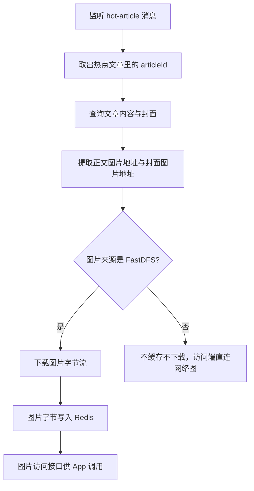

# 图片微服务导入与代码思路：从监听消息到图片入 Redis

> 🔒 安全提示：文中示例的口令/密钥均为课程教学环境演示口径，生产环境的安全要求见《安全与合规须知》。

发送端已经就绪，热文章消息正排队等消费，现在轮到接收的一方。这一课做两件事：把资料包里现成的图片微服务模块导进工程，再把它的开发思路逐段钉死。模块是给好的，思路是自己的，导入只花几分钟，真正决定后面几课写得顺不顺的，是把「监听到缓存」这条路线在动手前想清楚。

## 先给结论

- images 微服务来自资料包的现成模块，导入三步：解压进父工程目录、父 pom 注册 module、IDE 里添加该模块的 pom。
- 模块自带引导类与全套配置：FastDFS、Kafka、MySQL、Redis 必配，登录认证相关的 SecurityConfig 暂时用不上但保留着能看懂，另有一个图片转换工具对象按需实例化。
- 工具类 Base64Utils 提供编码与解码一对方法，服务于图片地址进 key、进接口参数时的字符安全化。
- 核心接口 `CacheImageService` 只有一个方法 `byte[] cacheRedis(String imgUrl, boolean isCache)`，缓存对象是图片字节，`isCache` 控制读取是否走缓存。
- 开发路线四步：监听消息取热点文章、凭 articleId 查文章内容、提取正文与封面图片地址并按来源分流、FastDFS 来源下载字节写 Redis；key 不能用原始 URL，要经编码再入键。

## 三步把模块导进来

资料包里带着一个做好的 images 模块压缩包，解压或直接拷贝，放进父工程目录下与其他微服务并列。模块要被 Maven 认领，还差一处登记：父 pom 的 modules 列表里加上它（模块依赖片段一并示意）：

```xml
<modules>
    <module>leadnews-admin</module>
    <module>leadnews-article</module>
    <module>leadnews-common</module>
    <module>leadnews-images</module>  <!-- 图片微服务，本讲新增 -->
    <!-- 其余模块略 -->
</modules>
```

登记完成后模块在 IDE 里还是灰的，因为还没真正纳入构建。在 Maven 面板点加号，选中 images 模块的 pom 确认，图标颜色转正常即导入成功。这个灰色状态值得多说一句：目录摆对了但 Maven 不认，类文件里全是红色引用，很多人在这一步怀疑代码有问题，其实只是模块没挂进聚合工程。

模块的 pom 与其他微服务一个模子：依赖 model 提供实体，依赖 common 提供全套封装，common 引入时排除了重复的日志实现防止绑定冲突。依赖关系对了，Redis、Kafka、FastDFS 的封装能力全部随 common 进入图片微服务的 classpath，这正是当初把第三方集成统一收口在公共工程的回报。

## 模块里都有什么

工程骨架不用写，先盘家底。引导类与其他微服务无异；配置文件覆盖了这条链路需要的全部中间件连接：FastDFS 配置里带着图片服务器地址头，导进来第一件事就是把它改成自己环境的地址（课程环境形如 `192.168.25.133`，80 端口），这个地址头在下载图片、拼访问 URL 时都要用；Kafka 配置对接消息；MySQL 配置供查文章；Redis 配置是重头，图片字节往这里写。SecurityConfig 这类登录认证相关的配置暂时用不着，留着能看懂即可，不影响主流程。

配置里另有一个图片转换工具对象，用的时候实例化注入即可，纯工具性质不承载业务逻辑。真正要认识的是 Base64 工具类，工程里没有就在 utils 包下建一个，包名按工程口径归位：

```java
package com.study.headline.utils;

import sun.misc.BASE64Decoder;

public class Base64Utils {

    /**
     * 解码
     * @param base64
     * @return
     */
    public static byte[] decode(String base64) {
        BASE64Decoder decoder = new BASE64Decoder();
        try {
            byte[] b = decoder.decodeBuffer(base64);
            for (int i = 0; i < b.length; ++i) {
                if (b[i] < 0) { // 转换异常处理
                    b[i] += 256;
                }
            }
            return b;
        } catch (Exception e) {
            return null;
        }
    }
}
```

解码循环里那个「小于 0 加 256」是这段代码的题眼：Java 的 byte 是有符号的，取值到 128 就翻成负数，Base64 解码产出的字节经符号位一搅就是脏数据，逐字节把负值补回 256 才还原出正确的二进制。编码方法与解码成对存在，把任意字节或字符串转成纯字母数字的安全形态。它在这条链路里的用武之地马上就到：图片 URL 里满是冒号、斜杠、问号、等号，直接塞进 Redis key 或接口参数，要么撞上保留字符要么被截断，先编码再流转，取回来再解码还原。

缓存服务的入口接口同样已在画面线里定形：

```java
package com.study.headline.images.service;

/**
 * 图片缓存服务
 */
public interface CacheImageService {

    /**
     * 缓存图片到 redis
     * @param imgUrl  图片地址
     * @param isCache 是否走缓存
     * @return 图片字节
     */
    byte[] cacheRedis(String imgUrl, boolean isCache);
}
```

两个签名各司其职：入参 `imgUrl` 是定位键的原料，出参 `byte[]` 印证缓存的是字节流；`isCache` 为真时先查缓存、未命中回源并回填，为假时强制回源，给「缓存被污染需要重取」的场景留了逃生门。

## 思路分析：四步把图片送进 Redis

代码骨架有了，开发路线按画面线的思路分析走，画成流程图：



**第一步，监听消息。** 复用公共工程的监听封装：业务监听类声明监听 `hot-article` 这个 topic，容器启动时由工厂统一建容器完成注册，拿到消息后按 type 反查还原成 `ApHotArticleMessage`，从载荷里取 `articleId`。监听类的具体编写在后面一课落地，这里先把位置占准。

**第二步，查文章。** 热文章对象只有 id，图片地址在文章里：文章内容的富文本里嵌着正文配图的 `img` 标签，封面图在文章实体的封面字段里。查一次文章，两类地址全部到手。

**第三步，来源分流。** 需求分析时圈定的纪律在这里兑现成代码分支：FastDFS 来源的图片才值得缓存，判断依据是地址形态（相对 fileId 拼地址头的稳定特征）；爬虫抓来的网络图不下载不缓存，访问端直连。分支虽小，守的是内存账与数据一致性两道门。

**第四步，下载与写入。** 对圈定范围的图片发起 HTTP 请求拉取字节流，读成 `byte[]`，以图片地址派生的 key 写入 Redis。这一步是纯粹的下载落地，重 IO 都在图片微服务内部消化，文章侧完全无感。

## key 设计与大小限制

**key 的原则是业务前缀加安全化地址。** 原始 URL 不能直接当 key：特殊字符破坏命令解析，长度也不可控。用 Base64Utils 的编码方法把地址转成安全字符串，再挂上业务前缀（示例按本课写法补全，具体拼法随后续访问接口课对齐）：

```java
// Redis key 设计示例：业务前缀 + 编码后的图片地址
String key = "app:cache:image:" + Base64Utils.encode(imgUrl);
```

前缀隔离业务空间，避免与登录态、频道首页缓存这些既有 key 撞名；编码后的地址不含保留字符，同一个 URL 编码结果恒定，天然合并成同一个 key，重复预热自动去重。

**大小限制要算三笔账。** Redis 侧，单图几十到几百 KB、热文章图集总量 GB 级，内存上限与淘汰策略（`maxmemory` 加 allkeys-lru）是护栏，防止图片缓存挤占登录态等核心数据的生存空间；下载侧，拉流要设超时与单图大小上限，异常大的图跳过缓存按原路径访问，防止单张大图拖垮整个预热任务；消息侧倒是最省心的一条，消息体里只有热点文章对象不含图片字节，远够不到生产者配置的消息上限，图片走 Redis 不走 Kafka 的边界在这条链路里维持得很干净。

## 常见误区

- **拿原始 URL 直接当 Redis key。** 错例是 `set http://192.168.25.133/group1/M00/...` 这类 key，特殊字符与长度都埋雷。正解是业务前缀加 Base64 编码地址，取用时解码还原。
- **忘记父 pom 登记，模块灰色就开写代码。** 错例是目录拷进来了、IDE 显示灰色、满屏红色引用就以为资料包坏了。正解是 modules 登记加 Maven 面板添加，颜色转正常再动手。
- **把爬虫网络图也拉下来缓存。** 错例是不做来源判断，所有图片地址一律下载入缓存，内存账失控且外部内容变更后缓存悬空。正解是按地址形态分流，只缓存 FastDFS 来源。
- **配置照抄不改环境地址。** 错例是图片服务器地址头、Redis 与 MySQL 连接沿用资料默认值，启动后下载与缓存全部落空。正解是导入模块后逐项核对配置，地址改成自己环境（课程集群为 node01~node03）。

## 面试可能被问到的问题

1. 面试官追问：「往工程里新增一个微服务模块，要动哪几处地方？」
   答：三处。模块目录放进父工程下；父 pom 的 modules 登记；IDE 的 Maven 面板添加该模块 pom。另外模块自身 pom 要正确依赖 model 与 common，依赖公共封装时注意排除重复的日志实现，缺一步要么不编译要么运行时绑定冲突。
2. 面试官追问：「Redis 里存图片字节，内存怎么估算、怎么兜底？」
   答：按 榜单条数乘单文章图片数乘单图体积 估总量，热文章范围下是 GB 级。兜底三件套：`maxmemory` 设上限、allkeys-lru 淘汰策略、图片缓存与核心数据隔离部署；再配每日批算全量覆盖刷新与略长于批算周期的 TTL，防止批算失败后旧图常驻。
3. 面试官追问：「Base64 在图片缓存链路里起什么作用？」
   答：两个用途。一是 key 安全化，URL 里的冒号斜杠问号直接进 Redis key 会撞保留字符，Base64 编码后是纯安全字符，同 URL 编码结果恒定还顺带完成去重；二是字节处理，解码时逐字节处理有符号 byte 的负值回绕，保证二进制还原正确。
4. 面试官追问：「消费端怎么判断哪些图片该缓存、哪些不该？」
   答：按地址来源分流。FastDFS 来源有稳定的地址形态，相对 fileId 拼地址头，命中即缓存；爬虫抓来的网络图本体不在自己存储里，下载缓存会造成内存失控与数据悬空，直接放行让访问端直连。判断逻辑是一个地址形态分支，成本极低。
5. 面试官追问：「cacheRedis 的 isCache 参数是什么设计意图？」
   答：它把「读」与「走缓存」解耦。为真时先查缓存未命中再回源回填，是常态路径；为假时强制回源，用于缓存被污染或图片更新后需要重新拉取的场景。一个布尔参数让调用方在不新增接口的情况下覆盖两种语义，代价是实现里要守住回填逻辑的正确性。

## 配套资料

- 代码：`materials/code/05/头条day13/`。该日资料包解压结果为空（未含源码文件），文中 images 模块的 pom 片段、Base64Utils、CacheImageService、配置清单与 key 设计示例均按画面线抄录并按本课写法补全；引用路径截至 `头条dayNN/` 层级，内层目录名含项目原名，不进入正文。
- 代码：`materials/code/05/头条day07/`，资料目录里真实随包提供 Kafka 封装九个工具类，图片微服务的消息监听与失败重试直接复用这套封装；`materials/code/05/头条day12/` 另有 Kafka Stream 封装可对照其监听注册思路。
- 环境：课程集群 node01~node03，MySQL root/123456；图片服务器地址头、Redis 与 Kafka 地址均按所在环境在 images 模块配置文件中修改。
