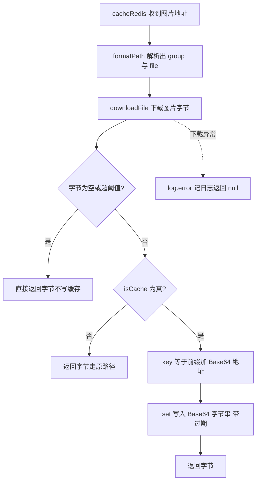

# 图片缓存逻辑编写：下载图片转字节写入 Redis 与过期续期

> 🔒 安全提示：文中示例的口令/密钥均为课程教学环境演示口径，生产环境的安全要求见《安全与合规须知》。

接口签名已经定形：`CacheImageService` 返回 `byte[]`，入参是图片地址加一个是否走缓存的开关。这一课把实现类写出来。核心动作看着简单，给一个地址、下载、写进 Redis，真正决定这段代码质量的是四件小事：URL 怎么拆成 FastDFS 的两个下载参数、key 怎么生成才安全、过期时间怎么管理、异常怎么处理才不拖垮调用方。图片微服务的 service 层要落两个接口，这一课先写缓存这一个，消息进来后的挑图逻辑留给下一课。

## 先给结论

- 实现类 `CacheImageServiceImpl` 挂 `@Service` 与 `@Log4j2`，注入 `FastDfsClient` 与 `StringRedisTemplate`，过期常量 `EXPIRE = 60 * 60 * 24`，单位是秒，即 24 小时。
- 下载前先把 URL 解析成 group 与 file 两个参数：`fastDfsClient.downloadFile(group, file)` 只认这两个值，完整 URL 里没有现成的，要自己截。
- 写入时 key 用业务前缀加 Base64 编码的图片地址，value 是图片字节经 Base64 转成的字符串，`set(key, value, EXPIRE, TimeUnit.SECONDS)` 一条命令带上过期。
- `isCache` 为真时读后回填缓存，为假时强制回源不碰 Redis；字节为空或超过单图大小阈值时直接返回，不进缓存。
- 第二个方法 `resetCache(String imageKey)` 用 `expire` 把已有 key 的失效时间重置回 24 小时，专治「榜单还没换血、这张图还得继续热」。
- 全程 try-catch，缓存失败只记日志不抛出，调用方拿到的返回值照常流转，单张图的失败不阻断主流程。

## 实现类的骨架

类挂上 Spring 管理与日志注解，两个依赖用 `@Autowired` 注入而不是现场 new，这是骨架里唯一容易走偏的地方：

```java
package com.study.headline.images.service.impl;

import com.study.headline.images.service.CacheImageService;
import lombok.extern.log4j.Log4j2;
import org.springframework.beans.factory.annotation.Autowired;
import org.springframework.data.redis.core.StringRedisTemplate;
import org.springframework.stereotype.Service;

import java.util.concurrent.TimeUnit;

@Service
@Log4j2
public class CacheImageServiceImpl implements CacheImageService {

    @Autowired
    private FastDfsClient fastDfsClient;

    @Autowired
    private StringRedisTemplate redisTemplate;

    // 失效时间：60 * 60 * 24 秒，即 24 小时
    final long EXPIRE = 60 * 60 * 24;

    // 单图大小阈值，超过就不进缓存（示例按本课写法补全）
    final int MAX_IMAGE_SIZE = 1024 * 1024;
}
```

Redis 客户端选 `StringRedisTemplate` 有讲究：value 计划存的是字符串形态的图片数据，字符串模板让读写两侧免掉类型转换；如果选 `RedisTemplate<byte[], byte[]>`，序列化器要自己配，`opsForValue()` 的每一步都多一层心智负担。`FastDfsClient` 是 FastDFS 的客户端封装，连接参数来自模块配置，交给 Spring 管理后配置变更才有生效的机会，方法里现场 new 出来的那份代码画面上出现过，属于早期写法，注入才是归宿。

Base64 工具类在导入模块那一课已经备好解码方法，编码方法与它成对存在，本课两头都要用：

```java
/**
 * 编码：字节转成纯字母数字的安全字符串，key 与 value 两头都用
 */
public static String encode(byte[] data) {
    return new BASE64Encoder().encode(data);
}
```

## 第一步：把 URL 解析成下载参数

FastDFS 的下载接口要两个参数：组名 group 与文件相对路径 file，而这条链路里流转的一直是完整 URL。素材管理各课定下的口径是库里存 fileId、回显时拼地址头成 URL，`formatPath` 做的正是镜像动作，把 URL 拆回两个下载参数：

```java
/**
 * 解析图片地址，取出 FastDFS 下载所需的 group 与 file
 * 例：http://192.168.25.133/group1/M00/00/00/wKjTgl.jpg
 * group = group1，file = M00/00/00/wKjTgl.jpg
 */
private Map<String, String> formatPath(String imgUrl) {
    Map<String, String> map = new HashMap<>();
    // 去掉协议与地址头，剩下 group1/M00/00/00/xxx.jpg
    String path = imgUrl.substring(imgUrl.indexOf("//") + 2);
    // 第一个斜杠之前是组名，之后整体是文件路径
    int index = path.indexOf("/");
    String group = path.substring(0, index);
    String file = path.substring(index + 1, path.length());
    map.put("group", group);
    map.put("file", file);
    return map;
}
```

方法返回 `Map<String, String>` 而不是自定义对象，消费侧就是两句 `map.get("group")`、`map.get("file")`，为了两个参数立一个类型不值得。解析的前提是地址确实是本站 FastDFS 的形态，这条纪律由上一层的来源分流保证，方法内部不再重复判断。

## 第二步：下载、限量、写入

主方法的完整流程，下载、阈值检查、按开关写入，全部收在一个 try-catch 里：

```java
@Override
public byte[] cacheRedis(String imgUrl, boolean isCache) {
    byte[] ret = null;
    try {
        Map<String, String> map = formatPath(imgUrl);
        String group = map.get("group");
        String file = map.get("file");
        // 从 FastDFS 下载图片字节
        ret = fastDfsClient.downloadFile(group, file);
        // 空字节或超过单图阈值，不进缓存直接返回
        if (null == ret || ret.length == 0 || ret.length > MAX_IMAGE_SIZE) {
            return ret;
        }
        // 需要缓存时，字节转 Base64 字符串写入 Redis，并带上过期时间
        if (isCache) {
            String imageKey = "app:cache:image:" + Base64Utils.encode(imgUrl);
            redisTemplate.opsForValue().set(imageKey, Base64Utils.encode(ret),
                    EXPIRE, TimeUnit.SECONDS);
        }
    } catch (Exception e) {
        // 缓存是尽力而为的旁路动作，失败只记日志，不阻断调用方
        log.error("图片缓存失败, imgUrl: {}", imgUrl, e);
    }
    return ret;
}
```

key 的拼法沿用既定口径：业务前缀 `app:cache:image:` 隔离出图片缓存的空间，避免与登录态、频道首页缓存撞名；地址经 Base64 编码后不含冒号斜杠这些保留字符，同一个 URL 的编码结果恒定，重复预热自动合并成同一个 key。value 这头也有 Base64 的活：`downloadFile` 返回的是字节，字符串模板只收字符串，图片字节编码成 Base64 字符串再落库，访问接口取出后解码还原。代价是体积膨胀到原来的三分之四左右，内存账要按膨胀后的口径算。

`isCache` 的语义在两个方向上分工：为真时这次读到的字节顺手回填缓存，预热路径恒传 true，保证一次下载必然落库；为假时强制回源不碰 Redis，留给「缓存被污染需要重取」的场景。「先查缓存、未命中再回源」的完整读路径由图片访问接口基于同一把 key 组织，本方法负责的是写侧的纪律。

## 第三步：过期时间与续期

`EXPIRE = 60 * 60 * 24` 是 86400 秒，配合 `TimeUnit.SECONDS` 正好一天。热文章榜单每天凌晨批算一轮，图片随消息重新预热覆盖，24 小时的过期时间与批算周期对齐；即便某一轮批算失败，旧图到期消失、读端回源重建，不至于永远占着内存。

第二个方法解决「图还热、但 key 快到期」的场景：

```java
@Override
public void resetCache(String imageKey) {
    // 把已有 key 的失效时间重置回 24 小时
    redisTemplate.expire(imageKey, EXPIRE, TimeUnit.SECONDS);
}
```

续期与覆盖是两条不同的路：key 还在、图没变时，`expire` 只把倒计时拨回起点，省掉一次下载；key 已经消失时 `expire` 静默失败返回 false，重建交给下一轮预热消息的覆盖写。两个方法合起来，写侧的过期策略就闭环了。

整条写入路径画出来是这样：



关键分支有两处：阈值判断在写入之前，把内存风险挡在 Redis 之外；`isCache` 判断在下载之后，两个方向共享同一次下载结果。

## 异常为什么吞掉

catch 里不抛出、不重试、只记日志，是这条链路的刻意设计。图片缓存是旁路动作，文章该热还是热，一张图下载失败不值得把调用方拖下水。公共 Kafka 封装的重试闭环只在监听器抛异常时介入，这里把异常吞掉，等于声明「单张图失败不触发消息重放」；漏掉的图由下一轮批算预热消息自然补上，TTL 与批算周期对齐保证了最终一致。反过来，如果异常往外抛，一张坏图会让整条消息反复回放，一篇文章的十几张图被重复下载，重试闭环反而放大了故障。

## 常见误区

- **拿原始 URL 直接当 Redis key。** 错例是 `set http://192.168.25.133/group1/...` 这种带保留字符的长 key。正解是前缀加 Base64 编码地址，取用时解码还原，同 URL 恒定同 key。
- **方法里现场 new 客户端。** 错例是 `FastDfsClient fastDfsClient = new FastDfsClient()`，连接配置脱离 Spring 管理，改配置不生效还复用不了。正解是 `@Autowired` 注入，客户端作为 Bean 存在。
- **常量与单位脱钩。** 错例是 `set(key, value, 86400)` 忘了传 `TimeUnit.SECONDS`，按默认毫秒算成 86 秒，图片缓存秒失效。正解是常量名带上语义，写代码时常量与 `TimeUnit` 成对出现。
- **缓存异常往外抛。** 错例是让下载异常沿调用链上翻，监听器整条消息重试，一张坏图拖累全篇文章。正解是 try-catch 吞掉记日志，返回 null 让上层自行兜底。

## 面试可能被问到的问题

1. 面试官追问：「value 为什么存 Base64 字符串而不直接存字节？」
   答：课程封装选用 `StringRedisTemplate`，字符串模板读写简单、与既有 key 风格统一，二进制经 Base64 转成安全字符串落库，取出后解码还原。代价是体积膨胀约三分之一，内存估算按膨胀后算。直接存字节也可以，换成字节数组模板并配好序列化器即可，两种方案的取舍在实现复杂度与内存占用之间。
2. 面试官追问：「key 为什么要加前缀再做 Base64 编码？」
   答：前缀隔离业务空间，避免与登录态、频道页缓存撞名，也便于按前缀扫描和运维清理；URL 里的冒号、斜杠、问号直接进 key 会破坏命令解析，编码后是纯安全字符，同一个 URL 编码结果恒定，天然合并重复预热。
3. 面试官追问：「resetCache 续期和 set 覆盖分别用在什么场景？」
   答：续期适合 key 存在且图片未变的情况，只把失效时间拨回，省一次下载；覆盖适合首次预热或内容可能已变化的场景，重新下载重新写。`expire` 对不存在的 key 无效，此时只能走覆盖路径重建。
4. 面试官追问：「单张图片下载失败，要把消息标成失败重试吗？」
   答：不。图片缓存是尽力而为的旁路动作，单图失败不应放大成整条消息重放，重放只会让同文章的其他图被反复下载。吞异常记日志，下一轮批算预热自然补上；只有核心链路依赖处理结果时，才值得抛异常让重试闭环介入。
5. 面试官追问：「24 小时的过期时间是怎么定的？」
   答：与热文章批算周期对齐。榜单每天凌晨刷一轮，预热消息随之重发，图片覆盖刷新，24 小时 TTL 保证批算周期内数据新鲜；批算失败时旧图到期消失、读端回源重建，TTL 是保险丝而不是唯一的失效手段。

## 配套资料

- 代码：`materials/code/05/头条day13/`。该日资料包解压结果为空（未含源码文件），文中 `CacheImageServiceImpl`、`formatPath`、常量定义与 key 设计按画面线抄录并按本课写法补全；引用路径截至 `头条dayNN/` 层级，内层目录名含项目原名，不进入正文。
- 代码：`materials/code/05/头条day07/`，真实随包提供 Kafka 封装九个工具类（监听接口与工厂、重试错误处理器等），实现类的异常取舍正建立在这套重试闭环的语义上；`materials/code/05/头条day12/` 另有 Kafka Stream 封装可对照其监听注册思路。
- 环境：课程集群 node01~node03，MySQL root/123456；FastDFS 地址头、Redis 与 Kafka 地址按所在环境在 images 模块配置文件中修改。
