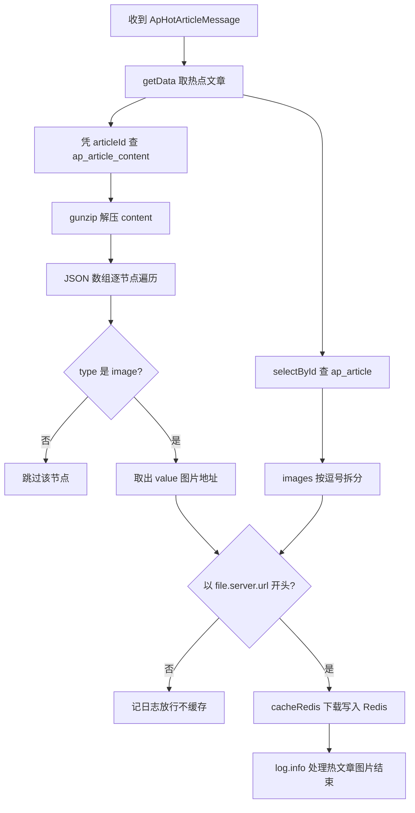

# 热文章图片处理：从热点消息里挑出值得缓存的图

> 🔒 安全提示：文中示例的口令/密钥均为课程教学环境演示口径，生产环境的安全要求见《安全与合规须知》。

缓存服务会把任何一张 FastDFS 图片下载入 Redis，但「哪些图值得缓存」这个业务判断还没有人做。图片微服务里真正懂业务的一层在这一课补上：收到热点文章消息后，把一篇文章里两类图片地址全部找出来，逐张过一遍合法性闸门，再交给缓存服务。这层逻辑写扎实了，后面监听类的任务就只剩「收消息、调这里」三行代码。

## 先给结论

- 新接口 `HotArticleImageService` 只有一个方法 `void handleHotImage(ApHotArticleMessage message)`，实现类 `HotArticleImageServiceImpl` 挂 `@Service` 与 `@Log4j2`。
- 注入三个对象：`ApArticleContentMapper` 查正文、`ApArticleMapper` 查封面、`CacheImageService` 做缓存；这里刻意不注入 Redis 模板，缓存的 key 规则、过期、异常处理全部收在缓存服务里。
- 图片地址来自两处：正文 content 经解压还原成 JSON 数组，`type` 为 `image` 的节点取 `value`；封面在文章表的 `images` 字段，多张以逗号分隔。
- 合法性过滤一道闸：地址必须以 FastDFS 地址头开头才算站内图，爬虫抓来的网络图记日志放行，不下载不缓存。
- 去重不写代码：URL 经 Base64 编码成恒定 key，set 覆盖写天然幂等，同一张图出现在多篇热文章里也只占一个 key。

## 接口与实现类骨架

接口与实现一次建齐，方法签名里那个参数就是文章端发来的消息封套：

```java
package com.study.headline.images.service;

import com.study.headline.common.kafka.messages.app.ApHotArticleMessage;

/**
 * 处理热点文章图片：解析内容图与封面图并缓存
 */
public interface HotArticleImageService {

    /**
     * 处理热文章图片
     * @param message 热点文章消息
     */
    void handleHotImage(ApHotArticleMessage message);
}
```

```java
@Service
@Log4j2
public class HotArticleImageServiceImpl implements HotArticleImageService {

    @Autowired
    private ApArticleContentMapper apArticleContentMapper;

    @Autowired
    private ApArticleMapper apArticleMapper;

    @Autowired
    private CacheImageService cacheImageService;

    // FastDFS 地址头，与 images 模块配置文件中的 file.server.url 对应
    @Value("${file.server.url}")
    private String fileServerUrl;
}
```

注入清单里最值得琢磨的是第三个：这里需要的是「把图缓存起来」这个能力，而不是 Redis 本身。直接注入 RedisTemplate 然后亲手 set，意味着 key 前缀、Base64 编码、过期时间、异常处理这些规则要在第二个类里复制一遍；注入 `CacheImageService`，这些细节全部留在缓存服务内部，本类只表达业务意图。分层不是形式主义，是让规则只有一个家。

消息对象 `ApHotArticleMessage` 继承公共封装的 `KafkaMessage<ApHotArticles>`，载荷是热点文章对象，`getData()` 一声就拿到，里面带 `articleId`，两张表查询全靠它定位。

## 正文配图：解压、解析、挑图

正文图片藏在文章内容里。自媒体发布与爬虫入库时，富文本内容被整理成 JSON 数组再经 gzip 压缩存进 `ap_article_content`，所以查询后要先把字节还原成字符串。数组每个节点是自描述的两段式结构：

```json
[
    {"type": "text",  "value": "正文第一段"},
    {"type": "image", "value": "http://192.168.25.133/group1/M00/00/00/wKjTgl.jpg"},
    {"type": "text",  "value": "正文第二段"}
]
```

解析与挑图的完整代码：

```java
private void cacheContentImages(ApHotArticles hotArticles) {
    // 凭 articleId 查文章内容记录
    ApArticleContent apArticleContent = apArticleContentMapper.selectOne(
            Wrappers.<ApArticleContent>lambdaQuery()
                    .eq(ApArticleContent::getArticleId, hotArticles.getArticleId()));
    if (null == apArticleContent) {
        return;
    }
    // 内容入库时经 gzip 压缩，先解压还原成 JSON 字符串
    String content = ZipUtils.gunzip(apArticleContent.getContent());
    JSONArray array = JSON.parseArray(content);
    for (int i = 0; i < array.size(); i++) {
        JSONObject obj = array.getJSONObject(i);
        // 只认 type 为 image 的节点，文本节点直接跳过
        if (!"image".equals(obj.getString("type"))) {
            continue;
        }
        // value 就是图片地址
        String imgUrl = obj.getString("value");
        cacheIfFastDfs(imgUrl, hotArticles.getArticleId());
    }
}
```

判断顺序有两道，缺一不可。`null == apArticleContent` 先挡掉没有内容记录的文章，热文章表里难免混进没有正文的条目；`type` 判断再挡掉文本节点，一篇图文混排的文章里 `text` 节点永远多于 `image`。取出的 `value` 就是完整图片地址，转手交给公共的闸门方法。

## 合法性闸门：只缓存 FastDFS 来源

需求分析阶段圈定的纪律在这里兑现成一个分支，内容图与封面图共用：

```java
private void cacheIfFastDfs(String imgUrl, Integer articleId) {
    // 非 FastDFS 来源的图片不缓存，访问端直连网络图
    if (!imgUrl.startsWith(fileServerUrl)) {
        log.info("非站内图片不进行缓存#articleId: {}, imgUrl: {}", articleId, imgUrl);
        return;
    }
    // 走缓存服务下载并写入 Redis
    cacheImageService.cacheRedis(imgUrl, true);
}
```

判断依据是地址形态：站内图的地址恒定以配置的地址头开头，后接 FastDFS 的 fileId；爬虫抓来的网络图挂着各种外部域名，一个 `startsWith` 就分了流。记日志不是多余的仪式，排查「为什么这张图没缓存」时，这行日志就是答案。网络图放行的理由在需求分析课已经算过账：本体不在自己的存储里，缓存等于复制外部内容，源头一变缓存悬空；数量又远大于热文章图集，全缓存内存账失控。

## 封面图片：字段拆分与同一道闸

封面图片的地址在文章表的 `images` 字段，多张封面以逗号拼接存储，查询后拆开逐张处理：

```java
private void cacheCoverImages(ApHotArticles hotArticles) {
    // 封面图片保存在文章表的 images 字段，多张以逗号分隔
    ApArticle apArticle =
            apArticleMapper.selectById(Long.valueOf(hotArticles.getArticleId()));
    if (null == apArticle || StringUtils.isBlank(apArticle.getImages())) {
        return;
    }
    String[] images = apArticle.getImages().split(",");
    for (String image : images) {
        cacheIfFastDfs(image, hotArticles.getArticleId());
    }
}
```

两处细节容易踩。`selectById` 要的主键是 `Long`，热点文章对象里的 `articleId` 是 `Integer`，`Long.valueOf()` 转一道类型才对得上；拆分前先判空，`images` 字段没有封面的文章是常态，`null.split()` 直接空指针。拆出的每一张地址走与内容图相同的 `cacheIfFastDfs`，闸门只有一道，规则才只有一份。

整条处理链画出来：



两条取图支线在闸门处汇合，方法收尾打一条结束日志并带上整条消息的 JSON，开始与结束成对出现，排查问题时才知道处理到了哪一步。

## 一次消息的成本账

一条热点消息触发的工作量：两次表查询、一次字符串解压、N 次（个位数到十几）HTTP 下载与 Redis 写入，全部发生在图片微服务内部，文章侧与数据库都无感。重复场景也压得住：同一篇文章的消息来了两遍，解析出的地址集合一致，key 恒定，set 覆盖写让最终状态与处理一遍完全相同，多花的只是下载 IO。批量预热的结果是「同一 URL 恒定同 key」这个设计白送的，没有一行去重代码。

## 常见误区

- **忘了解压直接解析内容。** 错例是 `JSON.parseArray(apArticleContent.getContent())`，拿到的是 gzip 压缩后的字节串，要么抛异常要么解析出乱码。正解是 `ZipUtils.gunzip` 还原后再解析，压缩与解压的口径与内容入库那一侧成对。
- **在实现类里注入 RedisTemplate 亲手写缓存。** 错例是这里直接 `redisTemplate.opsForValue().set(...)`，key 规则散落两处，改前缀要改两个类。正解是注入 `CacheImageService`，缓存细节只认一个家。
- **封面字段不判空就拆分。** 错例是 `apArticle.getImages().split(",")` 直接上，无封面文章一进来就空指针，整条消息处理中断。正解是先判对象再判字段，双保险。
- **把网络图也拉进缓存。** 错例是只判了图片类型不做来源过滤，爬虫文章的图全量入 Redis，内存失控且源头变化后缓存悬空。正解是地址头前缀这道闸，两条取图支线共用。

## 面试可能被问到的问题

1. 面试官追问：「图片处理服务为什么不直接操作 Redis？」
   答：分层考虑。key 前缀、Base64 编码、过期策略、异常处理全部收敛在 `CacheImageService`，本类只声明「这张图需要缓存」的业务意图。规则改动只碰一处，测试面收敛，上层代码也不会被缓存实现细节污染。
2. 面试官追问：「正文图片地址为什么解析 JSON 而不是正则抠 img 标签？」
   答：内容入库时已经是结构化 JSON 数组，`type` 与 `value` 自描述，fastjson 原生解析，稳定且快；富文本 HTML 只是渲染形态，正则抠标签对属性顺序、换行、转义都敏感，维护成本高。数据在生产时是什么形态，就按什么形态消费。
3. 面试官追问：「同一篇文章重复收到消息会怎样？」
   答：解析出的图片地址集合一致，Base64 编码后 key 恒定，缓存是 set 覆盖写，最终状态与处理一次完全相同，天然幂等。多花的只是一次下载 IO，量级个位数到十几张，可接受；若要进一步省 IO，可在消费端按 articleId 加去重，课程版没做。
4. 面试官追问：「合法性过滤为什么用地址前缀判断，不查库或查存储确认？」
   答：站内 FastDFS 图的 URL 有稳定形态，地址头加 fileId，一个 `startsWith` 零成本分流；查库或调存储接口确认文件存在，引入额外依赖与延迟，换来不了额外正确性。爬虫网络图的本体不在自己存储里，无论如何都不该进缓存，前缀判断刚好把两类一次分开。
5. 面试官追问：「图片清单为什么不随消息发过来，让消费端免解析？」
   答：热点文章对象里现成的只有 articleId，图片地址要查两张表、解压、遍历才能得到。发送端代劳会把图片域的解析逻辑压进文章域，消息体膨胀，解析结果还未必是消费端想要的形态。消息只声明「这篇热了」，取图与缓存是图片微服务的职责，边界清晰。

## 配套资料

- 代码：`materials/code/05/头条day13/`。该日资料包解压结果为空（未含源码文件），文中 `HotArticleImageService` 接口、实现类、内容解析与封面拆分代码按画面线抄录并按本课写法补全；引用路径截至 `头条dayNN/` 层级，内层目录名含项目原名，不进入正文。
- 代码：`materials/code/05/头条day07/`，真实随包提供 Kafka 封装九个工具类，这里消费的 `ApHotArticleMessage` 消息封套与公共 `KafkaMessage` 基类即建立在这批真实文件上；`materials/code/05/头条day12/` 另有 Kafka Stream 封装可对照。
- 环境：课程集群 node01~node03，MySQL root/123456；`file.server.url`、Redis 与 Kafka 地址按所在环境在 images 模块配置文件中修改。
