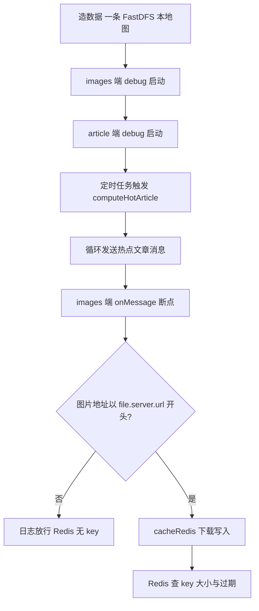

# 监听消息测试：从热点消息到 Redis 里的图片字节

> 🔒 安全提示：文中示例的口令/密钥均为课程教学环境演示口径，生产环境的安全要求见《安全与合规须知》。

代码三件套齐了：缓存服务会下载写库，处理服务会挑图过闸，监听类会收消息转发。这一课没有新代码，产出是一份可复用的联测剧本：怎么造数据、两个服务按什么顺序起、断点打在哪、Redis 里看什么、失败场景长什么样。链路横跨两个微服务加一套消息中间件，联测不排好剧本，出问题时连「哪一环坏了」都说不清。

## 先给结论

- 测试数据三条件：发布时间落在批算的统计窗口内（晚于昨天）、至少一条文章的封面是 FastDFS 本地图、其余保持爬虫数据原样充当反向样本。
- 启动顺序是 images 端先 debug 启动、article 端后 debug 启动，文章端启动后定时任务自动批算并发消息，不需要手工触发。
- 定时任务临时改成 `0 0/5 * * * ?`（每 5 分钟一轮）方便观察；上线口径是每天凌晨 0 点 05 分一轮（`0 5 0 * * ?`），测完必须改回。
- 断点链路：监听器 `onMessage` 收到消息、取 articleId、查内容解析图片、爬虫图放行、封面图命中 FastDFS 前缀、`cacheRedis` 写入，一气呵成。
- Redis 验证三查：按前缀 `keys` 查 key 是否出现、`strlen` 看大小（Base64 后约为原图字节的 4/3）、`ttl` 看过期倒计时。
- 失败场景两条：地址 404 下载异常被吞只记日志，超大图过阈值不进缓存，两者都不影响其余图片、不触发消息重放。

## 造数据：三条文章一条本地图

热文章批算只捞统计窗口内发布的文章，测试数据的发布时间要落在昨天之后；图片方面，库里大部分文章来自爬虫，图片全是外站地址，正向样本得手动造一条。提前在 FastDFS 里存一张真图，再把某篇文章的封面换成它的地址：

```sql
-- 测试数据：把一条文章的封面换成 FastDFS 本地图，发布时间挪进统计窗口
update ap_article
set images = 'http://192.168.25.133/group1/M00/00/00/test.jpg',
    publish_time = now()
where id = 10120;
```

数据设计成「多数反向、一条正向」是刻意的：爬虫文章的正文图与封面图会在闸门处逐张放行并打日志，正好把过滤逻辑也测到；那条本地图则负责验证端到端的正向链路。如果数据全是爬虫文章，跑完 Redis 空空如也，链路明明通了还以为坏了，这是这条链路联测最常见的冤案。

## 启动顺序与定时触发

先起 images 端再起 article 端，两端的启动方式与观察点不同。images 端以 debug 方式启动，断点打在监听器与处理服务里；启动日志里核对 `add auto listener` 那行输出，确认 `HotArticleListener` 被工厂收编。article 端也 debug 启动，它带着热文章批算的定时任务，触发周期为联测临时放宽：

```java
// 联测临时放宽：每 5 分钟触发一轮批算
// 上线口径：每天凌晨 0 点 05 分一轮，即 0 5 0 * * ?
@Override
public String trigger() {
    return "0 0/5 * * * ?";
}
```

任务一跑就是完整的一条链：批算查出窗口内文章、算分、缓存频道页、保存热文章，循环里逐条发 `ApHotArticleMessage`。放宽周期的好处是错过一轮不用重起，等几分钟下一轮自动补上；坏处是同一批数据会被反复处理，好在缓存是 set 覆盖写，幂等兜底，无害。

从造数据到落 Redis 的整条测试链：



正向样本走完 `G` 到 `I` 到 `J` 的路径，反向样本在 `G` 处被放行，两条路径各验各的。

## 断点里看什么

debug 模式下逐段放行，每一段都有一眼能确认的东西。消息一到，监听器断点先停，`data.value()` 是信封 JSON，展开看 `data` 字段里的热点文章，`articleId` 与造的数据对上（比如 10120）；往下走到内容解析，爬虫文章的内容解开是一串 JSON 数组，图片节点的 value 全是外部域名，闸门分支逐张打日志「非站内图片不进行缓存」后放行，这正是预期行为，别当成 bug。

翻到本地图那条数据，封面地址以地址头开头，走进缓存分支：`formatPath` 拆出 group 与 file，`downloadFile` 拉回字节，字节长度在阈值之内，`isCache` 为真，`set` 命令带上 86400 秒的过期执行完毕。断点停在这里时顺手看一眼返回的字节数组长度，非零即成功，剩下交给 Redis 侧验证。

## Redis 验证

不进 debug 环境的快速验证用命令行三查，课程集群的 Redis 在 node01~node03 上：

```bash
# 连课程集群的 Redis
redis-cli -h node01

# 一查 key：按业务前缀扫，应当出现编码后的图片缓存键
keys app:cache:image:*

# 二查大小：strlen 返回 value 的字符串长度，约为原图字节的 4/3
strlen app:cache:image:<编码串>

# 三查过期：ttl 返回剩余秒数，写入时按 86400 秒设置
ttl app:cache:image:<编码串>
```

`keys` 前缀扫描在测试环境随手用没问题，生产库要换成 `scan` 增量遍历，全量阻塞是它的原罪。`strlen` 的数值能反推原图体积：Base64 编码把三分之四的膨胀算进去，除一下就是字节数，验证「这张图确实下载成功了」比看日志还直接。`ttl` 随写入后时间流逝递减，只要不是负一（永不过期）或负二（key 不存在），过期策略就在正常工作。

## 失败场景验证

正向通了只算一半，三个失败场景各验一遍，每一个都能检验前面的某个设计。

**地址 404。** 把数据里那张本地图的 fileId 改成不存在的路径，下一轮消息进来，`downloadFile` 抛异常，被 `cacheRedis` 的 catch 拦住，日志里出现「图片缓存失败」，方法返回 null。观察三个现象：Redis 里没有这个 key；同一条消息里其他图片照常缓存；监听器正常返回、位移正常提交，消息不重放。这一组现象验证的正是「旁路吞异常」的设计，坏图只坏自己。

**超大图。** 换一张超过阈值的图（示例阈值 1MB），下载正常返回字节，阈值判断把它挡在写入之前，Redis 里同样没有 key，但返回值照常带着字节走原路径。它与 404 的差别在于：前者是异常路径，后者是正常路径上的策略跳过，日志的表现也不同。

**消息体损坏。** 手工往 topic 里塞一条残缺 JSON（用发送端代码改一版或用命令行工具），监听器 catch 住反序列化异常记「接收消息失败」，处理服务完全不会被调到，同样不重放。三个场景合起来，失败图谱就完整了：能局部失败的绝不整体失败，不可恢复的一律快速记日志跳过。

测试收尾别忘了两件事：把定时任务的 cron 改回每天凌晨 0 点 05 分，把造的那条测试数据的封面改回原值，联测环境不能变成线上定时炸弹。

## 常见误区

- **数据全用爬虫文章。** 错例是跑完批算去 Redis 一查，前缀下空空如也，怀疑链路有问题。正解是造数据时保证至少一条 FastDFS 本地图，正向反向样本都要有。
- **忘了改定时任务周期。** 错例是照线上口径等每天凌晨一轮，白等一天。正解是联测期临时放宽到 `0 0/5 * * * ?`，测完改回，两个口径都写进注释。
- **断点停太久。** 错例是在 `onMessage` 断点里慢慢研究代码，超过会话超时（封装的消费者配置为 90 秒）触发组内 rebalance，分区被挪走。正解是观察完及时放行，需要细看就先取下快照再放。
- **在测试环境用 keys 顺手扫了生产库。** 错例是养成习惯，上生产一扫阻塞整个 Redis。正解是测试用 `keys` 图快，生产一律 `scan` 增量遍历。

## 面试可能被问到的问题

1. 面试官追问：「图片预热联测的测试数据怎么设计？」
   答：控制变量三要素。发布时间落在批算统计窗口内保证消息发得出来；至少一条 FastDFS 本地图保证正向链路可验证；保留爬虫数据充当反向样本，覆盖闸门放行路径。正向反向都要有，只测正向等于没测过滤。
2. 面试官追问：「重复消费在这套链路里为什么无害？」
   答：图片缓存的 key 由 URL 经 Base64 恒定生成，写入是 set 覆盖语义，同一张图消费多少次，最终状态与消费一次一致，多花的只是下载 IO。联测期定时任务每 5 分钟重跑一遍同一批数据，正是靠这个性质保持数据正确。
3. 面试官追问：「怎么确认一条消息真的被消费成功了？」
   答：三个证据一起看：监听器日志有「接收到热文章消息」与处理开始结束的成对输出；Redis 里按前缀能查到预期 key 且 ttl 正常递减；消费组的 lag 归零说明位移已提交。三者齐了才算闭环，缺一个就顺着断点链路找。
4. 面试官追问：「断点停太久会发生什么？」
   答：消费者会话超时，封装配置为 90 秒，超时后 broker 认为该消费者下线，触发组内 rebalance，分区挪给别的消费者；断点放行后消息可能被重复投递。靠缓存的覆盖写语义兜底，数据不脏，但联测时要控制断点停留时间。
5. 面试官追问：「预热失败的图片后续怎么补救？」
   答：不做实时补救，等下一轮批算预热消息自然覆盖，TTL 与批算周期对齐保证最终一致。404 这类持续失败的地址会在每轮日志里重复出现，运维通过日志聚合发现问题源头，修数据或修存储后下一轮自动恢复，不需要人工补缓存。

## 配套资料

- 代码：`materials/code/05/头条day13/`。该日资料包解压结果为空（未含源码文件），文中 SQL、redis-cli 命令、cron 配置与失败场景按画面线抄录并按本课写法补全；引用路径截至 `头条dayNN/` 层级，内层目录名含项目原名，不进入正文。
- 代码：`materials/code/05/头条day07/`，Kafka 封装真实随包提供，联测观察点涉及的会话超时 90 秒、重试模板与错误处理器均出自其中的 `KafkaConsumerConfig` 与 `RetryErrorHandler`。
- 环境：课程集群 node01~node03，MySQL root/123456，Redis 与 Kafka 均部署在集群上；FastDFS 地址头与中间件地址按所在环境修改。
