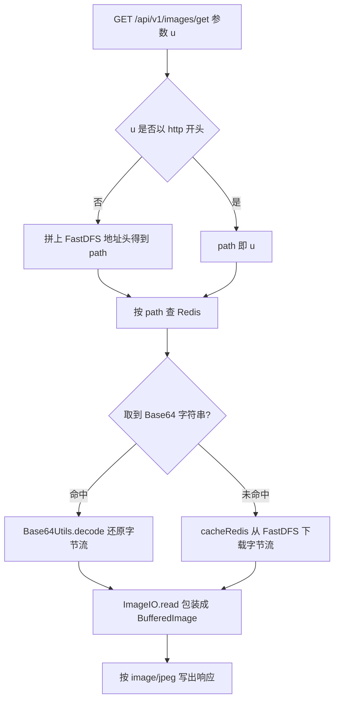

# 图片访问接口：从 Redis 里把图片以 HTTP 响应的形式吐出去

> 🔒 安全提示：文中示例的口令/密钥均为课程教学环境演示口径，生产环境的安全要求见《安全与合规须知》。

热文章的图片已经成批进了 Redis，key 是图片地址，value 是 Base64 字符串。可 Redis 里的字节再全，浏览器和 App 端的 image 组件也不认识，它们只认一个能直接出图的 HTTP 地址。存储侧的活干完只算一半，还得补一个图片访问接口：请求带一个图片地址进来，响应把图片本体吐出去。本课把这个 GET 接口写通，顺带解决两个问题：缓存的 key 怎么和请求参数对上，以及返回图片对象时 Spring MVC 那道必须补上的注解。

## 先给结论

- 接口契约很简单：GET 请求带参数 `u` 传图片地址，方法返回 `BufferedImage`，`produces` 声明 `image/jpeg`，响应头 Content-Type 由此定成图片类型。
- 命中路径：用补全后的图片地址查 Redis，取出的 Base64 字符串先解码成 `byte[]`，再经 `ImageIO.read` 包成图片对象返回。
- 未命中路径：转调图片缓存服务的 `cacheRedis(path, false)`，直接从 FastDFS 下载字节流；第二个参数传 false 表示只取不写缓存。
- 参数先补全再查询：地址不以 http 开头就拼上 FastDFS 地址头，保证与缓存写入侧的 key 完全一致，差一个字符都查不到。
- 返回图片对象的方法上必须加 `@ResponseBody`，课程现场在这栽了一跤，浏览器迟迟出不了图。

## 接口契约：一张图对应一个 GET 地址

接口定义沿用工程的惯例：apis 包里立契约，方法签名先行，HTTP 细节留给实现类。返回类型选 `BufferedImage` 而不是 `byte[]` 或 `String`，是因为这个返回值能被 image 标签的 src 直接消费，浏览器拿到响应就能渲染；入参 `u` 收图片地址，完整 URL 或相对路径都行：

```java
package com.study.headline.images.api;

import org.springframework.web.bind.annotation.RequestParam;

import java.awt.image.BufferedImage;

/**
 * 图片访问接口契约
 */
public interface ImagesControllerApi {

    /**
     * 图片访问接口
     * @param u 图片地址，完整 URL 或相对路径
     * @return 图片对象
     */
    BufferedImage getImage(@RequestParam("u") String u);
}
```

这个地址就是前后端约定的图片出图口：前端把页面里的 FastDFS 图片地址整体改写成 `图片接口地址?u=原地址` 的形态（改写的具体动线在前端改造课展开），用户侧的每一次图片请求于是都流经这里，缓存才有机会接住流量。接口层只有契约，真正的取图逻辑在 images 微服务的控制器里。

## Controller 实现：先查缓存，未命中回源

控制器实现契约接口，注解在这里补齐：类级 `@RequestMapping("/api/v1/images")` 定基路径，方法级 `@GetMapping` 细化到 `/get`，`produces` 与 `method` 一并声明。方法体是标准的读缓存三段式：

```java
package com.study.headline.images.controller;

import com.study.headline.images.api.ImagesControllerApi;
import com.study.headline.images.service.CacheImageService;
import com.study.headline.utils.Base64Utils;
import lombok.extern.log4j.Log4j2;
import org.apache.commons.lang3.StringUtils;
import org.springframework.beans.factory.annotation.Autowired;
import org.springframework.http.MediaType;
import org.springframework.data.redis.core.StringRedisTemplate;
import org.springframework.stereotype.Controller;
import org.springframework.web.bind.annotation.GetMapping;
import org.springframework.web.bind.annotation.RequestMapping;
import org.springframework.web.bind.annotation.RequestMethod;
import org.springframework.web.bind.annotation.RequestParam;
import org.springframework.web.bind.annotation.ResponseBody;

import javax.imageio.ImageIO;
import java.awt.image.BufferedImage;
import java.io.ByteArrayInputStream;

@Log4j2
@Controller
@RequestMapping("/api/v1/images")
public class ImagesController implements ImagesControllerApi {

    @Autowired
    private StringRedisTemplate redisTemplate;
    @Autowired
    private CacheImageService cacheImageService;

    @ResponseBody
    @GetMapping(value = "/get", produces = MediaType.IMAGE_JPEG_VALUE,
            method = RequestMethod.GET)
    @Override
    public BufferedImage getImage(@RequestParam("u") String u) throws Exception {
        String path = u;
        // 相对路径补上 FastDFS 地址头，保证与缓存写入侧的 key 完全一致
        if (!u.startsWith("http")) {
            path = InitConfig.PREFIX + u;
        }
        log.info("图片访问请求开始 path: {}", path);
        // 先查 Redis：缓存写入时图片字节以 Base64 字符串形态存储
        String baseCode = redisTemplate.opsForValue().get(path);
        if (StringUtils.isEmpty(baseCode)) {
            // 未命中：从 FastDFS 下载字节流，第二个参数 false 表示只取不写缓存
            byte[] bytes = cacheImageService.cacheRedis(path, false);
            return ImageIO.read(new ByteArrayInputStream(bytes));
        }
        // 命中：Base64 解码还原字节流，再包装成图片对象
        byte[] source = Base64Utils.decode(baseCode);
        BufferedImage bufferedImage = ImageIO.read(new ByteArrayInputStream(source));
        log.info("图片访问请求结束 path: {}", path);
        return bufferedImage;
    }
}
```

整条链路画出来是一棵以 Redis 命中与否为分叉的二叉树：



关键分叉在中间：命中与未命中最终汇到同一个 `ImageIO.read`，调用方拿到的响应形态完全一致，图片到底来自缓存还是存储，前端无从感知也不必感知。`InitConfig.PREFIX` 是工具模块初始化配置里的 FastDFS 地址头（协议加主机与端口），与图片缓存链路拼地址用的是同一处配置，这才保证「写 key 用的串」和「读 key 用的串」一字不差。

`cacheRedis` 的第二个参数是缓存服务的语义开关：传 true 时读取会带上缓存回填，传 false 表示调用方只要数据、不动缓存。访问接口这里传 false，理由是图片缓存的内容由预热侧全量维护（监听热文章消息批量写入，带 24 小时过期），读接口只做兜底取图，不让冷门图片挤占缓存空间。生产上要改成「未命中回填加互斥重建」也只在调用处换一个参数、在服务实现里补一段写入逻辑，接口契约不用动。

## 三个容易忽略的细节

**produces 决定响应头 Content-Type。** `produces = MediaType.IMAGE_JPEG_VALUE` 把响应的 Content-Type 定为 `image/jpeg`，浏览器靠它决定按图片渲染而不是按文本下载。这个属性和 `method` 一起写在 `@GetMapping` 里，还顺带把请求方式收紧为 GET，POST 打进来直接 405。

**byte 数组到图片对象要走两步。** Redis 里是 Base64 字符串，图片渲染要的是二进制，中间隔着两层转换：`Base64Utils.decode` 还原字节流，`ByteArrayInputStream` 把字节数组包成输入流，`ImageIO.read` 再读成 `BufferedImage`。解码方法内部逐字节处理了有符号 byte 的负值回绕，这是图片微服务导入课就备好的工具，读侧直接复用。

**返回 BufferedImage 依赖消息转换器。** 方法返回值由 Spring MVC 的消息转换器按 produces 的媒体类型写出，若工程默认的转换器组合写不出图片对象，调用会报媒体类型协商失败，此时显式注册一个 `BufferedImageHttpMessageConverter` 即可；排查这类问题先看响应状态码与日志里的转换器报错，不要急着怀疑缓存数据。

## 联调：断点加浏览器就够了

images 微服务以 debug 启动，在 `redisTemplate.opsForValue().get(path)` 一行打断点，用浏览器或接口工具直接请求：

```bash
# 课程环境 images 微服务端口 9010，u 传缓存里已有的图片地址
curl -o demo.jpg "http://localhost:9010/api/v1/images/get?u=/group1/M00/00/01/demo.jpg"
```

断点应停在命中路径上：path 是补全后的完整地址，baseCode 拿到一长串 Base64。放行后响应体就是图片本体。课程现场第一次请求浏览器却出不来图，排查半天代码逻辑没问题，最后发现少了一个注解：类上是 `@Controller` 而不是 `@RestController`，方法返回值被 Spring MVC 当成视图名去解析，自然找不到页面。补上 `@ResponseBody` 重启，图片立刻出来。返回 JSON 的接口里这个坑常被 `@RestController` 一笔带过，一旦哪天写了返回非字符串对象的接口，它就会回来找你。

## 常见误区

- **漏掉 @ResponseBody。** 错例是照着 JSON 接口的样子用 `@Controller` 返回 `BufferedImage`，Spring MVC 把返回值当视图名解析，浏览器得到 404 或空白。正解是方法上加 `@ResponseBody`，或类上直接用 `@RestController`。
- **读 key 与写 key 不一致。** 错例是接口收到相对路径直接拿去查缓存，而写入侧存的是带地址头的完整 URL，永远未命中。正解是查询前把地址补全成与写入侧完全相同的字符串。
- **解码与编码不配对。** 错例是写入侧用 `Base64Utils.encode` 编码、读侧用别的解码器按不同字符集解，字节错乱图片花屏。正解是编码解码用同一对工具方法，只经这一条通道。
- **未命中时把异常直接抛给用户。** 错例是 FastDFS 下载失败或图已删除时异常冒泡，用户看到 500。正解是捕获后回一张占位图或明确的 404 响应，兜底策略写进服务实现。

## 面试可能被问到的问题

1. 面试官追问：「图片缓存为什么存 Base64 字符串而不是直接存字节数组？」
   答：value 以字符串形态存储读写链路最省事，StringRedisTemplate 的序列化配置不需要额外处理二进制；Base64 编码后内容可打印，排查时能直接确认 key 与内容对得上。代价是体积膨胀约三分之一，图片场景可接受。若追求极限内存利用率，可换二进制安全的序列化器直接存字节。
2. 面试官追问：「未命中时为什么不回填缓存？」
   答：课程版的图片缓存由预热侧全量维护，内容范围与生命周期都是预热侧说了算，读接口只做兜底取图，避免冷门图片把热图挤出内存。生产上常见做法是未命中回填并带 TTL，但要配互斥重建防击穿、防重复写，缓存的主导权仍在写入侧。
3. 面试官追问：「接口为什么返回 BufferedImage 而不是 byte 数组？」
   答：两者都能出图。返回 BufferedImage 走图片消息转换器，produces 与 Content-Type 天然对齐，语义清晰；返回 byte 数组更通用，配合 produces 也能正确写出。关键是响应头必须声明图片类型，浏览器与 App 端的 image 组件才按图片处理。
4. 面试官追问：「如果缓存与 FastDFS 里都没有这张图，接口该怎么表现？」
   答：不能让异常直接冒给用户。捕获下载失败与图不存在的场景，返回明确的 404 或一张统一的占位图，同时记日志定位脏地址来源。占位图还能挡住前端因加载失败触发的重试风暴。
5. 面试官追问：「图片访问接口怎么防止被当成免费的代理下载器？」
   答：加来源与频次控制。接口只服务自家 App 的图片地址，可校验参数形态（必须是本站 FastDFS 的路径特征），配限流与鉴权；上了网关后再加一层黑白名单。缓存接口暴露在公网时，安全设计与性能设计同样重要。

## 配套资料

- 代码：`materials/code/05/头条day13/`。该日资料包解压结果为空（未含源码文件），文中 ImagesControllerApi、ImagesController 与请求示例为按画面线（IDE 截图出自课件与调试画面）抄录并按本课写法补全的可运行版本，包名统一改写为 `com.study.headline`；引用路径截至 `头条dayNN/` 层级，内层目录名含项目原名，不进入正文。
- 关联：`CacheImageService` 接口与 `Base64Utils` 工具来自图片微服务导入课的画面线口径（`materials/code/05/头条day07/` 可对照工程里真实随包的 Kafka 封装，消息监听复用同一套公共能力）。
- 环境：课程集群 node01~node03，MySQL root/123456；images 微服务端口课程环境为 9010，FastDFS 地址头在 images 模块配置文件中按所在环境修改。
