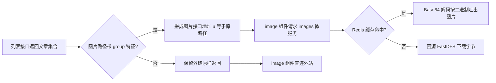

# 首页接口前端切换与联调：三行地址升级 v2，图片出口换到缓存接口

> 🔒 安全提示：文中示例的口令/密钥均为课程教学环境演示口径，生产环境的安全要求见《安全与合规须知》。

后端 V2 的三条路由已经注册，service 的缓存与回源路径也验证过了，剩下的事看起来小得反常：前端改配置里的接口地址，再把图片地址换到图片接口。真正的工作量在测试那一半：五个微服务加缓存加数据库中间件起一遍，登录进首页验证命中路径，上拉下拉验证回源路径，测试库没数据时还得顺着时间方向与频道维度把数据补齐。这一课把前端的改动、联调的环境清单与两条路径的体感差异一次讲完。

## 先给结论

- 前端核心改动只有一处：`src/common/conf.js` 里 load、load_new、load_more 三个地址的版本位 v1 改 v2，请求与解析代码零改动。
- 代理层不用动：proxyTable 剥的是自定义前缀，接口路径里的版本位原样透传，v1 换 v2 对它透明。
- 联调要起 article、behavior、user、login、images 五个微服务，外加 Redis 与 MySQL 中间件 Mycat，起不全时重启最省事。
- 图片地址在渲染层统一改写：路径带 `group` 特征的自家 FastDFS 图片替换为图片接口地址，爬虫文章的外链图片原样返回。
- 回源路径查空时按两个维度排查：时间方向（刷新要晚于锚点的增量）与频道维度（热文章行 channel_id 必须与请求频道对齐）。

## 接口地址切换：改的是版本位，不是结构

前端请求统一走 `src/common/request.js` 的封装，地址常量集中在 `src/common/conf.js`。切 V2 就是把三个地址的版本位改掉：

```javascript
// src/common/conf.js：三个列表接口全部升到 v2
const API = {
  load: '/api/v2/article/load',
  load_new: '/api/v2/article/load_new',
  load_more: '/api/v2/article/load_more'
};
```

请求体与响应壳两边都没动，页面里的调用、promise 处理、列表渲染全部原样。开发期请求走同源 dev server，由 `config/config.js` 的 proxyTable 转发到后端，转发规则剥掉的是 `/toutiaoapi` 这类自定义前缀，后面的 `/api/v2/article/load` 原样递给 article 微服务。版本位藏在剥前缀之后的路径里，代理层天然无感，这一段配置一行都不用改。

## 联调环境：一次要起的东西列清楚

这次改造横跨文章、行为、用户、登录、图片五个域，联调时的启动清单是完整的：article 微服务承载列表接口，behavior 微服务在加载时记录曝光与阅读行为，user 与 login 支撑登录态（登录用户走个人榜单，未登录走全局基线），images 微服务承接改写后的图片请求。缓存与数据库同样要就位：Redis 存着频道首页缓存与图片缓存，Mycat 挡在 MySQL 前面做中间件。五个 Spring Boot 进程加两个中间件，启动顺序没讲究，但要等它们全部就绪再发请求；Mycat 刚拉起就打请求容易连接失败，前端页面报接口错误时先别怀疑代码，把相关服务挨个重启一遍再试。

## 列表加载测试：两条路径分开验证

前端 dev server 起来后用浏览器打开页面预览，先登录，再进首页。在 article 服务的 `loadV2` 里打断点，首屏 load 请求进来时参数 dto 带 channelId，firstPage 是 true，往下走到频道首页缓存查询：key 按 `hot_article_first_page_` 加频道 id 拼出来，Redis 里能取到热文章计算课存好的列表，反序列化后直接 return。整条命中路径没有一行 SQL，控制台也看不到数据库日志，这就是首屏要的效果。

上拉与下拉验证的是回源路径。下拉刷新现场查了个空：锚点语义是「晚于 minTime 的增量」，翻遍测试库，热文章表的发布时间没有一个晚于当前时刻，方向条件天然查不出东西。补数据的动作有两步，缺一步都不行：

```sql
-- 时间维度：给一条热文章挪出一个晚于锚点的发布时间
update ap_hot_articles set release_date = '2026-11-05 23:00:00' where id = 1;
-- 频道维度：热文章行的 channel_id 必须与请求的频道对上
update ap_hot_articles set channel_id = 1 where id = 1;
```

改完再刷新，回源查到数据，页面上拉下拉都有内容。这里的排查思路值得留下：回源查询的过滤条件是词条或基线定行集、频道 id 等值定栏目、时间方向由 type 决定，查空时按「频道对没对、时间方向对没对」两问往下走，多数空结果都能当场定位。测试数据要与 `ad_channel` 表里的频道对应着造，只有频道 1 造了热文章，切到其他频道列表为空是数据问题而不是代码问题。

## 图片出口改造：一个判断函数收口

登录进首页后按 F12 看网络面板，文章封面的请求还直连着 FastDFS 存储节点。改造目标是把这类请求改道到图片接口：images 微服务的 GET 接口先查 Redis，命中直接吐出解码后的图片字节，未命中才回源存储。改写位置在列表项组件渲染封面的地方，文章的 mode 字段区分无图、单图、多图三种形态，图片地址统一过一个改写方法（示例命名 `formatImg`，按本课写法补全）：

```javascript
// 列表项组件里：封面图地址改写，示例命名 formatImg
formatImg(img) {
  // 自家 FastDFS 的路径都带 group 前缀，只有这类图片有缓存
  if (img.indexOf('group') !== -1) {
    // 课程环境 images 微服务端口 9010，u 参数传原始图片路径
    return 'http://localhost:9010/api/v1/images/get?u=' + img;
  }
  // 爬虫文章的外链图片原样返回，改写了反而查不到
  return img;
}
```

这个 `group` 判断是改写的安全阀。入库的文章有两个来源：自媒体端发布的文章，图片传到了自家 FastDFS，路径以 group 开头；爬虫抓来的文章，图片还是外站的完整链接。后者在 Redis 里没有任何缓存，拼到图片接口后面只会得到一次注定未命中的查询。判断收口之后，改写只作用于「确定有缓存覆盖」的那部分图片。改写后的请求链路如下：



验证方式与列表一样朴素：images 服务断点打在 Redis 查询一行，刷新页面，封面请求进来，参数 u 是补全后的完整路径，缓存里拿到 Base64 字符串，解码包装成图片对象写出响应。网络面板里这张图的请求地址已是 images 服务，响应类型是图片，FastDFS 那一侧在整个过程里没有被访问。

## 两种速度的体验对比

缓存改造好不好，请求两头发一次就有数。两条路径的取数链路与现场体感收成一张表：

| 路径 | 触发动作 | 取数链路 | 现场体感 |
|---|---|---|---|
| 缓存命中 | 首屏 load | 一次 Redis GET 加 JSON 反序列化 | 毫秒级返回，断点放行即出列表 |
| 缓存未命中回源 | 上拉或下拉 | 热文章表按条件查询，再回文章表取详情 | 明显等待，控制台可见计时打印 |

回源路径的慢有据可查：service 里临时加过 `System.currentTimeMillis` 前后计时，控制台打出的毫秒差就是这条链路的真实成本，热文章表一次查询加文章表一次回查只是下限，若实现里逐条回查还会放大成 N 加 1。命中路径把这些全部省掉，这组对比也解释了思路分析一课把流量大头（首屏 load）设计成唯一缓存路径的原因：调用量最大的请求拿到最大的收益，翻页与刷新诚实回源，各走各的账。

## 常见误区

- **只改 load 的地址。** 错例是首屏正常、上拉下拉仍在打 V1，两版接口行为不同却难以察觉，缓存验证的数据全被污染。正例是三个地址一起升版本，改完全局搜一遍 v1 确认无残留。
- **图片一律替换。** 错例是不加判断把所有 img 拼进图片接口，外链图片与数据没变的老图片白查一次缓存，还把 images 服务当成了代理下载器。正解是带 `group` 特征判断，只改写自家存储的图片。
- **把数据问题当缓存故障。** 错例是回源查空第一反应是缓存 key 拼错，沿着 Redis 排查半天。正解是先分清路径：首屏命中与否看缓存，回源查空先查测试数据的时间方向与频道对齐。
- **图片接口地址写死不带环境差异。** 错例是把课程环境的端口直接抄进提交的代码，换环境图片全挂。正解是地址头收敛到配置或常量，端口随环境走，代码里只留拼接逻辑。

## 面试可能被问到的问题

1. 面试官追问：「前端切 V2 为什么要连代理配置都不用改？」
   答：proxyTable 的匹配单位是自定义前缀，转发时把前缀剥掉，剩下完整路径原样透传。版本位在后半段路径里，对代理层透明。只要请求路径结构与转发目标不变，代理配置就与接口版本解耦。
2. 面试官追问：「联调时怎么证明首屏真的走了缓存？」
   答：三看。断点看代码路径，loadV2 在缓存命中分支直接 return，不进登录态分流；控制台看日志，命中时打出缓存规模的日志而没有 SQL；数据库看连接，回源路径必然伴随热文章表查询，命中路径全程无 SQL。三者一致才叫验证通过。
3. 面试官追问：「图片地址改写为什么用包含 group 判断，而不是判断域名？」
   答：入库的 FastDFS 相对路径本身不带域名，以 group 开头是这类路径的稳定特征；外链图片是完整 URL，域名五花八门，反向排除成本高。正向识别自家路径特征，代码短且不易漏，比维护外链域名黑名单可靠。
4. 面试官追问：「回源路径慢，除了缓存还能怎么优化？」
   答：先消灭 N 加 1，逐条回查合并成一次 IN 查询；再对回查结果做内存重排保住榜单名次；数据规模上来后，热文章榜单本身可以下沉到本地缓存或加二级缓存。这些优化与每日批算的缓存覆盖并不冲突，分属读路径与写路径。
5. 面试官追问：「下拉刷新走回源，那缓存什么时候能反映出新文章？」
   答：课程版由每日批算零点后全量覆盖频道首页缓存，白天新发布的文章要等下一次批算才进缓存，所以刷新路径必须回源拿增量。生产上可以再加一条写路径：文章发布事件触发缓存增量更新，让首屏缓存当天就带上新内容，代价是要处理并发写的一致性。

## 配套资料

- 代码：`materials/code/05/头条day13/`。该日资料包解压结果为空（未含源码文件），文中 conf.js 地址常量、formatImg 改写方法与测试数据 SQL 为按画面线（IDE 截图出自课件与调试画面）抄录并按本课写法补全的可运行版本，包名统一改写为 `com.study.headline`；引用路径截至 `头条dayNN/` 层级，内层目录名含项目原名，不进入正文。
- 关联：前端工程导入、request.js 封装与 proxyTable 同源代理的原始口径见前端导入与 http 请求两课正文；图片接口的命中与回源实现见图片访问接口一课。
- 环境：课程集群 node01~node03，Redis 部署在集群节点，默认密码 123456；MySQL root/123456，经 Mycat 中间件访问；article 微服务端口 9001、images 微服务端口 9010 以各环境配置文件为准；频道在 `ad_channel`、榜单在 `ap_hot_articles` 中查验。
