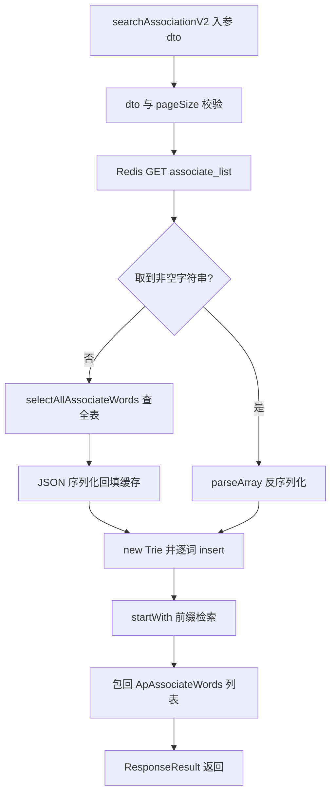

# 联想词 V2 落地：全量 Mapper、Trie 工具类与缓存联动的业务代码

> 🔒 安全提示：文中示例的口令/密钥均为课程教学环境演示口径，生产环境的安全要求见《安全与合规须知》。

方案课把路线定了：词库全量进 Redis，检索换 Trie 前缀树，接口契约只升版本位。这一课把四处新增写完：词库 Mapper 的全量查询、article 模块 utils 包里的 Trie 与 TrieNode 工具类、service 层的 V2 方法，控制层与综合测试在下一课收口。代码量不大，但有两个方向性判断（缓存分支谁在 if 谁在 else、成词标记记在哪）一旦写反，整条链路表面通顺实际查空，正好值得逐行说透。

## 先给结论

- Mapper 新增 `selectAllAssociateWords` 查词库全表，首版的 like 方法原样保留但不再调用，两版并存便于回退对照。
- Trie 与 TrieNode 放在 article 模块的 utils 包，对外只暴露两个方法：`insert` 插词、`startWith` 前缀检索，工程里只有 article 用得到，放 common 反而抬高归属成本。
- service 的 `searchAssociationV2` 五步走：参数校验、缓存优先、未命中回源并回填、构建 Trie、前缀检索后包回词条对象返回。
- 缓存 key 固定为 `associate_list`，value 是全量词库序列化成的 JSON 字符串，命中一次 Redis GET 就省掉一次词库表全扫。
- 课程版缓存没有过期与主动失效，词库变更后要删 key 重建或补 TTL，这是留白的生产演进点。

## Mapper：一条全量查询，旧的 like 留着

缓存要装的是整个词库，Mapper 补一条不带过滤条件的全量查询。在 `ApAssociateWordsMapper` 上新增方法：

```java
public interface ApAssociateWordsMapper {

    /** 首版：按关键字模糊查联想词，V2 起不再调用，保留用于对照回退 */
    List<ApAssociateWords> selectByAssociateWords(@Param("searchWords") String searchWords,
                                                  @Param("limit") Integer limit);

    /** V2 新增：查询词库全表，供缓存回填 */
    List<ApAssociateWords> selectAllAssociateWords();
}
```

对应 XML 只有 select 与 resultMap 的骨架，没有 where：

```xml
<!-- 查询词库全表：数据源只有一张小表，不加过滤条件 -->
<select id="selectAllAssociateWords" resultMap="BaseResultMap">
    select
    <include refid="Base_Column_List"/>
    from ap_associate_words
</select>
```

首版的 `selectByAssociateWords` 与它的 like XML 一并留在文件里。删除看似干净，实际是给回退埋坑：V2 万一要回滚，V1 的代码得整段找回；留着不动，切换与回退都只是改配置里接口地址的事。旧方法自 V2 起不再被调用，注释里写明状态，避免后人误以为还有调用方。

## Trie 工具类：两个方法撑起检索

TrieNode 是树的节点，四个字段各司其职：`var` 记当前字符，`isword` 标记从根到这里的路径是否构成完整词条，`children` 是子节点表（字符到子节点的映射），`containLongTail` 是长尾标记，表示这个前缀之下还挂着更长的词。Trie 持有根节点，根的字符不参与匹配，只当挂载点：

```java
package com.study.headline.article.utils;

import java.util.HashMap;
import java.util.Map;

/** Trie 节点：var 记字符，isword 记成词，children 挂子节点 */
public class TrieNode {
    public char var;
    public boolean isword;
    public Map<Character, TrieNode> children = new HashMap<>();
    public boolean containLongTail = false;
}
```

```java
package com.study.headline.article.utils;

import java.util.ArrayList;
import java.util.List;
import java.util.Map;

/** Trie：插入词条，按前缀检索 */
public class Trie {
    private TrieNode root;

    public Trie() {
        root = new TrieNode();
        // 根节点的字符不参与匹配，只当挂载点
        root.var = '\u0000';
    }

    /** 插入一个词：沿字符逐层建节点，末节点打上成词标记 */
    public void insert(String word) {
        TrieNode ws = root;
        for (int i = 0; i < word.length(); i++) {
            char c = word.charAt(i);
            if (!ws.children.keySet().contains(c)) {
                ws.children.put(c, new TrieNode());
            }
            ws = ws.children.get(c);
        }
        ws.isword = true;
    }

    /** 前缀检索：先沿前缀下行，再收集子树里全部成词节点 */
    public List<String> startWith(String prefix) {
        List<String> ret = new ArrayList<>();
        TrieNode ws = root;
        for (char c : prefix.toCharArray()) {
            if (!ws.children.containsKey(c)) {
                // 前缀在树里中断，一个候选都没有
                return ret;
            }
            ws = ws.children.get(c);
        }
        collect(ws, new StringBuilder(prefix), ret);
        return ret;
    }

    /** 深度优先收集：走到每个 isword 节点时收下当前路径拼出的词 */
    private void collect(TrieNode node, StringBuilder path, List<String> ret) {
        if (node.isword) {
            ret.add(path.toString());
        }
        for (Map.Entry<Character, TrieNode> e : node.children.entrySet()) {
            // 进子树前挂上当前字符，回来后摘掉，路径始终对应根到当前节点
            path.append(e.getKey());
            collect(e.getValue(), path, ret);
            path.deleteCharAt(path.length() - 1);
        }
    }
}
```

`insert` 逐字符下行，分支已存在就复用，不存在就新建，公共前缀天然只存一份；末节点必须置 `isword`，这个标记是检索阶段唯一的收词依据。`startWith` 分两段：先沿前缀下行定位子树，前缀在树里走断了就立即返回空；再从定位到的节点深度优先收集，每碰到一个成词节点就把路径拼成词收进结果。搜「微」能带出「微服务」，也能带出「微服务治理」，输入完整词同样命中，这正是联想的语义。两个类的位置有个小决策：放 article 模块 utils 还是公共 common，判据是使用范围，当前只有 article 的搜索域用得到，留在 article 让依赖方向最短；哪天其他模块也要做前缀检索，再上提到 common 不迟。

## Service V2：缓存联动与检索的完整流

service 接口在方案课已声明 `searchAssociationV2(UserSearchDto)`，实现类 `ApArticleSearchServiceImpl` 里补实现，注入 `StringRedisTemplate` 与词库 Mapper：

```java
@Autowired
private StringRedisTemplate redisTemplate;
@Autowired
private ApAssociateWordsMapper apAssociateWordsMapper;

@Override
public ResponseResult searchAssociationV2(UserSearchDto dto) {
    // 1. 参数校验：dto 与 pageSize 都要非空，条数上限 50
    if (dto == null || dto.getPageSize() == null || dto.getPageSize() > 50) {
        return ResponseResult.errorResult(AppHttpCodeEnum.PARAM_INVALID);
    }
    try {
        // 2. 先查缓存：全量词库挂在固定 key 下
        String assoStr = redisTemplate.opsForValue().get("associate_list");
        List<ApAssociateWords> aw = null;
        if (StringUtils.isBlank(assoStr)) {
            // 3. 未命中：查词库表全量并回填，第二次请求开始走缓存
            aw = apAssociateWordsMapper.selectAllAssociateWords();
            redisTemplate.opsForValue().set("associate_list", JSON.toJSONString(aw));
        } else {
            // 4. 命中：反序列化回词条列表
            aw = JSON.parseArray(assoStr, ApAssociateWords.class);
        }
        // 5. 构建 Trie 并逐词插入
        Trie t = new Trie();
        for (ApAssociateWords a : aw) {
            t.insert(a.getAssociateWords());
        }
        // 6. 前缀检索，字符串结果包回词条对象，对齐出参契约
        List<String> ret = t.startWith(dto.getSearchWords());
        List<ApAssociateWords> list = Lists.newArrayList();
        for (String s : ret) {
            ApAssociateWords ap = new ApAssociateWords();
            ap.setAssociateWords(s);
            list.add(ap);
        }
        return ResponseResult.okResult(list);
    } catch (Exception e) {
        log.error("联想词检索异常 searchWords: {}", dto.getSearchWords(), e);
        return ResponseResult.errorResult(AppHttpCodeEnum.SERVER_ERROR);
    }
}
```

整条链路画出来是一条缓存分叉再汇合的路径：



两个判断点是这段代码的成败所在。**缓存分支的方向不能反。** 取出的字符串为空才走查库回填，非空才走反序列化，这句大白话翻成代码时极易把两个分支写反：空串拿去 `parseArray` 得到 null，下一行建树直接空指针；有值反而去查库回填，缓存永远用不上，等于白挂一层 Redis。写完先盯一眼 if 条件里的 `isBlank`，再顺着两个分支各读一遍，方向对了才继续往下。**判空要在解引用之前。** 校验条件里 dto 的判空必须放在 `getPageSize()` 前面，pageSize 的判空必须放在大于 50 的拆箱比较前面，条件顺序就是执行顺序，写反了参数校验自己先抛空指针，防线变漏点。

出口处把 `List<String>` 包回 `ApAssociateWords` 也不是多余动作。出参契约是词条对象的列表，前端按 associateWords 字段渲染，直接把字符串列表塞进 ResponseResult，前端拿到的字段名对不上，整页联想框空白。返回前顺手按 `pageSize` 截断一刀也是值得补的收尾：Trie 收集子树时不知道条数上限，候选特别多的前缀会把整棵子树都吐出来，课程版没做这一步，生产实现建议在包装循环里判断条数及时 break。

## 缓存与词库的同步策略

缓存联动最薄弱的一段在「词库变了怎么办」。课程版的 `set` 不带过期时间，也没有任何主动失效，运营往 `ap_associate_words` 里加了新词，`associate_list` 里的旧名单纹丝不动，Trie 每次请求都从旧缓存重建，新词永远出不了候选。生产上按变更频率三选一：词库增删改的入口处顺手删掉 key，下一次查询回源重建，实时性最好，代价是与写路径耦合；给 key 设一个可容忍的 TTL（比如十分钟），接受分钟级延迟，换来实现零侵入；词库量级大了之后，把解析与建树的产物放进带版本号的本地缓存，词库变更时只推一个版本号，重建才不会压在每个请求上。还有一个每次请求都绕不开的开销要心里有数：课程版每个请求都 new Trie 并全量插入，词条数千时毫秒级尚可接受，词库一旦上万就该把树随缓存一起复用，这也是版本号方案的另一个动机。

复杂度上把新旧两版对齐看就一目了然：like 版每次请求全表扫描 N 条词条、逐条做字符串包含比较，代价 O(N×L)；V2 版命中路径一次 Redis GET 加一次 O(L) 的前缀下行加子树收集，与词库规模无关。数据库资源与查询效率两条需求，各自找到了着落。

## 常见误区

- **缓存分支写反。** 错例是 `isBlank` 为真时去 `parseArray`、有值时去查库，缓存永远不生效还伴随空指针。正解是空串查库回填、非空反序列化，写完顺着两个分支各走一遍。
- **insert 末尾漏置 isword。** 错例是只建链不打标，树看起来建好了，startWith 收不到任何成词节点，联想永远返回空。正解是插入循环结束后给末节点置 `isword = true`，单测用「插入后立即检索」验证。
- **校验条件的判空顺序颠倒。** 错例是 `dto.getPageSize() > 50` 写在 `dto == null` 前面，或漏掉 pageSize 的 null 判断直接拆箱比较，参数校验自己抛 NPE。正解是先对象后字段，先判空再比较。
- **直接返回字符串列表。** 错例是 startWith 的结果不做包装，ResponseResult 的 data 里是纯字符串数组，前端按词条对象解析全部失败。正解是包回 `ApAssociateWords` 并保持字段名与 V1 一致，契约不动才有无感切换。

## 面试可能被问到的问题

1. 面试官追问：「V2 里每个请求都重建 Trie，这样设计有什么问题，怎么改？」
   答：构建开销与词条总量成正比，词库几千条时毫秒级可接受，上万后每次请求的 CPU 与 GC 压力都会显形。改进方向是把构建好的树放进本地缓存复用，配合词库版本号失效：词库变更推新版本，下一次请求用新版本重建，平时直接复用。
2. 面试官追问：「缓存回填为什么放在查库之后立刻做，而不是异步？」
   答：回填在请求线程里做，代码路径直观，未命中的请求顺手把缓存喂满，第二个请求就能命中。异步回填要处理失败重试与并发写，收益只有省下请求线程里一次 Redis 写的耗时。小体量词库场景同步回填更划算，异步留给回填成本高的场景。
3. 面试官追问：「多个服务实例同时未命中，会不会同时查库回填？」
   答：会，这是缓存击穿的典型场景。词库全量查询本身轻量，短暂并发可容忍；要严格防护就加分布式锁或只让单实例回填，其他实例短暂等待。词库这种低频静态资产的击穿代价远小于热点数据，通常不做重防护。
4. 面试官追问：「Trie 的 startWith 结果顺序稳定吗，需要排序吗？」
   答：子树深度优先收集的顺序取决于 children 这个 HashMap 的遍历顺序，不保证与词库业务权重一致。展示次序有要求的场景，要么给词库加权重列、在包装循环里按权重排序，要么把 children 换成有序结构，不要依赖 HashMap 的天然顺序。
5. 面试官追问：「为什么旧的 like 方法留着不删，留着不会有维护负担吗？」
   答：并存期的价值在回退：V2 出问题切回 V1，删除旧代码意味着回退要靠版本管理翻历史。维护负担通过注释标明状态来控制，写清自 V2 起不再调用，等切换稳定后的清理窗口再统一移除，比当场删光稳妥。

## 配套资料

- 代码：`materials/code/05/头条day13/`。该日资料包解压结果为空（未含源码文件），文中 TrieNode、Trie、selectAllAssociateWords 与 searchAssociationV2 为按画面线（课件文档的工具类说明与 IDE 调试画面）抄录并按本课写法补全的可运行版本，包名统一改写为 `com.study.headline`；引用路径截至 `头条dayNN/` 层级，内层目录名含项目原名，不进入正文。
- 关联：`materials/code/05/头条day01/`，内层数据库规范设计说明书是词库表字段命名的依据；首版 like 查询的 Mapper 与 XML 全文见搜索联想词接口开发课正文，可与 V2 的全量查询对照。
- 环境：课程集群 node01~node03，Redis 部署在集群节点，默认密码 123456；MySQL root/123456；缓存 key `associate_list` 可在 Redis 中手工查验，词库数据在 `ap_associate_words` 中插入或修改后按同步策略验证。
