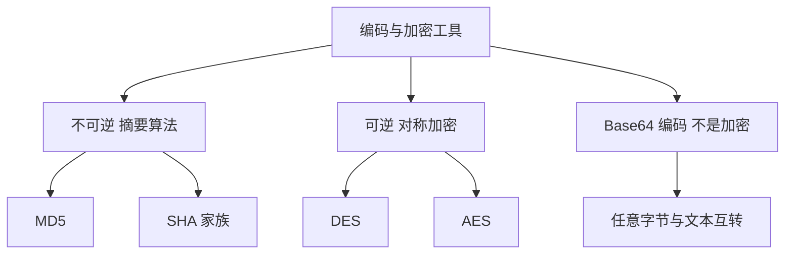

# 接口安全第一课：MD5、DES 与 Base64 各自管什么

> 🔒 安全提示：文中示例的口令/密钥均为课程教学环境演示口径，生产环境的安全要求见《安全与合规须知》。

登录改造的需求书上写得很直白：改造登录功能进行加密验证，实现不同的加密工具类，接口升级为 `/api/v2/login/login_auth`。落到现状上就是一句话，`ap_user` 表的 password 列现在存的是明文，登录比对是一行 `equals`，这两处都要换。换之前得先把工具备齐：MD5 与 DES 两个工具类拷进 common 模块的 utils 包，弄清每个算法能干什么、不能干什么，后面两课的验证逻辑才有的放矢。

## 先给结论

- 加密类工具先按「能不能还原」分家：MD5 这类摘要算法不可逆，DES 与 AES 这类对称算法可逆，Base64 是编码不是加密。
- 密码存储选不可逆摘要：库里存 MD5 串，登录时对输入做同样摘要再比对，两个串一致即密码正确。
- 裸 MD5 同串必同摘要，在线解密库靠海量串对照就能撞出简单密码，工程上要加盐：每个用户一个 salt，摘要按密码加盐计算，salt 存进 `ap_user.salt`。
- DES 对称可逆，加密解密用同一把密钥，适合需要还原原文的场景；utils 工程已有的 IdUtils 走的正是 AES 对称路线，负责 ID 混淆。
- 本课两个工具类落位 utils 包：`MD5Utils` 与 `DESUtils`，随后两课用它们改造密码验证与登录验证。

## 先分类：可逆与不可逆

选型之前先把地图画清楚，这张图把常用工具按「能不能从结果还原原文」分成三类：



不可逆意味着拿到结果推不回原文，它的价值在「只比对、不还原」的场景，密码是典型；可逆意味着持密钥即可还原，适合服务端以后还要把内容读回来的场景，比如混淆自增 ID；Base64 与安全无关，它只是把字节序列换成可打印文本表示，人人可解。分类记住了，选型就不会错位：需要「验而不用存」的选摘要，需要「存了还能取回」的选对称加密，需要「表示成文本」的选 Base64。

## MD5：不可逆摘要与比对

MD5 的用法只有一套动作：原文进，摘要出，同一段原文永远得到同一个摘要。工具类的核心是 JDK 的 `MessageDigest`：

```java
package com.study.headline.utils.common;

import java.security.MessageDigest;

/** MD5 摘要工具：同串必同摘要，无法由摘要还原原文 */
public final class MD5Utils {

    public final static String encode(String str) {
        try {
            // 创建并指定算法名称的摘要
            MessageDigest md = MessageDigest.getInstance("MD5");
            // 使用给定的字节数组更新摘要
            md.update(str.getBytes());
            // 计算并返回字节数组
            byte[] mdBytes = md.digest();
            StringBuilder hash = new StringBuilder();
            for (byte b : mdBytes) {
                // 单字节按无符号转十六进制，不足两位补 0
                String hex = Integer.toHexString(b & 0xff);
                if (hex.length() == 1) {
                    hash.append('0');
                }
                hash.append(hex);
            }
            return hash.toString();
        } catch (Exception e) {
            e.printStackTrace();
            return "";
        }
    }
}
```

用 `main` 方法跑两行验证性质：`encode("123456")` 打多少次都是同一个 32 位十六进制串，换成带大小写字母与标点的复杂串，输出又是另一个串。落库的用法随之定型：存用户时把密码摘要成串存进 password 列，登录时对输入做同样的摘要，把两个串做相等比较，一致就放行。库被拖走也拿不到明文，因为摘要算不出原文。

不加盐的隐患也在这里。简单密码的摘要串会被收集进在线破解库，输入摘要反查原文，`123456` 这类弱口令一查即中，本质是海量「原文到摘要」的对照表在碰撞，并不是真的逆运算。原文越复杂，对照表覆盖不到，撞不出来的概率越高，但把安全寄托在用户选复杂密码上不现实，所以要有加盐。

## 加盐：让同密码散列出不同的摘要

加盐的做法是把一段额外数据拼进原文再摘要。课程演示把盐写死成 `123`，`encodeWithSalt` 就是在 `encode` 外面拼一个串：

```java
/** 带盐摘要：盐拼在原文后面一起做 MD5 */
public static String encodeWithSalt(String str, String salt) {
    return encode(str + salt);
}
```

```sql
-- 课程演示：为测试账号补一个盐值（工程上应逐用户随机生成）
UPDATE `ap_user` SET `salt` = '123' WHERE (`id` = '1');
```

写死盐的问题一眼能看穿：盐固定则「同密码同摘要」的结论原样成立，攻击者按这个统一盐把常用密码的摘要重算一张表，照样碰撞。所以工程上的盐策略是每个用户不同：注册或改密时生成一段随机串存进该用户的 `ap_user.salt` 字段，password 列存「密码加盐后的摘要」；校验时先按手机号把用户查出来，取出他自己的 salt 与密文，用同样的拼接方式重算再比对。同密码的两个用户，库里两串摘要完全不同，对照表彻底失效。盐不需要保密，它随用户记录存在库里，起作用的方式是让「原文到摘要」的映射因人而异。

## DES：可逆的对称加密

对称加密是另一条路：结果可以用密钥还原成原文。DES 的加密与解密共享同一把密钥，工具类围绕 JDK 的 `Cipher` 展开：

```java
package com.study.headline.utils.common;

import javax.crypto.Cipher;
import javax.crypto.SecretKey;
import javax.crypto.SecretKeyFactory;
import javax.crypto.spec.DESKeySpec;
import javax.crypto.spec.IvParameterSpec;

/** DES 对称加密工具：加密与解密使用同一把密钥 */
public final class DESUtils {

    /** 示例密钥：工程中应从配置或密管系统读取 */
    private static final String KEY = "example-des-key";

    /** 加密：明文字节按 CBC 与 PKCS5Padding 加成密文字节 */
    public static byte[] encrypt(byte[] content, byte[] keyBytes) {
        try {
            DESKeySpec keySpec = new DESKeySpec(keyBytes);
            SecretKeyFactory keyFactory = SecretKeyFactory.getInstance("DES");
            SecretKey key = keyFactory.generateSecret(keySpec);
            Cipher cipher = Cipher.getInstance("DES/CBC/PKCS5Padding");
            cipher.init(Cipher.ENCRYPT_MODE, key, new IvParameterSpec(keyBytes));
            return cipher.doFinal(content);
        } catch (Exception e) {
            e.printStackTrace();
            return null;
        }
    }

    /** 解密：同一把密钥反向还原明文字节 */
    public static byte[] decrypt(byte[] content, byte[] keyBytes) {
        try {
            DESKeySpec keySpec = new DESKeySpec(keyBytes);
            SecretKeyFactory keyFactory = SecretKeyFactory.getInstance("DES");
            SecretKey key = keyFactory.generateSecret(keySpec);
            Cipher cipher = Cipher.getInstance("DES/CBC/PKCS5Padding");
            cipher.init(Cipher.DECRYPT_MODE, key, new IvParameterSpec(keyBytes));
            return cipher.doFinal(content);
        } catch (Exception e) {
            e.printStackTrace();
            return null;
        }
    }

    /** 字符串便捷加密：原文转字节加密，密文转十六进制串返回 */
    public static String encode(String content) {
        byte[] encrypted = encrypt(content.getBytes(), KEY.getBytes());
        if (encrypted == null) {
            return "";
        }
        StringBuilder sb = new StringBuilder();
        for (byte b : encrypted) {
            String hex = Integer.toHexString(b & 0xff);
            if (hex.length() == 1) {
                sb.append('0');
            }
            sb.append(hex);
        }
        return sb.toString();
    }
}
```

两个模式的差别只在 `init` 的第一个参数：加密是 `ENCRYPT_MODE`，解密是 `DECRYPT_MODE`，其余装配完全相同，这就是「对称」的字面含义。`DES/CBC/PKCS5Padding` 这串 transformation 一次说明了三件事：算法 DES、工作模式 CBC、填充方式 PKCS5Padding，加解密两侧必须一字不差，否则解出来是乱码。密文是字节数组，展示与传输前通常转成十六进制串，解密侧先把十六进制串还原成字节数组再进 `decrypt`，这一来一回课程里用 `byteToHexString` 与 `hexToByteArray` 两个辅助方法完成。密钥是这条路的生命线：`KEY` 目前是写死的示例占位，课程版演示用，工程上要从配置读取并严格保管，密钥泄露等于密文裸奔。顺带交代一句，DES 密钥只有 56 位有效强度，已属退役算法，工程新代码应选 AES，同属对称家族、密钥更长更安全，utils 工程里 IdUtils 做自增 ID 混淆用的就是 AES。

## Base64 是编码不是加密

工具清单里常有人把 Base64 一起算进加密，这里要单独掰正：Base64 只是把任意字节序列映射成 64 个可打印字符的编码，没有密钥、没有秘密，谁都能解码，把它写进响应或日志等于原文公开。它的正确用途是「让二进制数据在文本协议里好搬运」，比如把加密后的密文字节转成 Base64 串放进 JSON 字段，或在小图片与前端之间传递。成熟工程里这类工具是现成的，例如支付域通用包里的 `EncryptUtil` 就提供 `encodeUTF8StringBase64` 与 `decodeUTF8StringBase64` 一对方法，负责字符串与 Base64 的互转，定位始终是传输表示，不是安全手段。

## 在接口安全里各就各位

把四类工具放回登录改造的图纸上，各自的岗位就清晰了：

| 场景 | 选型 | 理由 |
|---|---|---|
| 密码存储与登录校验 | MD5 加盐（生产建议 BCrypt） | 只需比对不需还原，泄库拿不到明文 |
| 自增 ID 出网混淆 | AES（IdUtils） | 前端回传时要解密还原，对称可逆 |
| 需还原的敏感字段落库 | AES 或 DES | 持密钥可读回，密钥保管是前提 |
| 请求签名 md 请求头 | MD5 | 查询串排序后摘要，服务端重算比对防篡改 |
| 二进制进文本协议 | Base64 | 只解决表示问题，与安全无关 |

时间戳防重放的 `t` 请求头与摘要签名的 `md` 请求头在 day01 的接口规范里已立过条目，它们与密码摘要共同拼出接口安全的底层拼图：密码防「库泄见明文」，签名防「参数被改」，时间戳防「请求重放」，token 防「身份冒用」。这一课把密码这一环的工具备齐，后两课进入验证逻辑与控制层。

## 常见误区

- **把 Base64 当加密用。** 错例是「加密」后存库，实际人人可解，敏感数据等于没保护。正解是需要安全的选 MD5 加盐或对称加密，Base64 只做表示转换。
- **全站统一一个写死的盐。** 错例是盐固定为 `123`，同密码同摘要依旧成立，攻击者按统一盐重算对照表即可碰撞。正解是逐用户随机盐存 `salt` 字段，校验时取各自的盐。
- **密钥硬编码在源码里。** 错例是把生产密钥直接写进 `DESUtils` 常量并提交仓库，代码库泄露即密钥泄露。正解是密钥走配置中心或密管系统，源码里只留占位。
- **认为加了 MD5 就绝对安全。** MD5 计算快，暴力枚举成本低，生产存储密码的主流是 BCrypt 这类自带随机盐且刻意放慢计算的算法；MD5 加盐在本课承担的是教学口径，改造方向要心里有数。

## 面试可能被问到的问题

1. 面试官追问：「MD5 既然不可逆，为什么网上还能查出来？」
   答：那不是解密而是碰撞。在线库预存了海量「原文到摘要」的对照记录，拿摘要去反查命中即得原文，简单密码覆盖率高。对策是加盐让映射因人而异，或改用计算慢的 BCrypt 抬高枚举成本。
2. 面试官追问：「盐要不要保密？为什么每个用户的盐要不同？」
   答：盐不需要保密，它存于用户记录，安全价值在于让同密码不同用户产生不同摘要，对照表失效。若全站共用一个盐，攻击者按该盐重算一张表即可全线碰撞，等效于没加。
3. 面试官追问：「DES 和 AES 怎么选？」
   答：新工程一律 AES：密钥 128 位起步强度更高，硬件支持好。DES 只有 56 位有效密钥，已被攻破，只在维护存量系统时遇到，且替换时应整体评估加解密两侧与存量密文的迁移。
4. 面试官追问：「为什么密码存储不用 DES 加密，而是用摘要？」
   答：密码校验只需要「相同与否」，不需要还原原文，摘要正好只进不出；而可逆加密一旦密钥泄露，全库密码可被还原成明文，风险面更大。存摘要意味着哪怕拿到库与代码，也拿不到明文本身。
5. 面试官追问：「接口签名为什么用 MD5 而不是可逆加密？」
   答：签名只做防篡改比对，服务端用同样规则重算摘要比对即可，不需要解回原文；摘要输出定长，比对高效。配合时间戳可以同时防重放，超窗请求直接拒绝。

## 配套资料

- 代码：`materials/code/05/头条day13/`。该日资料包解压结果为空（未含源码文件），文中 `MD5Utils`、`DESUtils` 按画面线（课件文档与 IDE 演示画面）抄录并按主流写法补全：画面线上的十六进制转换循环未做无符号处理与补零，此处按 `b & 0xff` 补齐两位的可运行版本呈现；密钥一律用占位串。包名统一改写为 `com.study.headline`；引用路径截至 `头条dayNN/` 层级，内层目录名含项目原名，不进入正文。
- 关联：`materials/code/05/头条day01/`，内层数据库规范设计说明书是 `ap_user` 表 password 与 salt 字段口径的依据；`materials/code/04/shanjupay/shanjupay/shanjupay-common/src/main/java/com/shanjupay/common/util/MD5Util.java` 是其他课程工程里同款 MD5 工具的真实源码，`materials/code/04/shanjupay/shanjupay/shanjupay-common/src/main/java/com/shanjupay/common/util/EncryptUtil.java` 提供 Base64 编解码的真实写法，可对照阅读。
- 环境：课程集群 node01~node03，MySQL root/123456；salt 演示数据在 `ap_user` 表中执行 UPDATE 后生效，工具类的验证直接运行 `main` 方法即可。
