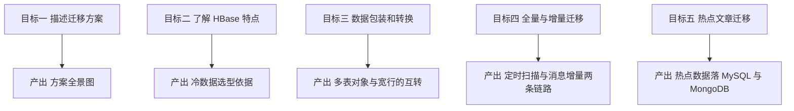

# 数据迁移开篇：五个目标与三条迁移链路

热文章计算落地之后，首页已经能优先展示热点内容，盘点数据家底时另一个问题浮出水面：爬虫抓来的、自媒体自建的、用户行为沉淀的，所有数据仍然全量压在 MySQL（经 MyCat 分片）里，其中绝大部分写入之后就再没被读过。数据迁移这一课要做的就是给数据分流：冷的搬去 HBase，热的落到 MySQL 与 MongoDB，并让整个同步过程自动运转。开课先把五个学习目标与对应的技术点对上号，后面每一课才知道自己在补哪块砖。

## 先给结论

- 当天五个目标：描述项目数据迁移的方案、了解 HBase 的特点、熟悉迁移中的数据包装和转换、完成文章数据的全量与增量迁移、完成热点文章数据的迁移。
- 课程分三小节推进：为什么需要自动同步、迁移方案、项目中集成 HBase 与 MongoDB。
- 迁移不是一次性脚本：全量靠定时扫描加同步标识，增量靠审核与热点计算发出的消息，自动同步是一条常驻链路。
- HBase 是当天的新面孔，定位是海量冷数据的栖身之所；数据包装和转换（多表对象聚合成一个存储对象，读取时反向拆解）是迁移代码里工作量最大的部分。

## 五个目标各挂哪条链路

目标课不喊口号，每一句目标都能落到当天的产出物上。预习时对着这张表把链路画出来，听实现课时按图索骥：

| 目标 | 挂靠的技术点 | 对应的产出 |
|---|---|---|
| 描述数据迁移的方案 | 迁移方案设计：全量、热点、审核后增量、过期清理 | 面试里能把方案讲清楚 |
| 了解 HBase 的特点 | 数据模型、rowkey、列族、集群角色 | 冷数据存储的选型依据 |
| 熟悉数据包装和转换 | 多表对象聚合成存储对象、读取反向拆解 | 迁移服务的核心代码套路 |
| 完成全量与增量迁移 | 定时任务、同步标识、消息监听 | 历史与新增数据进入 HBase |
| 完成热点文章迁移 | 热点消息消费、MySQL 与 MongoDB 双写 | 热点数据各就各位 |

五个目标到产出物的映射关系如下：



图上五个产出共用一条主干：数据从 MySQL 出发，经迁移服务分流，冷的沉淀到 HBase，热的回流到 MySQL 与 MongoDB。目标四是主干本身，目标一、二、三分别是它的设计图、地基与施工手艺。

## 为什么这一天值得单独立课

**第一，数据只增不减，分片只是摊薄增长。** 此前引入 MyCat 做分库分表时，文章组拆了 40 片、行为组拆了 50 片，写入压力被摊平，但增长本身没有止住：日增百万文章、日增十亿行为的量级口径下，每一片都在向单表红线逼近。给 MySQL 减负的下一步不是继续加片，而是把不再访问的数据请出去。

**第二，冷数据占着最贵的资源。** MySQL 实例是集群里规格最高的存储：SSD 磁盘、大内存缓冲池、金贵的连接数。让写入后只读一两次的历史数据占着这些资源，成本结构是倒挂的。

**第三，统计与在线读写互相拖累。** 不停地对在线库做实时操作与各种统计并不合适，这类旁路负载挪到独立的存储上，读写两条路才互不干扰。迁移服务接入 HBase 只需要两个配置键（ZooKeeper 地址与单元格大小上限），到集成环节再展开。

## 数据包装和转换：最容易被低估的目标

迁移不是表对表复制。一篇文章在 MySQL 里散在多张表：文章本体、内容、配置、作者信息；搬到 HBase 后要按 rowkey 聚成一行宽表。资料里的存储对象把这个约定直接写进了类结构：

```java
// 存储对象骨架（节选自资料包的 HBase 封装，包名按规范改写）
@Setter
@Getter
public class HBaseStorage extends StorageEntity {
    private String rowKey;          // 行键，迁移方案约定取 MySQL 主键 id
    private HBaseInvok hBaseInvok;  // 写入成功后的回调

    // 每个 StorageData 对应一个列族，列族名即原对象类名
    public List<String> getColumnFamily() {
        return getDataList().stream()
                .map(StorageData::getTargetClassName)
                .collect(Collectors.toList());
    }
}
```

存的时候多个对象组装成一个对象，按列族写入；查的时候从一个对象拆回多个对象。方向相反，代码成对出现，这是当天写迁移代码的基本节奏。

## 一天的节奏

三小节依次推进。为什么需要自动同步解决动机问题，把「迁什么、往哪迁、迁完原数据怎么办」一次说清；迁移方案给出需求分析与设计思路，四件事（全量、热点、审核后增量、过期清理）各定触发方式与目的地；项目中集成 HBase 与 MongoDB 是动手环节，配置、封装、链路逐一落地。听的时候带着一个问题：每条链路的数据从哪来、到哪去、失败了怎么办，答案都会在方案里。

把目标翻译成方法签名，迁移服务当天要落地的核心能力大致是这三块（示例为按本课写法补全）：

```java
// 迁移服务核心能力预告（示例为按本课写法补全）
public interface ArticleMigrationService {

    /** 全量同步：定时扫描未同步文章，组装写入 HBase */
    int migrateFullBatch();

    /** 增量同步：审核通过的文章按消息补进 HBase */
    void migrateIncrement(Long articleId);

    /** 热点迁移：关系数据入 MySQL，内容数据入 MongoDB */
    void migrateHotArticle(ArticleHotMsg msg);
}
```

## 常见误区

- **把目标课当目录页翻过去。** 错例是直接跳到集成章节抄代码。正解是五个目标就是验收清单，「描述迁移方案」更是面试高频题，值得先自己口述一遍。
- **把迁移理解成一次性搬家。** 错例是跑完一个脚本就算完成。正解是全量只是起点，审核后增量与热点回流是持续链路，同步一旦停摆，两边数据立刻出现代差。
- **把 HBase 当成 MySQL 的升级替换。** 错例是预期在 HBase 上做 join 与复杂统计。正解是它是分层存储的另一半，只有 rowkey 与范围两种取数姿势，选型看容量与吞吐。
- **低估数据包装和转换。** 错例是以为迁移就是逐表搬运。正解是多张表聚合、按列族写入、读取反向拆解，转换代码才是工作量大头，也是出错重灾区。

## 面试可能被问到的问题

1. 面试官追问：「用一分钟描述这个项目的数据迁移方案。」
   答：方案分四块：历史全量数据由定时任务扫描写入 HBase，靠同步标识防重防漏；热点文章由热点计算微服务发消息，迁移服务消费后把关系数据写 MySQL、内容数据写 MongoDB；审核通过的文章发消息增量同步进 HBase；过期热点按月从 MySQL 与 MongoDB 清理，HBase 侧保留全量不清。
2. 面试官追问：「为什么要自动同步，而不是手动搬一次数据？」
   答：数据只增不减，迁移后每天仍有新文章、新行为产生，手动搬运覆盖不了增量。自动同步让全量定时兜底、增量靠消息追平，两边数据保持连续一致，这也是方案设计的核心。
3. 面试官追问：「冷数据为什么选 HBase 承接？」
   答：HBase 架在 HDFS 上，靠横向扩展堆容量，一张表可以到十亿行级别；写入走 LSM 路径吞吐高；稀疏宽表正好承接多表对象组装；按 rowkey 点查与 MySQL 主键 id 对齐，冷数据召回路径简单。
4. 面试官追问：「迁移中的数据包装指什么？」
   答：源端一篇文章散在文章、内容、配置、作者多张表，目的端 HBase 按 rowkey 一行存储，写入前要把多个对象组装成一个存储对象并按列族划分，读取时再从一个对象拆回多个业务对象，转换代码成对出现。

## 配套资料

- 代码：`materials/code/05/头条day14/`，内含 hbase 与 mongo 两组存取封装（HBaseConfig、HBaseClent、HBaseStorageClient、HBaseStorage、MongoDBconfigure 等），当天集成环节的实物代码；引用路径截至 `头条day14/` 层级，内层目录名含项目原名，不进入正文。
- 说明：迁移微服务主体代码未随资料落库，涉及迁移服务的接口预告为按本课写法补全；迁移配置键名取自课件画面，主机值按课程集群 node01~node03 填写。
