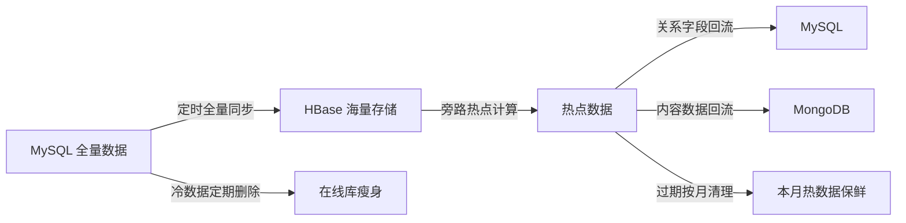

# 为什么要自动同步：拆完库的数据该往哪搬

分库分表落地之后，一个新问题摆上桌面：拆分把查询与写入的压力摊薄了，却挡不住数据只增不减。爬虫抓来的、自建的、用户行为沉淀的数据全部堆在 MySQL 里，绝大部分写入之后一年也读不上一次，却占着最好的存储资源。这一课读课件里那段方案口径，把「为什么必须自动同步」从动机层面讲透；迁移方案与集成实现，随后两课展开。

## 先给结论

- 分库分表治的是查询路径，治不了数据只增不减；自动同步做的是把「存」的成本分层：冷数据下沉，在线库瘦身。
- 课件口径：MySQL 的全量数据同步到 HBase，HBase 承接上亿级别的海量数据；迁移之后 MySQL 里的全量数据定期删除，但不是全删。
- 三套存储分工：MySQL 存主体关系数据，MongoDB 存具体内容数据，HBase 存海量全量数据；热点数据从 HBase 计算出来后回流 MySQL 与 MongoDB。
- 热点数据有保质期，按月定时清理，保证本月热数据一直在；HBase 侧不清理。
- 不停地实时操作在线库做统计并不合适，同步与统计走旁路，以流式的批量方式处理。

## 分库分表挡住了什么，没挡住什么

此前引入 MyCat 做分库分表时，文章组拆了 40 片、行为组拆了 50 片，按主键取模路由，配置出自课程资料的 mycat 目录：

```xml
<!-- 文章组：40 个分片节点，按 id 取模 -->
<table name="ap_article" dataNode="DNAP_$0-39" autoIncrement="true" primaryKey="id" rule="mod-long40"/>
<!-- 行为组：50 个分片节点，写入均匀、点查一步定位 -->
<table name="ap_show_behavior" dataNode="DNBE_$0-49" rule="mod-long50" autoIncrement="true" primaryKey="id"/>
```

这套配置解决了「单表撑不住」：写入按取模摊到几十个节点，点查带分片键一步定位。它没解决的是增长本身。日增十亿行为的口径下，50 片意味着单片日增约两千万行，预留的余量只够一年出头；文章日增百万，40 片的单片年增也在千万级。拆分赢得的是时间，不是豁免。

**成本结构同样在恶化。** MySQL 实例是集群里最贵的资源：SSD 磁盘、大内存缓冲池、金贵的连接数。让写入后只读一两次的流水数据占着这些资源，等于用高性能引擎养沉睡数据。查询侧也一样，范围扫描历史明细时磁盘 IO 随数据量线性上涨，缓冲池救不了冷查询。

## 课件那段话拆开读

需求页给的方案口径信息密度很高，逐句拆开，每句都对应一个设计决策。

**「所有数据都在 MySQL 里存着，数据量大了存储会受影响。」** 这是现状陈述，也是迁移的动因：不分冷热，所有数据共享一套存储与索引结构，冷数据拖累热数据。

**「不停地实时操作数据库不太合适，各种统计也吃力，所以要把 MySQL 的全量数据同步到 HBase。」** 统计与迁移都属旁路负载，把它们与在线读写隔开的前提是给它们一个独立的存储目的地，这就是 HBase 的位置：承接上亿级别的海量数据。

**「迁移完之后，MySQL 的全量数据会定期删除。」** 注意不是全删。删的是已经下沉到 HBase 的冷数据，热点与在用数据留在原地；删除动作走定时任务，动手前先校验 HBase 侧的数据完整性。

**「HBase 保存海量数据，在此基础上计算出热点数据，同步到 MySQL 以及 MongoDB。」** 热点不是凭空算的：全量数据在 HBase 侧躺着，热点计算在旁路完成，结果回流在线存储。

**「热点数据也会失效，按月清理，保证本月热数据一直在。」** 今天的热门文章下个月就凉了，热点列表按月滚动，清理任务每月跑一次。

整条流向画出来是一张分流图：



关键路径是「全量下沉、热点回流」八个字：HBase 承接全量成为事实上的数据底座，在线侧只保留热与在用的部分。

## 三套存储各管一段

方案里同时出现 MySQL、HBase、MongoDB，分工划得很清楚：

| 存储 | 存什么 | 为什么放它这 |
|---|---|---|
| MySQL | 主体关系数据：文章元信息、关系字段、回流后的热点 | 列表页按条件查关系字段，关系引擎最顺手 |
| MongoDB | 具体数据信息：文章内容等大字段 | 半结构化大文档，模式灵活，整篇读写 |
| HBase | 海量全量数据 | 上亿行容量、按 rowkey 点查，冷数据栖身 |

热点数据为什么存两份？列表页要的是标题、作者、频道、发布时间这些关系字段，详情页要的是正文全文。两类数据的查询模式完全不同，硬塞进一个引擎，要么列表查询被大字段拖慢，要么正文体验向列表妥协。分开存，各查各的。

## 删与不删、清与不清的分寸

迁移之后 MySQL 的数据去留要算两笔账。**该删的删：** 已同步到 HBase 且越过冷热判定线的冷数据定期删除，在线库瘦身。**该留的留：** 热点文章、近期数据与业务强依赖的数据原地不动，删除任务不碰它们。热点侧同理：MySQL 与 MongoDB 里的过期热点按月清理，HBase 里的全量不清，容量正是它的价值。

圈定迁移范围的思路示例（按本课写法补全，阈值按冷热判定标准定）：

```sql
-- 按时间与访问频次圈定冷数据，分批搬运
SELECT id, publish_time
FROM ap_article
WHERE publish_time < #{coldLine}
ORDER BY publish_time
LIMIT 1000;
```

搬运动作本身是旁路批处理，课件提到会用到流式编程，也就是用 Java 的 Stream 管道把「圈定、转换、写出」串起来。骨架示例为按本课写法补全：

```java
// 旁路批处理骨架（示例为按本课写法补全）：分页圈定、流式转换、批量写出
List<ArticleEntity> batch = articleMapper.selectColdBatch(coldLine);
batch.stream()
     .map(this::toStorageObject)       // 多表对象聚合成存储对象
     .forEach(storageClient::write);   // 写入 HBase，成功后回写同步标识
```

## 常见误区

- **把自动同步当成一次性搬家。** 错例是跑一个脚本导完历史数据就收工。正解是全量只是起点，审核后增量与热点回流是持续链路，同步停摆两边立刻出现代差。
- **把 HBase 当成更快的 MySQL。** 错例是预期在 HBase 上做 join 与聚合统计。正解是它只有 rowkey 精确查与范围扫两种姿势，价值在容量与写吞吐，不在复杂查询。
- **以为迁移完 MySQL 数据全删。** 错例是一刀切清空历史表。正解是删的只是已下沉且过线的冷数据，热点与在用数据保留，删除走定时加校验。
- **把热点清理理解成删数据。** 错例是过期热点从所有存储里抹掉。正解是清理只发生在 MySQL 与 MongoDB，HBase 的全量仍在，冷数据随时可召回。

## 面试可能被问到的问题

1. 面试官追问：「已经做了分库分表，为什么还要做数据迁移？」
   答：分库分表把单表压力摊薄，但数据只增不减，每一片都在逼近红线；而且冷数据占着最贵的 MySQL 资源。迁移是把存储成本分层，冷数据下沉到容量与吞吐型存储，在线库瘦身并专注热数据。
2. 面试官追问：「三套存储怎么分工，热点数据为什么要存两份？」
   答：MySQL 存主体关系数据服务列表查询，MongoDB 存文章内容等大字段服务详情页，HBase 承接海量全量数据。热点存两份是因为列表要关系字段、详情要正文全文，查询模式不同，分开存各自最优。
3. 面试官追问：「迁移之后 MySQL 的数据怎么处理，全删吗？」
   答：不是全删。已同步到 HBase 且越过冷热判定线的冷数据定期删除；热点与业务在用的数据保留；删除走定时任务并在删除前校验同步完整性。
4. 面试官追问：「热点数据会一直热吗，怎么维护？」
   答：热点有保质期，今天的热门文章下个月就凉。按月定时清理 MySQL 与 MongoDB 里的过期热点，保证本月热数据一直在；HBase 的全量数据不清理，过期热点随时可从全量召回。
5. 面试官追问：「为什么统计类负载要挪出 MySQL？」
   答：统计是大范围扫描，与在线读写争抢缓冲池、磁盘 IO 与连接数，互相拖累；挪到 HBase 旁路后各走各的存储与计算资源，在线库只服务高优先级读写。

## 配套资料

- 代码：`materials/code/05/头条day02/`，mycat 相关配置（schema.xml、rule.xml 等），文中分片规模与规则名出自其中。
- 代码：`materials/code/05/头条day14/`，HBase 与 MongoDB 存取封装，迁移目的地侧的实物代码。
- 说明：本课为动机与方案口径讲解，屏幕上无代码；SQL 圈定示例与 Java 批处理骨架为按本课写法补全。
