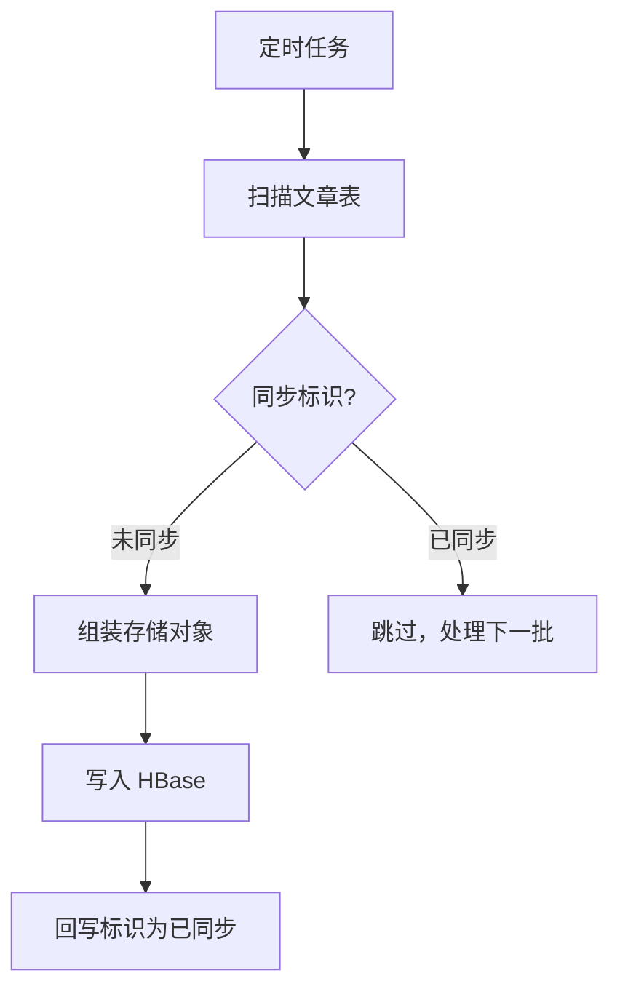
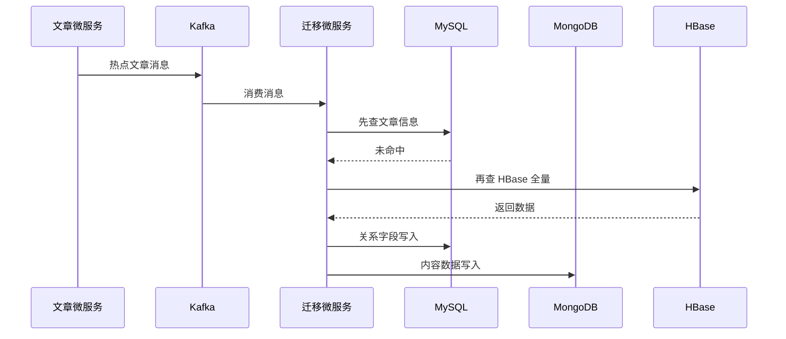

# 迁移方案设计：定时扫描、消息增量与两个目的地

动机讲完，这一课交方案。课件需求分析页一句话点题：有了大量数据基础后，实时计算后的热点文章需要保存起来。展开是两块迁移、两条消息链路、一个清理任务，外加数据包装的硬约定。方案要回答的不只是「往哪搬」，还有「怎么触发」「失败怎么办」「读的时候怎么找回来」。

## 先给结论

- 迁移分四件事：全量文章数据进 HBase、热点文章进 MySQL 与 MongoDB、审核通过的文章增量补进 HBase、过期热点按月清理。
- 课程选的路线是定时扫描加消息驱动：全量靠定时任务与同步标识兜底，增量与热点靠上游微服务发消息、迁移微服务消费。
- Rowkey 约定直接用 MySQL 主键 id，在线侧按 id 查文章与 HBase 按 rowkey 取数天然对齐。
- 需要迁移的不止文章一张表：文章本体、内容、配置、作者要组装成一个对象按列族写入，读取时再一拆多。
- HBase 侧不做清理；MySQL 与 MongoDB 侧按月清理过期热点。

## 需求分析：四个迁移动作，两种触发方式

| 迁移对象 | 触发方式 | 目的地 | 备注 |
|---|---|---|---|
| 全量文章数据 | 定时任务全量扫描 | HBase | 靠同步标识防重防漏 |
| 热点文章数据 | 热点计算后发消息 | MySQL + MongoDB | 关系字段入库、内容数据进 Mongo |
| 审核通过的文章 | 审核完成后发消息 | HBase | 增量补进全量 |
| 过期热点数据 | 定时任务按月清理 | 清 MySQL 与 MongoDB | HBase 不清 |

## 方案谱系：三种主流走法怎么选

把常见迁移路线摆在一起对比（按主流迁移方法论与课件口径整理）：

| 方案 | 做法 | 优点 | 代价 |
|---|---|---|---|
| 停机迁移 | 停服窗口内一次性搬完 | 简单，无一致性问题 | 业务中断，数据量越大窗口越长 |
| 双写 | 业务代码同时写旧库与新存储 | 实时性好 | 侵入业务代码，要处理两侧写入失败 |
| 定时扫描加消息增量 | 全量定时搬，增量靠事件追平 | 对在线业务零侵入，改造收敛在迁移服务 | 分钟级延迟 |

课程选第三种的完整形态。**在线资讯服务开不起停机窗口**，几十亿行数据也不可能在一个凌晨搬完；**双写把迁移逻辑塞进业务代码**，文章服务的每条写路径都要多一次外部调用，失败处理会把主链路搅浑；**定时扫描加消息**把改造收敛到一个独立的迁移微服务里，上游只多发一条消息，冷数据场景对分钟级延迟完全不敏感。

## 全量链路：定时扫描与同步标识

全量链路的闭环长这样：



关键的一段在「写入成功之后才回写标识」：扫描到就标记看似省事，进程一旦在写入前挂掉，这批数据就被永久标记为已同步，成了查不回来的黑洞；先写后标，失败的批次下一轮扫描自然重做，链路靠这个顺序拿到至少一次的保证。

文章表上加一个同步标识字段，取值约定 1 为已同步、2 为未同步（示例为按本课写法补全）：

```sql
-- 同步标识字段（示例为按本课写法补全）
ALTER TABLE ap_article ADD COLUMN sync_flag TINYINT DEFAULT 2 COMMENT '迁移标识：1 已同步 2 未同步';
```

存储侧的写入动作落在资料包的封装上，建表防重、按列族写入、成功回调一气呵成：

```java
// 存储客户端（节选自资料包的 HBase 封装，包名按规范改写）
public void addHBaseStorage(String tableName, HBaseStorage hBaseStorage) {
    if (null != hBaseStorage && StringUtils.isNotEmpty(tableName)) {
        hBaseClent.creatTable(tableName, hBaseStorage.getColumnFamily()); // 表不存在则建
        String rowKey = hBaseStorage.getRowKey();
        boolean result = addStorageData(tableName, rowKey, hBaseStorage.getDataList());
        if (result) {
            hBaseStorage.invok(); // 写入成功后的回调钩子，回写同步标识挂在这里
        }
    }
}
```

## 热点与审核：两条消息链路

热点链路的起点在文章微服务：它实时计算出热点文章后发一条消息，消息沿用项目既有的 Kafka 封装；迁移微服务消费消息，查询当前文章信息，最终把热点文章数据存到 MySQL 与 MongoDB。查询有个固定次序：先查 MySQL，查不着再查 HBase，因为全量迁移已经做过，HBase 是兜底。



为什么存两次：DB 存的是关系，Mongo 存的是具体数据。列表页按关系字段查询，详情页读正文全文，两类访问模式分开落地，各自最优。

审核链路复用同一套消息模式：文章审核通过后发消息，迁移微服务接收，拿到文章 id，把该文章相关数据组装同步到 HBase。新文章由此持续补进全量，HBase 里的数据不再是一次性快照。

MongoDB 侧的接入配置在资料封装里就是一个装配类：

```java
// MongoDB 接入配置（节选自资料包封装，包名按规范改写）
@Configuration
@PropertySource("classpath:mongo.properties")
public class MongoDBconfigure {

    @Value("${mongo.host}")   private String host;
    @Value("${mongo.port}")   private int port;
    @Value("${mongo.dbname}") private String dbName;

    @Bean
    public MongoTemplate getMongoTemplate() {
        return new MongoTemplate(getSimpleMongoDbFactory());
    }
}
```

## 设计思路的两个硬约定

**第一，Rowkey 用 MySQL 主键 id。** HBase 主要靠 Rowkey 查询，把 Rowkey 定成 MySQL 主键 id，在线侧任何按 id 取文章的路径都能无翻译地映射成一次 HBase get，冷数据召回不需要额外的索引表。

**第二，多表对象组装。** 需要同步到 HBase 的数据由多张表构成，不止文章表，还有它的配置、内容、作者。写入前把多个对象组装成一个对象，按列族划分；查询时再从一个对象拆回多个对象。包装与拆解成对出现，这正是「数据包装和转换」目标的技术落点。

接入配置只有两个键，键名与课件一致：

```properties
# 迁移服务接入 HBase 的配置（quorum 按课程集群 node01~node03 填写）
hbase.zookeeper.quorum=node01,node02,node03
hbase.client.keyvalue.maxsize=500000
```

`hbase.client.keyvalue.maxsize` 给单个单元格设了约 50 万字节的上限，正文这类大字段超限会在写入侧直接报错，把脏数据挡在迁移入口，而不是带进存储里。

## 常见误区

- **标识在写入前回写。** 错例是扫描到未同步就立即标记已同步。正解是写入 HBase 成功后再回写，失败批次留给下一轮，靠顺序保证至少一次。
- **先查 HBase 再查 MySQL。** 错例是既然全量在 HBase 就直接查它。正解是热点多为刚计算的新文章，MySQL 命中率高且数据最新，HBase 只做兜底。
- **把双目的地当冗余。** 错例是嫌存两次浪费，只写一处。正解是 MySQL 存关系字段服务列表，MongoDB 存内容大字段服务详情，职责不同，缺一不可。
- **给 HBase 也配清理任务。** 错例是三套存储统一按月清理。正解是 HBase 保留全量不清，清理只针对 MySQL 与 MongoDB 的过期热点。

## 面试可能被问到的问题

1. 面试官追问：「为什么选定时扫描加消息，而不是停机迁移或双写？」
   答：在线服务开不起停机窗口，几十亿行也搬不完；双写侵入业务代码，失败处理拖累主链路。定时扫描加消息把改造收敛在独立迁移服务，上游只多发消息，冷数据对分钟级延迟不敏感。
2. 面试官追问：「同步标识怎么设计，怎么保证不漏数据？」
   答：文章表加标识字段，1 已同步、2 未同步；定时任务只扫未同步批次，写入 HBase 成功后才回写标识，失败留给下一轮，构成至少一次语义；再配分批与校验任务兜底。
3. 面试官追问：「热点文章为什么同时写 MySQL 和 MongoDB？」
   答：DB 存关系，Mongo 存具体数据。列表页按关系字段查询走 MySQL，详情页读正文全文走 MongoDB，两类查询模式分开落地各自最优，也避免大字段拖慢列表。
4. 面试官追问：「Rowkey 为什么直接用 MySQL 主键 id？」
   答：HBase 主要靠 Rowkey 查询，主键 id 让在线侧按 id 取数的路径与 HBase get 一一对应，冷数据召回无需索引表；写入热点问题靠预分区控制。
5. 面试官追问：「迁移的数据为什么要做多表对象组装？」
   答：一篇文章散在文章、内容、配置、作者多张表，HBase 按 rowkey 一行存储，写入前把多个对象组装成一个对象按列族写入，读取时反向拆回多个对象；不组装则查询要做多次散取，代价高且容易不一致。

## 配套资料

- 代码：`materials/code/05/头条day14/`，hbase 与 mongo 两组封装源码共 9 个 Java 文件，文中 HBaseStorageClient 与 MongoDBconfigure 节选自其中（包名按规范改写）。
- 代码：`materials/code/05/头条day07/`，Kafka 收发封装工具类，热点与审核两条消息链路复用这套封装。
- 说明：迁移微服务主体与流程图出自课件画面，工程压缩包未随资料落库；同步标识字段与迁移接口示例为按本课写法补全。
