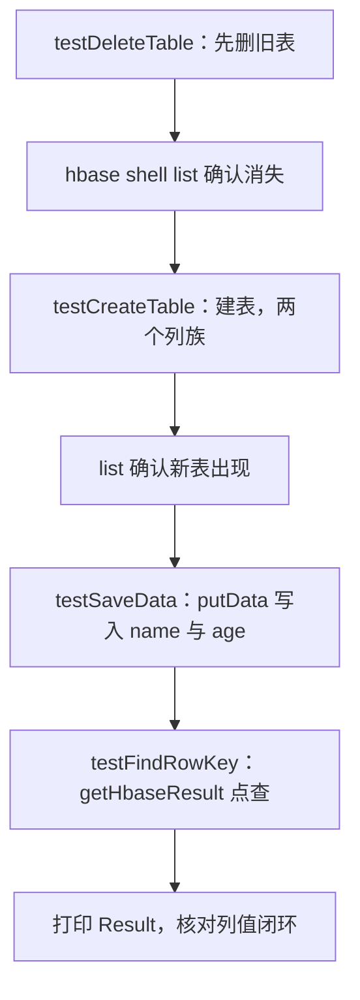

# 用原生 client 测通 HBase：迁移微服务建骨架，建删写查走一遍

公共模块里的 HBase 封装已经就位，但封装写得再全，没跑通之前都只是纸面能力。这一课先把迁移微服务的骨架搭起来，然后用最原生的 HBaseClent 写四个测试方法，把删表、建表、写入、点查整个流程在真实集群上走一遍，为后续的封装测试和真正的迁移代码铺路。

## 先给结论

- 迁移微服务骨架极薄：一个引导类加一个 InitConfig，组件扫描把公共模块的初始化配置、MySQL、HBase 封装整体扫进来，`@EnableScheduling` 给后面的定时任务留好开关。
- 依赖清单五样：Jackson、MySQL、Quartz、HBase、Kafka，公共封装随依赖一起进入工程，Mongo 等用到时再补。
- 测试顺序有讲究：先删掉同名旧表再建新表，保证每轮测试都从干净状态开始，结果可复现。
- putData 的 columns 与 values 两个数组按下标一一对应，长度不一致或顺序错位，列值就写串了。
- 每一步都有验证手段：服务器上 `hbase shell list` 看表，代码里 `getHbaseResult` 点查看数据，不靠感觉判断成败。

## 迁移微服务骨架：引导类加一个 InitConfig

新建的迁移服务叫 migration，取迁移的本义，工程从资料包导入即可，里面几乎没有业务代码，只有一个引导类和一个初始化配置类。InitConfig 的职责就是放行公共模块的组件：

```java
// 迁移服务初始化配置（示例为按本课写法补全，包名按规范改写）
@Configuration
@ComponentScan({"com.study.headline.common.init",
        "com.study.headline.common.mysql",
        "com.study.headline.common.hbase"})
@EnableScheduling
public class InitConfig {
}
```

`@ComponentScan` 的三个包各管一摊：init 包里的通用初始化逻辑、mysql 包里的数据库封装、hbase 包里的上一课那套 HBase 封装。扫进来之后，HBaseClent 这个 Bean 就能直接注入测试类。`@EnableScheduling` 此刻没有定时任务可跑，但全量迁移靠定时扫描驱动，开关提前打开，后面补任务类就能生效。依赖方面导入五样：Jackson 做序列化、MySQL 驱动、Quartz 供调度、HBase 客户端、Kafka 封装，各封装模块随依赖带入，测试阶段还缺 Mongo，到集成 Mongo 时再引入。

## 四个测试方法走完一轮建删写查

测试类注入最原生的 HBaseClent，四个方法各测一类动作：

```java
// HBase 原生 client 测试（示例为按本课画面与写法补全，包名按规范改写）
@RunWith(SpringRunner.class)
@SpringBootTest
public class HBaseTest {

    @Autowired
    private HBaseClent hBaseClent;

    @Test
    public void testDeleteTable() {
        hBaseClent.deleteTable("hbase_test_table_name");
    }

    @Test
    public void testCreateTable() {
        List<String> columnFamily = new ArrayList<>();
        columnFamily.add("test_column_family1");
        columnFamily.add("test_column_family2");
        boolean ret = hBaseClent.creatTable("hbase_test_table_name", columnFamily);
        System.out.println(ret);
    }

    @Test
    public void testSaveData() {
        // 表名、rowKey、列族、列名数组、列值数组
        String[] columns = {"name", "age"};
        String[] values = {"zhangsan", "28"};
        hBaseClent.putData("hbase_test_table_name", "test_row_key_001",
                "test_column_family1", columns, values);
    }

    @Test
    public void testFindRowKey() {
        Result hbaseResult = hBaseClent.getHbaseResult("hbase_test_table_name", "test_row_key_001");
        System.out.println(hbaseResult);
    }
}
```

实际执行按删、建、写、查的顺序推进。先连上服务器在 HBase 命令行里 `list` 一把，确认当前有哪些表，把同名测试表先删掉；`deleteTable` 的封装内部先 `disableTable` 再 `deleteTable`，跑完不报错，回命令行 `list`，表少了一张，删除验证通过。接着跑建表，参数是表名加一个列族集合，集合传几个都行，这里是两个；跑完再 `list`，新表出现。写入与点查最后跑，点查打印出的 Result 里能看到 rowkey `test_row_key_001` 携带 name 与 age 两列的值，数据闭环。



流程图里每个写动作后面都跟一个验证节点，这条链路的价值在于：任何一步失败都能立刻定位是连接问题、建表问题还是数据问题。

## putData 两个数组必须对齐

写入方法的参数有五个：表名、rowKey、列族、columns 数组、values 数组。rowKey 是整行的唯一标识，查询就靠表名加它定位；columns 是列族下要写的列名，values 是对应的值。两个数组靠下标咬合，封装源码里就是按下标循环写入的：

```java
// 封装内 putData 的写入循环（节选自资料包，包名按规范改写）
Put put = new Put(Bytes.toBytes(rowKey));
if (columns != null && values != null && columns.length == values.length) {
    for (int i = 0; i < columns.length; i++) {
        if (columns[i] != null && values[i] != null) {
            put.addColumn(Bytes.toBytes(familyName), Bytes.toBytes(columns[i]), Bytes.toBytes(values[i]));
        } else {
            throw new NullPointerException(MessageFormat.format(
                    "列名和列数据都不能为空,column:{0},value:{1}", columns[i], values[i]));
        }
    }
}
table.put(put);
```

下标 i 的列名配下标 i 的值，任何一个 null 都直接抛异常中断。调用侧一旦三个元素对两个元素，或者顺序写反，要么长度校验拦下，要么数据安静地写进错误的列，后者更难排查，写测试时就要养成两数组并排检查的习惯。

## 连不上时先查这三处

测试跑不起来多半卡在连接环节，报错集中在 ZooKeeper 一带，排查按命中率从高到低（以下报错形态按主流实践补充整理）：

```bash
# quorum 配置错误或主机不可达，常见两类表现
# 一、ZooKeeper 会话建立失败
org.apache.zookeeper.KeeperException$ConnectionLossException: KeeperErrorCode = ConnectionLoss for /hbase
# 二、长时间卡住后超时
java.io.IOException: Failed to get result within timeout, timeout= 90000 ms
```

**第一，核对 `hbase.zookeeper.quorum`。** 地址写错、少写节点或写成客户端无法解析的主机名都直指这两类报错，本课程环境按 node01~node03 填写，机器名必须能在本机 hosts 里解析。**第二，确认网络连通。** 客户端与集群之间防火墙未放行端口时，同样是会话失败，用 telnet 探测 ZooKeeper 端口即可分辨。**第三，确认服务真的活着。** 集群上 `status` 看一眼 HBase 与 ZooKeeper 进程，别在服务未启动的环境里反复改配置。

## 常见误区

- **跳过删表直接建表。** 错例是上一轮建过同名表，本轮直接跑建表方法，封装判存在后静默跳过，列族改了也没生效。正解是先删后建，或者换表名，让每轮测试环境可控。
- **列名值数组长度不一致还指望报错兜底。** 错例是认为封装什么都能拦住。正解是长度相等但语义错位时封装拦不住，写数据前人工对齐两数组。
- **把点查验证换成肉眼等日志。** 错例是 put 跑完不报错就当成功。正解是写入成功与数据可读是两回事，用 getHbaseResult 打印 Result 才算闭环。
- **表名、rowKey 想当然随意写。** 错例是测试代码里表名与命令行里核对的名字差一个字符，查了半天查的是另一张表。正解是测试表名、rowKey 统一用常量或复制粘贴，杜绝手敲。

## 面试可能被问到的问题

1. 面试官追问：「删表为什么封装里要先 disable 再 delete？」
   答：HBase 要求表先下线才能删除，直接 delete 一个启用状态的表会报 TableNotDisabledException。disable 把表摘出服务，delete 才能清理元数据与 HDFS 目录，两步缺一不可。
2. 面试官追问：「putData 用两个平行数组传列与值，和传 Map 比各有什么利弊？」
   答：数组写法与底层 addColumn 循环一一对应，性能上少一次装箱与哈希查找，但调用方要自己保证下标对齐；Map 写法不易错位，却多一次遍历开销且无法表达重复列。本项目的写入列集合固定，数组够用。
3. 面试官追问：「Result 对象里怎么取出列值？」
   答：Result 是一行 cell 的容器，listCells 拿到 Cell 列表后，用 CellUtil 或 Bytes 工具按 family、qualifier、value 的字节数组区间转字符串；也可以用 getColumnLatestCell 精确取某一列的最新版本。
4. 面试官追问：「客户端报 ConnectionLoss，你的排查顺序是什么？」
   答：先核对 quorum 配置与主机名解析，再 telnet 探测 ZooKeeper 端口确认网络放行，最后上集群确认 HBase 与 ZooKeeper 进程状态。三层从配置到网络到服务端，命中率依次排下来。
5. 面试官追问：「测试代码为什么要先删旧表再建新表？」
   答：建表方法有存在性判断，表已存在时会静默跳过，上一轮残留的表结构或数据会污染本轮结果。先删后建保证幂等可复现，这也是集成测试环境准备的标准做法。

## 配套资料

- 代码：`materials/code/05/头条day14/`，hbase 封装 6 文件，文中 putData 写入循环节选自 HBaseClent（包名按规范改写为 `com.study.headline`）；引用路径截至该层，内层目录不再展开。
- 说明：迁移微服务主体与测试类未随资料落库，InitConfig 与 HBaseTest 示例为按本课画面与写法补全；依赖清单与验证命令按课件画面线整理，主机名按 node01~node03 替换；连接报错一节按主流实践补充。
