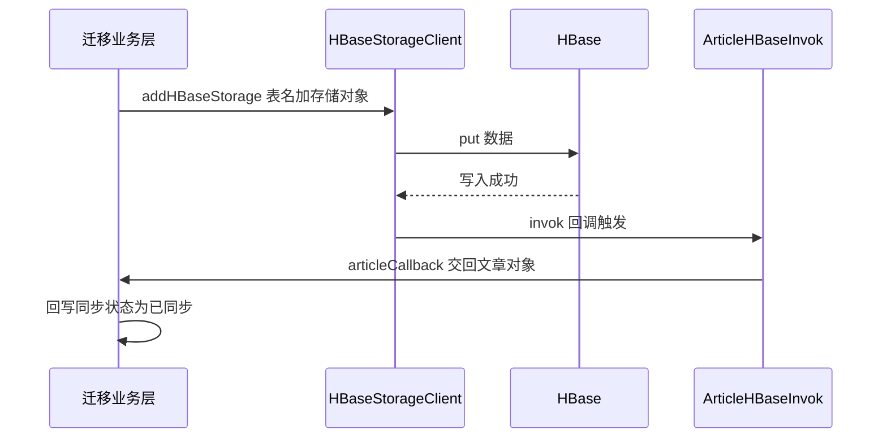
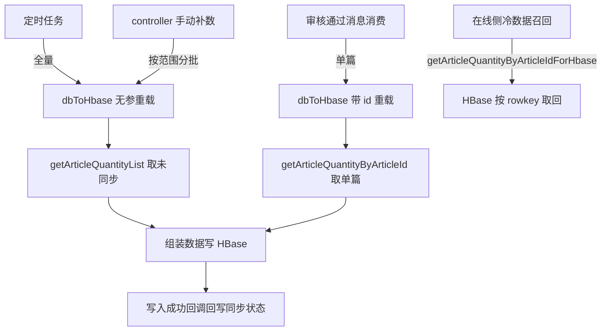
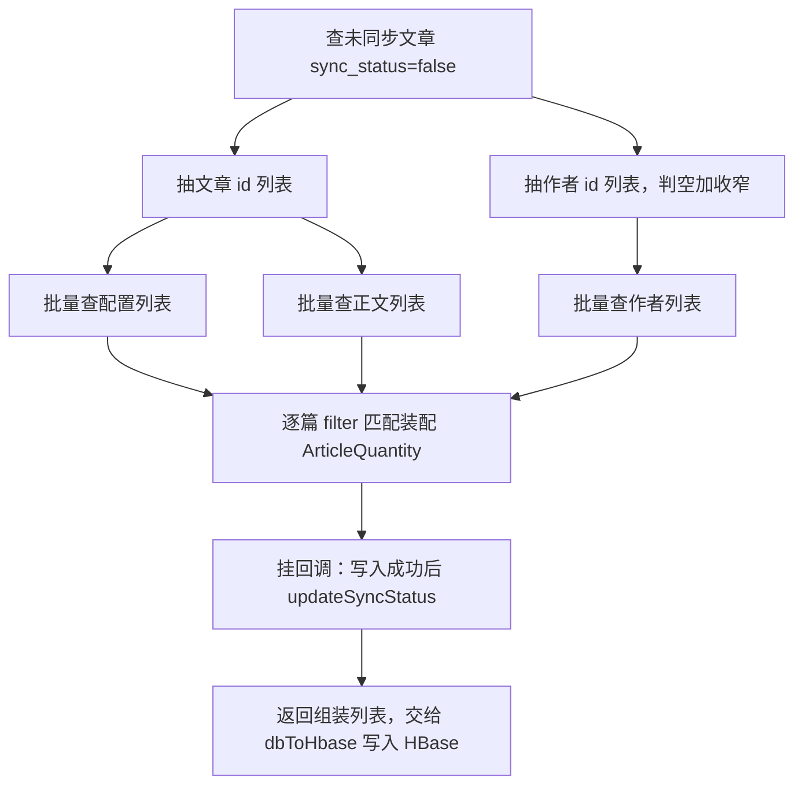
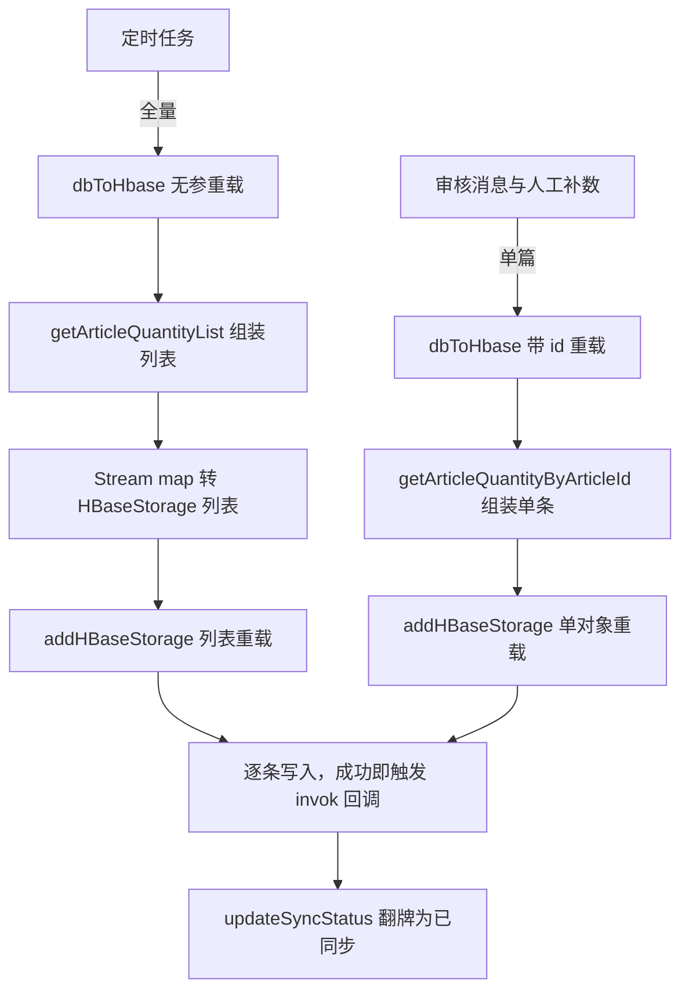
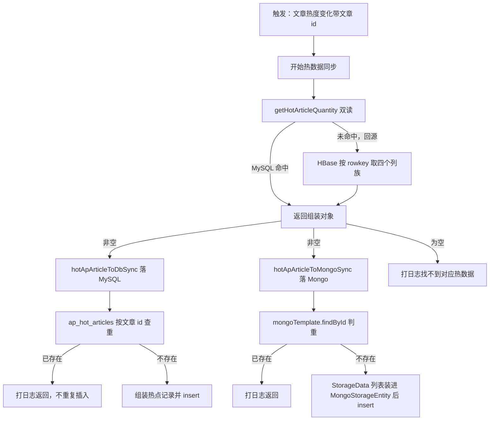

# 数据迁移_业务代码编写：从读取侧接口到同步、召回与三方清理的实现全记录

## 先给结论

- 系列定位：头条类资讯项目数据迁移的代码实现篇，把「MySQL 多表组装、写入 HBase、按需取回」的方案落成可运行的迁移微服务。
- 主线先铺读取侧再写写入侧：文章配置、内容、文章、作者四张表各配 Service 与 Mapper，统一由综合实体 `ArticleQuantity` 装载，rowkey 用文章主键 id，类名即列族名。
- 回调链贯穿全系列：装配时挂上 `ArticleHBaseInvok`，HBase 写入成功由存储客户端触发 `invok()`，回调回写 `sync_status`；失败批次保持未同步等下一轮，续传与幂等天然成立。
- 综合迁移接口 `ArticleQuantityService` 五个方法收口全部迁移动作：查询组三个（全量组装、按文章 id 组装、从 HBase 取回），写入组两个（全量同步与按文章 id 单篇同步）。
- 实现上的关键姿势：三次批量查询加内存 filter 装配替代循环查库，避免 N+1；`dbToHbase` 两个重载分别服务定时全量与消息单篇两条触发链路。
- 读取侧闭环落齐：从 HBase 按类型列表取数用 instanceof 拆解装回综合对象；热点文章同步走先在线库后 HBase 的双读，落 MySQL 与 Mongo 前各自查重。
- 删除要删三处：MySQL 热点表、HBase 整行、Mongo 实体，漏一处就留脏数据。
- 全系列的代码纪律：判空先行、类型收窄对齐、批量接口带 Blob 列清单、异常兜底带业务语义，脏数据不打断整批迁移。

## 第1部分：迁移业务动工：综合实体、回调骨架与文章配置接口

方案定了、封装测通了，真正开始写迁移业务时，第一行代码写什么？直觉会说「往 HBase 写」，但课程的落子顺序相反：先把「从 MySQL 读什么、怎么装、装完谁负责善后」这三件事铺好。这一课搭的是迁移业务的地基，一个装四表数据的综合实体、一条写入成功后回写状态的回调链，以及第一张表的查询接口，文章配置。

### 综合实体与回调：迁移数据的容器
一篇文章在 MySQL 里拆成四份：本体在 `ap_article`，互动开关在 `ap_article_config`，富文本正文在 `ap_article_content`，作者信息在 `ap_author`。迁移写入 HBase 时要按 rowkey 合成一行，读取时再从一行拆回四个对象，所以业务代码的出发点是一个能装下四份对象的综合实体（业务主体代码未随资料包落库，以下业务类为按画面线与口播整理、按本课写法补全的可编译示例，包名统一改写）：

```java
package com.study.headline.migration.entity;

// 综合实体：一篇文章迁移所需的全部数据
@Setter
@Getter
public class ArticleQuantity {
    // 文章实体
    private ApArticle apArticle;
    // 文章配置实体
    private ApArticleConfig apArticleConfig;
    // 文章内容实体
    private ApArticleContent apArticleContent;
    // 文章作者实体
    private ApAuthor apAuthor;
    // HBase 写入成功后的回调
    private HBaseInvok hBaseInvok;
}
```

只查文章本体数据不全，配置、内容、作者都缺，所以后续操作的主要对象就是它。四个独立 Service 负责各查各的表，最后把结果往这个容器里塞。

容器之外还有一条善后链路。存储客户端 `HBaseStorageClient.addHBaseStorage` 的既有约定是：写入成功才调用 `hBaseStorage.invok()`，而 `invok()` 做什么，由业务方塞进来的 `HBaseInvok` 实现决定。迁移业务要做的善后是把当前文章的同步状态改成已同步，于是有了两个配套类型：

```java
package com.study.headline.migration.entity;

// 回调接口：写入成功后由回调对象触发
public interface ArticleCallBack {
    void articleCallback(ApArticle apArticle);
}

// 回调对象：持有回调所需的文章与回调接口
@Setter
@Getter
@NoArgsConstructor
@AllArgsConstructor
public class ArticleHBaseInvok implements HBaseInvok {
    // 回调需要传递的对象
    private ApArticle apArticle;
    // 回调需要对应的回调接口
    private ArticleCallBack articleCallBack;

    @Override
    public void invok() {
        // 存储客户端写入成功后走到这里
        articleCallBack.articleCallback(apArticle);
    }
}
```

`ArticleHBaseInvok` 本身不带任何业务逻辑，它只是把「哪篇文章」和「回调做什么」打包在一起，等存储客户端在正确的时间点拉响。整条链的时序如下：



关键路径在最后两跳：善后动作不写在迁移主流程里，而是等 HBase 确认写入成功后再回调进来。主流程失败时回调根本不会响，同步状态原样留在「未同步」，这批数据下一轮扫描自然重做。

### 文章配置接口：两个查询方法
配置表的读取接口最小，就两个方法。批量这个项目里原本没有，得在 Mapper 层新增，XML 里用 `foreach` 把文章 id 集合拼成 `in` 条件：

```xml
<!-- ApArticleConfigMapper.xml：按文章 id 集合批量查询 -->
<select id="selectByArticleIds" resultMap="baseResultMap">
    select
    <include refid="Base_Column_List"/>
    from ap_article_config
    where article_id in
    <foreach item="item" index="index" collection="list" open="(" separator="," close=")">
        #{item}
    </foreach>
</select>
```

按单个主键查的方法表里原本就有，复用即可，不用动。Service 层跟着对齐两个方法，接口定义与实现分开落：

```java
package com.study.headline.migration.service;

public interface ApArticleConfigService {
    // 按文章 id 集合批量查询配置
    List<ApArticleConfig> queryByArticleIds(List<String> ids);
    // 按文章 id 查询单条配置
    ApArticleConfig queryByArticleId(Integer id);
}
```

```java
package com.study.headline.migration.service.impl;

@Service
@Log4j2
@SuppressWarnings("all")
public class ApArticleConfigServiceImpl implements ApArticleConfigService {

    @Autowired
    private ApArticleConfigMapper apArticleConfigMapper;

    @Override
    public List<ApArticleConfig> queryByArticleIds(List<String> ids) {
        return apArticleConfigMapper.selectByArticleIds(ids);
    }

    @Override
    public ApArticleConfig queryByArticleId(Integer id) {
        return apArticleConfigMapper.selectByArticleId(id);
    }
}
```

实现就是一步转发，Service 在迁移业务里不当裁判，只当传话筒；真正的编排逻辑集中在后续的综合接口里。

### 映射设计与幂等：配置数据落在 HBase 的哪里
配置表进了迁移链路，它的每个字段在 HBase 侧都有确定位置，映射关系如下：

| MySQL 侧 | HBase 侧 | 说明 |
|---|---|---|
| `ap_article_config` 行 | 某个列族下的一组列 | 列族名取自包装时目标类的类名 |
| `article_id` | rowkey 的一部分 | rowkey 直接用文章主键 id，配置跟着文章走 |
| `is_comment` 等开关字段 | 列名与列值原样搬 | 布尔语义在写入侧不翻译 |
| 表不存在 | 建表防重 | 存储客户端写入前先查表，缺了就按列族建 |

包装动作由综合实体的组装方法完成，它把四个对象逐个转成 `StorageData` 塞进一个 `HBaseStorage`，rowkey 取文章 id：

```java
// ArticleQuantity 内的组装方法：一个对象一个列族，写入成功后的回调对象挂进去
public HBaseStorage getHbaseStorage() {
    HBaseStorage hBaseStorage = new HBaseStorage();
    // rowkey 约定：直接用文章主键 id
    hBaseStorage.setRowKey(String.valueOf(apArticle.getId()));
    hBaseStorage.setHBaseInvok(hBaseInvok);
    addData(hBaseStorage, apArticle);
    addData(hBaseStorage, apArticleConfig);
    addData(hBaseStorage, apArticleContent);
    addData(hBaseStorage, apAuthor);
    return hBaseStorage;
}

private void addData(HBaseStorage hBaseStorage, Object entity) {
    StorageData data = StorageData.getStorageData(entity);
    if (null != data) {
        hBaseStorage.addStorageData(data);
    }
}
```

`HBaseStorage` 的列族列表是从数据列表反推的，每个 `StorageData` 的目标类名就是一个列族名，所以四张表的数据天然分进四个列族，互不干扰。表名用常量类里的约定值统一管理，全项目迁移数据就落这一张 HBase 表。

幂等这件事不用额外写代码。HBase 的写入是按 rowkey 加列的版本覆盖，同一篇文章迁移两遍，第二遍把第一遍的值原位盖掉，不会出现两条记录；同步状态又由回调链负责翻牌，已同步的行定时任务扫不到，重复迁移的入口本来就窄。真要强制重跑，也只会在 rowkey 相同的行上做一次无损覆盖。

## 第2部分：迁移读取侧铺齐：内容、文章、作者接口与同步状态回写

配置接口落定后，读取侧还剩三张表：正文、文章本体、作者。这一课把三个 Service 与对应 Mapper 补齐，顺带落下载体里最关键的一个方法，回写同步状态。三张表接口的写法高度相似，但文章表多出一个「查未同步」的条件查询，它正是全量迁移的取数入口；作者表则暴露出类型转换与空值判断这类不起眼却必踩的坑。

### 内容接口：与配置同构的批量查
`ap_article_content` 只有两个业务字段，文章 id 与压缩后的富文本正文，查询接口自然也是两个。Mapper 接口新增批量方法，XML 里把 `Base_Column_List` 与 `Blob_Column_List` 两个列清单都带上，正文是大字段，列清单里单列一类：

```xml
<!-- ApArticleContentMapper.xml：按文章 id 集合批量查询，含正文大字段 -->
<select id="selectByArticleIds" resultMap="resultMap">
    select
    <include refid="Base_Column_List"/>
    <include refid="Blob_Column_List"/>
    from ap_article_content
    where article_id IN
    <foreach collection="list" item="id" index="index" open="(" close=")" separator=",">
        #{id}
    </foreach>
</select>
```

Service 层照着接口定义与实现一路铺下去：

```java
package com.study.headline.migration.service;

public interface ApArticleContentService {
    // 按文章 id 集合批量查询正文
    List<ApArticleContent> queryByIds(List<String> ids);
    // 按文章 id 查询单条正文
    ApArticleContent getById(Long id);
}
```

```java
@Service
@SuppressWarnings("all")
public class ApArticleContentServiceImpl implements ApArticleContentService {

    @Autowired
    private ApArticleContentMapper apArticleContentMapper;

    @Override
    public List<ApArticleContent> queryByIds(List<String> ids) {
        return apArticleContentMapper.selectByArticleIds(ids);
    }

    @Override
    public ApArticleContent getById(Long id) {
        return apArticleContentMapper.selectById(id);
    }
}
```

与配置接口唯一的差别就是列清单多带了一个 Blob，写法完全复制。迁移业务里这类同构查询占了大头，认准一个模板能省一半时间。

### 文章接口：三件套撑起取数入口
文章表是迁移的主体，接口有三件事要做。按主键查与查未同步列表、更新同步状态，接口定义收拢在 `ApArticleService`：

```java
package com.study.headline.migration.service;

public interface ApArticleService {
    // 按文章主键查询
    ApArticle getById(Long id);
    // 查询未同步的数据
    List<ApArticle> listNoSyncArticle();
    // 更新同步状态
    void updateSyncStatus(ApArticle apArticle);
}
```

未同步查询走条件式 `selectList`：传什么条件就按什么查，Mapper XML 的动态 `where` 片段里预留了同步状态这个条件，传了就拼进去：

```xml
<!-- ApArticleMapper.xml：条件查询与同步状态更新 -->
<select id="selectList" resultMap="resultMap">
    select
    <include refid="Base_Column_List"/>
    <include refid="Base_Column_Where"/>
    from ap_article
</select>

<update id="updateSyncStatus">
    UPDATE ap_article SET sync_status = #{syncStatus} WHERE id = #{id}
</update>
```

```xml
<!-- 动态条件片段：同步状态传了才拼，其他条件同理按需追加 -->
<sql id="Base_Column_Where">
    <where>
        <if test="syncStatus != null">
            and sync_status = #{syncStatus}
        </if>
    </where>
</sql>
```

Service 实现里，查未同步就是 new 一个空的条件对象、只把同步状态置为 `false` 再下发：

```java
@Service
@Log4j2
@SuppressWarnings("all")
public class ApArticleServiceImpl implements ApArticleService {

    @Autowired
    private ApArticleMapper apArticleMapper;

    @Override
    public ApArticle getById(Long id) {
        return apArticleMapper.selectById(id);
    }

    @Override
    public List<ApArticle> listNoSyncArticle() {
        // 只查未同步的：条件对象里仅置同步状态为 false
        ApArticle apArticle = new ApArticle();
        apArticle.setSyncStatus(false);
        return apArticleMapper.selectList(apArticle);
    }

    @Override
    public void updateSyncStatus(ApArticle apArticle) {
        log.info("开始更新数据同步状态。apArticle: {}", apArticle);
        if (null != apArticle) {
            apArticle.setSyncStatus(true);
            apArticleMapper.updateSyncStatus(apArticle);
        }
    }
}
```

`updateSyncStatus` 的三步有讲究：先打日志留痕，再判空防住调用方传 `null`，然后置 `true` 才更新。方法自己把状态翻成已同步，调用方只管传文章对象，语义收在方法内部不外泄。

整条同步状态的流转闭环如下：


虚线那条路径是兜底：万一已同步的行需要强制重迁，HBase 按版本覆盖写入，状态改回 `false` 再扫一遍也不会留脏数据。

### 作者接口：空值与类型收窄的坑
`ap_author` 的查询按自己的主键走，批量按 id 集合查，单个按 id 查，实现同样是一步转发，但有两个细节值得单独拎出来：

```java
@Service
@SuppressWarnings("all")
public class ApAuthorServiceImpl implements ApAuthorService {

    @Autowired
    private ApAuthorMapper apAuthorMapper;

    @Override
    public List<ApAuthor> queryByIds(List<Integer> ids) {
        return apAuthorMapper.selectByIds(ids);
    }

    @Override
    public ApAuthor getById(Long id) {
        if (null != id) {
            return apAuthorMapper.selectById(id.intValue());
        }
        return null;
    }
}
```

**第一，查之前判空。** 文章对象里的作者 id 是包装类型，作者被删或数据不全时它就是 `null`，拿着 `null` 去 `intValue` 直接抛异常，迁移批次会被单个脏数据打断。**第二，类型收窄。** 文章侧作者 id 是 `Long`，作者表主键是 `Integer`，比对与传参前用 `intValue()` 收窄，两侧类型对齐，SQL 才能命中。这两个细节在后续组装文章数据时会再次出现，届时是用 `filter` 过滤掉作者 id 为空的文章。

### 失败与续传：sync_status 的闭环价值
读取侧铺齐后，迁移的容错模型就成立了。全量迁移按批次扫描 `sync_status = false` 的文章，组装写入 HBase，写入成功的批次由回调触发 `updateSyncStatus` 翻成 `true`；任何一环失败，这批文章的状态没动过，下一轮扫描原样捞出来重做。**失败不需要记录表，状态字段本身就是断点。** HBase 侧按 rowkey 覆盖写入保证了重做不产生重复，两侧配合出至少一次的迁移语义：可能多写一遍，绝不漏一篇。

这套设计与「扫描到就标记」的偷懒做法差别就在顺序上：先标记后写入，进程死在写入前，这批数据就被永久跳过，成了查不回来的黑洞；先写入成功再回调标记，最坏情况是重复写入，而覆盖语义把重复的代价降为零。

## 第3部分：综合迁移接口：五个方法收口全部迁移动作

四个表的 Service 铺齐之后，按理说迁移已经能跑了，但触发方会很难受：定时任务要自己编排「查未同步、组装、写 HBase、回写状态」，消息消费者要再写一遍几乎相同的流程，谁来做都要知道四个 Service 的先后顺序。这一课把这坨编排收口成一个综合接口，四个 Service 从此退居幕后，触发方只认识一个门面。方法定义完课程就按下暂停键，实现留给后面两课展开。

### 门面接口：五个方法各管一段
综合实体 `ArticleQuantity` 装着文章、配置、内容、作者四个对象加一个回调，综合迁移接口就是操作这个实体的门面，方法清单如下：

```java
package com.study.headline.migration.service;

public interface ArticleQuantityService {

    // 获取 ArticleQuantity 列表（未同步文章的四表组装集合）
    List<ArticleQuantity> getArticleQuantityList();

    // 根据文章 id 从 MySQL 获取组装后的 ArticleQuantity
    ArticleQuantity getArticleQuantityByArticleId(Long id);

    // 根据文章 id 从 HBase 获取 ArticleQuantity
    ArticleQuantity getArticleQuantityByArticleIdForHbase(Long id);

    // 数据库同步到 HBase（全量）
    void dbToHbase();

    // 根据文章 id 将数据库数据同步到 HBase（单篇）
    void dbToHbase(Integer articleId);
}
```

三个查询方法返回的都是 `ArticleQuantity` 而不是各自的 pojo，这是包装与拆解成对出现的约定：写入 HBase 前把四表数据装进一个对象，从 HBase 读回时也按一个对象交出，调用方拿到的永远是完整的一篇文章。`ForHbase` 后缀把数据来源标进方法名，冷数据召回走它，在线库查询走不带后缀的两个，调用方一眼就能选对方法。

写入组两个重载共享同一套编排：组装、写 HBase、成功后回调回写同步状态。差别只在取数范围，无参版本面向全量，带 id 版本面向增量。两条触发链路如下：



关键在取数与写入的衔接：全量链路先问「哪些没同步」，单篇链路直接按 id 取，殊途同归落到同一个写 HBase 的动作上，编排逻辑只有一份。

### 触发入口：定时、消息与 controller
接口定了，谁来调它是入口设计的问题。定时任务与消息消费是方案里既定的两条链路，无参与单篇两个重载正好一一对应。工程上还会留一个人工触发口，方便上线初期补数与验证，controller 示例如下（迁移工程主体未随资料包落库，此段为按本课写法补全的示例）：

```java
@RestController
@RequestMapping("/api/migration")
public class MigrationController {

    @Autowired
    private ArticleQuantityService articleQuantityService;

    /**
     * 手动触发全量迁移，支持按时间范围与批次大小切分
     * 示例：POST /api/migration/run?startTime=2024-01-01&endTime=2024-06-30&batchSize=500
     */
    @PostMapping("/run")
    public MigrationResult run(@RequestParam(required = false) String startTime,
                               @RequestParam(required = false) String endTime,
                               @RequestParam(defaultValue = "500") int batchSize) {
        // 全量入口：无参重载内部按未同步标记扫描
        articleQuantityService.dbToHbase();
        return MigrationResult.ok("迁移触发完成，批次大小 " + batchSize);
    }

    /**
     * 单篇补迁：按文章 id 精准同步
     */
    @PostMapping("/article/{articleId}")
    public MigrationResult migrateOne(@PathVariable Integer articleId) {
        articleQuantityService.dbToHbase(articleId);
        return MigrationResult.ok("文章 " + articleId + " 同步完成");
    }
}
```

参数按需给：时间范围与批次大小用来切分大表、避免一次扫描拖垮数据库，返回对象带上触发结果与统计数据（扫描数、成功数、失败数、耗时），执行情况从日志与返回值两条路都能看到。接口本身的两个重载是 `void`，统计信息靠实现里的日志输出与人工触发口的返回对象补齐，这是课程口径与工程补全的边界，示例里已经分开标注。

### 命名与拆分：为什么这样设计
**第一，`dbToHbase` 的名字即方向。** 方法名直接读作「从数据库到 HBase」，方向感写在签名里，读代码的人不需要进实现就知道数据流向；与之配套的 `ForHbase` 查询负责反方向，一进一出把读写两条路都钉死在命名上。

**第二，两个重载对应两条业务链路。** 全量重载服务定时迁移与人工补数，单篇重载服务审核通过后的增量同步：消息消费方拿到文章 id，调 `dbToHbase(articleId)` 就能精准补进 HBase，不必为一条新文章跑全量扫描。增量链路复用全量的组装与写入逻辑，差别只有取数方式，这正是把「按 id 组装」也放进查询组的原因。

**第三，接口先行的节奏。** 这一课只定签名，原因在口播里说得很直白：实现的代码还是比较多。把接口先钉死，获取未同步数据、组装写入、从 HBase 取回三段实现就可以分开演进，每一段的代码量都不至于失控，测试也能按方法逐个补。

## 第4部分：把未同步的文章捞出来：四表组装实现与回调闭环

综合迁移接口的签名定完，实现从哪个方法开始？答案是 `getArticleQuantityList`。它是全量迁移的取数起点：定时任务每一次醒来，靠它把库里所有还没同步的文章连配置、内容、作者一起捞出来装好，交给后面的同步方法写入 HBase。这一课的实现变量多、流程长，核心是两步：先把四张表按 id 批量查出来，再在内存里逐篇装配成综合对象，回调也在装配时一并挂上。

### 依赖注入：四个 Service 加一个存储客户端
实现类挂 `@Service` 与 `@Log4j2`，五个依赖一次注入到位：

```java
package com.study.headline.migration.service.impl;

@Service
@Log4j2
public class ArticleQuantityServiceImpl implements ArticleQuantityService {

    @Autowired
    private ApArticleService apArticleService;
    @Autowired
    private ApArticleConfigService apArticleConfigService;
    @Autowired
    private ApArticleContentService apArticleContentService;
    @Autowired
    private ApAuthorService apAuthorService;
    // HBase 存储客户端：既负责插入数据，也负责后续取回数据
    @Autowired
    private HBaseStorageClient storageClient;
}
```

四个 Service 各管一张表，顺序无所谓；`storageClient` 是 HBase 侧唯一入口，注入一次后面全用它的 `addHBaseStorage` 与取数方法，不直接碰原生 API。

### 查未同步：条件对象只置一个 false
取数入口复用文章接口的条件式查询，SQL 是一条带动态 `where` 片段的 `selectList`：

```xml
<!-- ApArticleMapper.xml：条件查询，传什么条件拼什么条件 -->
<select id="selectList" resultMap="resultMap">
    select
    <include refid="Base_Column_List"/>
    <include refid="Base_Column_Where"/>
    from ap_article
</select>

<sql id="Base_Column_Where">
    <where>
        <if test="syncStatus != null">
            and sync_status = #{syncStatus}
        </if>
    </where>
</sql>
```

查未同步就是 new 一个条件对象、只置 `syncStatus = false` 再下发，命中所有还没迁移过的文章。条件式设计在这里开始兑现好处：将来要按时间范围补数，往条件片段里追加一个 `<if>` 就行，SQL 主体不动。

### 三次批量查询：先抽 id 再批量取
拿到未同步文章列表后，先在内存里抽出两个 id 集合，用它们各查一次库：

```java
@Override
public List<ArticleQuantity> getArticleQuantityList() {
    log.info("生成 ArticleQuantity 列表");
    // 1. 查未同步的文章
    List<ApArticle> apArticleList = apArticleService.listNoSyncArticle();
    // 2. 抽文章 id 列表
    List<String> apArticleIdList = apArticleList.stream()
            .map(article -> String.valueOf(article.getId()))
            .collect(Collectors.toList());
    // 3. 抽作者 id 列表：作者 id 可能为空，过滤掉
    List<Integer> apAuthorIdList = apArticleList.stream()
            .map(article -> article.getAuthorId() != null
                    ? article.getAuthorId().intValue() : null)
            .filter(Objects::nonNull)
            .collect(Collectors.toList());
    // 4. 三次批量查询替代每篇三次单查
    List<ApArticleConfig> apArticleConfigList =
            apArticleConfigService.queryByArticleIds(apArticleIdList);
    List<ApArticleContent> apArticleContentList =
            apArticleContentService.queryByArticleIds(apArticleIdList);
    List<ApAuthor> apAuthorList = apAuthorService.queryByIds(apAuthorIdList);
    // 5. 逐篇装配，见下节
}
```

这一步的关键在数量级：一百篇未同步文章，数据库只被打四次（未同步列表、配置、内容、作者），如果把三次子查询写进文章循环里就是三百次往返。作者 id 用三元表达式判空再加 `intValue()` 收窄，空值在 `filter` 里剔除，避免下游拿 `null` 去查库。

### 逐篇装配：filter 匹配与回调挂载
四份列表在手，对每篇文章把属于它的那几条挑出来装进综合对象，匹配键是文章 id 与作者 id：

```java
// 逐篇装配：每篇文章在内存里找齐自己的配置、内容与作者
List<ArticleQuantity> articleQuantityList = apArticleList.stream().map(apArticle -> {
    ArticleQuantity articleQuantity = new ArticleQuantity();
    articleQuantity.setApArticle(apArticle);
    // 正文：按文章 id 过滤，一篇至多一条
    List<ApArticleContent> apArticleContents = apArticleContentList.stream()
            .filter(s -> s.getArticleId().equals(String.valueOf(apArticle.getId())))
            .collect(Collectors.toList());
    if (!apArticleContents.isEmpty()) {
        articleQuantity.setApArticleContent(apArticleContents.get(0));
    }
    // 配置：按文章 id 过滤，一篇至多一条
    List<ApArticleConfig> apArticleConfigs = apArticleConfigList.stream()
            .filter(s -> s.getArticleId().equals(String.valueOf(apArticle.getId())))
            .collect(Collectors.toList());
    if (!apArticleConfigs.isEmpty()) {
        articleQuantity.setApArticleConfig(apArticleConfigs.get(0));
    }
    // 作者：作者表主键与文章侧作者 id 比对，先判空再收窄到 int
    List<ApAuthor> apAuthors = apAuthorList.stream()
            .filter(s -> apArticle.getAuthorId() != null
                    && s.getId() == apArticle.getAuthorId().intValue())
            .collect(Collectors.toList());
    if (!apAuthors.isEmpty()) {
        articleQuantity.setApAuthor(apAuthors.get(0));
    }
    // 挂回调：HBase 写入成功后用于把同步状态改为已同步
    articleQuantity.setHBaseInvok(new ArticleHBaseInvok(apArticle,
            x -> apArticleService.updateSyncStatus(x)));
    return articleQuantity;
}).collect(Collectors.toList());
log.info("生成 ArticleQuantity 列表完成，size: {}",
        articleQuantityList == null ? 0 : articleQuantityList.size());
return articleQuantityList;
```

装配规则是三对一：一篇文章至多一条配置、一条正文、一个作者，所以匹配结果非空才取 `get(0)`。两侧类型也要收口，文章 id 在内容与配置表里是字符串，比对时用 `String.valueOf` 统一；作者 id 收窄成 `int` 再比。整条流水线如下：



回调挂在装配阶段而不是写入之后，是这条链路里最要紧的一步：`ArticleHBaseInvok` 把文章对象和「翻牌动作」打包随对象走，存储客户端只在写入成功后才触发 `invok()`。装配列表返回后交给全量同步方法逐条写入 HBase，成功一篇翻牌一篇，下一轮扫描的未同步集合随之缩小，全量迁移就这样一轮轮收敛到零。

## 第5部分：同步方法落地：dbToHbase 两个重载把组装数据送进 HBase

取未同步数据的组装列表有了，单篇按 id 组装的方法还剩个空壳，真正把数据送进 HBase 的两个同步方法也都还没写。这一课补齐这三块：按文章 id 的单篇装配、`dbToHbase()` 全量同步、`dbToHbase(Integer articleId)` 单篇同步。写完之后，迁移门面五个方法全部落地，定时任务与消息消费随时可以接入。

### 单篇装配：判空、查主表、非空才装
全量链路的组装在上一课已经完成，单篇装配是它的按 id 版本，给消息消费与人工补数用。实现思路与全量同构，只是取数范围从列表缩到一条：

```java
@Override
public ArticleQuantity getArticleQuantityByArticleId(Long id) {
    // id 为空直接返回，不做任何查询
    if (null == id) {
        return null;
    }
    ArticleQuantity articleQuantity = null;
    // 先查文章本体，查不到就没有组装的必要
    ApArticle apArticle = apArticleService.getById(id);
    if (null != apArticle) {
        articleQuantity = new ArticleQuantity();
        articleQuantity.setApArticle(apArticle);
        // 正文：按文章 id 查单条
        ApArticleContent apArticleContent =
                apArticleContentService.queryByArticleId(apArticle.getId());
        if (null != apArticleContent) {
            articleQuantity.setApArticleContent(apArticleContent);
        }
        // 配置：按文章 id 查单条
        ApArticleConfig apArticleConfig =
                apArticleConfigService.queryByArticleId(apArticle.getId());
        if (null != apArticleConfig) {
            articleQuantity.setApArticleConfig(apArticleConfig);
        }
        // 作者：用文章上的作者 id 查，注意别拿错成文章主键
        ApAuthor apAuthor = apAuthorService.getById(apArticle.getAuthorId());
        if (null != apAuthor) {
            articleQuantity.setApAuthor(apAuthor);
        }
    }
    return articleQuantity;
}
```

四段查询各有一处容易走神：正文与配置是按文章 id 查，传的是 `apArticle.getId()`；作者按作者 id 查，传的是 `apArticle.getAuthorId()`，两个 id 一字之差。每段查回的结果都判空后才塞进容器，某张子表缺数据不影响其余三份照常迁移，HBase 的稀疏列族模型接得住这种不完整。

### 全量同步：列表转 HBaseStorage 一次交付
`dbToHbase()` 是定时任务要调的入口，开头记一个时间戳，然后取组装列表、判空、转换、写入：

```java
@Override
public void dbToHbase() {
    long startTime = System.currentTimeMillis();
    // 取未同步数据并四表组装
    List<ArticleQuantity> articleQuantityList = getArticleQuantityList();
    if (null != articleQuantityList && !articleQuantityList.isEmpty()) {
        log.info("开始进行数据库到 HBase 同步，筛选出未同步的数据量：{}",
                articleQuantityList.size());
        // 组装列表统一转成 HBaseStorage 列表
        List<HBaseStorage> hBaseStorageList = articleQuantityList.stream()
                .map(ArticleQuantity::getHbaseStorage)
                .collect(Collectors.toList());
        // 批量交付给存储客户端，表名取常量
        storageClient.addHBaseStorage(
                HBaseConstants.APARTICLE_QUANTITY_TABLE_NAME, hBaseStorageList);
    } else {
        log.info("定时数据库到 HBase 同步，没有找到数据");
    }
    log.info("数据库到 HBase 同步结束，耗时：{} ms",
            System.currentTimeMillis() - startTime);
}
```

真正的写入只有一行，`addHBaseStorage` 的列表重载。客户端内部会对列表逐条调用单对象版本，每条先按列族建表防重，再按 rowkey 写入，写入成功即触发挂在 `HBaseStorage` 上的回调，回调里做的是 `updateSyncStatus` 翻牌。转换这一步 `ArticleQuantity::getHbaseStorage` 直接复用综合实体里已经写好的组装方法，rowkey、回调、四份 `StorageData` 都在那里备齐，这里只负责把 N 个综合对象映射成 N 个存储对象。

两个重载与回调的关系如下：



两条链路殊途同归：数据形状一样、写入入口一样、善后动作一样，差别只在取数范围。列表重载内部就是循环调单对象重载，所以「写入成功才回调」的约定在批量场景下逐条成立，一百条数据不会因为第九十九条失败而连坐前九十八条。

### 单篇同步：一条数据一次往返
`dbToHbase(Integer articleId)` 服务于审核通过后的即时同步，一条消息只对应一篇文章，跑全量扫描是浪费：

```java
@Override
public void dbToHbase(Integer articleId) {
    long startTime = System.currentTimeMillis();
    log.info("开始进行单篇数据库到 HBase 同步，articleId: {}", articleId);
    if (null != articleId) {
        // 参数是 Integer，组装方法收 Long，收窄转换一次
        ArticleQuantity articleQuantity =
                getArticleQuantityByArticleId(Long.valueOf(articleId));
        if (null != articleQuantity) {
            storageClient.addHBaseStorage(
                    HBaseConstants.APARTICLE_QUANTITY_TABLE_NAME,
                    articleQuantity.getHbaseStorage());
        }
    }
    log.info("单篇数据库到 HBase 同步完成，articleId: {}，耗时：{} ms",
            articleId, System.currentTimeMillis() - startTime);
}
```

方法体里三个判断各挡一种脏输入：文章 id 为空直接跳过写入；组装结果为空说明文章本体都不在库里，同样不写。参数是 `Integer` 而组装方法收 `Long`，中间用 `Long.valueOf` 转一次，这个转换写在这里，消息消费方就不需要关心类型细节。

### 耗时与日志：批量链路的观测面
两个同步方法都在入口记 `startTime`、出口打耗时，加上中间的数据量日志，一轮迁移在日志里的样子是固定的：开始同步、数据量多少、存储客户端逐条打印 rowkey 与耗时、同步结束总耗时。排查问题时按这几行对表：数据量为零说明未同步扫描没命中，可能是状态字段没置对；总耗时陡增说明 HBase 写入变慢，逐条日志能定位卡在哪个 rowkey。`HBaseStorageClient.addStorageData` 自身也打印每条的开始与完成日志，业务日志与客户端日志拼在一起就是完整的执行轨迹。

## 第6部分：从 HBase 取回数据与热点文章接口：双读取数、双路落库与三方清理

写入侧齐了，链路还差两件事：数据进了 HBase 到底能不能原样取回来，得有一个读回方法来验证；热点文章的存储战场要扩到三处，MySQL 的热点表、Mongo 的归档实体、HBase 的文章行，增删查都要有明确去处。这一课把读回方法、热点文章接口的骨架与核心同步逻辑一次写完，三个存储在同一个方法里协同。方法数量多，但主线只有一条：所有数据都围绕文章 id 流转，rowkey 是它，查重条件是它，三方删除的定位还是它。

### 从 HBase 读回：按类型列表取数与 instanceof 拆解
读回方法是综合接口五连的最后一块拼图。写入时四张表的数据按列族合成一行，rowkey 是文章主键 id；读回就是把这一行按列族拆回四个对象。先看类型列表怎么定：

```java
@Override
public ArticleQuantity getArticleQuantityByArticleIdForHbase(Long id) {
    // id 为空直接返回 null
    if (null == id) {
        return null;
    }
    ArticleQuantity articleQuantity = null;
    // 类型列表：要取回哪几个列族，与写入时塞入的四个对象一一对应
    List<Class> typeList = Arrays.asList(ApArticle.class, ApArticleConfig.class,
            ApArticleContent.class, ApAuthor.class);
    // rowkey 就是文章主键 id，转字符串后按类型列表取回
    List<Object> objectList = storageClient.getStorageDataEntityList(
            HBaseConstants.APARTICLE_QUANTITY_TABLE_NAME,
            ConvertUtils.toString(id), typeList);
    if (null != objectList && !objectList.isEmpty()) {
        articleQuantity = new ArticleQuantity();
        // 取回的是 Object，逐个判断真实类型再装进容器
        for (Object value : objectList) {
            if (value instanceof ApArticle) {
                articleQuantity.setApArticle((ApArticle) value);
            } else if (value instanceof ApArticleContent) {
                articleQuantity.setApArticleContent((ApArticleContent) value);
            } else if (value instanceof ApArticleConfig) {
                articleQuantity.setApArticleConfig((ApArticleConfig) value);
            } else if (value instanceof ApAuthor) {
                articleQuantity.setApAuthor((ApAuthor) value);
            }
        }
    }
    return articleQuantity;
}
```

三个环节值得拆开看。类型列表对应列族：封装约定里每个 `StorageData` 的目标类名就是列族名，所以要取哪几个列族，把对应类的 `Class` 塞进列表即可，与写入时 `addData` 塞对象的顺序天然对齐。rowkey 不用另想格式：写入侧就是 `String.valueOf(文章 id)`，读回侧把 id 转成字符串就命中同一行。取回的是 `List<Object>`：客户端按列族逐个反射还原对象，它不知道业务容器长什么样，只交出 `Object` 列表，识别类型与装配的活儿归业务层，`instanceof` 四连判断加强转就是拆解动作，四个类型互斥，顺序不影响结果。

底层还原的过程也交代一句。客户端先按表名与 rowkey 拿到整行 `Result`，再对类型列表里的每个类名调 `getFamilyMap` 取该列族下全部键值对，键是属性名、值是字符串形式的属性值，逐对 `addStorageEntry` 塞进新的 `StorageData`，最后按目标类型把键值对反射写回对象字段。哪一刻某个列族在行里不存在，`getFamilyMap` 返回空，对应的 `StorageData` 就不会被加进结果列表，读回列表因此可能少于四个对象，业务层的判空装配正好接住这种情况。

方法写完，验证闭环就齐了：先把某篇文章同步进 HBase，再用文章 id 调这个方法，四个字段都有值且与库里一致，说明写入、包装、反射还原整条链没有失真。

#### 读回验证：一次端到端的往返

验证不必等业务接入，写一个测试入口当场就能跑通（测试类为按本课写法补全的示例，业务类为真实口径）：

```java
// 测试：同步一篇文章进 HBase，再按 id 读回比对
@SpringBootTest
public class HbaseRoundTripTest {

    @Autowired
    private ArticleQuantityService articleQuantityService;

    @Test
    public void roundTrip() {
        // 先同步一篇文章
        Long articleId = 1383857487211950081L;
        articleQuantityService.dbToHbase(articleId.intValue());
        // 再从 HBase 读回，四个字段应全部非空
        ArticleQuantity quantity =
                articleQuantityService.getArticleQuantityByArticleIdForHbase(articleId);
        Assert.notNull(quantity, "HBase 读回为空");
        Assert.notNull(quantity.getApArticle(), "文章本体缺失");
        Assert.notNull(quantity.getApArticleContent(), "正文缺失");
        Assert.notNull(quantity.getApArticleConfig(), "配置缺失");
        Assert.notNull(quantity.getApAuthor(), "作者缺失");
    }
}
```

断言的四行对应四个列族，任何一处为空都能立刻定位是写入缺列还是还原失败。这轮往返还有一个隐含收益：读回对象的字段值如果与 MySQL 原值一致，说明 `StorageData` 的属性名做 key、属性值做 value 这套翻译在两个方向上是可逆的；一旦出现字段对不上，优先检查实体里 `@Setter` 缺失或者属性名拼写与写入侧不一致。

### 热点文章接口：六个方法与四个依赖
热点文章表 `ap_hot_articles` 存的是文章的热度结果，来源是上游流式计算产出的互动数据聚合。热度链路在迁移之前已经搭好：用户行为进 Kafka，流式聚合算出分值，结果要有地方落，这份接口就负责把结果安置到该去的存储。它要面对的不只是「存」，还有「存多久」：热点按月滚动，上个月的记录归为过期数据，要能查出来清理；文章本体可能归档进 HBase，组装热点记录时还要能从归档里把数据找齐。这些诉求叠在一起，接口就是六件事，条件查询、插入、删除、查过期、同步、清理：

```java
package com.study.headline.migration.service;

public interface ApHotArticleService {
    // 按条件查询热点文章
    List<ApHotArticles> selectList(ApHotArticles apHotArticles);
    // 插入热点文章
    void insert(ApHotArticles apHotArticles);
    // 热点数据同步：按文章 id 从 MySQL 或 HBase 取数，落 MySQL 与 Mongo
    void hotApArticleSync(Integer articleId);
    // 按主键删除
    void deleteById(Integer id);
    // 查询上一月份的过期热点数据
    List<ApHotArticles> selectExpireMonth();
    // 热点数据三方删除：MySQL、HBase、Mongo 各删一份
    void deleteHotData(Integer id);
}
```

热点文章表 `ap_hot_articles` 存的是文章的热度结果，来源是上游流式计算产出的互动数据聚合。接口定义六件事，条件查询、插入、删除、查过期、同步、清理：

```java
package com.study.headline.migration.service;

public interface ApHotArticleService {
    // 按条件查询热点文章
    List<ApHotArticles> selectList(ApHotArticles apHotArticles);
    // 插入热点文章
    void insert(ApHotArticles apHotArticles);
    // 热点数据同步：按文章 id 从 MySQL 或 HBase 取数，落 MySQL 与 Mongo
    void hotApArticleSync(Integer articleId);
    // 按主键删除
    void deleteById(Integer id);
    // 查询上一月份的过期热点数据
    List<ApHotArticles> selectExpireMonth();
    // 热点数据三方删除：MySQL、HBase、Mongo 各删一份
    void deleteHotData(Integer id);
}
```

实现类挂 `@Service`、`@Log4j2`、`@SuppressWarnings("all")`，依赖一次注齐：

```java
@Service
@Log4j2
@SuppressWarnings("all")
public class ApHotArticleServiceImpl implements ApHotArticleService {

    @Autowired
    private ApHotArticlesMapper apHotArticlesMapper;
    // Mongo 写入与查询
    @Autowired
    private MongoTemplate mongoTemplate;
    // HBase 读取与删除
    @Autowired
    private HBaseStorageClient hBaseStorageClient;
    // 综合迁移门面：双读取数全靠它
    @Autowired
    private ArticleQuantityService articleQuantityService;
}
```

四个依赖正好对应三处存储加一个门面：Mapper 管 MySQL 的热点表，`MongoTemplate` 管 Mongo，`HBaseStorageClient` 管 HBase，`articleQuantityService` 负责把散在各处的数据组装成综合对象。简单方法一步转发，Mapper 里都有现成实现：

```java
@Override
public List<ApHotArticles> selectList(ApHotArticles apHotArticles) {
    return apHotArticlesMapper.selectList(apHotArticles);
}

@Override
public void insert(ApHotArticles apHotArticles) {
    apHotArticlesMapper.insert(apHotArticles);
}

@Override
public void deleteById(Integer id) {
    apHotArticlesMapper.deleteById(id);
}

@Override
public List<ApHotArticles> selectExpireMonth() {
    return apHotArticlesMapper.selectExpireMonth();
}
```

`selectExpireMonth` 看着无参，其实条件藏在 SQL 里，按当前时间推上一月份：

```xml
<!-- ApHotArticlesMapper.xml：查询上一月份的热点数据，供过期清理用 -->
<select id="selectExpireMonth" resultMap="resultMap">
    select
    <include refid="Base_Column_List"/>
    from ap_hot_articles
    where date_format(create_time, '%Y-%m')
        = date_format(date_sub(now(), interval 1 month), '%Y-%m')
</select>
```

热点数据按月滚动，上个月的记录对当前列表没有价值，留着只占空间。这个方法把过期集合捞出来，配合后面的删除方法做月度清理，业务层无参、SQL 层有条件的错位是有意为之：过期规则写在数据层，调用方不关心月份怎么算。

### 热数据同步主流程：先在线库后 HBase 的双读
`hotApArticleSync(Integer articleId)` 是整个接口的心脏，先看主流程：

```java
@Override
public void hotApArticleSync(Integer articleId) {
    log.info("开始热数据同步，articleId: {}", articleId);
    // 双读取数：先 MySQL，查不到回源 HBase
    ArticleQuantity articleQuantity = getHotArticleQuantity(articleId);
    if (null != articleQuantity) {
        // 落 MySQL 热点表
        hotApArticleToDbSync(articleQuantity);
        // 落 Mongo 归档
        hotApArticleToMongoSync(articleQuantity);
    } else {
        log.info("找不到对应的热数据，articleId: {}", articleId);
    }
    log.info("热数据同步完成，articleId: {}", articleId);
}
```

```java
// 双读：在线库优先，冷数据回源 HBase
private ArticleQuantity getHotArticleQuantity(Integer articleId) {
    ArticleQuantity articleQuantity =
            articleQuantityService.getArticleQuantityByArticleId(
                    Long.valueOf(articleId));
    // 数据库里查不到，说明数据可能已归档，从 HBase 捞
    if (null == articleQuantity) {
        articleQuantity = articleQuantityService
                .getArticleQuantityByArticleIdForHbase(
                        Long.valueOf(articleId));
    }
    return articleQuantity;
}
```

双读的顺序有讲究。文章未归档时 MySQL 里的数据最新最全，在线库命中就没必要去碰 HBase；归档后的冷数据在线库已经删掉，HBase 里的历史行是唯一来源。两个方向调的都是门面方法，取数细节被封在 `ArticleQuantityService` 后面，这个方法只负责决定顺序。两条路取回的都是同一个 `ArticleQuantity`，后面的落库逻辑完全不用区分数据从哪来。

触发时机也要交代一句：文章审核通过、热度分值更新这类业务事件都会带着文章 id 进消息，消费方拿到 id 调 `hotApArticleSync`，同步动作跟着业务事件走，不需要全量扫描。方法开头与结尾各打一行日志，中间的取数与两路落库各有细粒度日志，一条消息从到达到处理完毕，轨迹能完整对上。参数收 `Integer` 与门面查询收 `Long` 之间的类型差，收口在 `getHotArticleQuantity` 里的一次 `Long.valueOf`，消费方不必感知。整条链路如下：



关键路径在判空之后的分叉：一个组装对象同时喂两路落库，两路各自查重、各自幂等，互不阻塞。任一路失败只影响自己那份数据，另一路照常完成，重跑一遍就把缺的补上。读回方法在此也留了后手：双读两次都空时打日志退出而不是抛异常，调用方按「数据不存在」处理，异常只留给真正意料之外的故障。

### 落 MySQL：查重之后的组装与插入
MySQL 侧的目标是 `ap_hot_articles`，思路是三步：拿文章 id、查重、不存在才插入：

```java
// 落 MySQL：已存在不重复插入
private void hotApArticleToDbSync(ArticleQuantity articleQuantity) {
    Integer apArticleId = articleQuantity.getApArticle().getId();
    if (null == apArticleId) {
        log.info("apArticleId 不存在，无法进行同步");
        return;
    }
    log.info("开始将热数据同步到 MySQL，articleId: {}", apArticleId);
    // 条件对象只置文章 id，查该文章是否已有热点记录
    ApHotArticles query = new ApHotArticles();
    query.setArticleId(apArticleId);
    List<ApHotArticles> hotArticleList = apHotArticlesMapper.selectList(query);
    if (null != hotArticleList && !hotArticleList.isEmpty()) {
        log.info("数据已同步，不需要再次同步，apArticleId: {}", apArticleId);
        return;
    }
    // 不存在才组装插入
    ApHotArticles temp = getHotArticles(articleQuantity);
    apHotArticlesMapper.insert(temp);
}

// 由组装对象生成热点记录，字段以项目 ApHotArticles 实体定义为准
private ApHotArticles getHotArticles(ArticleQuantity articleQuantity) {
    ApHotArticles apHotArticles = new ApHotArticles();
    ApArticle apArticle = articleQuantity.getApArticle();
    apHotArticles.setArticleId(apArticle.getId());
    apHotArticles.setScore(apArticle.getScore());
    apHotArticles.setName(apArticle.getTitle());
    apHotArticles.setCreateTime(new Date());
    return apHotArticles;
}
```

组装单独抽成 `getHotArticles` 是为了让赋值集中一处：文章 id 必填，热度分值、名称、创建时间按业务口径取，字段增减只动这一个方法。查重用条件对象而不是查全量再过滤，`selectList` 拿着只置了文章 id 的条件对象下发，动态 SQL 拼出精确匹配，返回非空就是已有热点记录，打日志直接返回。这套「查重加插入」看着啰嗦，但它是幂等的根基：同一条消息重复消费、同一个 id 重复触发，第二次进来查到已有记录就原样退出，表里永远不会出现同一篇文章的两条热点行。

边界也要说清：这个方法只在记录不存在时插入，文章已有热点行时返回不更新，热度分值后来的变化不会跟着刷进来。分值的持续更新由上游热度计算链路负责，同步接口守的是「首次落库」这一段，职责单一才好幂等。若把更新也揽进来，查重命中后还得比对分值、决定是否 update，重复消费的语义就复杂了。

### 落 Mongo：StorageData 列表原样入库
Mongo 侧存的是文章完整数据的归档，载体是 `MongoStorageEntity`，它继承存储基类，`@Id` 标在 `rowKey` 上，集合名在注解里固定。写入前同样先判重：

```java
// 落 Mongo：rowkey 判重后整包入库
private void hotApArticleToMongoSync(ArticleQuantity articleQuantity) {
    Integer apArticleId = articleQuantity.getApArticle().getId();
    // 文章 id 作为主键，转字符串后与写入侧一致
    String rowKey = ConvertUtils.toString(apArticleId);
    // 判重：已有实体说明同步过
    MongoStorageEntity mongoStorageEntity =
            mongoTemplate.findById(rowKey, MongoStorageEntity.class);
    if (null != mongoStorageEntity) {
        log.info("Mongo 数据已同步，不需要再次同步，articleId: {}", apArticleId);
        return;
    }
    // 复用组装对象里的 StorageData 列表
    List<StorageData> dataList = articleQuantity.getStorageDataList();
    if (null != dataList && !dataList.isEmpty()) {
        MongoStorageEntity entity = new MongoStorageEntity();
        entity.setRowKey(rowKey);
        entity.setDataList(dataList);
        mongoTemplate.insert(entity);
        log.info("将数据同步到 Mongo 完成，articleId: {}", apArticleId);
    }
}
```

这段最值得回味的是 `articleQuantity.getStorageDataList()` 的复用。写入 HBase 时，综合实体已经把四个对象转成了 `StorageData` 列表，属性名做 key、属性值做 value；这个列表在 Mongo 侧原样可用，`MongoStorageEntity` 继承的正是同一套存储基类，字段结构一模一样。一份组装喂两种存储，包装逻辑只写一遍，这正是把组装收进综合实体而不是散在写入处的回报。Mongo 与 HBase 的分工也由此清晰：HBase 面向按 rowkey 的快速单篇取回，Mongo 面向整包数据的留档，rowkey 同为文章 id，两侧可以互相印证。

`MongoStorageEntity` 本身值得看一眼，它的字段结构与存储约定一目了然：

```java
// Mongo 存储实体：@Id 标明主键，@Document 固定集合名
@Document(collection = "mongo_storage_data")
@Setter
@Getter
public class MongoStorageEntity extends StorageEntity {
    // 主键 rowKey，与 HBase 侧共用文章 id 转字符串的口径
    @Id
    private String rowKey;
}
```

rowKey 之外的 `dataList` 全部继承自存储基类，`StorageData` 里装着目标类名、列名数组与列值数组，`addStorageEntry` 逐对添属性。Mongo 的文档把这些字段原样存下来，读侧按同一套结构反射还原，与 HBase 的列族翻译是同一套协议的两种落地。`insert` 与 `remove` 都由 `MongoTemplate` 承担，`findById` 的第一个参数就是主键值，类型必须与 `@Id` 字段的 `String` 对齐，这也是 rowKey 在同步方法里先转字符串的原因。

### 三方清理：删除时三处一个都不能少
文章删除或热点过期清理时，数据的三份拷贝要一起走：

```java
@Override
public void deleteHotData(Integer id) {
    // MySQL 热点表按主键删
    apHotArticlesMapper.deleteById(id);
    // HBase 按表名加 rowkey 删整行
    String rowKey = ConvertUtils.toString(id);
    hBaseStorageClient.gethBaseClent().deleteRow(
            HBaseConstants.APARTICLE_QUANTITY_TABLE_NAME, rowKey);
    // Mongo 先查出实体再删
    MongoStorageEntity mongoStorageEntity =
            mongoTemplate.findById(rowKey, MongoStorageEntity.class);
    if (null != mongoStorageEntity) {
        mongoTemplate.remove(mongoStorageEntity);
    }
    log.info("热点数据三方删除完成，articleId: {}", id);
}
```

三个存储的删除姿势各不相同：MySQL 按主键直接删；HBase 走底层客户端的 `deleteRow`，表名加 rowkey 定位整行；Mongo 没有「按 id 删」的直觉写法时就先 `findById` 查出实体、再对实体 `remove`，查不到说明本来就没有，无需报错。方法不返回删除数量，成功与否靠日志与下游查询验证，清理类操作保持简单。

删除的触发场景有两类：单篇文章被下架或删除，热点记录随之清走，走的是按 id 的三方删除；月度滚动清理，`selectExpireMonth` 把上一月份的热点捞出来，遍历逐篇调 `deleteHotData`，数据按月新陈代谢。HBase 的 `deleteRow` 在表不存在时会安静跳过，客户端内部先查表存在性再执行删除，清理代码不需要为「表还没建」的场景写分支。删完之后用上一节的读回方法按 id 查一次，返回 `null` 即三处都已清干净，验证动作与清理动作共用同一套工具。

## 常见误区

- **回调对象只塞数据不实现 `invok`。** 错例是给 `ArticleHBaseInvok` 填上文章和回调接口两个属性就算完事，接口方法空着。正解是 `invok()` 里必须转发到 `articleCallBack.articleCallback(apArticle)`，否则存储客户端拉响的钩子是空的，同步状态永远翻不了牌。
- **批量查询写成循环单查。** 错例是拿到 id 集合后 for 循环里逐个 `selectByArticleId`，一百篇文章就是一百次往返。正解是 XML 里 `foreach` 拼 `in` 一次取回，网络开销从 N 次降为 1 次。
- **给配置单开一个 rowkey 存 HBase。** 错例是觉得配置是独立表就单独建一张 HBase 表存放。正解是四表数据合成一行，配置列族挂在文章 id 的 rowkey 下，读一篇取一次，避免多表散取和对齐问题。
- **为重复迁移手写去重逻辑。** 错例是写入前先查 HBase 判断存在与否。正解是依赖按版本覆盖的写入语义，rowkey 相同即覆盖，重跑无损，前置查询反而拖慢批量链路。
- **查未同步时手动拼 SQL 写死条件。** 错例是为未同步查询单写一条 `where sync_status = 0` 的 SQL。正解是复用条件式 `selectList` 加动态 `where` 片段，条件传什么查什么，后续按时间范围补查时同一套 SQL 就能扩展。
- **回写状态放在写入 HBase 之前。** 错例是组装完数据先把状态置 `true` 再异步写 HBase。正解是写入成功回调后再更新，失败批次保持 `false`，靠顺序拿到至少一次语义。
- **包装类型直接参与比对。** 错例是 `apArticle.getAuthorId().equals(apAuthor.getId())`，包装类型与基本类型混比轻则装箱拆箱，重则空指针。正解是先判空，再 `intValue()` 收窄成同一类型比对。
- **批量接口忘了带 Blob 列清单。** 错例是照抄配置表的列清单，正文查出来是 `null`。正解是内容表的 XML 同时引入 `Base_Column_List` 与 `Blob_Column_List`，大字段单列成清单是建表时定下的结构，查询侧要对齐。
- **触发方绕过门面直接编排。** 错例是定时任务和消息消费各自注入四个 Service，各自写一遍组装与写入流程。正解是编排收敛在 `ArticleQuantityService` 的实现里，触发方只调门面，流程改动只动一处。
- **把单篇同步也跑成全量扫描。** 错例是审核消息来了之后调无参重载，为一条文章扫全表。正解是走 `dbToHbase(Integer articleId)`，按 id 精准组装，链路代价与文章数量解耦。
- **冷数据查询混用 MySQL 查询方法。** 错例是在线侧冷数据召回也调 `getArticleQuantityByArticleId`，数据被归档后 MySQL 里可能已经查不到。正解是按数据所在存储选方法，冷数据走 `ForHbase` 版本，按 rowkey 一次取回四表组装结果。
- **给 `void` 方法硬塞统计职责。** 错例是为了返回统计改接口签名，把所有调用方一起拖下水。正解是核心链路保持 `void`，统计靠实现内日志与人工触发口的返回对象承载，可观测性与接口纯净度各管各的。
- **把子查询写进文章循环。** 错例是对每篇文章循环内查配置、查内容、查作者，N 篇文章 3N 次往返。正解是先按 id 集合三次批量查回，再在内存 `filter` 装配，数据库往返次数与文章数量解耦成常数。
- **过滤条件两侧类型不一致。** 错例是拿 `Long` 型文章 id 直接与字符串型 `articleId` 比对，永远不相等，装配结果全是空。正解是统一成字符串比文章 id，作者 id 用 `intValue()` 收窄后再比，类型对齐匹配才命中。
- **filter 结果不做非空判断直接取第一条。** 错例是匹配列表为空时照样 `get(0)`，直接抛 `IndexOutOfBoundsException`，整批迁移中断。正解是 `isEmpty()` 判断后非空才装配，数据不全的文章照样迁，缺的列在 HBase 稀疏模型里不占空间。
- **忘记挂回调。** 错例是装配时只塞四份数据，`hBaseInvok` 留空。正解是回调随对象挂载，写入成功后由存储客户端触发翻牌；漏挂的后果是状态永远停在未同步，每轮扫描重复处理同一批文章。
- **判空条件写错连接符。** 错例是 `if (null == list && list.isEmpty())`，`&&` 短路失效，列表为 `null` 时照样调 `isEmpty()`，直接抛 `NullPointerException`。正解是 `null != list && !list.isEmpty()` 做正向判断，非空才进同步分支，空列表走「没有找到数据」的日志。
- **批量同步自己写 for 循环逐条 put。** 错例是拿到组装列表后循环调原生 API 写 HBase，把建表防重、逐条回调这些既有机制全部绕开。正解是转成 `HBaseStorage` 列表后一次交给 `addHBaseStorage` 的列表重载，循环在客户端内部，回调逐条触发，翻牌不会漏。
- **作者查询误传文章主键。** 错例是 `apAuthorService.getById(apArticle.getId())`，查出来永远是别的作者或空。正解是传 `apArticle.getAuthorId()`，文章主键与作者 id 是两个维度，一字之差数据就错位。
- **单篇同步不做类型收口。** 错例是把 `Integer` 的文章 id 直接传给收 `Long` 的组装方法，编译期就报错，或者随手强转埋下精度隐患。正解是 `Long.valueOf(articleId)` 显式转换，转换动作收在同步方法内部，调用方保持简单。
- **读回后不判类型直接强转。** 错例是拿到 `List<Object>` 就按固定顺序 `(ApArticle) objectList.get(0)` 强转，列族缺失或缺数据时顺序错位，取出来的可能是配置却按文章用。正解是 `instanceof` 判断真实类型再装配，对象自报家门比位置约定可靠。
- **双读顺序反过来。** 错例是每次都先查 HBase，在线数据也在 HBase 有一份，查询要多跳一次远程调用。正解是在线库优先、未命中才回源 HBase，热数据基本命中第一跳，HBase 只兜底归档数据，整体延迟最低。
- **落库前不做查重。** 错例是消息重复消费时直接 insert，`ap_hot_articles` 同一篇文章出现多条热点行，列表与统计全部失真。正解是 MySQL 按文章 id 条件查询判重、Mongo 按 rowkey `findById` 判重，两个存储各自幂等，重跑无损。
- **删除只删 MySQL 一处。** 错例是清理热点只调 `deleteById`，HBase 行与 Mongo 实体原样留着，读回方法还能捞出已删除的文章。正解是三方一起删，HBase 按 rowkey 删整行，Mongo 查出实体再 remove，删完用读回方法验证返回 `null`。
- **Mongo 判重用 save 一删了之。** 错例是嫌 `findById` 判重啰嗦，直接 `mongoTemplate.save`，主键相同就整条覆盖，重复消息会反复覆盖同一条归档，历史属性被最后一次写入抹平。正解是先判重、不存在才 `insert`，`insert` 遇到主键冲突会报错，天然防覆盖，语义与幂等要求一致。

## 面试可能被问到的问题

1. 面试官追问：「迁移为什么要设计一个回调接口，直接在写入代码后面写更新状态不行吗？」
   答：写入动作在存储客户端里，业务层拿不到「写入成功」这个时点。把善后逻辑做成 `HBaseInvok` 回调交给客户端在成功后触发，写入与善后解耦，失败时回调不响，同步状态留在未同步，天然支持下一轮重做。

2. 面试官追问：「ArticleQuantity 为什么要把四张表的对象装在一起？」
   答：HBase 按 rowkey 一行存储，写入前要把多表数据组装成一个对象按列族写入，读取时再从一个对象拆回多个。不组装的话，读一篇冷文章要按表散取多次，还要自己保证四个来源的数据对齐。

3. 面试官追问：「重复迁移会不会把 HBase 里的数据搞脏？」
   答：不会。HBase 的 put 按 rowkey 和列做版本覆盖，同一篇文章再迁一遍就是原位覆盖新值，不会产生重复行；加上同步状态回调回写后定时任务不再扫到它，重复执行是幂等的。

4. 面试官追问：「配置表批量查询的 SQL 要注意什么？」
   答：用 `foreach` 生成 `in` 条件一次取回，注意 `open`、`close`、`separator` 三个属性的括号与逗号，id 为空集合时 `in ()` 是语法错误，业务层要先判空再下发查询。

5. 面试官追问：「列族为什么用类名来命名？」
   答：包装对象时每个 `StorageData` 携带目标类名，存储客户端直接拿它当列族名建表写入，包装与拆解两侧按同一规则对齐，不需要额外的列族映射配置，新增要迁移的表时也只需多塞一个对象。

6. 面试官追问：「迁移失败的数据怎么续传？」
   答：同步状态字段就是断点。扫描只取状态为未同步的批次，写入 HBase 成功后由回调把状态翻成已同步；失败批次状态未动，下一轮扫描自然重做，HBase 按 rowkey 覆盖写入保证重做幂等，整套机制不需要额外的失败记录表。

7. 面试官追问：「updateSyncStatus 为什么要先判空再置位？」
   答：判空防住调用方传入 null 导致的空指针，迁移是批量长流程，单条脏数据不该打断整批；置位放在方法内部而不是调用方，是把「已同步」的语义收口在一个地方，谁翻牌、什么时候翻牌一目了然，日志也集中在这一处留痕。

8. 面试官追问：「条件式 selectList 相比为每个场景写专用 SQL 好在哪？」
   答：动态 where 片段让一个查询服务多个场景，查未同步只传同步状态为 false，将来按时间范围补数、按频道补查都在同一条 SQL 上加条件，Mapper 与 XML 不用膨胀；代价是条件组合要靠测试覆盖，常用组合固定下来后反而比一堆专用 SQL 好维护。

9. 面试官追问：「作者 id 从文章表带过来是什么类型，比对时要注意什么？」
   答：文章侧是包装的 Long，作者表主键是 Integer，比对与传参前先判空再 intValue 收窄。包装类型在过滤表达式里直接 equals 或拆箱都可能出问题，空值要过滤掉，类型要收窄到一致，SQL 的等值条件才能真正命中。

10. 面试官追问：「为什么同步状态设计成布尔字段而不是全局水位？」
   答：全局水位要求批次严格有序，失败一条就卡住整条水位；行级布尔标记让每篇文章独立流转，失败只影响自己，无序重做也不漏。代价是每行都要多一次状态回写，用行级开销换来了无序容错，对批量迁移这种场景更划算。

11. 面试官追问：「为什么要设计一个综合迁移接口，直接用四个 Service 不行吗？」
   答：四个 Service 是按表拆的数据访问层，编排逻辑如果散在每个触发方里，定时任务、消息消费、人工补数要各写一遍组装与写入流程。综合接口把这些收口成门面，触发方只认五个方法，流程修改只改实现一处，也方便统一加日志、限流与统计。

12. 面试官追问：「dbToHbase 为什么拆成无参和带 id 两个重载？」
   答：对应两条触发链路。定时全量迁移走无参重载，内部先取未同步文章再批量写入；审核通过的消息消费拿到文章 id，走带 id 重载精准同步单篇。两条链路共享组装与写入逻辑，只有取数范围不同，拆成重载既复用了流程又避免了为单条数据跑全量扫描。

13. 面试官追问：「查询方法返回 ArticleQuantity 而不是各表实体，好处是什么？」
   答：HBase 侧一篇文章就是一行，四表数据按列族合并存储。返回组装对象后，写入前的包装与读取后的拆解使用同一个数据形状，调用方永远拿到完整文章；如果返回散的实体，每个调用方都要自己再做一次四表对齐，成本和出错面都更大。

14. 面试官追问：「ForHbase 后缀的查询什么时候用？」
   答：数据已经同步进 HBase 之后，在线侧按文章 id 召回冷数据时用它。方法内部按 rowkey 从 HBase 取回一行，拆成四表组装对象返回。与查 MySQL 的方法按数据所在存储区分，热点新文章查库，归档冷数据查 HBase。

15. 面试官追问：「人工触发迁移的入口要注意什么？」
   答：要能切分与观测。参数上支持时间范围与批次大小，避免一次全量扫描拖垮主库；返回上给出触发结果与统计，扫描数、成功数、失败数、耗时要能看到。入口只调门面接口，不重复实现迁移逻辑，权限也要收紧，防止误触发大范围迁移。

16. 面试官追问：「查未同步文章的 SQL 怎么设计的？」
   答：一条条件式 `selectList` 配动态 `where` 片段，片段里对同步状态做 `<if>` 判断，业务层传条件对象只置 `syncStatus = false`。传了就拼、不传就查全量，后续按时间范围补数可以往同一片段追加条件，不用另写 SQL。

17. 面试官追问：「四张表的数据为什么要先批量查再内存装配？」
   答：循环内逐篇查库是 N+1 问题，一百篇文章就是三百多次数据库往返。先抽 id 集合批量查回三份列表，再对每篇文章用 Stream 的 `filter` 按 id 匹配装配，数据库往返固定四次，与文章数量无关，大批量迁移时差距是数量级的。

18. 面试官追问：「回调为什么在装配阶段挂载，而不是写入成功后再设置？」
   答：回调对象 `ArticleHBaseInvok` 携带文章与翻牌动作，随综合对象一起交给存储客户端；客户端的约定是写入成功才触发 `invok()`。装配时挂好，写入与善后的衔接由客户端的既有机制保证，迁移主流程不需要再关心时序，漏挂与乱序都不可能出现。

19. 面试官追问：「装配时出现类型不一致的匹配问题怎么处理？」
   答：文章 id 在不同表里类型不同，主表是 Long，内容与配置表按字符串存文章 id，作者主键是 Integer 而文章侧作者是 Long。比对前统一：字符串侧用 `String.valueOf` 收口，整型侧判空后 `intValue()` 收窄，类型一致匹配才能命中，包装类型先判空防拆箱异常。

20. 面试官追问：「某篇文章的作者被删了，组装列表里它是什么样？」
   答：作者 id 为空的文章在抽作者 id 时就被过滤，装配阶段作者列表也匹配不到，`ArticleQuantity` 的作者字段留空，文章本体、配置、正文照常迁移。HBase 是稀疏宽表，空缺的列族不占存储，读取侧按空处理即可，不能用异常中断整批。

21. 面试官追问：「全量同步为什么要先把组装列表转成 HBaseStorage 列表，而不是循环里逐条调单对象重载？」
   答：转换与写入分开后，业务层只负责把数据整理成存储客户端认识的形状，写入节奏、建表防重、逐条回调全部收敛在客户端。列表重载内部就是循环调单对象重载，语义一致；业务层少一层循环嵌套，链路日志也更整齐，整批的量与耗时一眼可见。

22. 面试官追问：「单篇同步和全量同步的实现为什么分开写两个重载，而不是一个方法加个参数？」
   答：两条链路的取数方式完全不同，全量走未同步扫描加批量组装，单篇走按 id 直查。拆成重载后各自的方法体都只有一条主线，读代码不需要在分支里跳；调用方按场景选方法，定时任务调无参版本，消息消费调带 id 版本，语义比传参更清楚。

23. 面试官追问：「写入 HBase 成功之后，MySQL 里的同步状态是怎么变成已同步的？」
   答：组装 `ArticleQuantity` 时挂了回调对象，回调里做的是 `updateSyncStatus`。存储客户端的约定是写入成功才调用 `invok()`，所以状态翻牌紧跟在真实写入之后；写入失败回调不响，状态留在未同步，下一轮扫描自然重做，不需要额外的补偿逻辑。

24. 面试官追问：「同步方法里记录 System.currentTimeMillis 的目的是什么，能用其他方式吗？」
   答：目的是给批量链路留下耗时观测面，入口记起点、出口算差值，配合数据量日志就能算出单条平均耗时。也可以用 StopWatch 这类工具，语义相同；关键是日志要打出处理条数与总耗时，否则批量任务跑得慢只能靠猜。

25. 面试官追问：「表名为什么用常量类管理，直接写字符串不行吗？」
   答：全项目迁移数据只落一张 HBase 表，表名散在字符串里，写错一个字母就悄悄落到另一张表，读侧按常量查又查不到。收在 `HBaseConstants` 里，写入与读取两侧引用同一个常量，编译期就保证一致，将来要换表名也只改一处。

26. 面试官追问：「从 HBase 读回组装对象，为什么要传一个类型列表进去？」
   答：封装约定里列族名就是目标类名，类型列表实际是在声明要取哪几个列族。客户端按列表逐个反射还原对象，返回 `Object` 列表；业务层再用 `instanceof` 拆进综合容器。写入与读取用同一套类名对齐规则，新增迁移表时只要类型列表多塞一个 `Class`，读写两侧自动扩展。

27. 面试官追问：「热点数据为什么 MySQL、Mongo、HBase 各存一份？」
   答：三处存储角色不同。MySQL 的 `ap_hot_articles` 面向在线查询与列表展示；Mongo 按文章 id 整包留档，正文大字段与四表数据都装在一个实体里，适合历史回溯；HBase 按 rowkey 支撑单篇快速取回与归档冷数据的召回。同一份数据按访问模式拆到最合适的存储，读放大由同步链路一次性付清。

28. 面试官追问：「双读策略为什么先查 MySQL 再查 HBase，反过来行不行？」
   答：数据分布决定了顺序。未归档的文章只在 MySQL 有，先查 HBase 必然多一次 miss；归档后的冷数据只在 HBase 有，第二跳兜底。先在线库后归档库，绝大多数请求一次命中，整体延迟最优。反过来也能跑对，但每条热数据都要多付一次 HBase 远程调用。

29. 面试官追问：「Mongo 侧的 MongoStorageEntity 和 HBase 侧的 HBaseStorage 有什么关系？」
   答：两者都继承同一个存储基类，字段结构一致，rowkey 加一个 `StorageData` 列表，每个 `StorageData` 携带目标类名与属性键值对。区别只在持久化方式：HBase 把类名当列族、属性当列，Mongo 把整个实体按注解的集合名落文档。组装一次，两种存储都能直接消费。

30. 面试官追问：「hotApArticleSync 重复消费同一条消息会怎样？」
   答：不会产生脏数据。取数是幂等的，落库前两侧都查重：MySQL 按文章 id 条件查询命中已有记录就返回，Mongo 按 rowkey findById 命中也返回。重复消费最多多打几行日志，第二次执行的写入量为零。这也是消息类同步链路的标准防线，业务幂等比依赖消息不重复更可靠。

31. 面试官追问：「查询上一月份过期数据的方法为什么不传参数？」
   答：过期规则是稳定的业务约定，按创建时间落在上一月份即视为过期，这个条件封装在 Mapper 的 SQL 里，用日期函数按当前时间推算。业务层无参调用，规则变更只改一处 SQL；如果将来过期口径变成按频道或按热度分档，再把条件提为参数也不迟。

## 配套资料

- 代码：`materials/code/05/头条day14/`，hbase 封装六个 Java 文件（`HBaseStorageClient`、`HBaseClent`、`HBaseConfig`、`HBaseConstants`、`HBaseStorage`、`HBaseInvok`）与 mongo 封装三个 Java 文件，文中回调触发时机、列族推导逻辑节选自其中；引用路径截至 `头条day14/` 层级，内层目录冠以项目原名，正文统一以「头条类资讯项目」指代。
- 说明：迁移微服务业务主体（综合实体、回调对象、配置 Service 与 Mapper XML）未随资料包落库，文中业务代码按画面线与口播整理、按本课写法补全为可编译示例，包名统一改写为 `com.study.headline`；字段映射表按画面线与封装逻辑对照整理。
- 代码：`materials/code/05/头条day14/`，hbase 封装六个 Java 文件与 mongo 封装三个 Java 文件，文中回调触发与按 rowkey 覆盖写入的口径依据其中的 `HBaseStorageClient` 与 `HBaseStorage`；引用路径截至 `头条day14/` 层级，内层目录冠以项目原名，正文统一以「头条类资讯项目」指代。
- 说明：迁移微服务业务主体（内容、文章、作者三个 Service 与 Mapper XML）未随资料包落库，文中业务代码按画面线与口播整理、按本课写法补全为可编译示例，包名统一改写为 `com.study.headline`；`sync_status` 字段与动态条件片段按画面线 SQL 抄录整理。
- 代码：`materials/code/05/头条day14/`，hbase 封装六个 Java 文件与 mongo 封装三个 Java 文件，文中写入成功回调、按 rowkey 取数等语义依据其中的 `HBaseStorageClient` 与 `HBaseStorage`；引用路径截至 `头条day14/` 层级，内层目录冠以项目原名，正文统一以「头条类资讯项目」指代。
- 说明：迁移微服务业务主体未随资料包落库，`ArticleQuantityService` 接口定义按画面线与口播整理并改写包名为 `com.study.headline`；controller 触发入口、时间范围与批次参数、统计返回为按本课写法补全的工程示例，文中已注明。
- 代码：`materials/code/05/头条day14/`，hbase 封装六个 Java 文件（`HBaseStorageClient`、`HBaseStorage`、`HBaseInvok` 等）与 mongo 封装三个 Java 文件，文中存储客户端注入、写入成功触发回调的机制依据其中的封装源码；引用路径截至 `头条day14/` 层级，内层目录冠以项目原名，正文统一以「头条类资讯项目」指代。
- 说明：迁移微服务业务主体未随资料包落库，实现类与装配流程按画面线与口播整理、按本课写法补全为可编译示例，包名统一改写为 `com.study.headline`；动态 SQL 片段按画面线抄录整理，类名 `ArticleQuantity` 沿用课程代码口径。
- 代码：`materials/code/05/头条day14/`，hbase 封装六个 Java 文件，文中 `addHBaseStorage` 列表与单对象两个重载、写入成功触发 `invok()` 回调、表常量 `APARTICLE_QUANTITY_TABLE_NAME` 均节选自其中的 `HBaseStorageClient`、`HBaseStorage`、`HBaseConstants`；引用路径截至 `头条day14/` 层级，内层目录冠以项目原名，正文统一以「头条类资讯项目」指代。
- 说明：迁移微服务业务主体未随资料包落库，`getArticleQuantityByArticleId` 与两个 `dbToHbase` 重载按画面线与口播整理、按本课写法补全为可编译示例，包名统一改写为 `com.study.headline`；单条正文的按文章 id 查询沿接口既定口径补齐。
- 代码：`materials/code/05/头条day14/`，hbase 封装六个 Java 文件（`HBaseStorageClient`、`HBaseClent` 等）与 mongo 封装三个 Java 文件（`MongoDBconfigure`、`MongoStorageEntity`、`MongoConstant`），文中 `getStorageDataEntityList`、`deleteRow`、`MongoStorageEntity` 的注解与继承结构节选自其中；引用路径截至 `头条day14/` 层级，内层目录冠以项目原名，正文统一以「头条类资讯项目」指代。
- 说明：迁移微服务与热点文章业务主体未随资料包落库，`getArticleQuantityByArticleIdForHbase`、`ApHotArticleService` 及三个同步私有方法按画面线与口播整理、按本课写法补全为可编译示例，包名统一改写为 `com.study.headline`；`ApHotArticles` 实体字段、`selectExpireMonth` 的 SQL 为按画面与主流写法补全，`ConvertUtils.toString` 沿课程画面口径。
