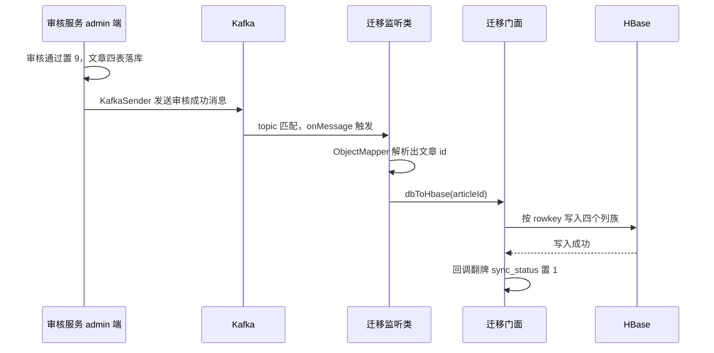

# 审核通过的即时同步：Kafka 钩子让新文章实时进 HBase

定时全量迁移有了，但它有个天然的迟滞：文章审核通过到下一次扫描之间总有一段空窗，cron 配成每天一次时这段空窗长达一天。新文章发布后立刻要能被冷数据召回与热点链路用到，靠等是等不来的。这一课在审核落库链路的终点挂一个消息钩子：审核成功发一条 Kafka 消息，迁移微服务监听到后按文章 id 即时同步进 HBase。全量任务继续兜底，增量链路负责即时。

## 先给结论

- 钩子挂在审核成功处：自媒体文章与爬虫文章的审核都在 admin 端，状态置 9、文章四表落库完成后发送审核成功消息，落库与迁移在这里交接。
- 消息体只带文章 id 与来源类型，`ArticleAuditSuccess` 封装类定义在 common 模块，自媒体与爬虫两个审核方共用。
- 发送走封装的 `KafkaSender`，方法内部自带 try/catch，Kafka 不可用时发送静默失败，审核主流程不受影响。
- 接收端在迁移微服务实现 `KafkaListener` 接口，`topic()` 从 `KafkaTopicConfig` 读配置，`onMessage` 里解析消息、判空、调 `dbToHbase(articleId)`，同步逻辑一行不写，全部复用门面。
- 失败有三道保险：发送容错、解析容错、同步状态不翻牌由定时任务兜底，增量失败不丢数据。

## 钩子挂在哪：审核成功点与消息定义

审核入口有两处：admin 端的爬虫文章审核与自媒体文章审核，两条路最终都汇到同一个动作，审核通过、状态置 9、文章数据落进 App 端的四张表。钩子就挂在这个动作完成之后，谁审核成功谁发消息。消息体在 common 模块定义，两个审核方共用同一个类：

```java
package com.study.headline.common.kafka.messages;

// 审核成功消息：携带文章 id 与来源类型
@Setter
@Getter
public class ArticleAuditSuccess extends KafkaMessage<ArticleAuditSuccess> {

    // 来源类型：自媒体端 / 爬虫端
    public static final String ARTICLE_TYPE_WM = "wm";
    public static final String ARTICLE_TYPE_SPIDER = "spider";

    // 文章 id，迁移监听侧真正消费的字段
    private Integer articleId;
    // 来源类型
    private String type;

    @Override
    protected String getType() {
        // 消息类型标识，与 topic 配套
        return "ARTICLE_AUDIT_SUCCESS";
    }
}
```

消息里最重要的字段就是文章 id，类型字段用来区分来源，迁移场景下两类文章的处理完全一致，甚至不指定类型也能跑。有意不塞整篇文章对象进消息：消息越瘦越快，序列化与反序列化的负担越小，而且数据以库为准，监听侧按 id 回查组装，消息里带再多字段也可能过期。

topic 名称照项目的既有口径管理，配置文件里定义，配置类绑定读取：

```properties
# kafka.properties：审核成功消息的 topic
kafka.topic.articleAuditSuccess=ARTICLE_AUDIT_SUCCESS_TOPIC
```

```java
@Data
@Configuration
@ConfigurationProperties(prefix = "kafka.topic")
@PropertySource("classpath:kafka.properties")
public class KafkaTopicConfig {
    String adminTest;
    // 审核成功消息 topic，键为 kafka.topic.articleAuditSuccess
    String articleAuditSuccess;
}
```

发送与接收两侧都从这个配置类取名称，谁也不硬编码字符串。topic 名拼错是最阴的坑，发往 A 收在 B，两边日志都「正常」就是数据不过来，收口到一处后这类问题在代码层面就被消灭了。

## 发送端：带容错的一行调用

自媒体审核的 Service 里，状态置 9 之后注入发送器、发出消息：

```java
// 审核通过、文章四表落库完成后，发送迁移消息
@Autowired
private KafkaSender kafkaSender;
@Autowired
private KafkaTopicConfig kafkaTopicConfig;

public void auditSuccess(ApArticle apArticle) {
    ArticleAuditSuccess auditSuccess = new ArticleAuditSuccess();
    auditSuccess.setArticleId(apArticle.getId());
    auditSuccess.setType(ArticleAuditSuccess.ARTICLE_TYPE_WM);
    // key 用文章 id，同 key 进同分区，天然保序
    kafkaSender.sendMesssage(kafkaTopicConfig.getArticleAuditSuccess(),
            String.valueOf(apArticle.getId()), auditSuccess);
}
```

`KafkaSender` 是 common 封装的发送器，方法名按封装源码原样引用，内部把消息对象转成 JSON 再投递，关键在它的异常处理：

```java
@Component
public class KafkaSender {

    @Autowired
    KafkaTemplate<String, String> kafkaTemplate;
    @Autowired
    ObjectMapper mapper;

    public void sendMesssage(String topic, String key, KafkaMessage<?> message) {
        try {
            this.kafkaTemplate.send(topic, key, mapper.writeValueAsString(message));
        } catch (Exception e) {
            logger.error("send message to [{}] error:", topic, e);
        }
    }
}
```

发送异常被就地消化，只落一条错误日志。这是刻意的取舍：审核落库是主流程，迁移同步是锦上添花，为一条发不出去的消息让审核失败，主次就颠倒了。丢掉的这次即时同步由定时任务在下一轮兜底，数据不会真丢。

## 接收端：迁移微服务的监听类

迁移微服务建一个监听包，实现封装的 `KafkaListener` 接口。接口要求实现 `topic()` 声明自己听哪个频道，`onMessage` 承载消费逻辑：

```java
package com.study.headline.migration.kafka.listener;

@Component
@Log4j2
public class ArticleAuditSuccessListener implements KafkaListener<String, String> {

    @Autowired
    private KafkaTopicConfig kafkaTopicConfig;
    // JSON 解析消息体
    @Autowired
    private ObjectMapper objectMapper;
    @Autowired
    private ArticleQuantityService articleQuantityService;

    @Override
    public String topic() {
        // 消息名称读自配置类，与发送端同源
        return kafkaTopicConfig.getArticleAuditSuccess();
    }

    @Override
    public void onMessage(ConsumerRecord<String, String> data) {
        log.info("接收到审核成功消息：{}", data.value());
        if (null == data.value()) {
            return;
        }
        ArticleAuditSuccess auditSuccess = null;
        try {
            auditSuccess = objectMapper.readValue(
                    data.value(), ArticleAuditSuccess.class);
        } catch (JsonProcessingException e) {
            log.error("解析审核成功消息失败：{}", data.value(), e);
        }
        // 解析成功且文章 id 非空才同步
        if (null != auditSuccess && null != auditSuccess.getArticleId()) {
            articleQuantityService.dbToHbase(auditSuccess.getArticleId());
        }
    }
}
```

监听类里没有一行 HBase 的代码，解析出 id 后直接调门面的单篇重载，组装、写入、回调翻牌都是 `dbToHbase(articleId)` 内部的既有机制。这种「监听薄、门面厚」的分工让消息侧的代码常年稳定：将来迁移目标换了、组装逻辑调了，监听类一个字都不用改。

端到端链路如下：



时序图末尾那一步是关键：同步状态只有写入成功才翻牌。监听侧调用失败、HBase 写入失败，状态都留在 0，定时全量任务下一轮照样捞到，增量的失败自动退化为全量的下一轮。

## 验证与降级：双断点跑通一条链

测试这条链路要备好两个断点：发送端的发送位置一个，监听端的解析处一个。自媒体库里的文章状态先置为待审核，admin 端发起审核，审核代码一路放行到发送断点，消息对象已填好文章 id 与类型；放行后监听断点几乎同时命中，`data.value()` 里就是刚才那条 JSON，解析出对象后文章 id 清晰可见。继续放行，门面按 id 组装四表、转 `HBaseStorage` 写入，日志打出「添加 StorageData 到 HBase 完成」，库里的 `sync_status` 同步翻成 1。全链从审核到入 HBase 只有一次消息往返的延迟。

降级设计顺带被这条链验证：把 Kafka 停掉再走一遍审核，发送端日志报错但审核流程照常完成，文章四表照常落库；重启 Kafka 后什么都不用补，定时任务把这篇未同步的文章在下一轮扫走。即时链路挂掉，系统退化为慢一点的最终一致，而不是报错报警惊动用户。

## 常见误区

- **消息体塞整篇文章对象。** 错例是把文章、配置、正文全塞进消息，富文本正文轻松几十 KB，Kafka 吞吐与消费速度都被拖垮，消息里的数据还可能与库不一致。正解是只带文章 id 与类型，监听侧按 id 回查组装，数据永远以库为准。
- **发送端不做容错。** 错例是直接裸调 `kafkaTemplate.send`，Kafka 抖动时异常一路抛回审核事务，文章落库被连坐回滚。正解是发送动作收口在封装内 try/catch，失败落日志，主流程继续，同步缺口由定时任务补齐。
- **监听端解析不兜异常。** 错例是 `readValue` 不套 try/catch，一条格式坏掉的消息让消费线程反复报错甚至卡死消费位点。正解是解析失败捕获后落日志、放弃本条，坏消息不阻塞后续正常消息。
- **发送与接收各写一份 topic 字符串。** 错例是发送端写 `ARTICLE_AUDIT_SUCCESS_TOPIC`、监听端手敲另一个相近名字，数据静默丢失。正解是两侧都从 `KafkaTopicConfig` 读同一字段，改 topic 只动配置文件。

## 面试可能被问到的问题

1. 面试官追问：「审核通过后为什么不直接调用迁移服务，而要走 Kafka？」
   答：直接调用把两个服务耦成强依赖，迁移服务重启或宕机会拖累审核主流程。走消息后两侧各自独立部署、独立伸缩，审核只管发，迁移只管收，瞬时审核高峰也能被消息队列削平。代价是多一跳延迟与消息基础设施的运维，对同步类需求完全值得。
2. 面试官追问：「消息里为什么只放文章 id，把数据都带上不是省一次回查吗？」
   答：省下的那次回查并不贵，省回来的链路质量却很实：消息轻，投递与消费都快；不携带业务数据，就没有消息与库不一致的问题；文章数据的组装由迁移侧统一处理，发送方不需要关心迁移侧要哪些字段。消息传引用、数据在库里，是同步类消息的常规做法。
3. 面试官追问：「监听端同步失败，这条文章数据会丢吗？」
   答：不会。同步状态在 HBase 写入成功后才翻牌，监听失败或写入失败时状态留在未同步，定时全量任务下一轮把它扫走。即时链路负责快，全量链路负责全，失败自动降级为延迟到账，不需要人工补数。
4. 面试官追问：「这条消息被重复消费会怎样？」
   答：重复消费无害。`dbToHbase(articleId)` 走门面按 id 组装后写 HBase，写入按 rowkey 覆盖，同一篇文章写两遍不留重复行；回调翻牌后下一轮扫描也不再命中。消息侧不追求精确一次，靠业务幂等消化重复，这比在消息层做去重简单可靠得多。
5. 面试官追问：「爬虫端的审核同步要怎么接入？」
   答：消息类是共用的，爬虫审核通过后 new 一个 `ArticleAuditSuccess`，类型置为爬虫枚举，发到同一个 topic。监听侧不做区分，按文章 id 走同一个门面方法；类型字段留给需要区分来源的场景，比如统计两端的同步量。接入成本就是发送处几行代码。
6. 面试官追问：「增量同步和定时全量同时存在，会不会重复迁移？」
   答：会重复触发但不会重复劳动。增量先到就写入并翻牌，随后的定时扫描查不到它；定时先写完，增量消息来了照样按 rowkey 覆盖写一遍，结果一致。两条链路在门面与数据层汇合，用幂等性吸收时序差异，这是双链路设计能省心的前提。

## 配套资料

- 代码：`materials/code/05/头条day07/`，Kafka 封装九个 Java 文件（`KafkaSender`、`KafkaListener`、`KafkaMessage`、`KafkaTopicConfig` 等），文中 `KafkaSender.sendMesssage` 的容错实现、`KafkaListener` 接口的 `topic` 约定、`KafkaMessage` 的消息包装与 `KafkaTopicConfig` 的配置绑定均节选自其中；引用路径截至 `头条dayNN/` 层级，内层目录冠以项目原名，正文统一以「头条类资讯项目」指代。
- 代码：`materials/code/05/头条day14/`，hbase 封装六个 Java 文件与 mongo 封装三个 Java 文件，文中写入成功触发回调、按 rowkey 覆盖写依据其中的 `HBaseStorageClient` 与 `HBaseStorage`；引用路径均截至 `头条dayNN/` 层级，内层目录冠以项目原名，正文统一以「头条类资讯项目」指代。
- 说明：审核落库链路与迁移业务主体未随资料包落库，消息类 `ArticleAuditSuccess`、监听类 `ArticleAuditSuccessListener`、发送点代码按画面线与口播整理、按本课写法补全为可编译示例，包名统一改写为 `com.study.headline`；`KafkaTopicConfig` 的 `articleAuditSuccess` 字段与 `kafka.properties` 键名按课程口径补全。
