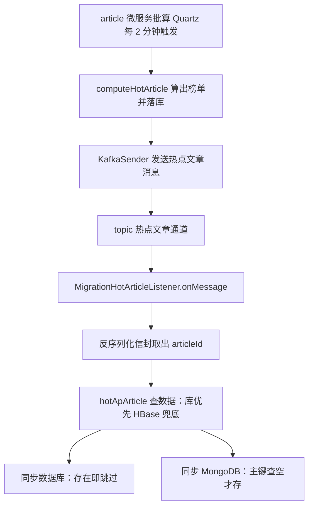

# 热点文章消息同步：榜单算完之后，热文如何备进 MySQL 与 MongoDB

迁移微服务走到这里，文章数据已经有两条进 HBase 的通道：定时全量扫库，以及审核成功消息触发。榜单这边还悬着最后一截：热文章定时计算在 article 微服务把算好的榜单落进 MySQL 后，顺手发出一条热点文章消息，这条消息谁接、接住之后干什么，是热点数据链路的收口动作。本讲把监听器与同步方法写完，热点文章才真正拥有自己的落地路径，查询侧的提速改造也就有了着落。

## 先给结论

- 发送侧早已备好：批算方法算完榜单就发送热点文章消息，载荷是热文章实体，文章 id 就在 data 里；迁移侧不重新定义消息，只写监听。
- 监听器 `MigrationHotArticleListener` 实现 common 封装的 `KafkaListener<String, String>` 接口，topic 从 `KafkaTopicConfig` 取，`onMessage` 里反序列化信封、取出 articleId、调用同步方法。
- 同步方法 `hotApArticle(articleId)` 三步走：查数据（数据库优先，查不到从 HBase 兜底）、同步数据库（已存在直接跳过）、同步 MongoDB（按主键查，没有才存）。
- 两处先查后写就是幂等：消息重复投递、定时任务反复触发，都不会产生重复数据。
- 测试不必手造消息：article 微服务留着每 2 分钟一次的热点批算 Quartz，服务一启动就持续生产消息，断点跟完即可验收。

## 发送侧回看：榜单算完顺手发一条

热文章批算的五步（查前一天文章、算分、缓存频道、按词条落库、图片缓存暂缓）在 day12 已经闭环，画面里的 `computeHotArticle` 在词条落库的循环之外还有一记收尾：榜单数据逐条封装成消息发出去。消息不需要新定义，信封与载荷都是现成的：

- 信封继承 common 的 `KafkaMessage`，type 字符串走统一注册路由；
- 载荷是热文章实体 `ApHotArticles`，字段里就有 `articleId`，同步侧要的正是它。

发送走 day07 的 `KafkaSender`，topic 名挂在 `KafkaTopicConfig` 里，与审核成功消息共用同一套三层配置（环境 properties 给真实值、common 占位透传、配置类绑定字段）。这条消息的真实身份是「通知」：榜单里该文章热了，收到消息的服务自己去把文章数据备齐。为什么通知里只带文章 id 而不带全文？消息体越瘦越好，完整数据由消费方按 id 回查，既避免大报文挤占通道，也保证消费方拿到的永远是当时最新的一版数据。

## 监听器：实现 KafkaListener 接口接住消息

迁移微服务下新建 `kafka.listener` 包，监听器实现 common 封装的 `KafkaListener` 接口，泛型与之前落库监听器一致，都是 `<String, String>`：

```java
package com.study.headline.migration.kafka.listener;

@Component
@Log4j2
public class MigrationHotArticleListener implements KafkaListener<String, String> {

    @Autowired
    private KafkaTopicConfig kafkaTopicConfig;

    @Autowired
    private ObjectMapper mapper;

    @Autowired
    private ApHotArticleService apHotArticleService;

    @Override
    public String topic() {
        // 热点文章消息通道，与发送侧共用同一个配置项
        return kafkaTopicConfig.getHotArticle();
    }

    @Override
    public void onMessage(ConsumerRecord<String, String> data, Consumer<?, ?> consumer) {
        log.info("接收到热点文章数据: {}", data);
        String value = data.value();
        if (null != value) {
            ApHotArticleMessage message = null;
            try {
                message = mapper.readValue(value, ApHotArticleMessage.class);
            } catch (JsonProcessingException e) {
                log.error("热点文章消息解析失败: {}", value, e);
            }
            if (null != message) {
                Integer articleId = message.getData().getArticleId();
                if (null != articleId) {
                    apHotArticleService.hotApArticle(articleId);
                }
            }
        }
    }
}
```

这段代码有四道必须咬住的防线。**value 判空。** 消息体为空串或 null 时直接放弃，反序列化没有意义。**解析要 try-catch。** 通道里万一混进一条不合契约的 JSON，`readValue` 抛出的异常如果裸奔，消费线程的容错方式因封装而异，最坏情况是后续消息被拖累；捕获后打 error 日志留证，消息本身丢弃即可，Kafka 的 offset 照常推进。**信封判空。** 解析失败返回 null，不能直接链式调 `getData()`。**articleId 判空。** 载荷字段缺失时不触发同步，空转一次同步方法的代价远大于一次 if。

类上的 `@Component` 交给 Spring 管理后，注册由 common 封装代办；迁移微服务的组件扫描要同时带上线程所在的 `kafka.listener` 包与 common 的 kafka 封装包，少扫一个，监听器就是摆设，启动日志里也不会有对应的注册痕迹。

## hotApArticle：查数据，再分两路同步

监听器把活转交给 Service，方法体只做三步编排：

```java
@Override
public void hotApArticle(Integer articleId) {
    // 1. 查数据：先查数据库，查不到再从 HBase 兜底
    ArticleQuantity quantity = queryArticleQuantity(articleId);
    // 2. 同步数据库：已有记录直接跳过
    syncToDb(quantity);
    // 3. 同步 MongoDB：按主键查，没有才写入
    hotApArticleToMongo(articleId, quantity);
}
```

**第一步查数据的顺序是「库优先、HBase 兜底」。** 文章数据落在两处：迁移目标存储 HBase，以及尚未迁完时仍在的关系库。过渡期里一篇文章可能只存在于其中一处，所以先查库，查不到再动用迁移综合接口里现成的 HBase 取数方法把它捞回来。等全量迁移收敛完毕，库查成为常态，HBase 兜底变成低频路径，这个顺序让热路径始终打在最便宜的数据源上。

**第二步同步数据库，靠先查后写实现幂等。** 查询命中已有记录时打出「数据已同步」日志直接返回，查不到才落库。热点批算的 Quartz 在测试期每 2 分钟跑一次，同一篇文章的榜单消息会一轮轮重复到来，存在即跳过让重复消息变成无害的空转。

**第三步同步 MongoDB 是本讲真正的新增写入。** mongo 封装在 day14 已经备好：`MongoDBconfigure` 装配 `MongoTemplate`，存储实体继承 `StorageEntity` 基类、主键字段带 `@Id` 注解。写入前的检查与数据库侧同一个思路，先按主键查，查不到才保存：

```java
// MongoDB 侧：先查后存（按画面线与 mongo 封装整理）
private void hotApArticleToMongo(Integer articleId, ArticleQuantity quantity) {
    String rowKey = String.valueOf(articleId);
    // 主键即文章 id，先查有没有
    MongoStorageEntity exist = mongoTemplate.findById(rowKey, MongoStorageEntity.class);
    if (null == exist) {
        MongoStorageEntity entity = new MongoStorageEntity();
        entity.setRowKey(rowKey);
        // 载荷装文章数据列表，由 StorageEntity 基类统一承载
        mongoTemplate.save(entity);
        log.info("热点文章同步 mongo 完成, articleId: {}", articleId);
    }
}
```

消息一到就同步、同步过就跳过，整条链路收拢成一张图：



图的左端是生产者，右端是两路落库。看懂这张图的关键在 G 节点：消息只带了 id，数据的完整度靠回查保证，回查顺序又依赖迁移进度，这正是迁移类链路与普通业务链路最大的不同。

## 断点验收：启动即有消息，删库清场看写入

测试流程值得原样走一遍，因为它的起点不是「造数据」而是「启动服务」。article 微服务的批算 Quartz 挂着每 2 分钟的测试 cron，服务一起来就自动计算并发消息，迁移侧只需要在自己的两处打好断点：监听器入口一处，mongo 保存前一处。

清场动作先做：把 mongo 客户端里上一轮残留的热点文章文档删掉，制造一个「库里没有」的初始状态。消息到达后入口断点命中，放行到 `getData().getArticleId()`，屏幕上的 id 与消息侧对得上（比如 10160），说明解析链路无损。继续放行进同步方法，数据库那一路因为文章已在表中，断点里能看到「已同步」分支直接返回；mongo 那一路因为刚删过库，查询为空，走进保存分支。保存完成刷新客户端，集合里多出一条含 articleId 的文档，同步即算成功。放行之后下一轮榜单消息 2 分钟内又会进来，重复执行不产生重复数据，幂等当场可验。

## 常见误区

- **监听器写了却没人扫。** 错例是类加了 `@Component` 就等消息进来，组件扫描没带 common 的 kafka 封装包或迁移服务的监听包，注册工厂没实例化，永远收不到消息。正解是核对扫描包与依赖，用启动日志确认监听器注册。
- **解析失败不判空继续取值。** 错例是 `readValue` 抛异常后裸奔，或解析结果为 null 仍然链式调 `getData().getArticleId()`，消费线程当场 NPE。正解是 try-catch 加信封、id 两层判空，坏消息丢弃留日志。
- **重复消费直接写库。** 错例是收到消息无脑 insert，批算 Quartz 每两分钟一轮，热点数据按轮次翻倍。正解是数据库与 mongo 两侧都先查后写，存在即跳过，必要时再补唯一约束兜底。
- **把消息里的榜单字段当完整数据用。** 错例是只凭消息载荷里的分值、时间拼查询数据，缺配置、缺正文、缺作者。正解是按 articleId 回查四表组装的完整数据，消息只承担通知职责。

## 面试可能被问到的问题

1. 面试官追问：「热点数据为什么要再同步一份到 MongoDB？」
   答：热点文章是典型的读多写少场景，首页榜单请求全部打在这一份数据上。文档型存储把一次榜单展示所需的数据聚合成单文档读取，避免关系库多表关联；写入由消息触发、频率低，读放大写收敛，读写比例决定这份副本值得维护。
2. 面试官追问：「消息重复投递怎么办，这条链路的幂等在哪里？」
   答：幂等做在消费侧两处：数据库先查后写，存在即跳过；MongoDB 按文章 id 作主键先查后存。消息只带文章 id，同一篇文章同步多少次结果一致，重试、重复触发、服务重启后的 offset 重放都不会产生脏数据。
3. 面试官追问：「查数据为什么是数据库优先、HBase 兜底？」
   答：迁移是渐进过程，过渡期文章可能只存在于关系库或 HBase 之一。库优先让已迁数据之外的情形也能查到，HBase 兜底覆盖「库里没有但已迁移」的文章；全量迁移完成后兜底路径自然退化为低频分支，顺序始终把热路径放在最廉价的数据源上。
4. 面试官追问：「为什么不批算完直接调迁移服务的接口，而要走 Kafka？」
   答：消息把两个微服务解耦成异步关系，article 侧算完即走，迁移侧慢半拍也不阻塞批算；榜单消息有天然的突发量，Kafka 兜住削峰；迁移侧宕机期间消息在通道里堆积，恢复后继续消费，不丢不重（配合幂等）。同步 RPC 在这些场景里要么互相拖死，要么各自造重试。
5. 面试官追问：「批算产生的榜单是词条数乘 1000 条，为什么消息按文章粒度发？」
   答：消息的职责是通知「该文章热了，把它的数据备齐」，词条维度的榜单副本与已读标记是查询侧的物化结果，与数据同步无关。按文章粒度同步让写入量与词条数解耦，幂等键也稳定在文章 id 上；若按词条发消息，消息量放大词条数倍，同步的却是同一份文章数据，纯属浪费。

## 配套资料

- 代码：`materials/code/05/头条day14/`，hbase 封装（`HBaseStorageClient`、`HBaseStorage`、`HBaseInvok` 等）与 mongo 封装（`MongoDBconfigure`、`MongoConstant`、`MongoStorageEntity`）为真实随包文件，`hotApArticle` 的 HBase 兜底查询与 mongo 存取落在这些类上。
- 代码：`materials/code/05/头条day07/`，Kafka 通用封装（`KafkaListener` 接口、`KafkaSender`、`KafkaMessage` 信封与 `KafkaTopicConfig`）为真实文件，监听器与消息解析直接使用这套接口。
- 说明：迁移微服务的监听器与同步业务代码未随资料包落库，文中示例为按画面线（IDE 逐行输入截图）与口播整理补全的可编译版本，包名统一改写为 `com.study.headline`；引用路径截至 `头条dayNN/` 层级，内层目录名含项目原名，不进入正文。
