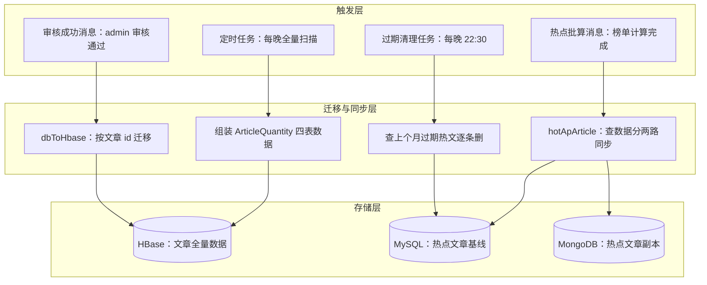

# 过期热文定时清理与数据迁移收官：把 day14 收拢成一张全景图

> 🔒 安全提示：文中示例的口令/密钥均为课程教学环境演示口径，生产环境的安全要求见《安全与合规须知》。

热点数据同步做完，迁移链路只欠两件事：给热文数据定一个「保质期」，到点自动清理；再把整天搭起来的三条通道收拢成一张全景图，确认每一块数据都有自己的进出路径。清理的实现量很小，一个 Quartz 任务类加一个查删方法；收官复盘却比代码更重要，迁移类项目的价值要在全景里才看得清。

## 先给结论

- 清理走 Quartz：`MigrationDeleteHotDataQuartz` 继承 `AbstractJob`，cron 为 `0 30 22 * * ?`，每晚 22:30 执行一次，类上加 `@DisallowConcurrentExecution` 防止上一轮没跑完下一轮又起。
- 清理两步走：先 `selectExpireMonth()` 查出过期的热文章数据，判空后逐条 `deleteHotData` 删除；job 只做薄壳，计时与日志留在 `executeInternal`。
- 课程选「定时查删」而不是存储层 TTL：业务语义是「过期榜单整体下线」，定一个每晚执行的任务最直观，也最好排查。
- 自测技巧：把 cron 临时改成每 1 分钟或每 2 分钟，观察删除效果，验完换回 22:30 正式值。
- day14 全景：文章数据靠「定时全量 + 审核消息」两路进 HBase，热点数据由批算消息触发同步进 MySQL 与 MongoDB，过期热文每晚清理，查询侧随后从 mongo 读热点。

## 任务骨架：cron 定在每晚 22 点 30 分

迁移微服务的 `job` 包下新建任务类，骨架与 day12 的批算任务同一套写法，继承 common 封装的 `AbstractJob`，三个重载各管一段：

```java
/**
 * 定期删除过期的热点数据
 */
@Component
@Slf4j
@DisallowConcurrentExecution
public class MigrationDeleteHotDataQuartz extends AbstractJob {

    @Autowired
    private ApHotArticleService apHotArticleService;

    @Override
    public String[] triggerCron() {
        // 每晚 22:30 执行一次
        return new String[]{"0 30 22 * * ?"};
    }

    @Override
    protected void executeInternal(JobExecutionContext jobExecutionContext)
            throws JobExecutionException {
    }

    @Override
    public String desTrigger() {
        return "每天22:30执行一次，删除过期热点数据";
    }
}
```

cron 六段（秒 分 时 日 月 周）在这里取值 `0 30 22 * * ?`：秒 0、分 30、时 22，日、月不限，周位写 `?`。日与周同时出现必须有一个是问号，这是 Quartz 与 Linux crontab 的方言差异，抄错了解析直接报错。`triggerCron` 返回数组依然是任务开关：返回空数组等于任务下线，上线与下线之间不需要注释代码。

类上的 `@DisallowConcurrentExecution` 是删除任务特有的防护。删除语句跑得慢时（数据量一大，查加删都可能拖长），Quartz 默认到点就再触发一次，两轮并发删除轻则重复扫表，重则行锁冲突。注解一挂，同一任务同一时刻只有一个实例在跑，代价是拖长的轮次会推迟触发点，对清理场景完全可接受。

## 查删两步：先查上个月的过期数据，再逐条删

`executeInternal` 保持薄壳，前后计时打日志，业务在私有方法里：

```java
@Override
protected void executeInternal(JobExecutionContext jobExecutionContext)
        throws JobExecutionException {
    long start = System.currentTimeMillis();
    log.info("开始删除数据库过期数据");
    deleteExpiredData();
    log.info("删除数据库过期数据结束, 耗时: {}", System.currentTimeMillis() - start);
}

// 删除过期热点文章：先查后删，逐条清理
private void deleteExpiredData() {
    List<ApHotArticles> hotArticleList = apHotArticleService.selectExpireMonth();
    if (null != hotArticleList && !hotArticleList.isEmpty()) {
        for (ApHotArticles apHotArticles : hotArticleList) {
            apHotArticleService.deleteHotData(apHotArticles);
        }
    }
}
```

查询方法的名字里带 `ExpireMonth`，语义是取上个月及更早的热文章数据。热点榜单的价值随时间衰减：今天的榜单明天就旧了，留一个月已经照顾到「回看上月榜单」这类边缘需求，更早的数据对查询没有意义，只占存储。查出来的列表判空后逐条删除，单条删而不是整批一条 SQL 删，为的是删除动作走 Service，未来加灰度开关、加归档逻辑都有落点。

自测时不必等晚上十点半：把 cron 临时改成 `0 0/1 * * * ?`（每分钟）或 `0 0/3 * * * ?`（每 3 分钟），跑一轮看看过期数据被清掉、日志里出现耗时记录，再把表达式换回 `0 30 22 * * ?`。换回来这一步别省，测试表达式上了生产，就是「每晚删一次」变成「每分钟删一次」的事故。

## 定时查删之外：TTL 为什么没被选上

存储层自带过期机制，为什么不用？两条路各有各的语义边界。HBase 的 TTL 设在列族上，单位秒，到期数据由 Compaction 在后台合并时惰性清理，特点是零维护成本，坏处是不精确：数据过期到真正消失有延迟，删除进度不可见，而且 TTL 挂在列族粒度，同一列族里想保留更久的字段只能分开建模。MongoDB 的 TTL 索引按单字段时间戳清理，后台任务约 60 秒巡检一轮，同样不保证到点即删，而且索引只认一个日期字段。

课程要的语义是「过期的榜单数据整体下线，且下线时间可控、可观测」。定时查删虽然要自己写任务，但每一轮删了多少、耗时多久全在日志里，出问题先查 Quartz 表与任务日志，排查链路与批算任务完全一致。数据量涨上来之后的演进方向也明确：按月拆表或按 rowKey 前缀批量删，把逐条删除升级成分段扫描，任务骨架不动。这段取舍属按主流写法展开，画面与口播只给了「定时调 Service 删除」这一条实现。

## day14 收官：迁移全景一图收拢

整天内容散在三块存储与四条触发路径里，收拢成一张图才好验收：



三条写入路径各有一句口诀。**文章数据进 HBase**，靠定时全量兜底（查 `sync_status` 为 false 的文章批量迁移，写入成功回调翻牌）加审核消息增量补齐（新审核的文章第一时间进 HBase），全量与增量配合，迁移状态收敛到「全部已同步」。**热点数据进 MySQL 与 MongoDB**，由批算消息触发，监听器解析文章 id 后查数据、两路同步，两侧都先查后写保幂等。**过期热文靠任务清理**，每晚 22:30 查上个月数据逐条删。

收官复盘还留了一个改造方向，在全景图之外：迁移完成不等于业务用上，热点文章的查询接口要从 MySQL 切到 MongoDB。做法是注入 `MongoTemplate`，查询封装对象后解析成文章列表与文章详情需要的四个对象（文章、配置、正文、作者），文档里已经装齐了这四块内容，一次查询替代关系库的多次关联，比 MySQL 快一截。这一步的取舍逻辑值得记住：迁移的收益最终要由查询侧的改造兑现，存储换了、查询不换，等于白迁。

迁移这个动作本身也有账要算。**为什么迁：** 冷热分离，海量文章数据放 HBase 这类分布式宽表，热点数据放文档库提速读。**迁移的难在哪：** 四张表字段类型不一致（文章 id 一边是 Long 一边是字符串），组装要防 N+1，写入要靠回调翻牌同步状态，任何一处松了，迁移就不收敛。这些坑在前面的课程里逐一踩过，收官时它们是面试里「说说你做过的数据迁移」的完整素材。

## 常见误区

- **cron 抄错方言或位序。** 错例是把 Linux 五段式 `30 22 * * *` 直接填进 Quartz，少一位秒解析失败；或把周位写成 `*` 与日位冲突。正解是六段式 `0 30 22 * * ?`，日与周一个置 `?`，写完先核对语义再上线。
- **查询结果不判空直接循环。** 错例是 `selectExpireMonth()` 返回 null 时直接 `for` 循环，任务每晚 NPE 一次，qrtz 表里全是失败记录。正解是 null 与空列表双判，空数据是常态，安静返回才算健康。
- **删测试数据后忘换回正式 cron。** 错例是自测时把表达式改成每分钟一次，验证完没换回，生产环境清理任务空转 1440 轮，数据库白挨一天扫描。正解是测试表达式与正式表达式分环境管理，上线前核对 `desTrigger` 描述与 cron 语义一致。
- **只删 MySQL 不管 mongo 副本。** 错例是过期清理只清了关系库的热文章表，mongo 里按文章 id 存的副本继续留着，查询侧命中旧文档，用户看到已过期的榜单。正解是清理范围覆盖热文数据的每一份副本，或让副本自带过期策略并与清理任务口径一致。

## 面试可能被问到的问题

1. 面试官追问：「为什么选定时查删而不是 HBase 或 MongoDB 的 TTL？」
   答：TTL 的清理时机由存储层后台进程决定，不精确也不可观测；TTL 粒度固定在列族或单字段，表达不了「过期的榜单整体下线」这种业务语义。定时查删自己控制节奏，删了多少、耗时多久全在日志里，任务骨架与批算清理一致，排查成本低。数据量大了再演进成分批删除或归档，骨架不用动。
2. 面试官追问：「清理任务定在每晚 22:30，为什么是这个时间？」
   答：热点榜单的时效以天计，保留一个月兼顾了回看需求与存储成本；22 点 30 分落在业务低峰，删除产生的磁盘 IO 与锁竞争对线上查询影响最小。凌晨已有全量迁移任务在跑，把清理安排在迁移之前完成，避免两个批任务互相挤压。
3. 面试官追问：「`@DisallowConcurrentExecution` 解决什么问题，集群下够用吗？」
   答：它保证同一个 JobDetail 上一次执行未结束时不再触发新一轮，防止单实例内并发。集群模式靠的是 Quartz 的数据库行锁（LOCKS 表），多个节点到点时只有一个抢到执行权，两者叠加才完整：行锁管跨节点互斥，该注解管实例内重入。
4. 面试官追问：「数据量涨到千万级，逐条删除还能用吗？」
   答：撑不住，要换姿势。常规做法是分批：按主键或时间范围每次圈几千条，删一批提交一批，避免长事务与大结果集；或者改为归档，把过期数据搬进历史库后只删热表索引范围。再进一步是按月预分区、整分区下线，把删除降级成元数据操作。任务骨架不变，改的只是删除策略。
5. 面试官追问：「用一两分钟说说 day14 这套迁移方案的价值？」
   答：价值在冷热分离与读写提速：海量文章全量数据进 HBase，用分布式宽表换掉关系库的容量天花板；热点文章同步进文档库，首页榜单查询从多表关联变成单文档读。链路用定时全量加消息增量收敛迁移状态，用先查后写保幂等，用过期任务控制数据生命周期。难点集中在四表类型对齐、组装防 N+1 与回调翻牌，收益集中在查询侧的加速改造。

## 配套资料

- 代码：`materials/code/05/头条day14/`，hbase 封装（`HBaseStorageClient` 等）与 mongo 封装（`MongoDBconfigure`、`MongoStorageEntity`）为真实随包文件，全景图中 HBase 与 MongoDB 两路的存取机制可在其中核对。
- 说明：`MigrationDeleteHotDataQuartz` 与删除业务未随资料包落库，类骨架、cron `0 30 22 * * ?` 与方法结构按画面线（IDE 逐行截图与课件 8.2 节）整理，查删方法体按口播与主流写法补全为可编译示例；TTL 对比一节为按主流写法展开的讨论；包名统一改写为 `com.study.headline`；引用路径截至 `头条dayNN/` 层级，内层目录名含项目原名，不进入正文。
- 环境：课程集群 node01~node03，MySQL root/123456；Quartz 依赖的 qrtz 表与 MyCat 登记沿用 day12 的搭建结果。
