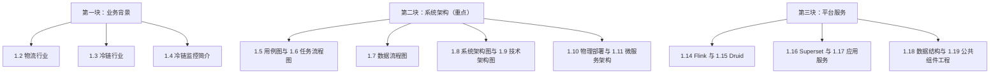

# 冷链监控平台开篇：从物流土壤到物联网实时监控的技术版图

换项目最容易犯的错，是拿旧地图走新路。前一个阶段的项目是资讯类社交产品，重内容迁移与检索；这一个项目是设备监控，重数据采集与实时计算，技术重心整个换了轨。day1 全天没有一行业务代码，它的任务是三件事：这门课要做的系统长什么样、系统背后站着哪些技术、动手前要把哪些环境准备好。把这三件事想清楚，后面每一天的代码才有落点。

## 先给结论

- 平台定位：面向冷链行业的设备监控平台，核心链路是物联网数据采集加实时监控，仓库里的温湿度传感器持续上报数据，平台实时计算、实时告警、实时出报表。
- day1 三块目标：业务背景（物流行业、冷链行业、冷链监控行业及三者关系）、系统架构全景（用例、任务流程、数据流程、系统架构、技术架构、物理部署、微服务拆分）、平台服务盘点（大数据组件、应用微服务、Redis/Kafka/ZooKeeper 等中间件）。
- 技术栈四层：表现层 Vue 体系，应用层 Spring Boot 微服务加 Netty 长连接，服务层 Kafka、Flink、Quartz、Superset，存储层 Redis、MySQL、Druid、HDFS。
- day1 的重点在架构全景一条线，业务背景可以快读，系统环境与中间件安装必须跟着做，否则后面每天开不了工。
- 配套的公共组件工程已经可以落地，公司、仓库、主机、设备四级实体与设备报文结构是后续所有代码的地基。

## 一、三块目标，对应一天的章节

学习目标按三块展开，day1 的二十个小节正好按这三块排布，对照着走不会迷路：



第一块回答「为谁做」：物流是冷链的土壤，冷链是物流的细分，冷链监控又是冷链行业的数字化保障，三层背景一层套一层。第二块回答「长什么样」，这是 day1 的重点，从用户怎么用（用例图）、任务怎么流转（任务流程图）、数据怎么流（数据流程图），一路看到系统架构、技术架构、物理部署，最后数清系统拆成了多少个微服务。第三块回答「用什么做」：大数据组件选了哪些、应用服务怎么分工、Redis、Kafka、ZooKeeper 这些中间件各自站在什么位置。

## 二、平台在做什么：一段设备报文就能看清

物联网采集这个说法有点抽象，公共组件工程里的一段真实实体把它落到实处。设备侧的实时消息实体长这样：

```java
package com.study.coldchain.common.netty.entity;

@Data
@TableName("cz_message_realtime")
public class MessageEntity implements Serializable {
    // 归属链：设备属于主机，主机属于仓库，仓库属于公司
    private String metercode;   // 设备编码
    private String hostid;      // 主机 id
    private String houseid;     // 仓库 id
    private String companyid;   // 公司 id
    // 采集值与告警状态
    private int tem;            // 温度
    private int maxtem;         // 温度上限
    private int mintem;         // 温度下限
    private int hum;            // 湿度
    private int temalert;       // 温度状况：1 高温，0 正常，-1 低温
    private int humalert;       // 湿度状况：1 高湿，0 正常，-1 低湿
    private int state;          // 状态：1 在用，0 停用，2 异常
    private String lon;         // 经度
    private String lat;         // 纬度
    private String curtime;     // 上报时间
}
```

字段本身就说明了系统要做什么：一台设备报上温度、湿度与位置，平台拿它跟上下限比对，立刻得出超没超标，这就是实时监控的最小单元。设备与服务端的对话走自定义文本报文，实体的报文方法把字段拼成定长分隔的串：

```java
// 设备测试报文：段与段之间用竖线分隔
public String deviceMessage() {
    StringBuffer sb = new StringBuffer();
    sb.append("SHT");
    sb.append("|").append(this.getMetercode());
    sb.append("|").append(this.getTem());
    sb.append("|").append(this.getHum());
    sb.append("|").append(this.getState());
    sb.append("|").append(this.getLon());
    sb.append("|").append(this.getLat());
    sb.append("|").append(this.getCurtime());
    sb.append("|").append("SH5lb1.2.1R");
    return sb.toString();
}
```

`SHT` 是报文头，结尾是版本尾，中间依次是设备码、温度、湿度、状态、经纬度与时间。服务端用 Netty 承接这类 TCP 长连接，解析报文、还原实体，再把数据送进后面的链路。按 day1 的架构图，整条数据链路是：设备经采集服务接入，数据先进 Kafka 消息总线，实时计算消费总线做告警与统计，结果落进统计分析存储与分布式缓存，历史冷数据归档到 HDFS，可视化层从统计存储出报表。每一站用什么组件，下一节对号入座。

## 三、技术栈盘点：四层组件与章节映射

技术架构图把组件按四层排开，每一层都能在资料目录里找到对应的章节与代码：

| 层 | 组件 | 落点 |
|---|---|---|
| 表现层 | Vue.js、Element UI、Echarts、Node.js | day8 数据可视化 |
| 应用层 | Spring Boot、Spring Cloud Gateway、Eureka、MyBatis-Plus、Socket、Netty | day2 微服务框架、day3 数据采集服务 |
| 服务层 | Kafka（消息总线）、Flink、Quartz、Superset | 1.13 中间件安装、1.14 Flink 简介、day4 Flink 与流数据处理、day6 实时计算 |
| 存储层 | Redis（分布式缓存）、MySQL、Apache Druid（统计分析存储）、Hadoop HDFS（冷数据存储） | 1.15 Druid 简介、day7 统计分析 |

这张表里有几个值得提前想明白的分工。**Kafka 是总线不是队列。** 采集服务把设备数据统一投进消息总线，实时计算、统计、落库各自消费，发送方不关心谁在收，链路的每一站因此可以独立扩容。**Flink 管实时，Druid 管时序统计。** 告警要的是秒级响应，落在流计算里；报表要的是任意时间范围的聚合，落在时序 OLAP 存储里，两者不是替代关系。**Netty 管接入。** 设备不会说 HTTP，长连接与自定义报文的编解码都压在 Netty 上，这是应用层里最「物联网」的一个组件。

## 四、公共组件工程：day1 就能落地的代码

day1 的资料包带了一个公共组件工程 `cold-common`，虽然小，五脏俱全：`admin` 包放公司、仓库、主机、设备、监控点等管理侧实体，`netty` 包放设备报文实体，`job` 包放调度任务实体，`user` 包放登录用户与令牌，`utils` 包是 Redis 工具、统一返回体、令牌生成器这类通用件。管理侧实体之间是一条四级归属链：

```java
package com.study.coldchain.common.admin.entity;

@Data
@TableName("cz_meter")
public class MeterEntity implements Serializable {
    @TableId
    private String id;          // 设备主键
    private String metercode;   // 设备编码
    private String hostid;      // 挂在哪台主机下
    private String houseid;     // 主机属于哪个仓库
    private String companyid;   // 仓库属于哪家公司
}
```

设备报上来的每一条温湿度数据，都要顺着 `hostid`、`houseid`、`companyid` 找到自己的公司、仓库与主机，告警路由、报表聚合、权限隔离全部建立在这条归属链上。day1 就把这些实体定下来，是因为后面每一天的代码都在往这张骨架上挂功能：采集服务往里写，统计服务按归属聚合，管理服务按公司隔离权限。

## day1 的学习路线

按三块目标的轻重排一条路线：业务背景三节（物流、冷链、冷链监控）快读，抓住「为什么监控」的动机即可；架构部分是重点，用例图、任务流程、数据流程、系统架构、技术架构、物理部署、微服务拆分，每一节都要能对着图复述一遍数据从哪来、到哪去；系统环境与服务、中间件安装两节动手做，Redis、Kafka、ZooKeeper 装不到位，day2 起步就卡壳；Flink、Druid、Superset 三个组件当天只求混个脸熟，各自有专门的章节展开。自检标准很简单：合上资料能画出系统架构图的分层与组件位置，就具备了往下学的资格。

## 常见误区

- **拿资讯项目的经验套监控项目。** 错例是以为还是「接口加增删改查」，对消息总线、流计算、时序存储这些组件视而不见。正解是先接受新链路：采集进总线，计算实时做，报表按时序聚合，业务代码只是链路的一小段。
- **把设备接入想当然当成 MQTT。** 错例是按 IoT 惯例去找 MQTT broker，项目里设备侧走的是自定义文本报文加 TCP 长连接，编解码在 Netty 服务端完成。正解是先读公共组件的报文实体与报文方法，协议长什么样以代码为准。
- **day1 全是图就跳过。** 错例是只看业务背景两节，中间件安装不跟着做，day2 起环境报错连不上。正解是把 1.12 与 1.13 当成实操任务，装完对照 1.12 的服务清单逐个验证。
- **背景课当闲书，不记三者关系。** 错例是物流、冷链、冷链监控三节囫囵看过。正解是记住层层递进的关系与每个行业环节的痛点，后面每个功能的设计动机都能追溯到这层背景，比如告警阈值为什么要挂在仓库与主机两级实体上。

## 面试可能被问到的问题

1. 面试官追问：「冷链监控平台的核心链路是什么？」
   答：设备经 TCP 长连接接入采集服务，报文解析后投进 Kafka 消息总线；实时计算消费总线做阈值判断与告警，结果写时序存储；可视化层从时序存储出报表，管理端维护公司、仓库、主机、设备的归属关系。一句话：采集、总线、实时计算、时序存储、可视化，五段链路各司其职。
2. 面试官追问：「为什么用 Netty 做设备接入，而不是让设备直接 HTTP 上报？」
   答：设备端资源受限，长连接加轻量文本协议的开销远小于反复建连的 HTTP；监控数据是高频上报，长连接省掉握手成本，服务端用 Netty 的编解码器与线程模型稳住大量并发连接。HTTP 更适合管理端这类低频交互，接入协议要与通信双方的能力匹配。
3. 面试官追问：「告警这种实时判断为什么交给 Flink，定时任务扫表不行吗？」
   答：定时任务的延迟下限是任务周期，扫全表的代价随数据量线性涨；Flink 消费消息总线，数据到达即计算，窗口与状态让「最近 N 分钟超温」这类判断有现成语义，还能在告警里做去重与升级。监控场景对延迟敏感，流计算是正解，定时任务留给对账这类低频活。
4. 面试官追问：「温湿度数据为什么选 Druid 存，MySQL 不行吗？」
   答：温湿度是典型的时序数据，写入持续不断、查询几乎全是时间范围加维度聚合。Druid 面向这类负载设计：高吞吐写入、按时间自动分区、任意维度聚合毫秒级返回；MySQL 存亿级采样点，索引膨胀与聚合代价都会失控。业务档案（设备、仓库）留 MySQL，时序指标进 Druid，各存所长。
5. 面试官追问：「这个平台的微服务是怎么拆的？」
   答：按系统架构图拆成四类服务：数据采集服务负责设备接入与报文解析，统计服务负责统计分析与数据服务，营销服务承载实时计算，管理服务包含用户、权限、部门、异常与基础档案管理；入口统一走网关，服务注册发现用 Eureka。拆分逻辑是负载特征：采集重连接，计算重吞吐，管理重事务，各自独立部署扩容。

## 配套资料

- 代码：`materials/code/06/day1 背景介绍与系统介绍/`，公共组件工程 `cold-common` 为真实随包代码（30 余个 Java 文件）：`admin` 包的公司、仓库、主机、设备实体，`netty` 包的设备报文实体，`job` 包的调度实体，`user` 包的登录实体，`utils` 包的 Redis 工具与统一返回体；文中两段代码按该工程整理。
- 说明：引用路径截至 `materials/code/06/` 的 day 目录层级；工程内包名含机构前缀，正文统一改写为 `com.study.coldchain`，模块名沿用业务语义的 `cold-common`；技术架构分层与数据链路按 day1 的系统架构图、技术架构图画面整理。
