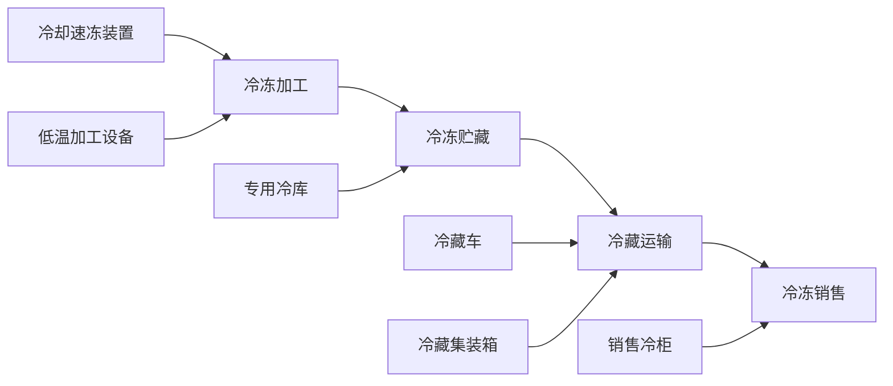

# 冷链行业简介：让物品全程不断温的那条链

北方的超市里摆着南方刚摘的果蔬，南方的餐桌上切着草原运来的牛羊肉，本地的药店卖着外地药企生产的乳制品与药品。这些东西从原产地到消费者手里，短则几天，长则十几天，凭什么没有腐坏变质？普通快递的答案是好包装，冷链行业的答案是另一条底线：全程不断温。

监控平台要服务的行业就是这条链。这一节把冷链的定义、四个核心环节、温区差异与行业构成讲清楚，后面冷链监控、系统用例、任务流程每一节的需求，出发点都埋在这里。

## 先给结论

- 冷链与普通物流在流程上没有差别，唯一差别是物品必须在冷冻环境下完成运输、存储、加工、销售的全过程。
- 冷链分四个核心环节：冷冻加工、冷冻贮藏、冷藏运输、冷冻销售，每一环都对应专用设备与专门的公司。
- 设备是行业的第一道门槛：冷却速冻装置、专用冷库、冷藏车、冷藏集装箱、销售端冷柜，缺一环链条就断了。
- 温度波动是最大的风险源，运输环节尤甚，一车货温度大幅变化就可能整批变质无法使用，这是按环节布监控点的根本原因。
- 行业里专门做运输、做仓储、做冷库、做配送的公司都有，分工细、交接多，温湿度数据是各方对账的唯一凭证。

## 一、什么是冷链：多了一条温度底线

冷链的定义可以拿普通物流做参照。物流解决的是把物品从供应地搬到接收地，冷链面对的物品多了一个属性：对温度敏感。鱼肉蛋奶、果蔬生鲜、疫苗生物制品，常温下放不了几天，必须让物品在冷冻的环境下完成运输、存储、加工、销售，这个加了温度约束的物流形态就是冷链。

约束只有一条，牵动的成本却是一整条链。冷库要建，冷藏车要配，制冷机组要维护，销售端要有冷柜，任何一环断温，前面的投入全部作废。冷链课件里有一张图把这件事画得很直白：冷库、制冷机组、超低温设备、冷藏车四个节点，全部指向中心的「冷链」二字，合成一个闭环。设备围着温度转，这就是行业的运转方式。

## 二、四个环节，四类风险

冷链的四个环节首尾相接，把四个环节与各自的设备、风险对齐看，监控需求的来源就清楚了：



四个环节一路向下游，设备从生产端一路铺到销售端，任何一个节点的温度失控都会沿链条放大。

**冷冻加工是链条的起点。** 鱼肉蛋类的冷冻、蔬菜水果的预冷、冷冻食品与奶制品的低温加工，都在这一环完成。支撑它的是冷却、速冻装置以及低温作业环境，物品入库前的第一道温度关口在这里把住。

**冷冻贮藏是链条的蓄水池。** 加工完的食品药品、果蔬生鲜要进专用冷库，专门进行冷冻存储，否则就会变质。冷库不是普通仓库加了台空调，它的保温结构、制冷系统、温区划分都是专门的工程，存储期间温度必须持续达标，存储环节的监控由此而来。

**冷藏运输是风险最集中的一环。** 无论公路汽车运输还是船舶集装箱运输，都要用专门的冷藏车、冷藏集装箱。运输途中车厢开门、制冷故障、外界气温变化都会引起温度波动，课件里反复强调：温度波动是非常需要重点关注的地方，某一辆车温度发生很大变化，非常容易造成运输物品变质、无法使用。运输环节的监控点最密，正是因为这里变量最多。

**冷冻销售是链条的末端。** 从生产地到消费者手里要经过很多中间商，最后落到销售门店、超市、销售网点，这些场所同样需要冷库和冷冻冷柜来维持低温销售。末端离消费者最近，出问题也最直接，一柜冰淇淋化了就是眼前可见的损失。

## 三、温区：不同货品，不同的温度纪律

「冷链」不是一个温度，不同的物品对温度的要求差别很大，行业里按温度范围划分出多个温区。课程的原料里没有展开温区表，这里按行业通行口径补全，用于建立直觉：

| 温区 | 常见温度范围 | 典型物品 |
|---|---|---|
| 深冷速冻 | 零下 25 度以下 | 高档水产、特殊生物制品 |
| 冷冻 | 零下 18 度上下 | 速冻食品、肉类、冰淇淋 |
| 冰鲜冷藏 | 0 到 4 度 | 生鲜果蔬、乳制品、鲜肉 |
| 恒温 | 10 度上下 | 部分药品、巧克力 |

温区落在系统里，就是仓库的类型与阈值。公共组件工程的仓库实体把这件事记在了数据模型上：

```java
package com.study.coldchain.common.admin.entity;

@Data
@TableName("cz_warehouse")
public class WarehouseEntity implements Serializable {
    @TableId
    private String id;
    private String housecode;      // 仓库编码
    private String housename;      // 仓库名称
    private String houseaddress;   // 仓库地址
    private String housetype;      // 仓库类型：1 冷库，2 恒温库
    private String companyid;      // 所属公司 id
    private String principalname;  // 负责人
    private String principaltel;   // 负责人电话
    private BigDecimal longitude;  // 经度
    private BigDecimal latitude;   // 纬度
    private Double areasize;       // 库房面积
    private String housestatus;    // 状态：1 正常，0 空库
}
```

`housetype` 区分冷库与恒温库，经纬度支撑地图定位，负责人字段决定告警发给谁。温区对应的阈值则落到下一层的设备档案上，每个采集设备带自己的温度上下限。若要用配置文件表达一套温区默认值，可以写成这样（示例为按本课写法补全，课程工程中阈值最终是逐设备配置的）：

```yaml
# 冷链温区默认阈值示例（逐设备覆盖此默认值）
coldchain:
  temp-zones:
    - code: frozen
      name: 冷冻区
      min-tem: -25
      max-tem: -18
    - code: chilled
      name: 冷藏区
      min-tem: 0
      max-tem: 4
    - code: constant
      name: 恒温区
      min-tem: 8
      max-tem: 12
```

同一张平台要同时看住几个温区，靠的就是「仓库定类型、设备定阈值」这两层配置。

## 四、行业构成：分工细、交接多的长链

冷链行业里的玩家非常多，课件里的说法是：专门做运输的、专门做仓储的、专门做冷库的、专门做配送的，各类公司共同构成整个冷链物流。分工细意味着一件货从原产地到消费者手里要经过多次交接，每一次交接都是一次责任边界：货交出去的时候温度是否达标，接收的时候是否达标，出了问题算谁的。口头说不清，只有连续的温湿度记录能说清，这也是后面讲冷链监控平台时「数据自动采集」分量最重的原因。

在冷链物流能做的事情非常多，其中有一个环节承上启下：把上述所有环节的温度状态管起来。这就是冷链监控，下一节展开它要监控什么、用什么设备、解决哪些核心问题。

## 常见误区

- **把冷链当成「加了冰块的快递」。** 错例是以为放几个冰袋就能冷链运输，忽略冷库、制冷机组、冷藏车这类专用设备的系统性投入。正解是按四环节理解，每一环的设备都是硬门槛，断一环全链作废。
- **只盯运输环节，忽略加工与销售。** 错例是以为冷链监控就是给货车装温度计。正解是四个环节都要布点：加工有速冻工序要求，贮藏有冷库温区要求，销售端有冷柜温度要求，运输只是变量最多的一环。
- **所有货品用同一套温度标准。** 错例是拿零下 18 度一路冻到底，冻坏冰鲜果蔬，或者用冷藏温度运冻肉造成变质。正解是按温区管理，仓库类型与设备阈值按货品温度要求配置。
- **行业环节当背景故事听过就算。** 错例是急着看代码，跳过行业环节。正解是记住每个环节的风险点，后面系统的报警规则、报表维度、地图上的仓库点位，都能追溯到这一节的环节划分。

## 面试可能被问到的问题

1. 面试官追问：「冷链和普通物流的本质区别是什么？」
   答：流程环节相同，都是运输、存储、加工、销售的接力，区别在于冷链的物品对温度敏感，必须在冷冻环境下完成全过程。于是行业要投入专用冷库、冷藏车、制冷机组等设备，且温度波动随时可能造成整批货损，管理与监控的颗粒度因此细得多。
2. 面试官追问：「冷链的四个环节分别监控什么？」
   答：冷冻加工盯工序温度与速冻装置状态；冷冻贮藏盯冷库温湿度与制冷设备；冷藏运输盯车厢温湿度、车辆位置与开门事件；冷冻销售盯门店冷柜温度。共同点是都要持续记录温度并和阈值比对，差异在于各环节的设备形态与风险变量不同。
3. 面试官追问：「为什么说运输环节风险最集中？」
   答：运输途中变量最多，开关门、制冷机组故障、外界气温、路况延误都会引起温度波动，且车在移动中人工无法盯守。所以运输环节要同时采集温湿度与位置，超温即时告警，事后能按运单回放全程温度轨迹。
4. 面试官追问：「温区划分怎么落到系统设计上？」
   答：落到两层配置：仓库实体的类型字段区分冷库、恒温库，决定这间库的监控策略；设备档案上的温度上下限与湿度上下限决定具体判定标准。实时计算拿采集值与阈值比对得出高温、正常、低温三种状态，温区不同只是阈值不同，判定链路完全复用。
5. 面试官追问：「冷链行业分工细对监控系统有什么影响？」
   答：交接多，责任边界多，各方都要以数据为凭证对账。所以监控数据必须连续、带时间戳、带设备与仓库归属信息，能按公司、仓库、主机逐级追溯，这也是系统里企业、仓库、主机、设备四级归属链的业务来源。

## 配套资料

- 代码：`materials/code/06/day1 背景介绍与系统介绍/`，其中公共组件工程 `cold-common` 为真实随包代码，`admin` 包的公司、仓库、主机、设备实体与本讲直接相关，文中仓库实体代码按该工程的 `WarehouseEntity` 整理，包名统一改写为 `com.study.coldchain`。
- 说明：引用路径截至 `materials/code/06/` 的 day 目录层级，工程内层目录含项目原名，不写入博客；温区分类表与温区 YAML 示例为按行业通行口径补全，课程工程中的阈值以逐设备配置为准；四环节与设备闭环结构按本讲课件画面整理。
