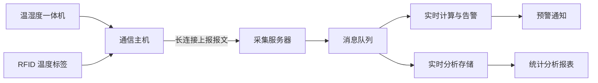

# 冷链监控简介：把温度从人工盯守变成自动采集与自动预警

上一节的四个环节已经说明，冷链里每一环都离不开低温，而温度偏偏是无时无刻不在变的量。靠人巡库抄表、靠司机凭感觉判断车厢冷不冷，既盯不住半夜三点的水果库，也追不上一趟干线车里的波动。冷链监控要做的，就是把温湿度从人工手段换成系统手段：自动采集、自动比对、自动通知、自动出报表。

这一节回答三个问题：监控对象是什么、数据怎么从设备走到平台、平台要解决哪些核心问题。课程选择在 day1 概念阶段就给出答案，因为后面所有代码都是照着这三个问题长的。

## 先给结论

- 冷链监控的对象是运输与存储过程中的温度和湿度，外加设备位置与设备工作状态，开关门等事件在行业里也属常见扩展。
- 采集端的主力设备是温湿度一体机与 RFID 温度标签，数据经带通信模块的主机提交给服务器处理。
- 平台的定位：对冷链运输、仓储过程中的温湿度做监控、预警以及统计分析，实现数据自动采集、监控指标可配置化、预警通知自动化、分析报表统计四项能力。
- 价值落点：提升生鲜冷链的安全管理水平，增加企业与政府对业务环节的掌控。
- 感知异常只是起点，把异常通知到对的人、把历史数据变成报表，才是监控平台区别于温度计的完整闭环。

## 一、监控什么：一段真实报文实体给出的清单

监控对象不是拍脑袋定的，公共组件工程的实时消息实体把平台关心的字段全部列了出来：

```java
package com.study.coldchain.common.netty.entity;

@Data
@TableName("cz_message_realtime")
public class MessageEntity implements Serializable {
    // 归属链：设备、主机、仓库、公司逐级向上
    private String metercode;   // 设备编码
    private String hostid;      // 主机 id
    private String houseid;     // 仓库 id
    private String companyid;   // 公司 id
    // 温湿度采集值与阈值
    private int tem;            // 温度
    private int maxtem;         // 温度上限
    private int mintem;         // 温度下限
    private int hum;            // 湿度
    private int maxhum;         // 湿度上限
    private int minhum;         // 湿度下限
    // 判定结果与设备状态
    private int temalert;       // 温度状况：1 高温，0 正常，-1 低温
    private int humalert;       // 湿度状况：1 高湿，0 正常，-1 低湿
    private int state;          // 设备状态：1 在用，0 停用，2 异常
    // 位置与时间
    private String lon;         // 经度
    private String lat;         // 纬度
    private String curtime;     // 上报时间
}
```

把字段归组，监控对象就浮出来了。**第一组是温湿度本身**，`tem` 与 `hum` 是采集值，上下限跟着记录走，平台拿采集值与阈值比对就能立刻得出超没超标。**第二组是判定结果与设备状态**，`temalert`、`humalert` 是温湿度是否越界的结论，`state` 标记设备自身是否正常工作，设备停摆同样会留下监控盲区，所以设备健康状态也在监控范围里。**第三组是位置与时间**，经纬度让在途设备能画轨迹，时间戳让每条数据可审计。开关门、震动这类事件型信号在行业里通常由门磁等传感器补充上报，本课平台的报文以温湿度、状态与位置为主。**归属链四字段最容易被忽视**：每条数据都带着设备、主机、仓库、公司的层级，告警要按它路由到责任人，报表要按它做维度聚合，监控平台是长在组织结构上的。

## 二、怎么采集上报：设备与链路概览

采集侧的常见设备有两类。一类是**温湿度一体机**，把温度、湿度两个探头的采集能力做在一台设备里，采集到的温湿度数据提交给服务器处理，是仓储场景的主力；另一类是**RFID 温度标签**，贴在货物或包装上记录温度，适合追踪单件货物在整条链路上的温度历史。两类设备的数据最终都要汇聚到通信主机上，再由主机送到服务端，链路概览如下：



主机这一环值得单独说。设备数量多、单点功耗低，通常不会让每台传感器各自直连服务器，而是多台设备挂在一台主机下，由主机统一对外通信。主机实体里有一个字段暴露了它的通信方式：

```java
package com.study.coldchain.common.admin.entity;

@Data
@TableName("cz_host")
public class HostEntity implements Serializable {
    @TableId
    private String id;
    private String hostcode;   // 主机编码
    private String hostname;   // 主机名称
    private String houseid;    // 所属仓库 id
    private String hostmodel;  // 主机型号
    private String simcode;    // sim 卡号
    private String hoststatus; // 状态：1 正常，0 停用
}
```

`simcode` 说明主机走移动网络把数据发回服务端，仓库里的设备不必依赖库内有线网络。服务端承接这批上报的正是采集服务，报文按自定义文本协议解析后进入消息队列，之后的实时计算、存储、报表属于平台内部链路，day1 只立骨架，后续几天逐段实现。

## 三、平台要解决的四个核心问题

课件把冷链监控平台的能力总结成四条，每一条都对应系统里的具体机制。

**数据自动采集。** 采集频率是档案的一部分，设备实体上有采集间隔字段：

```java
package com.study.coldchain.common.admin.entity;

@Data
@TableName("cz_meter")
public class MeterEntity implements Serializable {
    @TableId
    private String id;
    private String metercode;     // 设备编码
    private String hostid;        // 所属主机 id
    private String houseid;       // 所属仓库 id
    private String companyid;     // 所属公司 id
    private String meterstatus;   // 状态：1 在用，0 停用，2 异常
    private String maxtem;        // 温度上限
    private String mintem;        // 温度下限
    private String maxhum;        // 湿度上限
    private String minhum;        // 湿度下限
    private Integer meterinterval; // 采集间隔，单位秒
}
```

`meterinterval` 以秒为单位定义多久采一次，采集节奏由配置驱动，而不是每台设备各写各的定时逻辑。自动采集替代的是人工巡检，数据连续不断，才谈得上后面的比对与统计。

**监控指标可配置化。** 温度湿度上下限都挂在设备档案上，不同仓库、不同温区、不同货品各配各的阈值，改阈值是改配置不是改代码。判定逻辑保持通用：采集值与上下限比对，产出高温、正常、低温三种状况。同一个平台能同时看住冷冻库与恒温库，靠的就是阈值与设备解耦。

**预警通知自动化。** 判定出异常只是第一步，通知必须自动送到人。工程里有一个监控人员实体承担这件事：

```java
package com.study.coldchain.common.admin.entity;

@Data
@TableName("cz_monitor")
public class MonitorEntity implements Serializable {
    @TableId
    private String id;
    private String username;     // 监控人员
    private String userphone;    // 人员电话
    private String monitorstate; // 预警类型：0 温湿度，1 温度，2 湿度
    private String hostid;       // 监控主机 id
    private String hostcode;     // 监控主机编码
    private String hostname;     // 监控主机名称
}
```

监控人员绑定到主机层级，并声明关心温度、湿度还是两者都要，异常发生时平台按这条配置把预警送到对应的人。设备启动、重启、预警报警设施如何联动，课件把它列为冷链监控行业要关注的内容，平台以告警事件加通知通道的方式承接。

**分析报表统计。** 单条数据解决当下的问题，报表解决趋势问题：温湿度随季节的变化、哪座仓库超温次数多、哪个时段风险高。数据持续沉淀后按时间与归属维度聚合，管理端据此调整策略，政府与企业也用它做安全管理的凭证。

四条能力合起来，平台的完整轮廓是：数据从设备自动进来，与可配置的阈值实时比对，异常自动通知，全程数据沉淀成报表，最终提升生鲜冷链的安全管理水平，让企业与政府对业务环节的掌控从靠人变成靠数据。

## 常见误区

- **把冷链监控当成「存温度数据」。** 错例是只做采集入库加曲线展示，异常发生时无人知晓。正解是采集、判定、通知、统计四段缺一不可，告警链路才是平台的核心价值。
- **阈值写死在代码里。** 错例是判定逻辑里直接写数字常量，换个仓库改代码重新发版。正解是阈值与采集间隔进设备档案，按设备配置，判定逻辑保持通用。
- **采集越频繁越好。** 错例是不加区分把采集间隔配到秒级，设备端耗电、服务端存储与计算压力线性上涨。正解是按物品价值与风险等级设定间隔，静态存储的冷库可以放宽，在途运输的车辆要收紧。
- **只关心数据不关心设备。** 错例是设备离线几天无人发现，监控出现盲区。正解是把设备状态纳入监控对象，`state` 字段的在用、停用、异常与长时间未上报都要触发告警。

## 面试可能被问到的问题

1. 面试官追问：「冷链监控平台的监控对象有哪些？」
   答：以温湿度为核心，同时监控设备位置与设备工作状态，行业里还常扩展开关门等事件信号。每条数据带设备、主机、仓库、公司的归属链，采集值与阈值比对产出温度状况与湿度状况，异常即告警。
2. 面试官追问：「温湿度一体机和 RFID 温度标签有什么区别，分别用在哪？」
   答：一体机是持续采集设备，实时上报温湿度，适合冷库、冷藏车这类固定监控点；RFID 温度标签随货物走，记录单件货的温度历史，适合追踪整条链路上的货品温度。平台设计上两者都要能接，数据统一进链路。
3. 面试官追问：「监控指标可配置化是怎么实现的？」
   答：温度湿度上下限与采集间隔都是设备档案字段，管理员按仓库、温区、货品逐设备配置；判定逻辑只做通用的阈值比对，产出高、正常、低三种状况。改指标等于改配置，不需要改代码。
4. 面试官追问：「预警通知自动化要解决什么问题？」
   答：异常判出来还要送到对的人手上。系统里配置监控人员与预警类型，绑定到主机层级，温度、湿度或两者都关心可自由组合，异常发生时按配置路由通知。没有这一环，采集与判定都只是摆设。
5. 面试官追问：「冷链监控平台对企业的价值是什么？」
   答：把温度管理从人工巡检变成自动采集与自动预警，减少变质损失；全程数据沉淀可审计，交接对账有据可依；报表揭示趋势与薄弱环节，帮助改进仓储运输策略。一句话，提升生鲜冷链安全管理水平，增强企业与政府对业务环节的掌控。

## 配套资料

- 代码：`materials/code/06/day1 背景介绍与系统介绍/`，公共组件工程 `cold-common` 为真实随包代码，文中四段实体代码按该工程 `netty` 包的 `MessageEntity`、`admin` 包的 `HostEntity`、`MeterEntity`、`MonitorEntity` 整理，包名统一改写为 `com.study.coldchain`。
- 说明：引用路径截至 `materials/code/06/` 的 day 目录层级，工程内层目录含项目原名，不写入博客；采集设备形态、RFID 温度标签、移动网络上报等描述按本讲课件画面与讲解整理；开关门等事件型扩展按行业常见做法补充，课程报文以温湿度、状态与位置为主。
