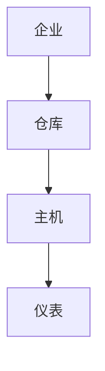
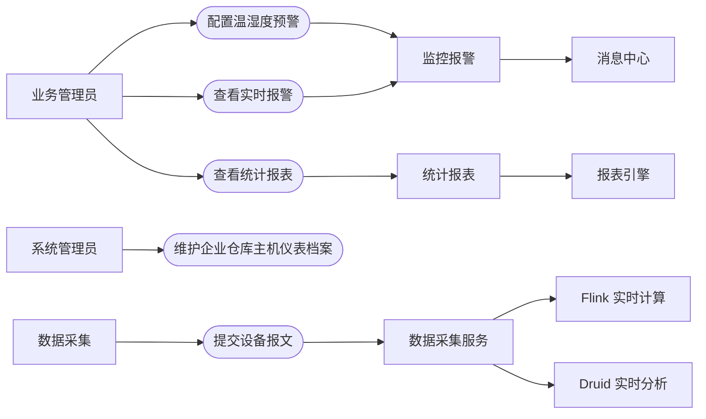

# 冷链监控平台的业务功能与用例图：六块界面，三类角色

行业背景铺完，进入系统本身。接手一个陌生系统，最快的路径是先回答两个问题：系统能干什么，谁在用。业务功能列表回答前者，用例图回答后者。day1 把这两张图放在代码之前，用意正是先立住「做什么、谁来做」，后面每天写的服务、表、接口都能在这两块图上找到位置。

## 先给结论

- 业务功能共六块：工作台总览、全国地图、实时报警、温湿度曲线、统计报表、系统管理。
- 系统管理维护企业、仓库、主机、仪表四级档案；仪表指仓库里的温湿度采集器，温度上限、湿度上限等阈值就在这里设置。
- 用例图上有三类角色：业务管理员设置温湿度预警并查看报表，系统管理员维护企业仓库主机仪表档案，数据采集是系统级角色，代表设备向服务端提交报文。
- 服务端接住报文后做实时计算并存入存储系统；监控报警对接消息中心，统计报表由报表引擎支撑。
- 界面与用例一一对应：地图背后是仓库档案，报警列表背后是监控报警链路，主机管理页面正是仪表档案的操作台。

## 一、六块业务功能，从总览到档案

业务功能按使用场景排布，从打开系统的第一眼到日常运维的操作台，覆盖完整：

**工作台是全局总览。** 登录后先看当前有多少设备、设备实时状态报表、哪些设备出了故障、温度预警的情况，故障设备按仓库占比出饼图。管理员扫一眼就知道今天系统的健康度，要处理的事情集中在哪里。

**全国地图是空间视角。** 地图上标出全国现有哪些仓库、每座仓库当前温度处于什么状态。仓库实体本身就带经纬度字段，地图点位直接由档案数据渲染，点开点位还能下钻看仓库内的设备。

**实时报警是待办清单。** 以列表形式逐设备展示当前实际温度、湿度，以及是否发生预警或报警变化。悬停某条记录可见明细，报警记录菜单里沉淀历史，处理过程可追溯。

**温湿度曲线是单点回放。** 温度曲线与湿度曲线按设备画出随时间的变化，超温时段在曲线上一目了然，配合阈值线能直接看出越界的幅度与持续时间。

**统计报表是趋势与规律。** 统计温湿度预警的趋势：是否进行了温度预警、湿度预警，按时间与仓库维度聚合。曲线看单点，报表看整体，管理决策靠报表。

**系统管理是数据地基。** 维护企业、仓库、主机、仪表四级档案。前五块功能展示的都是运行时数据，运行时数据全部长在四级档案上，档案不对，地图上没点、报警找不到人、报表分不清仓库。

## 二、四级档案：仪表是阈值配置的落点

四级档案是一条归属链，企业包含仓库，仓库包含主机，主机下挂仪表：



仪表这个词容易望文生义，它不是电表水表，而是仓库里的温湿度采集器，也就是前面讲的温湿度一体机。它提交上来的温湿度数据要和阈值比对，所以阈值、采样间隔都配置在仪表档案上。主机管理页面的字段清单与仪表实体的对应关系如下：

| 页面字段 | 实体字段 | 说明 |
|---|---|---|
| 仪表编号 | `metercode` | 设备唯一编码 |
| 主机名称 | `hostname` | 所属主机 |
| 仓库名称 | `housename` | 所属仓库 |
| 企业名称 | `companyname` | 所属企业 |
| 温度阈值 | `maxtem`、`mintem` | 温度上下限 |
| 湿度阈值 | `maxhum`、`minhum` | 湿度上下限 |
| 采样间隔 | `meterinterval` | 单位秒 |
| 状态 | `meterstatus` | 在用、停用、异常 |

这段对应关系落在公共组件工程的仪表实体里：

```java
package com.study.coldchain.common.admin.entity;

@Data
@TableName("cz_meter")
public class MeterEntity implements Serializable {
    @TableId
    private String id;
    private String metercode;    // 设备编码
    private String hostid;       // 所属主机 id
    private String houseid;      // 所属仓库 id
    private String companyid;    // 所属公司 id
    private String meterstatus;  // 状态：1 在用，0 停用，2 异常
    private String maxtem;       // 温度上限
    private String mintem;       // 温度下限
    private String maxhum;       // 湿度上限
    private String minhum;       // 湿度下限
    private Integer meterinterval; // 采集间隔，秒
}
```

归属链四字段与阈值、间隔放在同一张档案里，意义在于：配置改在哪里，告警就路由到哪里，报表就聚合到哪里。企业档案本身则是这条链的根，实体上除了名称、编号、地址这些基本信息，还带质量管理员与负责人及其电话，异常升级时的联络路径从企业档案起步：

```java
package com.study.coldchain.common.admin.entity;

@Data
@TableName("cz_company")
public class CompanyEntity implements Serializable {
    @TableId
    private String id;
    private String company;        // 企业名称
    private String abbreviation;   // 企业简称
    private String companynumber;  // 企业编号
    private String companyaddress; // 公司地址
    private String managementname; // 质量管理员
    private String managementphone;// 质管员电话
    private String leader;         // 负责人姓名
    private String leaderphone;    // 负责人电话
}
```

## 三、用例图：三类角色与服务的对接

把六块功能往用例图上归拢，角色有三类：业务管理员、系统管理员、数据采集。前两类是人，第三类是系统级角色，代表设备侧的报文提交。用例与后台服务的对接关系画出来是这样：



**业务管理员的用例围绕「看与配」。** 设置温度湿度的预警规则，查看实时报警与统计报表，不碰基础档案。日常运营里告警阈值调不调、趋势怎么变，是这个角色的功课。

**系统管理员的用例围绕「档案」。** 设备管理、主机管理、仓库管理、企业管理都在这里，加上登录用户与权限维护。档案是全局正确性的源头，交给专门的系统管理员，业务管理员只消费不修改，职责边界因此清晰。

**数据采集是容易被忽略的角色。** 用例图上它不是人，而是一个系统级参与者：设备采集上来的温湿度通过它提交给服务端，服务端做实时计算，最终存储到存储系统。把它画成角色是为了强调一条边界：采集链路有自己的生命周期与失败模式，设备掉线、报文异常都是这一环要处理的事情，与人的操作无关。

服务对接部分是后面几天课程的路线图：数据采集服务把报文交给 Flink 做实时计算、交给 Druid 做实时分析，监控报警把通知交给消息中心，统计报表落在报表引擎上。用例图上每一条从用例指向服务的连线，都对应接下来要写的一块代码。

## 常见误区

- **把仪表当成水电表。** 错例是按生活直觉理解「仪表」，漏掉它就是温湿度采集器这个事实。正解是记住仪表带温度上下限、湿度上下限、采样间隔与设备状态，是四级档案的最末端。
- **两类管理员混为一谈。** 错例是以为管理员只有一个，权限设计成一个大角色。正解是业务管理员管预警配置与报表查看，系统管理员管企业仓库主机仪表档案与用户权限，权限模型按用例图切分。
- **用例图只画人。** 错例是忽略数据采集这个系统级角色，设计接口时没人对报文提交负责。正解是把采集当成一等角色，它有自己的用例与失败处理，服务端要为它的异常做兜底。
- **阈值配在仓库全局一处。** 错例是一座仓库一套上下限，同库里不同设备的差异无处安放。正解是阈值挂在仪表档案上按设备配置，仓库类型只决定默认策略。

## 面试可能被问到的问题

1. 面试官追问：「这个监控平台的业务功能有哪几块？」
   答：工作台总览设备数量与故障、预警报表，全国地图展示仓库点位与温度状态，实时报警列表逐设备展示当前温湿度与预警变化，温湿度曲线做单点回放，统计报表看预警趋势，系统管理维护企业、仓库、主机、仪表四级档案。
2. 面试官追问：「用例图上为什么有数据采集这个角色，它不是人吧？」
   答：它是系统级参与者，代表设备侧向服务端提交报文。画成角色有两层用意：一是采集链路有自己的用例与异常场景，设备掉线、报文非法都要处理；二是把「谁在产生数据」显式标出来，接口设计与责任划分不靠猜。
3. 面试官追问：「业务管理员和系统管理员的职责边界怎么切？」
   答：业务管理员配置温湿度预警、查看实时报警与统计报表，是运营侧；系统管理员维护企业、仓库、主机、仪表四级档案和用户权限，是基础数据侧。业务管理员消费档案但不改档案，改动权限集中在系统管理员，数据出错时责任链清晰。
4. 面试官追问：「四级档案对告警和报表分别意味着什么？」
   答：告警按归属链路由，仪表异常先定位主机、仓库、企业，再找到企业档案上的负责人与质管员通知出去；报表按同一链路做多级聚合，可以按企业、仓库、主机任意维度统计预警趋势。没有归属链，告警送不到人，报表也聚不起来。
5. 面试官追问：「仪表档案上要配哪些监控相关参数？」
   答：温度上下限、湿度上下限决定异常判定标准，采样间隔决定采集频率，设备状态标记在用、停用、异常。这些参数与设备编码、归属层级同表存储，阈值变更留痕，判定逻辑通用不写死。

## 配套资料

- 代码：`materials/code/06/day1 背景介绍与系统介绍/`，公共组件工程 `cold-common` 为真实随包代码，`admin` 包的企业、仓库、主机、仪表、监控人员实体与 `user` 包的登录用户实体构成本讲的档案骨架，文中企业与仪表实体代码按该工程 `CompanyEntity`、`MeterEntity` 整理，包名统一改写为 `com.study.coldchain`。
- 说明：引用路径截至 `materials/code/06/` 的 day 目录层级，工程内层目录含项目原名，不写入博客；六块业务功能、三类角色与服务对接关系按本讲课件界面与用例图画面整理，界面字段清单按主机管理页面整理。
