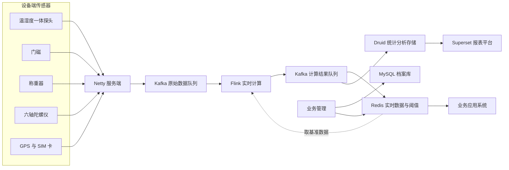

# 数据流程图：一条温湿度报文从传感器走到报表的旅程

任务流程图已经把每个环节要做的事标清楚了，为什么还要再画一张数据流程图？因为「做了什么」与「数据去哪了」是两个问题。监控类系统的业务逻辑往往不复杂，复杂的恰恰是数据旅程：一条报文从传感器出发，要经过接入、缓存、计算、存储、展示五类角色的接力，任何一站的流向没想清楚，写代码时就会把数据放到不该放的地方。day1 的这张数据流程图，把整条链路的数据走向一次讲透。

## 先给结论

- 任务流程图侧重链条上每个节点「执行什么任务」，数据流程图侧重每个节点「产生或存储的数据往哪流」，一张管动作，一张管数据。
- 主干链路五段接力：设备数据经网络进入 Netty 服务端，解析后投进 Kafka；Flink 实时监听队列做计算，结果再投回 Kafka；Redis 监听队列存实时数据，Druid 沉淀统计结果。
- 设备端不是单一探头：温湿度一体探头、门磁、称重器、陀螺仪、GPS 与 SIM 卡，各采一个维度的数据。
- 业务管理是企业、仓库、主机、设备等档案数据的源头，设置结果写 MySQL，热点副本放 Redis 供实时计算取用。
- Netty、Flink、Redis 三个核心组件互不直连，全部通过 Kafka 解耦，实时性靠「数据到队列即被消费」保证。

## 一、任务流程图管动作，数据流程图管数据

两张图长得像，视角完全不同。任务流程图按时间顺序回答「谁在什么环节做什么」：设备提交数据、服务端解析、触发异常报警、基础数据入库、页面展示，节点是动作。数据流程图换一个视角盯住数据本身：每个环节会产生什么数据、加工什么数据、加工完存到哪、最终给谁消费。

画成图，冷链监控平台的数据流向是这样的：



图里有两处最容易看漏。虚线是「Flink 从 Redis 取基准数据」：温度上限、下限这类阈值存在缓存里，计算时拿来与实时值比对；下方的回路是「Flink 结果回投 Kafka 再落 Redis」：计算结果不直写缓存，而是重新进队列，由 Redis 监听后存储。一进一出都走队列，这正是整张图的设计灵魂，后文展开。

## 二、源头：设备端采集的六类数据

数据流程图的起点不是「设备」两个字，而是六类各司其职的采集部件：

- **温湿度一体探头**：核心采集部件，负责库内温度与湿度两个最关键的指标。
- **门磁**：监测大门是否关闭紧合。门关不严，库内温度会悄悄漂移，门磁数据用来解释温湿度异常的成因。
- **称重器**：采集所载物品的重量。
- **三轴与六轴陀螺仪**：用在运输车辆上，监测行驶中的车身倾斜度、转弯姿态与速度，冷链运输摔没摔、翻没翻，靠它说话。
- **GPS 与 SIM 卡**：定位设备所在的经纬度与位置信息；SIM 卡插卡入网，为设备提供流量通道。
- **显示屏**：本地查看采集到的数据，不依赖后端也能读数。

这些部件采集出来的数据，最终要变成能在网络上传输的东西。公共组件工程里的报文实体给出了答案：一条设备报文就是一个定长分隔的文本串，把设备编码、温度、湿度、状态、经纬度与时间按竖线拼起来：

```java
package com.study.coldchain.common.netty.entity;

// 设备测试报文：段与段之间用竖线分隔，SHT 为报文头，结尾是版本尾
public String deviceMessage() {
    StringBuffer sb = new StringBuffer();
    sb.append("SHT");
    sb.append("|").append(this.getMetercode());
    sb.append("|").append(this.getTem());
    sb.append("|").append(this.getHum());
    sb.append("|").append(this.getState());
    sb.append("|").append(this.getLon());
    sb.append("|").append(this.getLat());
    sb.append("|").append(this.getCurtime());
    sb.append("|").append("SH5lb1.2.1R");
    return sb.toString();
}
```

这就是数据流程图最上游的形态：一串纯文本，既是数据的源头，也决定了接入端必须做解析。

## 三、主干：Netty 解析，Kafka 承运，Flink 加工

报文经网络到达后端，Netty 服务端负责接收与解析。设备不会说 HTTP，这条接入通道是 TCP 长连接，Netty 把文本报文按分隔符切段、还原成结构化对象，再转换成 JSON 格式推进 Kafka 队列。进队列的消息体大致长这样（按报文实体字段补全的示例）：

```json
{
  "metercode": "SHT0001",
  "hostid": "h1001",
  "houseid": "w2001",
  "companyid": "c3001",
  "tem": 8,
  "maxtem": 10,
  "mintem": 2,
  "hum": 65,
  "temalert": 0,
  "humalert": 0,
  "state": 1,
  "lon": "116.40",
  "lat": "39.90",
  "curtime": "2026-11-06 10:00:00"
}
```

字段里的 `temalert` 与 `humalert` 就是 Flink 要算出来的东西。Flink 实时监听 Kafka 队列，计算是 Kafka 与 Redis 两边结合着做的：从 Redis 取出该设备的温度上下限基准，与队列里的实时值比对，超出上限判高温，跌破下限判低温，把结论写进告警状态字段。消息体里带上了 `hostid`、`houseid`、`companyid` 三级归属，告警要通知到哪家公司、哪个仓库，靠的就是这三个字段。

Flink 处理完的数据不直接写库，而是扔回另一个 Kafka 队列。下游由 Redis 监听这个队列，发现数据有变化就实时存储，让业务应用系统随时能读到最新状态；统计侧的结果则沉淀到 Druid，供报表聚合。这条「计算完回投队列」的回路值得多看一眼：Flink 不需要认识 Redis 是谁，Redis 也不需要认识 Flink 是谁，双方只认队列。哪天要加一个新消费者，比如把告警推送到短信网关，只要新建一个队列订阅，计算层一行代码都不用动。

把主干收拢成一句话：Netty 管接入与解析，Kafka 管承运与解耦，Flink 管加工，Redis 与 Druid 管落地，三个核心组件 Netty、Flink、Redis 全部挂在 Kafka 这根总线上，系统之间的实时性由「数据进队列立刻被消费」来保障。

## 四、两条旁路：业务管理与报表统计

主干之外还有两股数据流。业务管理模块维护企业、仓库、设备、主机这些基础档案，以及监控参数的实时设置，设置结果存入 MySQL，其中阈值这类高频读取的数据会同步一份到 Redis，供 Flink 计算时取用。没有这条旁路，主干上的比对就成了无米之炊：上下限从哪来、告警该路由给谁，全靠档案数据撑着。

另一股是报表流。统计报表平台 Superset 不碰实时队列，而是监听 Druid 里的数据生成报表。实时告警走缓存求快，报表聚合走 Druid 求全，两股流量分开走，互不拖累。

## 常见误区

- **把数据流程图画成任务流程图。** 错例是节点里写「提交解析」「异常报警」这类动词短语。正解是节点写数据实体与存储落点：报文、消息体、实时数据、统计结果，动作放回任务流程图里去。
- **以为 Flink 直接读写 Redis 闭环。** 错例是画成 Flink 算完直接写 Redis。正解是 Flink 计算时读 Redis 取基准，算完只负责回投 Kafka，存储由监听队列的 Redis 完成，读写两条路要分开。
- **漏掉业务管理这条旁路。** 错例是只画设备上报主干。正解是把档案流画进去，MySQL 与 Redis 里档案数据的有无，直接决定告警能不能算、能不能路由。
- **数据线只出不出。** 错例是每条线都指向下一站，没有终点。正解是每条数据流必须有落点，MySQL、Redis、Druid 三种存储各自接住一类数据，图才成立。

## 面试可能被问到的问题

1. 面试官追问：「任务流程图和数据流程图到底有什么区别？」
   答：任务流程图以节点动作为中心，描述每个环节执行什么任务，按时间顺序展开；数据流程图以数据为中心，描述每个节点产生、加工、存储的数据流向。前者回答「做什么」，后者回答「数据从哪来到哪去」，同一系统两张图配合使用。
2. 面试官追问：「Flink 算出告警后，为什么不直接写 Redis，要绕一圈 Kafka？」
   答：回投队列是为了解耦。Flink 与下游消费者互不感知，都只依赖 Kafka；新增或替换消费者不动计算层，计算层扩容也不影响存储层。直写会让 Flink 与 Redis 强耦合，任何一方故障或扩容都会牵连另一方。
3. 面试官追问：「实时计算为什么要结合 Redis，只用 Kafka 里的数据不够吗？」
   答：队列里只有设备实时值，比对还需要温度上下限、设备归属这些基准数据，它们由业务管理维护、变化频率低，适合放 Redis 供计算高频读取。Kafka 提供实时原料，Redis 提供比对基准，两者结合计算才完整。
4. 面试官追问：「设备端都有哪些采集类型，各解决什么问题？」
   答：温湿度一体探头采核心温湿度；门磁监测大门闭合状态，解释温漂成因；称重器采重量；六轴陀螺仪监测运输中车身倾斜与速度；GPS 与 SIM 卡负责定位与流量通道；显示屏提供本地读数。多类型采集支撑的不只是告警，还有异常归因。
5. 面试官追问：「Superset 的报表数据为什么不从 MySQL 取？」
   答：报表是按时间范围和维度做聚合的时序分析，Druid 面向这类负载设计，聚合查询毫秒级返回；MySQL 擅长事务与点查，亿级采样点上的范围聚合代价高。实时态在 Redis，统计态在 Druid，档案态在 MySQL，各取所长。

## 配套资料

- 代码：`materials/code/06/day1 背景介绍与系统介绍/`，公共组件工程 `cold-common` 为真实随包代码：`netty` 包的报文实体 `MessageEntity` 含 `deviceMessage` 报文方法与温度上下限、告警状态字段，`admin` 包的公司、仓库、主机、设备四级归属实体，`utils` 包的 Redis 工具 `JedisUtil`；文中 Java 代码按该工程整理，JSON 消息体为按报文实体字段补全的示例。
- 说明：引用路径截至 `materials/code/06/` 的 day 目录层级；工程内包名含机构前缀，正文统一改写为 `com.study.coldchain`；数据流向与设备采集类型按本课数据流程图的画面与讲解整理。
