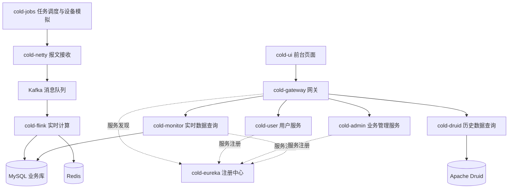

# 冷链监控平台的微服务拆分：十一个工程各管一段

拿到工程列表的第一反应往往是疑惑：一个设备监控平台，为什么要拆出十来个工程？把所有功能塞进一个 Spring Boot 应用，编译部署一条命令，不是更省事？省事只在小系统里成立。设备报文一进洪峰，页面查询就跟着卡；任何一个模块的小改动，都要整包重新发布。

平台的处理方式是把职责切开，每个工程只回答一个问题：谁管页面、谁管用户、谁管报文、谁管计算。拆完再看这张图，阶段一 Spring Cloud 课程里讲过的注册中心、网关、服务拆分，在冷链监控平台里成建制地落了地。

## 先给结论

- 平台按职责拆成 11 个工程：cold-ui 前台、cold-gateway 网关、cold-eureka 注册中心、cold-user 用户、cold-admin 业务管理、cold-monitor 实时数据查询、cold-druid 历史数据查询、cold-flink 实时计算、cold-netty 报文接入、cold-jobs 任务调度，外加一个被各服务共享的 cold-common。
- cold-common 单独成工程而不是拷代码：实体与公共组件只维护一份，谁要用谁依赖。
- 服务协作有两条主线：管理链是 cold-ui 经网关调各业务服务，设备链是 cold-jobs 到 cold-netty 到 Kafka 再到 cold-flink。
- 所有服务统一注册到 cold-eureka，网关按服务名转发，服务之间不认 IP 只认名字。

## 一、拆分思路：按职责切，不按技术切

**面向人的服务跟着页面走。** cold-ui 是前台页面工程，浏览器的每个 API 请求都从它发出，它不直接调后端服务，统一打到网关。登录、退出这类账号能力归 cold-user；公司、仓库、主机、设备这些档案的设置归 cold-admin，也就是业务管理与系统管理。

**面向数据的服务跟着查询走。** 同样是查数据，实时与历史被拆成两个服务：cold-monitor 查业务库里的实时指标，cold-druid 查 Apache Druid 里的历史数据。数据源不同、查询特征不同，拆开后各自的缓存策略与承载能力互不牵连。

**面向设备的服务跟着报文走。** cold-jobs 用分布式定时任务模拟硬件设备定时发报文，cold-netty 接收报文并推入队列，cold-flink 在 Apache Flink 集群里做实时计算。三个工程串成设备的供数、接入与计算。

**面向治理的只剩三个工程。** cold-eureka 是 Spring Cloud 服务注册中心的封装，cold-gateway 是网关服务，cold-common 是公共工程。治理件不承载业务，它们的职责是让上面的服务彼此能找到、能复用。

## 二、工程清单：一张表对齐职责

| 工程 | 类别 | 职责 |
|---|---|---|
| cold-ui | 前端 | 前台页面，所有 API 请求的发起方 |
| cold-gateway | 治理 | 网关，统一入口与路由转发 |
| cold-eureka | 治理 | 服务注册中心封装 |
| cold-user | 业务 | 用户服务，登录、退出等 |
| cold-admin | 业务 | 业务管理与系统管理，公司、仓库、主机、设备档案 |
| cold-monitor | 业务 | 实时数据查询 |
| cold-druid | 业务 | 历史数据查询，读 Apache Druid |
| cold-flink | 计算 | 实时数据处理工程，运行在 Flink 集群 |
| cold-netty | 接入 | 设备报文接收服务 |
| cold-jobs | 接入 | 分布式任务调度，模拟硬件设备发报文 |
| cold-common | 公共 | 实体对象与公共组件，被其他服务依赖 |

两条调用链在一张图里的走向如下：



图的左半边是管理链：页面请求进网关，网关按路由分发到四个业务服务；右半边是设备链：模拟器发报文，报文经接收服务进队列，Flink 算完的结果落库，实时查询服务再从库里取数给前台。两侧在 cold-monitor 与业务库处汇合，实时链路算出来的数据，正是页面链路要展示的数据。

## 三、cold-common 为什么单独成一个工程

最典型的共享点是实体。`MessageEntity` 定义在 cold-common 的 netty 包里，cold-netty 收报文要按它解析，cold-flink 计算要按它取字段，cold-monitor 查库要按它映射实时指标表。三方共用同一份定义，字段改动只改一处；如果各拷一份，同一个实体改三次，迟早对不上。

公共工程在别的工程里以依赖方式引入，cold-flink 工程的真实依赖片段（groupId 按约定改写）：

```xml
<!-- cold-flink 工程依赖片段：公共工程只维护一份，各服务按依赖引用 -->
<dependency>
    <groupId>com.study.coldchain</groupId>
    <artifactId>cold-common</artifactId>
    <version>0.0.1-SNAPSHOT</version>
</dependency>
<dependency>
    <groupId>org.apache.flink</groupId>
    <artifactId>flink-connector-kafka_2.11</artifactId>
    <version>1.8.0</version>
</dependency>
```

cold-common 里还有 job 包的调度实体 `ScheduleJobEntity`、user 包的系统用户实体 `SysUserEntity`、utils 包的 Redis 工具类与序列化工具。它的边界是「实体与通用组件」，业务逻辑不进来；一旦越界，所有服务都会强依赖一个大而全的包，公共工程就从复用资产变成耦合源头。

## 四、服务间协作：网关路由与注册中心

网关怎么知道请求该转给谁，答案写在它的路由配置里（按 cold-gateway 工程真实配置整理，域名已脱敏）：

```yaml
spring:
  application:
    name: cold-gateway
  cloud:
    gateway:
      discovery:
        locator:
          enabled: true        # 按注册中心里的服务名自动发现
      routes:
      - id: cold-user-router
        uri: lb://cold-user    # lb 前缀：从注册中心取实例做负载均衡
        predicates:
        - Path=/cold/sys/user/**
      - id: cold-admin-router
        uri: lb://cold-admin
        predicates:
        - Path=/cold/admin/**
      - id: cold-monitor-router
        uri: lb://cold-monitor
        predicates:
        - Path=/cold/device/monitor/**
      - id: cold-druid-router
        uri: lb://cold-druid
        predicates:
        - Path=/cold/apache-druid/query/**
```

`lb://cold-user` 的含义是：转发前先问注册中心 cold-user 有哪些实例，再挑一个发过去。服务横向扩容、实例上下线，网关的配置一行都不用改，这就是「只认名字不认 IP」。

设备链与库的衔接另有两条暗线。Flink 的计算结果写进业务数据库，cold-monitor 从库里读出来供前台展示，实时计算与实时查询之间不直连，靠库解耦；cold-jobs 的报文数据来自定时任务数据库，Quartz 按配置的 cron 周期驱动模拟设备发送。所有服务启动时都向 cold-eureka 注册，前端自始至终只需要认识网关一个地址。

## 常见误区

- **把 cold-common 当杂物间。** 错例是哪个服务都往 common 里塞自己的业务方法，最后所有服务强依赖一个大而全的包。正解是 common 只放实体与通用组件，业务逻辑留在各自服务里。
- **服务之间直连 IP 调用。** 错例是配置文件里写死对方服务的地址端口，实例一换就断。正解是调用走注册中心里的服务名，扩容与迁移不牵连调用方。
- **把 cold-flink、cold-netty 当普通 Web 服务监控。** 错例是用 HTTP 健康检查接口探活来管理它们。正解是它们是常驻计算与接入进程，要看队列积压、连接数、作业状态这类专属指标。
- **以为拆得越细越好。** 错例是把每个 Controller 拆成一个服务，运维成本先爆炸。正解是拆分粒度以「独立变化的原因」为单位，11 个工程已覆盖页面、治理、业务、接入、计算五类职责。

## 面试可能被问到的问题

1. 面试官追问：「你们的微服务是按什么粒度拆的？」
   答：按职责与数据特征拆，不按技术分层拆。账号能力归用户服务，档案管理归业务管理服务，实时与历史查询因数据源不同拆成两个服务，设备接入与实时计算独立成服务，注册中心、网关、公共工程负责治理。粒度的依据是一个服务只因一类原因变化。
2. 面试官追问：「公共工程 cold-common 的边界在哪里，为什么单独建工程？」
   答：边界是实体与通用组件，比如设备报文实体、调度任务实体、Redis 工具类。单独建工程是因为它被几乎所有服务依赖，只维护一份定义，字段改动一处生效；各服务拷贝代码的话，同名实体改三处，迟早对不上。
3. 面试官追问：「网关路由里的 lb:// 前缀是什么意思？」
   答：load balance，表示转发目标不是写死的地址，而是从注册中心按服务名拉取实例列表做负载均衡。服务扩容、缩容、重启，网关的路由配置都不用动。
4. 面试官追问：「实时数据查询和历史数据查询为什么拆成两个服务？」
   答：两者数据源与查询特征完全不同。实时查询走业务库，读最新设备指标；历史查询走 Apache Druid 的 OLAP 分析。拆开后可以分别做缓存策略、容量规划与独立发布，互不拖累。
5. 面试官追问：「设备链路和页面链路为什么要分开走？」
   答：设备链路是 TCP 报文进 Kafka 再进 Flink 的流式链路，负载来自设备数量与上报频率；页面链路是 HTTP 请求经网关到业务服务的调用链，负载来自在线用户。两条链路的协议、峰值形态、扩容手段都不同，分开才能独立演进。

## 配套资料

- 代码：`materials/code/06/day1 背景介绍与系统介绍/`，公共工程 `cold-common`：user 包的 `SysUserEntity`、admin 包的 `CompanyEntity` 与 `WarehouseEntity` 等档案实体、job 包的 `ScheduleJobEntity`、netty 包的 `MessageEntity`，以及 utils 包的 Redis 与序列化工具类。
- 代码：`materials/code/06/day2 微服务框架与基础服务/`，cold-eureka、cold-gateway、cold-user、cold-admin 四个工程的起步代码，网关路由片段按 `cold-gateway` 的真实配置整理。
- 代码：`materials/code/06/day6 实时计算 - 冷眼项目实战/`，cold-flink 工程依赖 cold-common 的 `pom.xml` 片段为真实配置（该目录名含项目代号，正文统一称冷链监控平台）。
- 说明：引用路径截至 day 目录层级；工程内包名与 groupId 含机构前缀，正文统一改写为 `com.study.coldchain`。
