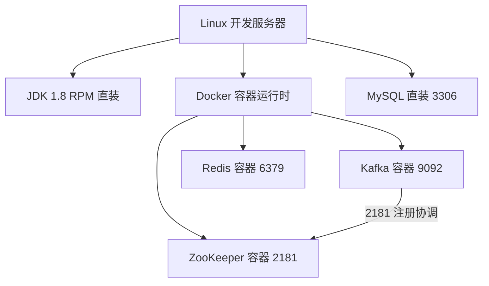

# 中间件安装：让 Kafka、ZooKeeper、Redis、MySQL 各就各位

服务代码都齐了，启动那一刻却全是 Connection refused：Kafka 连不上、Redis 连不上、数据库连不上。落地一套微服务系统，装中间件是绕不开的第一步。装的取舍一句话就能说完：让每个组件待在对的位置，无状态的归容器，要持久化的归操作系统。

## 先给结论

- JDK 1.8 以上是底座，Windows 开发机直接装包并设置 JAVA_HOME，Linux 服务器下载 RPM 包安装，同样要设置 JAVA_HOME。
- Docker 承载 ZooKeeper、Kafka、Redis 三个组件：yum 一条命令装 Docker，docker pull 拉镜像，docker run 起容器。
- MySQL 不进容器，直接装在 Linux 操作系统上，为的是数据持久化稳稳落在磁盘。
- 端口约定：ZooKeeper 2181、Kafka 9092、Redis 6379、MySQL 3306；验证靠 docker ps 加应用侧连通。

## 一、安装清单：谁进容器，谁不进

判断标准是有状态的程度。ZooKeeper、Kafka、Redis 在开发环境里属于「起了就能用」的组件，容器化之后删了重起没有任何负担，环境重建成本极低，适合放 Docker。MySQL 是全系统档案与业务数据的家，数据文件、配置、日志都要求稳定落盘，放进容器一旦误删实例就是数据事故，所以直接装在 Linux 操作系统上。

安装清单的全貌：



Kafka 与 ZooKeeper 之间多一条依赖线：Kafka 启动时要连接 ZooKeeper 完成注册与协调，所以 ZooKeeper 必须先起。

## 二、JDK 与开发工具

Linux 服务器按步骤先下载、再安装、后验证（按本课步骤整理）：

```bash
wget https://example.com/jdk-8u221-linux-x64.rpm   # 下载 JDK 安装包，地址按实际镜像源替换
mv jdk-8u221-linux-x64.rpm /usr/local/
rpm -ivh jdk-8u221-linux-x64.rpm                   # RPM 方式安装
java -version                                      # 验证安装结果
```

装完还有一步不能省：设置 JAVA_HOME。Windows 与 Linux 都要设置，Linux 写进 `/etc/profile` 或 `~/.bashrc`：

```bash
export JAVA_HOME=/usr/java/jdk1.8.0_221
export PATH=$PATH:$JAVA_HOME/bin
source /etc/profile
```

Windows 开发机一侧装好 JDK 1.8 以上版本后，还要备齐 Git、Maven、IDEA、Node.js 这几个开发工具，后端构建靠 Maven，前端工程化靠 Node.js。

版本停在 1.8 不是保守，是对齐：Spring Boot 2.1.8 这一代组件与后面要用的 Flink 1.8 都锚定在 JDK 8 上，底座版本跟着依赖体系走，而不是追着最新版跑。

## 三、Docker 与三大组件

Docker 本身的安装与验证只要三步：

```bash
yum -y install docker          # 安装 Docker，自动下载安装镜像并装好
service docker start           # 启动服务，等价于 systemctl start docker.service
docker ps                      # 无报错即服务已启动
```

然后把三个组件的镜像拉下来：

```bash
docker pull wurstmeister/zookeeper
docker pull wurstmeister/kafka
docker pull redis
docker images                  # 查看已下载的镜像
```

启动 ZooKeeper 容器：

```bash
docker run -d --name zookeeper -p 2181:2181 wurstmeister/zookeeper
# -d 后台运行；--name 指定容器名；
# -p 2181:2181 冒号前是宿主机端口，冒号后是容器内部端口
```

启动 Kafka 容器，参数集中在一串环境变量里（按本课环境约定整理）：

```bash
docker run -d --name kafka -p 9092:9092 \
  -e KAFKA_BROKER_ID=0 \
  -e KAFKA_ZOOKEEPER_CONNECT=zookeeper:2181 \
  -e KAFKA_ADVERTISED_PORT=9092 \
  -e KAFKA_ADVERTISED_LISTENERS=PLAINTEXT://:9092 \
  -e KAFKA_LISTENERS=PLAINTEXT://:9092 \
  -e KAFKA_NUM_PARTITIONS=1 \
  -e KAFKA_DEFAULT_REPLICATION_FACTOR=1 \
  -e KAFKA_OFFSETS_TOPIC_REPLICATION_FACTOR=1 \
  -e KAFKA_AUTO_CREATE_TOPICS_ENABLE=true \
  wurstmeister/kafka
# KAFKA_ZOOKEEPER_CONNECT 指向本机 zookeeper 容器的 2181
```

`KAFKA_ZOOKEEPER_CONNECT` 决定 broker 到哪里注册，`KAFKA_ADVERTISED_PORT` 与 `KAFKA_ADVERTISED_LISTENERS` 决定元数据里广播给客户端的地址，这两个没配对，客户端要么连不上要么收不到消息。镜像还支持一批环境变量控制分区数、副本数与日志保留时长，单机开发环境把这些参数全部按 1 收敛，把集群语义简化掉，只在本地留一个能跑通链路的 broker；`--name` 固定容器名，让 Kafka 的连接参数能按名字指向 ZooKeeper，省去记 IP 的麻烦。

Redis 的启动最简单，先查再起（启动命令为按本课写法补全，画面在 docker run 处截止）：

```bash
docker search redis            # 查询可用镜像，第一项通常是官方镜像
docker run -d --name redis -p 6379:6379 redis
```

## 四、MySQL 直装与验证

MySQL 走 Linux 直装的路径。理由在持久化：数据目录由 `my.cnf` 明确指定，备份、恢复、慢日志这一整套运维链路都是围绕操作系统上的目录体系建立的，直装让数据生命周期的掌控权留在系统管理员手里，不随容器生灭。

三个容器起完，先看状态：

```bash
docker ps                      # STATUS 列为 Up 表示容器运行中
```

组件装好只是服务端就位，应用侧能不能连通才是终点。工程里 Kafka 与 Redis 的客户端依赖（cold-common 工程真实 `pom.xml`）包括 `spring-kafka`、`spring-boot-starter-data-redis`、`jedis`，装好的中间件正是这些依赖的对端。应用侧的连接配置把端口约定固化下来（按本课写法补全，域名已脱敏）：

```yaml
spring:
  kafka:
    bootstrap-servers: kafka1.example.com:9092   # 指向 Kafka 容器映射的宿主机端口
  redis:
    host: redis1.example.com
    port: 6379
```

服务启动后日志里出现 Kafka 与 Redis 的连接建立记录，整条安装链才算闭环。

## 常见误区

- **-p 两端端口写反。** 错例是 `-p 9092:9092` 随手套用，遇到两端不一致的场景就懵。正解是冒号前是宿主机端口，冒号后是容器端口；应用连的是宿主机端口，容器端口由组件进程监听。
- **Kafka 不配广播地址。** 错例是只映射 9092 就完事，客户端能建连却收不到消息。正解是把 `KAFKA_ADVERTISED_PORT` 与 `KAFKA_ADVERTISED_LISTENERS` 配成客户端可达的地址，跨机访问时尤其如此。
- **把 MySQL 塞进容器图省事。** 错例是数据写在容器可写层，容器一删数据全没。正解是要进容器的存储组件必须显式挂载持久化卷，本课的取舍是干脆直装 Linux。
- **docker ps 看不到容器就以为没启动。** 正解是加 `-a` 查看全部容器，STATUS 为 Exited 说明启动后退出过，先看容器日志找原因，再动手重启。

## 面试可能被问到的问题

1. 面试官追问：「为什么 MySQL 不放 Docker 里？」
   答：MySQL 是重度有状态的组件，数据文件、配置、日志都要求稳定持久化，且备份恢复、慢查询治理这套运维链路围绕操作系统目录体系建立。直装让数据生命周期不随容器生灭，避免误删实例丢数据；无状态的 ZooKeeper、Kafka、Redis 在开发环境里容器化，重建成本低。
2. 面试官追问：「docker -p 的端口映射原理是什么？」
   答：容器有自己的网络命名空间，端口彼此隔离。-p 把宿主机端口的流量转发到容器内部端口，两端数值可以不同。应用访问的是宿主机端口，容器内组件监听的是自己的端口，写反了就连不上。
3. 面试官追问：「Kafka 容器为什么依赖 ZooKeeper？」
   答：Kafka 的 broker 列表、配置与协调信息早期版本都存放在 ZooKeeper 里，broker 启动时向它注册。容器化部署用 KAFKA_ZOOKEEPER_CONNECT 指向 ZooKeeper 容器的 2181 端口，因此启动顺序上 ZooKeeper 必须先起。
4. 面试官追问：「KAFKA_ADVERTISED_LISTENERS 是干什么用的？」
   答：客户端先连 bootstrap 地址获取元数据，之后按元数据里的广播地址直连 broker。广播地址配错或不可达，就会出现「能连上却拿不到数据」的现象，跨机或跨网段访问时必须配成客户端可达的地址。
5. 面试官追问：「组件装完之后怎么验证可用？」
   答：分两层。服务端用 docker ps 看容器状态、用 telnet 探端口；应用侧看服务启动日志里 Kafka 与 Redis 连接是否建立，再发一条消息、消费一条消息做闭环验证。

## 配套资料

- 代码：`materials/code/06/day1 背景介绍与系统介绍/`，cold-common 工程的 `pom.xml` 含 `spring-kafka`、`spring-boot-starter-data-redis`、`jedis`、`druid-spring-boot-starter` 等真实依赖，装好的中间件正是这些依赖的对端。
- 代码：`materials/code/06/day3 数据采集服务/`，cold-netty 的 `application-dev.yml` 记录应用侧实际连接 Kafka 的地址与消费分组配置。
- 说明：安装命令与参数按本课画面与步骤整理，示例地址统一用 example.com 占位；Redis 的 docker run 命令为按本课写法补全；工程内包名统一改写为 `com.study.coldchain`。
