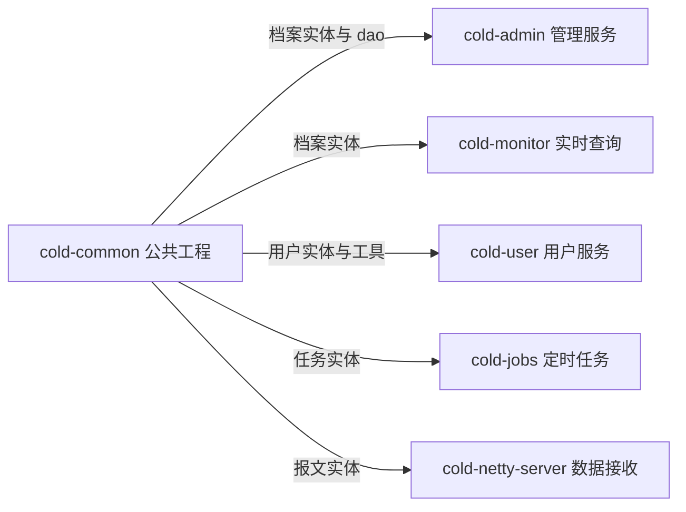

# 公共组件工程：实体、返回封装与工具类的一次沉淀

把服务拆成微服务之后，马上会遇到一个尴尬：cold-admin 与 cold-monitor 都要读公司档案表，实体类各自写一份，某天给档案加个字段只改了一边，另一边的接口返回就开始缺字段，这类问题还很难在编译期发现。公共组件工程 cold-common 就是为这个尴尬准备的：实体、dao、统一返回封装、分页工具、自定义异常、公共工具类，一处定义，所有服务随 Maven 依赖共享。应用服务清单那篇带过它一句，这里把它的包结构、核心类与复用方式展开。

## 先给结论

- cold-common 是一个纯 jar 库工程，没有启动类，不对外提供端口，唯一的职责是被其他工程依赖。
- 包结构按业务域划分：admin（公司、仓库、主机、表计、监控点）、user（系统用户、令牌）、job（定时任务）、netty（设备报文）四组实体与 dao，外加 exception 与 utils 两个横切包。
- 抽取的判断标准：凡是多个服务要共用同一张表或同一份结构的实体与 dao，就下沉到 common；各服务自己的 Controller 与 Service 留在服务内。
- 统一返回封装在课程画面里记作 R，随包工程里落成 `Result` 类，结构与用法一致：继承 `HashMap`，默认 `code=0`、`msg=success`，链式 `put` 想带什么带什么。
- 分页由 `PageUtils` 承接 MyBatis-Plus 的 `IPage` 结果，Service 返回它，Controller 用 `Result` 包住交给前端。

## 一、为什么实体要住进公共工程

设想没有 cold-common 时的样子：cold-admin 有自己的 Controller、Service、dao 和实体，访问公司表 cz_company；cold-monitor 也要读这张表出实时报表。服务已经拆成两个进程，数据库和表却是同一张，于是公司实体要么写两份，要么一个服务去引另一个服务的 jar。写两份必然漂移，跨服务引用则把服务之间的边界搅乱了。

**第一，公共的部分下沉。** 实体类和 dao 层与业务流程无关，只描述表结构和最基本的增删改查，把它们抽到 cold-common，两个服务各自依赖这份公共定义，表结构变更只改一处。

**第二，带行为的部分留下。** 查询条件怎么拼、保存前要不要校验、事务边界在哪，这些属于服务的业务逻辑，各自留在自己的工程里。公共工程放「长一样的东西」，服务工程放「各自干活的逻辑」，边界就清楚了。



这张图在讲依赖方向：箭头全部指向公共工程，服务之间不互相依赖实体。谁也不引谁的包，公共约定都从 cold-common 走，服务挪端口、拆分重组都不牵连别人。

## 二、包结构：按业务域分包

随包工程的源码树按业务域组织，与三个数据库的表分布一一对应：

```bash
cold-common/src/main/java/com/study/coldchain/common
├── admin        # 公司、仓库、主机、表计、监控点：entity + dao
├── user         # 系统用户、用户令牌、登录表单：entity + dao
├── job          # 定时任务配置与执行日志：entity + dao
├── netty        # 设备报文实体 MessageEntity
├── exception    # 自定义异常 MyException
└── utils        # Result、PageUtils、JedisUtil、YmlUtil、TokenGenerator 等
```

dao 层薄到几乎没有内容，继承 MyBatis-Plus 的 `BaseMapper` 就拿到了单表全套 CRUD（真实随包代码，包名按 `com.study.coldchain` 口径改写，节选）：

```java
package com.study.coldchain.common.admin.dao;

import com.baomidou.mybatisplus.core.mapper.BaseMapper;
import com.study.coldchain.common.admin.entity.CompanyEntity;
import org.apache.ibatis.annotations.Mapper;

/** 企业信息表 */
@Mapper
public interface CompanyDao extends BaseMapper<CompanyEntity> {
}
```

admin 包里 `CompanyEntity`、`WarehouseEntity`、`HostEntity`、`MeterEntity`、`MonitorEntity` 对应档案链五张表，user 包里 `SysUserEntity`、`SysUserTokenEntity`、`SysLoginForm` 支撑登录链路，job 包里 `ScheduleJobEntity`、`ScheduleJobLogEntity` 对应任务配置与日志表，netty 包里 `MessageEntity` 是设备报文与实时指标的公共载体。这些实体的字段在系统数据结构一篇已经逐表对过，这里是它们在代码里的家。

## 三、统一返回封装：Result

Controller 给前端返回什么？接口刚起步时十个 Controller 十个样子，前端要挨个适配。cold-common 用一个统一封装把格式钉死，`Result` 继承自 `HashMap`，构造出来就自带成功态，出错走静态工厂，想附加数据就链式 `put`（真实随包代码，节选）：

```java
package com.study.coldchain.common.utils;

import org.apache.http.HttpStatus;

import java.util.HashMap;

/** 统一返回封装：本质是一个不断塞值的 HashMap */
public class Result extends HashMap<String, Object> {
    private static final long serialVersionUID = 1L;

    public Result() {                       // 默认即成功
        put("code", 0);
        put("msg", "success");
    }

    public static Result error() {
        return error(HttpStatus.SC_INTERNAL_SERVER_ERROR, "未知异常，请联系管理员");
    }

    public static Result error(int code, String msg) {
        Result result = new Result();
        result.put("code", code);
        result.put("msg", msg);
        return result;
    }

    public static Result ok() {
        return new Result();
    }

    /** 链式塞值：想带什么数据就 put 什么 */
    public Result put(String key, Object value) {
        super.put(key, value);
        return this;
    }
}
```

所有接口的响应体因此有了固定骨架：`code` 为 0 表示成功，非 0 表示失败，`msg` 说明情况，其余键装数据，装列表、装对象都行。管理服务里的真实用法：

```java
@RequestMapping("/list")
public Result list(@RequestParam Map<String, Object> params) {
    PageUtils page = companyService.queryPage(params);
    return Result.ok(page.getPageMap());          // 分页结果整包返回
}

@RequestMapping("/info/{id}")
public Result info(@PathVariable("id") String id) {
    CompanyEntity company = companyService.getById(id);
    return Result.ok().put("company", company);   // 链式塞一条档案
}
```

`Result.ok()` 返回成功封装，`.put(...)` 返回自身，所以可以一路点下去。user、admin、monitor 的 Controller 全部走这套封装，前端解析响应的代码只写一份。

## 四、分页工具：PageUtils 与 Service 层的配合

`PageUtils` 是分页数据的统一形态，五个字段加两个构造器（真实随包代码，节选）：

```java
package com.study.coldchain.common.utils;

@Data
public class PageUtils implements Serializable {
    private static final long serialVersionUID = 1L;
    private int totalCount;   // 总记录数
    private int pageSize;     // 每页记录数
    private int totalPage;    // 总页数
    private int currPage;     // 当前页数
    private List<?> list;     // 列表数据

    /** 直接承接 MyBatis-Plus 的分页结果 */
    public PageUtils(IPage<?> page) {
        this.list = page.getRecords();
        this.totalCount = (int) page.getTotal();
        this.pageSize = (int) page.getSize();
        this.currPage = (int) page.getCurrent();
        this.totalPage = (int) page.getPages();
    }

    /** 转成与前端约定的 Map：page、total、items 三个键 */
    public Map getPageMap() {
        Map<String, Object> map = new HashMap<>();
        map.put("page", getTotalPage());
        map.put("total", this.getTotalCount());
        map.put("items", this.getList());
        return map;
    }
}
```

它的用法在 Service 层。Service 查公司列表，收前端传来的分页参数与查询条件，组一个 MyBatis-Plus 的 `Page` 与 `QueryWrapper`，查完把 `IPage` 结果直接交给 `PageUtils` 的构造器，页码、总数、当前页全部对号入座（真实随包代码，节选）：

```java
@Service("companyService")
public class CompanyServiceImpl extends ServiceImpl<CompanyDao, CompanyEntity>
        implements CompanyService {

    @Override
    public PageUtils queryPage(Map<String, Object> params) {
        // 分页参数：page 与 pagesize，缺省第 1 页、每页 10 条
        int current = params.get("page") == null ? 1 : Integer.valueOf(params.get("page").toString());
        int size = params.get("pagesize") == null ? 10 : Integer.valueOf(params.get("pagesize").toString());
        Page<CompanyEntity> page = new Page<>(current, size);

        // 查询条件：公司名称模糊匹配
        String company = params.get("company") == null ? "" : params.get("company").toString();
        QueryWrapper<CompanyEntity> wrapper = new QueryWrapper<>();
        wrapper.lambda().like(CompanyEntity::getCompany, company);

        // 执行查询，IPage 结果转成 PageUtils
        IPage<CompanyEntity> result = this.page(page, wrapper);
        return new PageUtils(result);
    }
}
```

整条链路串起来是：Controller 收参数，Service 用 MyBatis-Plus 分页查出 `IPage`，`new PageUtils(result)` 收口，Controller 再 `Result.ok(page.getPageMap())` 包给前端。MyBatis-Plus 的分页对象只活在这条链路内部，前端永远只见到约定好的 `page`、`total`、`items` 三个键， ORM 换了前端也不知情。

## 五、自定义异常与工具类清单

自定义异常 `MyException` 继承 `RuntimeException`，带两个字段：`msg` 提示信息，`code` 业务错误码，默认 500，可以按业务定义成 401 之类。抛出的写法是 `throw new MyException("设备编码不能为空", 401)`，不带一堆模板代码。它与统一返回封装是一对：异常抛出后由服务侧的异常处理器接住，转成 `Result.error(code, msg)` 返回前端，错误出口因此也是统一的。

utils 包里其余的工具类各司一职：`JedisUtil` 封装 Redis 连接池，按 Key、String、List、Set、Hash、SortSet 分组提供操作；`YmlUtil` 基于 snakeyaml 读 yml 配置文件，按 `a.b.c` 形式的 key 取值；`TokenGenerator` 生成登录令牌；`Constant` 沉淀公共常量；`SpringContextUtils` 在非 Spring 管理的代码里取容器中的 bean；`ValidatorUtils` 做参数校验；`SerializeUtil` 管序列化。公共变量、Redis 操作、yml 读取这些「每个服务都可能用但都不复杂」的能力，全部沉在公共工程里，服务工程不再各自造轮子。

复用的落点在 Maven：服务工程的 pom 里引 cold-common 一个坐标，实体、dao、工具与它锁定的依赖版本（MyBatis-Plus、Jedis、fastjson 等）随之进入 classpath。这也是公共工程的隐含责任，它锁的版本就是所有服务的版本底座。

## 常见误区

- **给公共工程加启动类、打成可执行 jar。** 错例：照着服务工程的样子给 cold-common 配 Spring Boot 打包插件。正解：它是纯依赖库，没有 main 方法也没有端口，被服务引入后才在服务的进程里生效。
- **把业务逻辑下沉进公共工程。** 错例：把「保存公司前校验编码唯一」这类规则写进 common。正解：common 只放结构与无状态工具，业务规则属于各服务的 Service 层，下沉会造成依赖它的所有服务行为被绑定。
- **把 Result 当强类型 DTO 设计。** 错例：以为换字段类型编译器会兜底。正解：本质是 `HashMap`，键名靠约定维护，改键名要同步前端，字段敏感的场景应另建明确的响应类。
- **改公共实体不评估影响面。** 错例：随手删一个字段，某个服务悄悄编译失败或运行缺值。正解：公共实体被全部服务依赖，变更要过一遍引用方，升级按兼容性评估。

## 面试可能被问到的问题

1. 面试官追问：「为什么要把实体和 dao 抽到公共工程，而不是各服务维护各自的？」
   答：多个服务访问同一张表时，各自维护实体会产生字段漂移，接口返回悄悄缺字段。抽到公共工程后表结构只定义一次，所有服务随 Maven 依赖共享，变更收敛到一处。代价是公共工程成为变更影响面最大的模块，升级需要评估所有引用方。
2. 面试官追问：「Result 继承 HashMap 的设计有什么利弊？」
   答：好处是扩展灵活，任何数据链式 put 进去就能返回，统一了 code 与 msg 的骨架；坏处是弱类型，键名靠约定，编译期发现不了拼错。响应结构要求严格的项目会改用泛型响应类，本课规模下 HashMap 封装足够且最省事。
3. 面试官追问：「PageUtils 是怎么和 MyBatis-Plus 的分页衔接的？」
   答：Service 用 Page 与 QueryWrapper 执行查询得到 IPage，PageUtils 的构造器直接读它的 records、total、size、current、pages 五个值完成封装，再由 getPageMap 转成前端约定的三个键。ORM 的分页对象被隔离在服务层内部，前端契约稳定。
4. 面试官追问：「自定义异常一般怎么设计？」
   答：继承 RuntimeException 避免调用链上到处 try-catch，至少带提示信息与业务错误码两个字段，配合全局异常处理器把异常翻译成统一返回封装的 error 形态。这样业务代码只负责抛，错误响应的格式由一处维护。
5. 面试官追问：「公共工程的依赖版本会传递给所有服务，怎么避免版本冲突？」
   答：版本在公共工程的 pom 里统一锁定，服务不重复声明，需要覆盖时在服务侧显式声明更高优先级的版本并回归验证。更规范的做法是父 pom 或 BOM 统一管版本，公共工程只声明需要的坐标不写版本号。

## 配套资料

- 代码：`materials/code/06/day1 背景介绍与系统介绍/`，公共工程 `cold-common` 为真实随包代码：utils 包 `Result`、`PageUtils`、`JedisUtil`、`YmlUtil`、`TokenGenerator`、`Constant`、`SpringContextUtils`、`ValidatorUtils`、`SerializeUtil`，exception 包 `MyException`，admin/user/job 包的 entity 与 dao，netty 包 `MessageEntity`；复用示例取自 `materials/code/06/day2 微服务框架与基础服务/` 随包工程 `cold-admin`（`CompanyController`、`CompanyServiceImpl`）。
- 说明：引用路径截至 `materials/code/06/` 的 day 目录层级；工程内包名与 groupId 含机构前缀，正文统一按 `com.study.coldchain` 口径改写。
