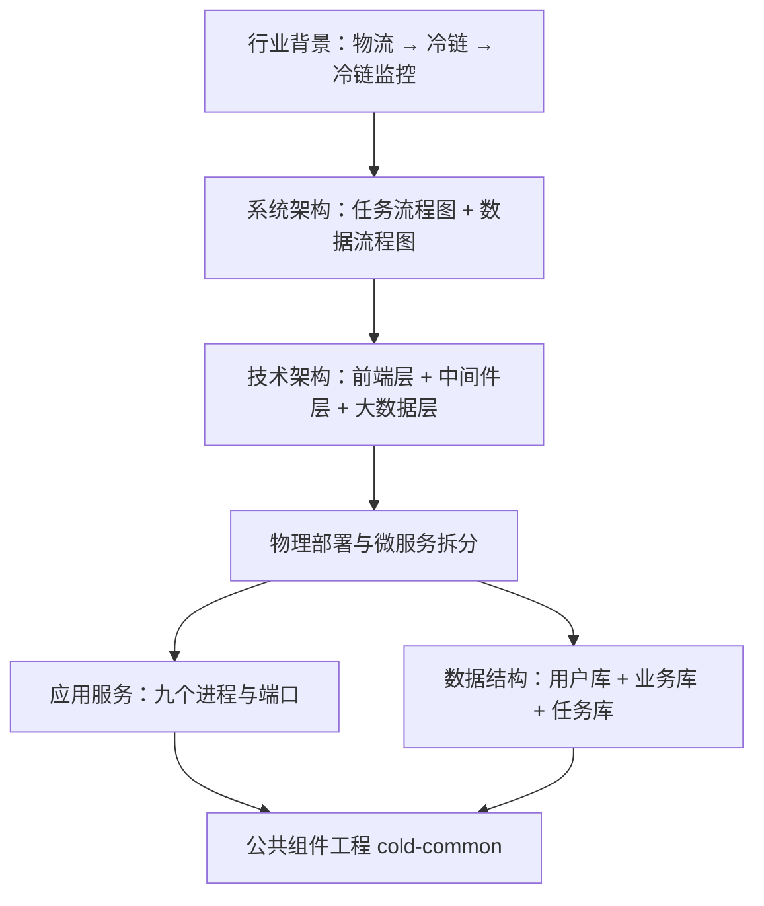

# day1 学习总结：一条线串起冷链监控平台的开局

day1 的信息密度很大：行业背景、系统架构、技术架构、部署、服务清单、数据结构、公共工程，七八个话题一天过完，合上资料往往只剩「冷链、微服务、Flink」几个孤立名词。检验是否真学会了，办法是把整条主线自己复述一遍：每一层解决什么问题、下一层从哪里接手。这里按复盘的顺序把线串起来，顺带把 day1 留下的问题与 day2 的去向对齐。

## 先给结论

- day1 是一条漏斗：行业背景定问题，系统与技术架构定方案，服务清单与数据结构定落点，公共组件工程给代码底座；复述也从上往下走，越说越具体。
- 技术架构记三层就够：前端 Vue 系出页面，中间件 Spring 系出服务，大数据侧 Kafka、Flink、Apache Druid、Superset 出算力与可视化。
- 要带走的两张清单：应用面九个进程与端口，数据面三个库与实时指标表这个交汇点。
- 代码面的公共底座在 cold-common：档案与报文实体、统一返回封装、分页工具、自定义异常。
- day1 只认盘子不动代码，遗留的全是「怎么落地」类问题，day2 逐一兑现。

## 一、漏斗主线：从行业到代码



这张图在讲 day1 的章节依赖：上层决定下层。行业背景决定了要监控的对象是仓库与车队上的温湿度；监控目标决定了数据要「采集、解析、序列化、处理、可视化」地流动，这就是任务流程图与数据流程图；数据流动的方式决定了技术选型与部署形态；部署与拆分落在九个服务进程上，数据落在三个库里；最后 cold-common 把所有服务都要用的代码沉到底座。复述时漏掉任何一层，下一层就会讲不清来历。

## 二、背景与架构：为什么是这个盘子

背景部分是一个递进：物流行业关心品质、数量、成本、效率、安全五个因素；冷链把对象收窄到温湿度敏感的仓储与运输；冷链监控再把目标落到具体动作上，盯住仓库、车队、车辆上的温度与湿度，超限就告警。问题一旦具体，方案就好评估了。

技术架构按三层记。前端层是 Element UI、ECharts、Vue、Node.js，负责页面与图表；中间件层是 Spring MVC、Spring Boot、Spring Cloud Gateway、Eureka、MyBatis-Plus、Netty，负责把业务做成一个个可部署的服务；大数据层是 Kafka、Flink、Quartz、Superset，Kafka 收流，Flink 做实时计算，Quartz 管调度，Superset 出报表。三层的衔接关系比名词更重要：设备报文经 Netty 进入 Kafka，Flink 消费后计算，结果写入存储，查询服务与可视化在存储之上出数，这正好是 asr 里那句「Flink 实时计算、结果存 Druid、Superset 查询」的完整版。

部署面记住两件事：中间件用 Docker 在 Linux 服务器上拉起，应用以 Spring Boot 可执行 jar 落地。day1 的环境命令值得留档：

```bash
# 环境面：JDK 8 直接 rpm 安装，中间件用 Docker 拉起
rpm -ivh jdk-8u202-linux-x64.rpm
docker run -d --name zookeeper -p 2181:2181 -t wurstmeister/zookeeper
docker run -d --name kafka --publish 9092:9092 --link zookeeper wurstmeister/kafka:latest

# 应用面：注册中心与网关先行，业务服务随后
java -jar cold-eureka-0.0.1-SNAPSHOT.jar &
java -jar cold-gateway-0.0.1-SNAPSHOT.jar &
```

## 三、服务与数据：两张必须带走的清单

应用面一张表（端口与启动命令按本课画面整理）：

| 应用 | 端口 | 职责 |
|---|---|---|
| cold-eureka | 8001 | 服务注册中心 |
| cold-gateway | 8080 | API 网关，前端统一入口 |
| cold-user | 8185 | 用户登录与退出 |
| cold-admin | 8181 | 公司、仓库、主机、设备档案管理 |
| cold-druid | 8182 | 查询 Druid 时序数据 |
| cold-monitor | 8183 | 查询 MySQL 实时指标 |
| cold-jobs | 8184 | 定时任务模拟设备发报文 |
| cold-netty-server | 10010 | 接收设备报文 |
| cold-ui | 8000 | 前端页面（Tomcat 托管） |

这张表要连同依赖顺序一起记：注册中心先起，网关随后，业务服务最后；数据链路上 cold-jobs 与 cold-netty-server 是数据源头。微服务拆分与注册发现的关系在 day1 是图上的箭头，day2 之后就是配置文件里的真实条目。

数据面记三个库的边界：用户库 cold-user 存 sys_user 与 sys_user_token；业务库 cold 存档案链（cz_company、cz_warehouse、cz_host、cz_meter、cz_monitor）与实时指标表 cz_message_realtime；任务库 cold-job 里 Quartz 的 QRTZ_ 表管调度，工程自研的 schedule_job 与 schedule_job_log 管业务侧任务。全平台数据的交汇点是 cz_message_realtime：设备报文经 Netty 与流计算写入，报表查询靠它的冗余字段直接出数。

## 四、公共工程与遗留问题

代码面的底座是 cold-common。四组业务包（admin、user、job、netty）放实体与 dao，utils 包放统一返回封装、分页工具与各类公共能力。复盘时最值得再看一眼的是三个类的分工：`Result` 统一响应骨架（code、msg 加链式 put），`PageUtils` 承接 MyBatis-Plus 分页并转成前端约定键，`MyException` 给业务错误一个带错误码的出口。收尾画面里反复出现的正是它（真实随包代码，包名按 `com.study.coldchain` 口径改写，节选）：

```java
package com.study.coldchain.common.exception;

@Data
public class MyException extends RuntimeException {
    private static final long serialVersionUID = 1L;
    private String msg;        // 提示信息
    private int code = 500;    // 业务错误码，可按场景定义为 401 等

    public MyException(String msg) {
        super(msg);
        this.msg = msg;
    }
}
// 用法：throw new MyException("设备编码不能为空", 401);
```

day1 留下的问题也该盘点清楚，它们全是怎么落地的问题：九个 Spring Boot 工程怎么快速创建，公共工程的 pom 依赖怎么配出来；服务注册与发现在 Eureka 里怎么配；网关路由怎么按服务名转发；token 在哪一层校验；开发环境没有真实设备，报文从哪来。这些问题的答案就是 day2 的目录：Spring Boot 工程创建，Eureka 注册中心，Gateway 网关，用户服务与系统管理服务，再用 Quartz 搭一个设备模拟器补上报文来源。day1 认过的端口、实体与表名，会从 day2 起一一在工程里现身。

## 常见误区

- **把 day1 当纯概念课跳过。** 错例：急着写代码，端口、表名、实体类全靠后面现查。正解：day1 的清单就是后续所有章节的地图，写每个服务时都会回到这张图。
- **把 Flink 作业当成又一个 Spring Boot 服务。** 正解：Flink 实时计算是独立的大数据作业，Superset 是独立平台，都不在九个 Spring Boot 进程的清单里，部署与运维方式也不同。
- **背端口不背启动顺序。** 正解：注册中心、网关、业务服务的顺序背后是依赖关系，顺序乱了服务起不来或者注册不上，排障时先看启动顺序。
- **复述只报名词。** 错例：能背出 Kafka、Flink、Eureka，说不出谁连谁。正解：每个名词都补一句上下游，报文从哪来、算完去哪里、谁查它，串不起来的名词等于没学。

## 面试可能被问到的问题

1. 面试官追问：「用两分钟介绍一下这个项目的整体架构？」
   答：冷链监控平台监控仓库与车队的温湿度。设备报文由 Netty 服务接收进入 Kafka，Flink 做实时计算，结果写入存储；后台按微服务拆成注册中心、网关、用户、管理、实时查询、Druid 查询、定时任务等九个服务，前端 Vue 应用经 Gateway 访问；公共实体与工具沉淀在公共工程里被各服务共享。
2. 面试官追问：「为什么要引入 Flink、Druid 和 Superset？」
   答：三者各管一段：Flink 负责对设备报文做实时计算与告警判断；Druid 存计算结果的时序数据，支撑按时间维度的聚合分析；Superset 基于这些数据做可视化报表。Spring Boot 服务处理管理与查询，重计算与重分析交给大数据组件，职责分明。
3. 面试官追问：「微服务是怎么拆分的，依据是什么？」
   答：按业务职责拆，用户、档案管理、实时指标查询、时序数据查询、定时任务、报文接收各自成服务，再加注册中心与网关两个基础设施。拆分让每类职责独立部署独立伸缩，服务间通过注册中心发现、通过网关统一入口。
4. 面试官追问：「数据为什么分成三个库？」
   答：按服务边界划分，用户库、业务库、任务库各归各的服务访问，数据所有权清晰，结构变更互不牵连。当前规模下分库不分表，驱动是服务边界而不是数据量。
5. 面试官追问：「day1 里你觉得最值得借鉴的设计是什么？」
   答：可以答公共组件工程与数据库维护时间戳。前者把多服务共享的实体、返回封装、分页与异常收敛到一处，避免重复定义漂移；后者用 ON UPDATE CURRENT_TIMESTAMP 让任何变更路径都刷新修改时间，为大数据按时间增量抽取兜底。

## 配套资料

- 代码：`materials/code/06/day1 背景介绍与系统介绍/`，公共工程 `cold-common`（utils 包 `Result`、`PageUtils`、`JedisUtil`、`YmlUtil` 等，exception 包 `MyException`，admin/user/job/netty 包实体与 dao）；day2 预告对应的工程在 `materials/code/06/day2 微服务框架与基础服务/`。
- 本课无讲义包，文中环境命令、服务清单与三层技术架构按本课画面整理；`MyException` 为真实随包代码（包名按 `com.study.coldchain` 口径改写）。
