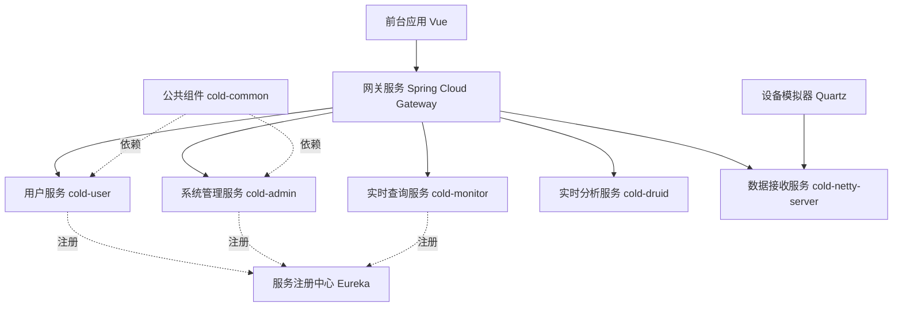

# day2 学习目标：注册中心、网关与用户服务的落地清单

day1 把冷链监控平台的盘子认完了：九个服务、三个库、一套公共工程，全在纸面上。day2 开始动代码，一上来要立五样东西：Spring Boot 工程、注册中心、网关、用户服务、系统管理服务，末尾还要用 Quartz 搭一个设备模拟器。东西多，容易学着学着忘了「为什么是这五个」。先把目标与技术点的映射摊开，再动手，每个工程都能对上它在骨架图里的位置。

## 先给结论

- day2 的五个落点：会创建 Spring Boot 应用、部署 Eureka 注册中心、部署 API 网关、部署用户服务与系统管理服务、部署基于 Quartz 的分布式任务调度（设备模拟器）。
- 骨架口诀四句：前端只认网关，服务全注册，实体进公共工程，报文由模拟器供。
- 前后端分离规范是贯穿 day2 的前提：后端只出接口并统一返回封装，前端只消费接口，两边靠契约并行。
- 网关与注册中心回答两个不同的问题：网关管「请求从哪进、往哪转」，注册中心管「每个服务现在在哪」。

## 一、微服务骨架：一张图定分工

整个项目基于 Spring Cloud 的微服务体系搭建。按画面里的体系结构图，模块分五类：前台应用、网关服务、公共组件、设备模拟器、服务注册中心，业务服务挂在网关之下。



这张图在讲 day2 要立的关系。前台应用是 Vue 开发的 HTML 与 JS 页面，所有请求只发给网关；网关按服务名从注册中心查地址再转发；所有子服务用 Spring Boot 创建，启动时把名字与端口登记到注册中心；公共组件装着数据库实体类与公共方法，被各服务当依赖引入；设备模拟器用分布式调度框架 Quartz 驱动，在开发环境顶替真实冷库设备向数据接收服务供报文。day1 见过这张图，day2 的任务就是把图上黑色加粗的部分变成能跑的进程。

## 二、目标与技术点的映射

课件列的目标与对应技术、落地工程一一对上（工程名与端口按本课口径）：

| 目标 | 关键技术 | 落地工程 |
|---|---|---|
| 创建 Spring Boot 应用 | Maven、Spring Initializr | 全部 cold-* 工程 |
| 部署注册中心 | Eureka Server | cold-eureka，8001 |
| 部署 API 网关 | Spring Cloud Gateway | cold-gateway，8080 |
| 部署用户服务 | Spring Boot、Shiro 密码加密、MyBatis-Plus | cold-user，8185 |
| 部署系统管理服务 | Spring Boot、MyBatis-Plus | cold-admin，8181 |
| 部署分布式任务调度 | Quartz | 设备模拟器（quartz 练习工程先行） |

day2 随包工程与这张表一一对应：

```bash
# day2 随包工程清单
cold-eureka     # 注册中心：8001
cold-gateway    # 网关：8080
cold-user       # 用户服务：8185，登录与退出
cold-admin      # 系统管理服务：8181，公司仓库主机设备档案
quartz-demo     # Quartz 练习示例，为设备模拟器打底
```

用户服务当前版本提供的业务很收敛：登录、退出等基本的用户操作，登录成功发 token，后续请求凭 token 通行。系统管理服务管的是公司、仓库、主机、设备四层档案的增删改查，day1 数据结构篇里的档案表就在这里落地。两者都是具体业务系统，是微服务骨架第一批「住进来」的住户。

## 三、前后端分离：先把规矩立好

前后端分离不是「前端一个工程、后端一个工程」这么表面，它是一套开发规范：后端不再渲染页面，只提供接口；前端独立开发页面，通过接口取数据渲染；两边的约定是接口路径、入参格式与响应结构。这样拆的好处直接：两个团队按契约并行开发，接口定完谁也不用等谁；前端可以独立部署到 Tomcat 甚至 CDN；后端换实现、换语言，只要契约不变前端无感。

契约要落到具体字段上，统一返回封装就是契约的骨架。按本课用户服务的接口写法整理一个登录契约：

```yaml
# 接口契约示例：登录（按本课用户服务接口整理）
# 请求：POST /sys/user/login，请求体为 JSON，含 username 与 password
# 响应：统一返回封装，code 为 0 表示成功，token 与过期秒数随包返回
{ "code": 0, "msg": "success", "token": "b1f3d2e4", "expire": 43200 }
```

`code` 非零就是失败，`msg` 带原因，业务数据一律用额外键装。这个格式就是公共工程里统一返回封装定下的，day2 写的每个接口都要遵守它，前端解析响应的逻辑因此只写一份。

## 四、网关与注册中心：day2 的两块硬骨头

**为什么非要一个网关。** 没有网关时，前端要背下每个服务的地址，服务挪端口、加实例，前端跟着改；跨域、鉴权这些横切事也得到处配。网关把请求收拢到一个入口：前端只认网关地址，网关按服务名查注册中心路由，横切逻辑在入口统一做。Spring Cloud Gateway 要解决的核心问题就是路由转发与入口治理。网关不止一种实现，Zuul、Nginx 各有位置，本课选 Spring Cloud Gateway，与 Spring Cloud 体系衔接最顺。

**注册中心与「封装成自己的」。** Eureka 是独立工程独立进程，不是一段配置。day2 会从零建出 cold-eureka：引 eureka server 依赖，配置文件里声明自己、关掉自我注册，启动类加一个开关注解，一个注册中心就跑起来了。day2 完成后，注册表里应该能看到这些名字（预期视图，按本课端口整理）：

```yaml
# day2 完成后 Eureka 注册表里应有的服务（预期视图）
cold-eureka-server: 8001   # 注册中心自身，已设为不自我注册、不拉取注册表
cold-gateway: 8080
cold-user: 8185
cold-admin: 8181
```

这四行就是 day2 的验收标准：图上的骨架从箭头变成了注册表里的条目。往下再走，就是让用户服务与系统管理服务真正带业务跑起来，以及把 Quartz 调度搭成设备模拟器。

## 常见误区

- **把前后端分离理解成「各写各的、不用定契约」。** 正解：分离的前提是接口契约，路径、入参、统一返回封装都要先定，否则前端联调时天天改解析代码，分离的效率优势全部抵消。
- **以为网关可省，前端直连服务端口。** 正解：绕过网关就丢了统一入口，服务地址暴露给前端，注册发现的收益归零，跨域与鉴权也无处安放。
- **把注册中心当成配置文件里的一个地址。** 正解：Eureka 是独立进程独立工程，有自己的依赖、配置与端口，它挂了影响的是新实例的注册与发现，day2 要单独把它建出来。
- **以为设备模拟器可有可无。** 正解：开发环境没有真实冷库设备，模拟器靠 Quartz 定时发报文喂整条链路，没有它，数据接收、计算、告警全都没数据可验。

## 面试可能被问到的问题

1. 面试官追问：「为什么需要一个网关服务？」
   答：网关给前端一个唯一入口，前端只认网关地址；网关按服务名从注册中心路由到具体实例，服务挪端口或扩容前端无感；跨域、鉴权、限流这类横切逻辑也在入口统一处理。没有网关，这些事会散落到每个服务与前端配置里。
2. 面试官追问：「前后端分离的开发规范具体指什么，为什么值得遵守？」
   答：后端只出接口并按统一返回封装响应，前端只消费接口，双方按接口契约并行开发。好处是团队解耦、前端可独立部署、后端实现可替换；代价是契约要先定清，字段与格式变更要走同步。
3. 面试官追问：「服务注册与发现解决什么问题？」
   答：微服务实例的地址是动态的，扩容、重启、迁移都会变。服务启动时把名字与端口登记到注册中心，调用方按名字查询再调用，地址变化不需要改任何配置。Eureka 就是这个登记簿，本课所有 Spring Boot 服务都注册进去。
4. 面试官追问：「用户服务和管理服务为什么拆成两个服务，合成一个不行吗？」
   答：职责不同，用户服务管身份认证与令牌，管理服务管公司、仓库、主机、设备档案。拆开后各自独立部署与演进，权限边界也清晰；小项目合成一个也能跑，但档案改动的发布就会牵连登录功能，这正是微服务要避免的耦合。
5. 面试官追问：「为什么用 Quartz 做设备模拟器，用线程 sleep 循环不行吗？」
   答：Quartz 提供 cron 表达式调度、任务持久化与集群下防重复执行的能力，模拟器的发送周期用 cron 配置即可调整，还能配合数据库记录任务状态。手写循环没有调度语义，改频率要改代码，进程重启任务就丢，多实例还会重复发报文。

## 配套资料

- 代码：`materials/code/06/day2 微服务框架与基础服务/`，随包工程 `cold-eureka`、`cold-gateway`、`cold-user`、`cold-admin`、`quartz-demo`；登录契约依据 `cold-user` 的登录接口与令牌生成逻辑（`SysLoginController`、`SysUserTokenServiceImpl`）。
- 说明：引用路径截至 `materials/code/06/` 的 day 目录层级；学习目标、体系结构图与端口按本课画面整理，接口契约为按本课用户服务写法整理的示例。
