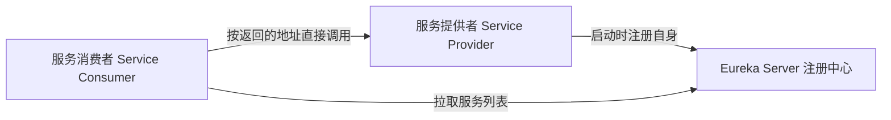
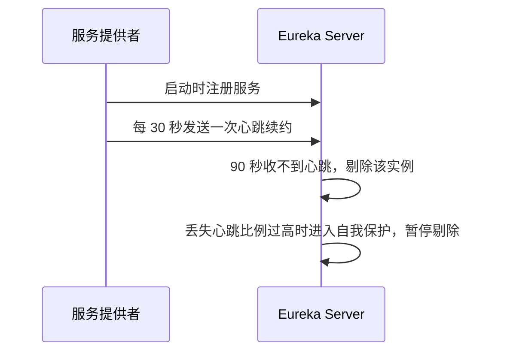

# 服务注册中心概述：微服务架构里的通讯录

单体拆成微服务之后，最先撞上来的往往不是业务问题，而是一个很朴素的问题：服务 A 想调用服务 B，B 到底在哪台机器、哪个端口上。把地址写死在配置文件里，服务一搬家就要改一轮配置、重启一轮进程；服务一多，「谁在哪」这本账本身就是沉重的负担。服务注册中心就是专门管这本账的组件，它集中保存「服务名到地址列表」的映射，让服务之间按名字找人，而不是按 IP 撞运气。

## 先给结论

- 注册中心集中维护「服务名 → 地址列表」的映射，服务上线、下线、换地址只通知中心一处，不用挨个通知所有调用方。
- 注册中心固定三个角色：中心节点 Eureka Server、服务提供者 Service Provider、服务消费者 Service Consumer，任何实现都绕不开这三者。
- 实现不止 Eureka 一种，Zookeeper、Consul、Nacos 都能充当注册中心，角色模型相通，差异在一致性策略与生态。
- 微服务粒度小、数量成倍增长，注册中心还必须回答宕机发现、及时下线、水平扩展、异常降级与自身高可用这几道分布式难题。
- Eureka 的取舍是保可用、弃强一致：靠心跳续约感知存活，靠自我保护避免网络抖动误删服务。

## 一、通讯录：注册中心解决什么问题

每个人都有手机，手机里都有通讯录。想给某个人打电话，多数人记不住号码，得先按名字在通讯录里找到号码，再拨出去。新朋友入了网，或者老朋友换了号，把新号码存进通讯录，后续照样按名字找到人。

个人通讯录有个天然缺陷：号码变了，得自己挨个通知所有联系人，通知不全，就会有人打过来发现是空号。公司通讯录解决得更好：所有员工的姓名与号码挂在公司统一的目录上，可以是内网的一个页面，也可以是一份文档。号码变更只需要更新目录一处，全员自然都能查到新号码。代价是这个目录本身必须可靠，目录挂了，所有人都找不到人。

服务注册中心就是这套「统一目录」的软件化。服务提供者启动时把自己的名字和地址登记上去，地址变更只改登记处；服务消费者按名字查目录，拿到地址后直接调用。变更通知的成本从「通知所有人」降为「通知一处」，这正是微服务架构里服务注册与服务发现的本质，也是它从现实场景演进而来的路径。

## 二、服务数量膨胀之后要答的几道题

微服务的粒度比传统 SOA 小得多，同样的业务体量，微服务可能拆出十几个甚至几十个进程，服务数量成倍增长，有效管理服务注册信息的重要性随之陡增。而且分布式系统里，注册中心要做的远不止「存名字和地址」这么简单。

**宕机要及时发现。** 提供方进程崩了，注册中心得尽快感知，不能让消费者拿着旧地址一直撞墙。

**下线要及时同步。** 计划内发布摘掉一个实例，目录要尽快更新，避免流量继续打进已停服的节点。

**扩容要平滑。** 加机器扛洪峰时，新实例注册成功就该自动进入调用名单，不需要手工改任何调用方的配置。

**异常要能降级。** 依赖的服务出问题时，调用方要有路可走，注册中心提供的信息要能支撑熔断与降级的决策。

**注册中心自己要高可用。** 目录一旦不可用，全系统的服务间调用都失去依据，所以注册中心本身通常要部署成集群，公司通讯录的场景里也是同样的道理。

这五道题决定了评估一个注册中心实现时，不能只看「能不能登记、能不能查询」，还要看它的健壮性与一致性策略。

## 三、三个角色与一次完整调用

不管哪种实现，注册中心体系都包含三个角色。Eureka Server 是中心节点，提供服务注册与服务发现；Service Provider 是服务提供方，把自身服务注册到 Eureka Server 上，让消费方能够找到它；Service Consumer 是服务消费方，从 Eureka Server 获取注册服务列表，然后发起调用。

下面这张图描述三个角色之间的交互关系。



关键路径在最下面这一笔：消费者拿到列表之后，调用是直接打到提供者身上的，流量并不经过注册中心。落到冷链监控平台上，用户服务对外提供用户注册、用户登录这类接口，它作为提供者注册到注册中心；其他应用或服务作为消费者，从注册中心拿到用户服务的地址列表，直接发起调用。

## 四、不止一种实现，以及 Spring Cloud 的封装

注册中心有很多种实现，不同公司有自己的程序。Zookeeper 可以做注册中心，本身支持高可用部署；Consul 是另一款注册中心；阿里提供的 Nacos 同样是注册中心。实现细节各有不同，但角色模型是一致的，都是中心节点加提供者加消费者。

Spring Cloud 对 Eureka 做了一层封装，收进 spring-cloud-netflix 子项目，让它与 Spring Cloud 体系的工程可以直接引用。集成入口是一个 starter，依赖片段如下：

```xml
<dependency>
    <groupId>org.springframework.cloud</groupId>
    <artifactId>spring-cloud-starter-netflix-eureka-server</artifactId>
</dependency>
```

一个依赖就把服务端能力整包带入，具体版本由工程的 `dependencyManagement` 统一锁定，不需要逐个指定。引入之后怎么建工程、怎么配置、怎么启动，是下一篇的内容。

## 五、AP 取舍与心跳机制

角色与流程讲完，还差一块选型时的判断依据：注册中心在一致性与可用性之间怎么取舍。这部分超出本课画面的展开范围，按业界主流理解补全，读的时候当作课外补充。

CAP 指分布式系统的三个性质：一致性 Consistency、可用性 Availability、分区容忍 Partition tolerance。网络分区无法避免，三者只能取其二。Eureka 选的是 AP：注册中心集群的节点之间对等复制注册表，分区发生时每个节点照样响应注册与查询，宁可返回的数据稍旧，也不拒绝服务。对服务调用来说，拿到一份几秒前的地址列表通常不影响业务，而整本「通讯录」查不了才是灾难。Zookeeper 走的是 CP，选主期间对外不可用，宁可停服也要保证数据一致。

Eureka 用心跳维持目录的新鲜度，流程如下。



服务正常时每 30 秒续约一次；注册中心 90 秒收不到某个实例的续约，就把它从列表里剔除。当短时间内丢失心跳的实例比例过高，Eureka 认为这更可能是网络出了问题而不是服务真的全挂了，于是进入自我保护模式，暂时不再剔除，宁可保留可能已失效的实例，也不清空大半个注册表。这套机制与 AP 取舍是自洽的：一切以「目录可用」为先。

## 常见误区

- **把注册中心当调用通道。** 错例是以为请求会经过 Eureka 转发。正解是注册中心只存地址，消费者拿到列表后与提供者直连，流量不走注册中心。
- **认为服务下线立刻生效。** 错例是停掉服务就期望消费者马上感知。正解是心跳周期加客户端缓存，感知存在秒级到分钟级的延迟，发布摘流量要预留这个窗口。
- **拿 Eureka 和 Zookeeper 比出绝对优劣。** 错例是笼统地说谁先进谁落后。正解是按一致性需求选：能容忍短暂不一致、优先保可用，选 Eureka 一类的 AP 实现；强一致优先，选 CP 实现。

## 面试可能被问到的问题

1. 面试官追问：「为什么微服务需要注册中心，直接把 IP 配在调用方不行吗？」
   答：IP 直配在服务很少时可行，但服务数量一多，每次上下线、迁移都要改所有调用方的配置并重启，运维成本高且容易漏改。注册中心把「服务名到地址」集中管理，变更只通知一处，调用方按名字动态发现，扩缩容不用改代码也不用改配置。
2. 面试官追问：「服务注册中心的三个角色分别做什么？」
   答：中心节点如 Eureka Server，维护注册表，提供注册与查询能力；服务提供者把自身服务注册上去；服务消费者从注册中心拉取服务列表，再按地址直接调用提供者。
3. 面试官追问：「CAP 理论下 Eureka 为什么选 AP？」
   答：服务调用场景里，短暂的数据不一致通常无害，拿着稍旧的地址列表仍能正常调用；而注册中心整体不可用，会让所有服务间调用失去依据。所以 Eureka 集群各节点对等复制、分区时照常响应，优先保证可用性。
4. 面试官追问：「心跳、剔除、自我保护是怎么配合的？」
   答：提供者默认每 30 秒发一次续约心跳，Eureka Server 超过 90 秒收不到就把该实例剔除；当丢失心跳的实例比例异常高时进入自我保护，暂停剔除，防止网络抖动把健康实例整批清掉。
5. 面试官追问：「除了 Eureka 还有哪些注册中心，差别在哪？」
   答：常见的有 Zookeeper、Consul、Nacos。角色模型一致，差别主要在一致性取舍与功能边界，比如 Zookeeper 偏 CP，Nacos 兼顾注册中心与配置中心。选型看业务对一致性、可用性与生态的要求。

## 配套资料

- 代码：`materials/code/06/day2 微服务框架与基础服务/`，注册中心工程 `cold-eureka` 与客户端工程 `cold-user`、`cold-gateway` 的真实配置都在该 day 目录下，搭建步骤在下一篇展开。
- 说明：引用路径截至 `materials/code/06/` 的 day 目录层级；文中依赖片段来自本课画面线，版本管理方式以真实工程 `pom.xml` 为准；心跳、剔除、自我保护与 CAP 取舍部分为本课画面未展开的内容，按主流写法补全并已注明。
