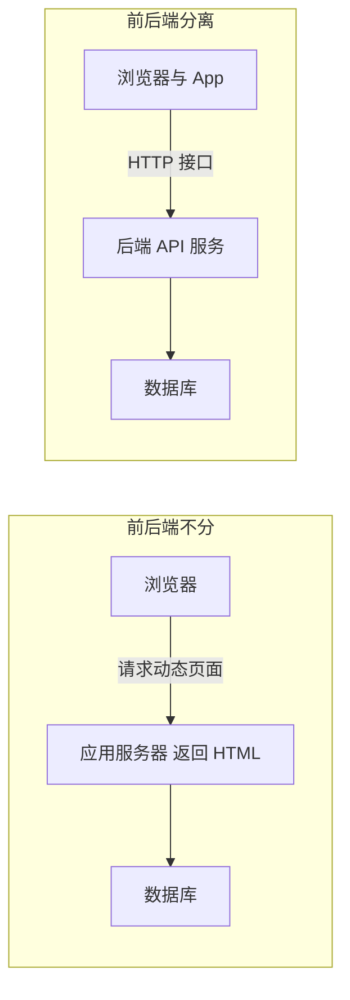

# 前后端分离开发规范：把接口契约立在写代码之前

前后端分离之后，双方唯一的接触面就是接口。后端图省事把数据拼装扔给前端，前端按自己的喜好定义字段名，接口文档口头约定，联调时就会陷入经典的扯皮现场：你说参数没传，我说接口没通，谁也说不清责任在谁。要避免这种局面，规范必须立在写代码之前：URL 怎么定、返回什么形状、出错怎么表达，双方先签「合同」，再各自开工。

## 先给结论

- 前后端分离的核心诉求是各自专注：前端管交互与展示，后端做高可用、高并发、高性能的数据服务，接口是唯一的契约。
- RESTful 是一种接口设计风格而非强制标准：URL 表示资源，请求方法表示动作，路径只放名词。
- 返回体统一为 code 加 message 加数据的三段式，出错时除状态码外必须带 message，否则前端只知道错了、不知道错在哪。
- 列表与分页各有固定形状，分页字段放外层还是 data 里两种流派都可以，关键是全局统一。
- 跨域在网关用 `CorsWebFilter` 统一放开，接口文档依托工程内引入的 Swagger 组件维护。

## 一、从混在一起到各干各的

早期的程序不分前后端。页面与业务代码耦在同一个工程里，浏览器请求页面，应用服务器直接返回 HTML，典型代表是 JSP 一类的应用：后端人员一边写接口一边写页面。这种模式下前端高度依赖后端的开发环境，后端接口没出来，前端就停摆，效率低；职责纠缠不清，出了问题互相推诿。

分离之后，前端开发 HTML、CSS、JS，后端只开发 API，响应也各自独立，双方只需要提前约定好接口，前端用假数据或 mock 数据先行开发，不再被后端进度卡住。这个演进大致走了三个阶段：早期靠 jQuery、Dojo 这类库做页面渲染，复杂度高、复用差；随后前端工程化，引入 MVC、MVVM 一类的分层框架，前端组件可以复用；Node.js 兴起后进入全栈时代，路由、页面控制完全由前端接管，后端逐渐弱化为真正的数据服务，只做业务处理逻辑，关注高可用与高并发。

两种模式的请求链路差异如下。



上图两条链路的本质区别在谁生成页面：旧链路里页面由后端渲染，新链路里后端只吐数据，页面由前端的 JS 在浏览器里拼出来。

## 二、RESTful：把 URL 当资源来写

目前市面上的接口风格主要有 RESTful API 与 RPC 两类，课程重点讲前者。RESTful 即 Representational State Transfer，是一种 Web API 的设计风格，适配前后端分离的模式。它的理念是：后端的任务就是提供数据，对外提供数据资源的访问接口，客户端访问的 URL 表示要操作的资源，操作方式用 HTTP 自带的请求方法表达。

同一批学生数据，按风格可以覆盖全部增删改查：

```text
GET    /students      获取所有学生
POST   /students      新增一个学生
GET    /students/1    获取编号为 1 的学生
PUT    /students/1    修改编号为 1 的学生
DELETE /students/1    删除编号为 1 的学生
```

这只是一套默认约定，并不是强制。用 POST 配一个带动词的地址来做删除同样能实现，只要前后端双方约定统一即可。但既然要约定，就往下细一层，把风格落到每个环节：

**域名。** API 部署在专用域名下，例如 `https://api.example.com`；接口简单时也可以挂在主域名的路径下。

**版本。** 版本号放进 URL，例如 `http://www.example.com/app/1.0/foo` 与 `app/1.1/foo` 并存，为的是向下兼容；另一种做法是把版本放进 HTTP 头，例如 `Accept: vnd.example.com.foo+json; version=1.0`，不如 URL 直观，但同样常见。

**路径。** 路径又称端点，每个网址代表一种资源，只能有名词不能有动词。`getProducts` 这种写法把动作混进了 URL，动作应该放在方法或函数里，URL 只留 `products`，配合请求方法表达获取、新增、修改、删除。

**请求方法。** GET 获取一项或多项，POST 在服务器新建资源，PUT 更新资源，用 POST 做更新或删除也常见；PATCH 部分更新，OPTIONS 用于询问资源的可变更属性，属于较少用的一档。

**过滤信息。** 记录很多时服务端不能一次全吐，API 应提供参数让前端过滤结果：

```text
?limit=10               指定返回记录的数量
?offset=10              指定返回记录的开始位置
?page=1&per_page=10     指定第几页与每页条数
?sortby=name&order=asc  指定排序字段与排序顺序
?animal_id=1            指定查询条件
```

## 三、状态码与 message：把错误说清楚

请求处理完，后端要返回状态码告诉前端结果：200 表示成功，201 表示新建成功，204 表示无返回内容；400 表示请求有误，401 表示权限不够，403 表示禁止访问，404 表示资源不存在，500 表示服务器端错误。

状态码只解决「错没错」，解决不了「错在哪」。前端拿到一个 503，只知道服务器端出了问题，具体是参数没传够、记录不存在，还是参数类型不匹配，全靠猜。所以返回体里必须带一个 message 字段，把后端处理产生的具体问题用人话写出来，前端拿到后直接提示或按分支处理。状态码定大类，message 讲细节，两者配合才算把错误表达完整。

## 四、返回体形状：实体、列表与分页

开发规范层面有几条原则：接口只返回数据，前端尽量只做渲染逻辑；禁止返回 HTML 页面，返回一律用 JSON；请求参数统一包装，放入名为 body 的 key 中，例如登录请求把用户名、密码包成一个 JSON 传给后端。数据返回的形状则按三种场景固定下来。

单个实体：

```json
{
  "code": 200,
  "message": "success",
  "data": {
    "entity": {
      "id": 1,
      "name": "XXX"
    }
  }
}
```

分页列表，分页元信息放在外层，data 里只放列表数据：

```json
{
  "code": 200,
  "message": "success",
  "recordCount": 2,
  "totalCount": 2,
  "pageSize": 10,
  "pageNo": 1,
  "data": {
    "list": [
      { "id": 1, "name": "XXX" },
      { "id": 2, "name": "XXX" }
    ]
  }
}
```

分页字段的位置存在两种流派：一种像上面这样放在外层，data 只承载数据；另一种把分页信息收进 data，整个返回体就是 code、message、data 三段。两种都成立，团队选一种全局统一即可，别一个接口一个样。

## 五、在冷链监控平台落地

规范落到工程里，看两处真实代码。用户服务的登录接口按约定接收包装成 JSON 的请求体，返回统一形状：

```java
package com.study.coldchain.user.controller;

@RestController
@RequestMapping("sys/user")
public class SysLoginController {

    @PostMapping("/login")
    public Map<String, Object> login(@RequestBody SysLoginForm form) throws IOException {
        SysUserEntity user = sysUserService.queryByUserName(form.getUsername());
        // 账号不存在或密码错误时，返回带说明的错误结果
        if (user == null || !user.getPassword().equals(
                new Sha256Hash(form.getPassword(), user.getSalt()).toHex())) {
            return Result.error("账号或密码不正确");
        }
        // 登录成功，签发 token
        return sysUserTokenService.createToken(user.getUserId());
    }
}
```

错误时 `Result.error("账号或密码不正确")` 把 message 一并带回，前端不用猜；这就是状态码加 message 这条规范的工程化表达。统一返回结构由公共组件工程提供，下一节展开。

跨域是分离模式绕不开的问题，页面与接口不同源时浏览器会拦截请求。平台的处理方式是在网关统一放开，`cold-gateway` 里注册一个全局的 CORS 过滤器：

```java
package com.study.coldchain.gateway.common;

@Configuration
public class CorsConfig {
    @Bean
    public CorsWebFilter corsFilter() {
        CorsConfiguration config = new CorsConfiguration();
        config.addAllowedMethod("*");       // 放行所有请求方法
        config.addAllowedOrigin("*");       // 放行所有来源
        config.addAllowedHeader("*");       // 放行所有请求头
        config.setAllowCredentials(true);   // 允许发送 cookie
        UrlBasedCorsConfigurationSource source =
                new UrlBasedCorsConfigurationSource(new PathPatternParser());
        source.registerCorsConfiguration("/**", config);
        return new CorsWebFilter(source);
    }
}
```

跨域逻辑只写这一处，所有经过网关的接口都生效，各业务服务不再重复处理。接口文档方面，公共组件工程引入了 Swagger 组件，接口按注解维护说明，前端以生成的文档为准对接，避免口头传参。

## 常见误区

- **URL 里写动词。** 错例是 `/getProducts`、`/listOrders` 一路动词开路。正解是路径只放名词 `products`，动作交给 GET、POST、PUT、DELETE 这些请求方法表达。
- **只回状态码不带 message。** 错例是出错只返回一个 500，前端只能弹「未知错误」。正解是 message 写清具体原因，参数缺失、记录不存在、类型不匹配各是各的说法。
- **分页格式一个接口一个样。** 错例是有的接口分页字段在 data 里、有的在外层，前端每接一个接口都要现猜。正解是选定一种形状，全平台统一。
- **把拼装逻辑推给前端。** 错例是后端图省事，把多个接口的结果交给前端拼装、把业务判断塞进页面。正解是数据处理归后端，前端只做交互与展示，这条界限松动了，扯皮就开始了。

## 面试可能被问到的问题

1. 面试官追问：「前后端分离到底分离了什么？」
   答：分离的是职责与部署。前端专注交互与展示，产出 HTML、CSS、JS，后端专注高可用高并发的数据服务，双方只通过接口通信；前端可以用 mock 数据先行开发，不被后端进度阻塞，联调成本与扯皮概率都降下来。
2. 面试官追问：「RESTful 是什么，为什么路径只能放名词？」
   答：RESTful 是一种 Web API 设计风格，URL 表示资源、请求方法表示动作。动作放 URL 里会把「操作什么」和「怎么操作」搅在一起，同一个动作可能出现 getProducts、deleteProduct1 等五花八门的写法；名词路径加统一的方法语义，接口一眼能懂。
3. 面试官追问：「PUT 和 POST 都能做更新，怎么取舍？」
   答：按风格 PUT 对应幂等的整体更新，POST 对应新建或非幂等操作。实际项目里用 POST 做更新、做删除也很常见，规范允许变通，关键是前后端达成统一并在全团队保持一致。
4. 面试官追问：「返回里为什么除了状态码还要有 message？」
   答：状态码只能表达错误大类，401 是权限、500 是服务端异常，前端无法据此给出具体提示。message 承载细节，比如参数缺失、记录不存在、类型不匹配，前端拿到后可直接展示或按分支处理，排查问题时也省一轮沟通。
5. 面试官追问：「跨域是什么，为什么在网关统一处理？」
   答：浏览器对与页面不同源的请求有同源策略限制，分离部署后页面与接口不同源就会触发跨域。在网关注册一个全局 CORS 过滤器，放行方法、来源、请求头，所有下游接口一次生效，业务服务不用各自重复配置，策略也便于集中收紧。
6. 面试官追问：「分页信息放外层还是 data 里？」
   答：两种都是成熟做法，放外层的好处是 data 保持纯数据语义，放 data 里则整个返回体只有三段更整齐。没有对错，重点是全局统一一种，让前端按固定形状写解析。

## 配套资料

- 代码：`materials/code/06/day2 微服务框架与基础服务/`，登录接口来自 `cold-user` 真实工程，跨域配置来自 `cold-gateway` 真实工程；统一返回结构 `Result` 由公共组件工程提供，见 day1 目录。
- 说明：引用路径截至 `materials/code/06/` 的 day 目录层级；包名已改写为 `com.study.coldchain`；RESTful 风格的域名、版本、过滤参数等约定按本课画面线整理，示例地址均以 `example.com` 占位。
