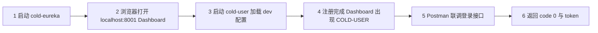
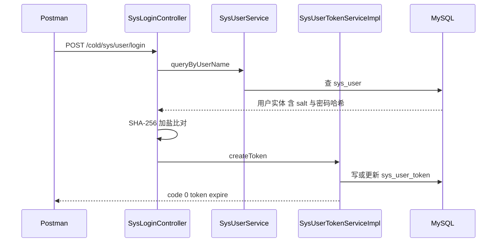

# 把用户服务跑起来：启动顺序、接口联调与排错

> 🔒 安全提示：文中示例的口令/密钥均为课程教学环境演示口径，生产环境的安全要求见《安全与合规须知》。

代码拆解完毕，这一节解决三个问题：怎么启动、怎么验证、出了错怎么办。用户服务连接着注册中心与 MySQL，启动有先后，验收有抓手，常见的几类报错也都有固定的排查路径。

## 先给结论

- 启动顺序固定：先 `cold-eureka`，再 `cold-user`，业务服务启动时需要注册中心已经在位。
- 用户服务激活的 profile 是 dev，启动即加载 `application-dev.yml` 里的 Eureka 与数据库配置。
- 验收两步：Dashboard 的实例表出现 `COLD-USER` 行，Postman 调登录接口返回 code 0 与 token。
- 登录接口完整地址 `http://localhost:8185/cold/sys/user/login`，POST 提交 JSON，成功响应里带 token（12 小时有效期）与 expire。
- 报错按阶段分三层查：编译期查 cold-common 是否重新 install，启动期查 Eureka 与数据库连通性，运行期查请求头与 token。

## 一、启动顺序：注册中心先行

用户服务的主类标注了 `@EnableDiscoveryClient`，进程一起来就要向注册中心注册并续心跳，注册中心不在位，注册动作只能失败重试。所以顺序是先起 `cold-eureka`，它的职责单一，启动很快；确认 8001 端口的 Dashboard 能打开，再起 `UserApplication`，启动日志里注意一行关键信息：当前激活的 profile 是 dev，Eureka 地址与数据库连接都来自 `application-dev.yml`。



启动 `cold-eureka` 之后先看一眼 Dashboard，此时实例表里只有注册中心自己那一行（单机模式把自己也注册了上去）。等 `cold-user` 起来刷新页面，实例表多出一行 `COLD-USER`，这个名字就是 `application.yml` 里 `spring.application.name` 的大写形式。看到这一行，注册链路就算验收通过。

## 二、Postman 联调：一次登录请求的完整回路

Postman 是常用的接口测试工具，用它模拟前端调登录接口，请求要填四样东西：

- 方法选 POST，登录接口用 `@PostMapping` 声明，用 GET 是打不进去的。
- 地址 `http://localhost:8185/cold/sys/user/login`，端口 8185 与 `/cold` 前缀都来自 `application.yml`。
- Body 选 raw 加 JSON，提交的内容是一个 `SysLoginForm` 形状的字符串：

```json
{
  "username": "cold1",
  "password": "cold123"
}
```

- 账号以数据库里预置的用户为准，`captcha` 这类字段程序里没有用到，可以不带。

点 Send 之后看响应。账号密码正确时返回 code 为 0、msg 为 success，另外多出两个字段：

```json
{
  "code": 0,
  "msg": "success",
  "token": "920d0b8ca698b56ea68f6b396465f074",
  "expire": 43200
}
```

`token` 与 `expire` 是链路深处放进去的。`createToken` 先用 `TokenGenerator` 生成新 token，过期时间取当前时间加 12 小时（代码里 `EXPIRE` 常量为 `3600 * 12` 秒，落库时再乘 1000 换算成毫秒），然后按 `user_id` 查 `sys_user_token`：没有记录就保存一条，已有记录就更新，最后 `Result.ok().put("token", token).put("expire", EXPIRE)` 把两个字段链式附加进统一返回体。`Result.ok()` 新建的对象默认就是 code 0 加 msg success，与 Postman 看到的完全对得上。

把密码改错再发一次，返回变成 code 500、msg 账号或密码不正确。原因在控制器的比对逻辑：用户输入的明文密码连同库里的 salt 做一次 SHA-256，与 `sys_user.password` 里存的哈希值做 equals 比较，两边算法一致、盐一致，相同的输入才有相同的结果；任何一个对不上就返回错误。统一返回的好处在这里显出来，前端只需按 code 分支处理。

退出接口也顺手验一下：POST 请求 `/cold/sys/user/logout`，请求头里带 `token` 字段，后端按 token 把 `sys_user_token` 里那一行删掉，之后再拿这个 token 访问就查不到了，凭证失效即刻生效。

## 三、常见启动报错与排查

课程现场与工程实践里，这一步的报错集中在几类，按启动阶段切开来查最快。

**编译期：找不到公共工程的类。** 报错形如找不到 `SysUserEntity`、`Result` 的符号。原因是 `cold-common` 改动后没有重新 `mvn clean install`，本地仓库里还是旧包。正解是先 install 公共工程，再构建 `cold-user`。

**启动期：注册中心连不上。** 日志里出现注册失败或 `defaultZone` 地址无法解析。原因是 Eureka 没启动，或 `application-dev.yml` 里的主机名本机解析不了。正解是先起注册中心，hosts 里把配置的主机名指回本机。

**启动期：数据库连接失败。** Druid 初始化报错，多半是库还没建、连接地址或账号对不上。课程环境的 MySQL 用 root 加密码 123456，建好 `cold-user` 库并导入随包 SQL 脚本，dev 配置里的账号密码与库的授权保持一致即可。

**运行期：接口 401 或鉴权不过。** 请求头没带 token，网关的过滤器会直接拦下返回 401；带了 token 但已被 logout 删除，业务侧同样视为未认证。排查方向是先确认 token 原样传递，再查 `sys_user_token` 里有没有这一行。

一次联调的完整调用链如下：



读图的抓手是两次数据库操作：查用户与写凭证，中间的哈希比对发生在服务内存里，明文密码从头到尾不落库。

## 常见误区

- **先起业务服务再起注册中心。** 错例是随手先点 `UserApplication`，注册反复失败还找不到原因。正解是把「注册中心先行」当启动纪律。
- **漏掉 context-path。** 错例是 Postman 里写 `http://localhost:8185/sys/user/login`，少了 `/cold` 直接 404。正解是记住完整地址由 IP 加端口加 `/cold` 加类路径加方法路径拼成。
- **拿注册中心里的服务名当请求路径。** 错例是看到注册中心显示 `COLD-USER`，就按 cold-user 去拼 URL。正解是请求路径用 `context-path` 的 `/cold`，服务名只用于注册中心与网关路由。
- **把 expire 当时间戳解析。** 错例是前端把 `expire` 的 43200 当秒级时间戳转日期，转出来一个 1970 年。正解是它是有效期秒数，即 12 小时，真正的过期时刻存在 `sys_user_token.expire_time` 里。

## 面试可能被问到的问题

1. 面试官追问：「为什么必须先启动 Eureka 再启动业务服务？」
   答：业务服务作为 eureka client，启动过程中要向注册中心注册并开始心跳续约，注册中心不在位时注册只能失败或延迟重试，依赖服务发现的调用方也会受影响。开发时先起 Eureka，Dashboard 确认可用后再起业务服务，排障也省事。
2. 面试官追问：「登录接口的成功响应里有哪些字段，分别怎么来的？」
   答：code 与 msg 来自 `Result` 的默认形状，code 0 表示成功；token 由 `TokenGenerator` 对 UUID 做 MD5 生成；expire 是有效期秒数，12 小时。三者经链式 put 组装成统一返回体，token 同时按用户落进 `sys_user_token` 表。
3. 面试官追问：「怎么验证用户服务真的注册到注册中心了？」
   答：打开 8001 端口的 Eureka Dashboard，实例表出现 `COLD-USER` 行即注册成功，服务名来自 `spring.application.name`。更进一步可以停掉服务观察实例消失，或通过网关按服务名调用一次验证解析与转发。
4. 面试官追问：「密码错误和账号不存在返回同一个提示，这样设计合理吗？」
   答：合理。若区分「账号不存在」与「密码错误」，攻击者可以借此枚举有效账号。统一返回账号或密码不正确，不向外部泄露账号是否存在的信息，是登录接口的通行做法。
5. 面试官追问：「token 有效期 12 小时，快到期怎么处理？」
   答：本平台在每次登录时刷新 token 与过期时间；若要支持无感续期，可在校验通过时检查剩余有效期，临近过期就签发新 token 返回给前端替换。也可以引入 Redis 滑动过期，思路一致，都是服务端掌控有效期。

## 配套资料

- 代码：`materials/code/06/day2 微服务框架与基础服务/`，用户服务工程 cold-user 的 `application.yml`、`application-dev.yml`、启动类 `UserApplication`、`SysLoginController`、`SysUserTokenServiceImpl`，以及资料目录下 `doc/sql/cold-user.sql`（两张表结构与预置 admin 账号），均为真实随包文件。
- 代码：`materials/code/06/day2 微服务框架与基础服务/`，注册中心工程 cold-eureka 与网关工程 cold-gateway 的配置文件，用于对照启动顺序与联调链路。
- 说明：引用路径截至 `materials/code/06/` 的 day 目录层级；包名与 groupId 已改写为 `com.study.coldchain`；主机名以 `example.com` 占位；Postman 请求与响应 JSON 为按本课演示整理。
