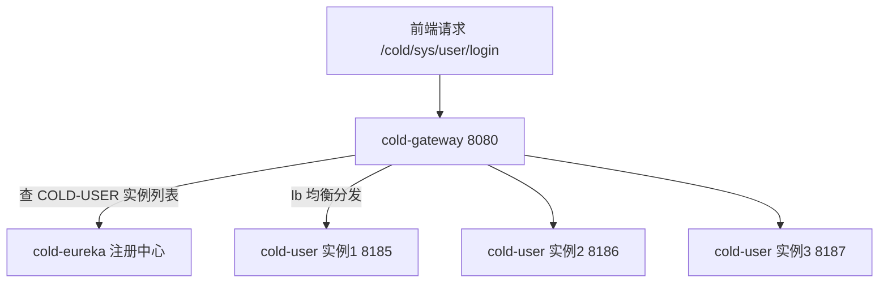
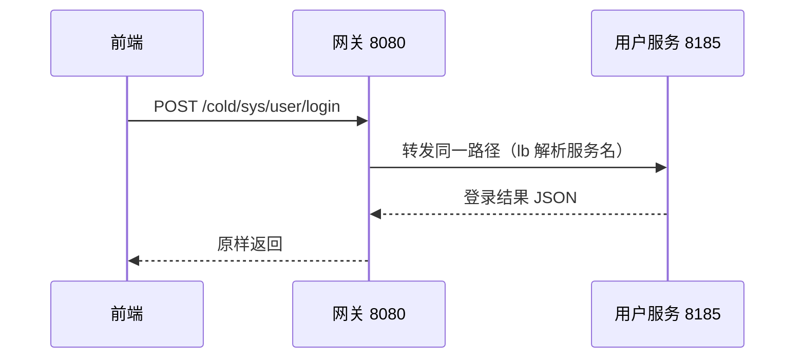

# 配置网关路由规则：一个端口把请求分发给所有微服务

网关工程启动之后，从 8080 发请求只会得到 404，因为它还不知道哪类请求该交给谁。路由规则是网关的灵魂：一条规则说清「遇到什么样的路径，转发到哪个服务」，配齐之后前端只用记一个地址。这一节以用户服务的登录接口为例，把路由规则的写法、负载均衡的含义和验证过程走通。

## 先给结论

- 一条路由至少三部分：`id` 规则名、`uri` 转发目标、`predicates` 匹配条件，写在 `spring.cloud.gateway.routes` 下。
- 转发目标写成 `lb://cold-user`，`lb` 即 load balance（负载均衡），服务名解析成实际实例地址这件事由注册中心配合完成。
- 路径断言用 `Path=/cold/sys/user/**`，双星号匹配多级路径；网关侧不剥前缀，因为下游服务都保留 `/cold` 的 context-path，路径原样转发正好对上。
- 验证方法：注册中心、用户服务、网关依次启动，从 8080 调登录接口能拿到用户服务的返回，路由即生效。

## 路由规则的三要素

路由配置写在 `application.yml` 的 `spring.cloud.gateway` 下面。先把服务发现定位打开，再写显式路由：

```yaml
spring:
  cloud:
    gateway:
      discovery:
        locator:
          enabled: true
      routes:
        - id: cold-user-router          # 路由规则的唯一名字，有业务含义即可
          uri: lb://cold-user           # 转发目标，lb 代表从注册中心负载均衡
          predicates:
            - Path=/cold/sys/user/**    # 匹配的请求路径
```

三要素对应一个句式：「什么请求（predicates），转发到哪（uri），这条规则叫什么（id）」。`id` 随意起名但要有业务含义，`cold-user-router` 一眼可知是去用户服务的规则；`uri` 里的 `cold-user` 正是用户服务在 `spring.application.name` 里登记的名字；`predicates` 是断言，这里用路径断言，`/cold/sys/user/**` 的双星号表示后面还有任意多级路径，`login`、`info` 都能盖住。

YAML 的注释是井号，不是双斜杠，配置文件里写 `//` 会被当成配置值解析报错，课程里特意点过这一笔。另外路由块的对齐方式也有讲究：`- id` 引出的列表项与它的子键要对齐在同一列，缩进乱了规则不生效，而且这种错误启动时往往不报错，只会在请求时莫名 404。

## lb 与负载均衡

`lb://` 前缀是路由配置里最关键的一个符号。假设用户服务部署了三台实例，注册中心的服务列表里 `COLD-USER` 就有三条记录，网关转发时按负载均衡策略把请求均匀摊到三台机器上，而不是每次都砸同一台。



图里体现的分工是：注册中心只负责「有哪些实例」，网关负责「这一棒交给谁」。按默认策略轮询分发只是最简配置，权重比例这类更细的分发规则也可以在路由上追加配置，课程演示用的是最简形态。实例数量变化时，服务列表随心跳自动更新，网关的这行配置始终不用动。

## 路径前缀怎么对齐

断言里的 `/cold/sys/user/**` 与用户服务的自身路径要能接上。用户服务工程的 context-path 配的是 `/cold`，登录接口的 Controller 映射是 `sys/user`，所以它对外暴露的完整路径就是 `/cold/sys/user/login`。网关收到同样的路径后原样转发，两边严丝合缝。

这就是本平台「网关不剥前缀」的原因：所有业务服务共享 `/cold` 前缀，网关转发时保持路径不变最省事。Spring Cloud Gateway 本身支持剥离前缀的过滤器，比如 `StripPrefix=1` 会把第一段路径削掉再转发，适合下游服务不带公共前缀的场景。两种写法都合法，关键看下游怎么暴露路径：

```yaml
spring:
  cloud:
    gateway:
      routes:
        - id: cold-user-router
          uri: lb://cold-user
          predicates:
            - Path=/cold/sys/user/**
          # 下游服务若不带 /cold 前缀，才需要下面这行（本平台不需要）
          # filters:
          #   - StripPrefix=1
```

顺带把上一节留的尾巴收掉：网关工程里那行 servlet 风格的 context-path 并不参与这里的匹配，Spring Cloud Gateway 是 WebFlux 应用，外部请求看到的前缀完全由 `Path` 断言决定。判断前缀归属只看两处：网关的路由断言写了什么，下游服务的 context-path 加 Controller 映射拼出来是什么。

## 启动验证：从 404 到正常返回

验证顺序有讲究：注册中心先起，用户服务第二，网关最后，保证路由第一次转发时服务列表就是全的。三个进程都起来后，打开注册中心 Dashboard，实例表里应同时出现 `COLD-EUREKA-SERVER`、`COLD-GATEWAY`、`COLD-USER` 三行，状态都是 UP。

在 Postman 里新建一个 POST 请求，地址直接指向网关的 8080 端口，路径与用户服务的登录接口一致，请求体带上用户名与密码。点击发送，返回正常，说明网关把这次请求转给了 8185 的用户服务，登录逻辑在用户服务里执行完，结果原路经网关回到前端。把这条链路画出来就是：



时序图里网关只做了转发这一件事，业务逻辑全在用户服务里。路由规则跑通一条之后，剩余服务的规则就是复制粘贴换个名字，真实工程的 `application.yaml` 里一共配了五条：

```yaml
spring:
  cloud:
    gateway:
      discovery:
        locator:
          enabled: true
      routes:
        - id: cold-user-router
          uri: lb://cold-user
          predicates:
            - Path=/cold/sys/user/**
        - id: cold-admin-router
          uri: lb://cold-admin
          predicates:
            - Path=/cold/admin/**
        - id: cold-monitor-router
          uri: lb://cold-monitor
          predicates:
            - Path=/cold/device/monitor/**
        - id: cold-jobs-router
          uri: lb://cold-jobs
          predicates:
            - Path=/cold/system/schedule/**
        - id: cold-druid-router
          uri: lb://cold-druid
          predicates:
            - Path=/cold/apache-druid/query/**
```

五条规则结构完全一致，差别只在 id、目标服务名与路径前缀。`discovery.locator.enabled` 打开后，网关还会按注册中心里的服务名自动生成一批默认路由，显式写 `routes` 的意义在于路径可控、规则可查，两者并存时显式规则优先级更高。

## 常见误区

- **注释符号写错。** 错例是习惯性用 `//` 给 YAML 加注释。正解是 YAML 用井号，双斜杠会被解析成配置值，启动即报错。
- **路由列表缩进错位。** 错例是 `- id` 与子键缩进不齐、或者多条路由的横杠没对齐。正解是严格保持列表项同一层级，这类错不报启动异常，只会在请求时 404，排查成本高。
- **`uri` 忘写 `lb://` 前缀。** 错例是直接写 `uri: cold-user`。正解是负载均衡转发必须写 `lb://服务名`，少了前缀网关把它当普通地址处理，转发直接失败。
- **以为网关会自动剥前缀。** 错例是断言写了 `/cold/sys/user/**`，下游服务却没有 `/cold` 的 context-path，转发过去 404。正解是先确认下游暴露的完整路径，再决定保持原样还是加 `StripPrefix` 过滤器。

## 面试可能被问到的问题

1. 面试官追问：「一条 Spring Cloud Gateway 路由由哪几部分组成？」
   答：最核心的是三部分：`id` 是规则唯一标识；`uri` 是转发目标，可以是 `lb://服务名` 的负载均衡形式，也可以是具体地址；`predicates` 是断言集合，决定什么样的请求命中这条规则，路径断言 `Path` 最常用，还可以按 Method、Header、Query 参数、时间窗口等条件组合断言。
2. 面试官追问：「uri 里的 lb:// 是什么机制？」
   答：lb 是 load balance 的缩写。网关拿到服务名后，从注册中心拉取该服务的实例列表，再按负载均衡策略选一个实例发起转发。实例增减时列表自动更新，网关配置无需改动，这正是网关依赖注册中心的原因。
3. 面试官追问：「discovery.locator.enabled 打开后为什么还要手写 routes？」
   答：locator 会按注册中心的服务名自动生成默认路由，路径形如服务名开头，规则隐式存在。手写 routes 能自定义路径前缀、控制暴露范围、加上过滤器，规则落在配置文件里可审查可回滚。生产环境通常显式配置，locator 只在开发期图方便。
4. 面试官追问：「StripPrefix 过滤器解决什么问题？」
   答：网关收到的路径常带公共前缀，而下游服务不一定按这个前缀暴露接口。StripPrefix 按数值把路径的前 N 段剥掉再转发，例如 `StripPrefix=1` 把 `/cold/user/login` 变成 `/user/login`。用不用它取决于下游服务的路径设计，本平台各服务共享 `/cold` 前缀，所以网关不剥离。
5. 面试官追问：「路由配置了但请求 404，怎么排查？」
   答：按链路查四处：断言路径与实际请求路径是否逐字一致，双星号是否覆盖到具体接口；YAML 缩进是否正确，规则是否真的被加载；目标服务是否已注册且状态 UP，服务名拼写是否一致；下游服务自身的 context-path 加接口映射拼出的路径与转发后的路径是否吻合。从网关日志和下游访问日志两边对照，缺口很快能定位。

## 配套资料

- 代码：`materials/code/06/day2 微服务框架与基础服务/`，网关工程 `cold-gateway` 的 `application.yaml`（五条真实路由规则）、用户服务 `cold-user` 的 `application.yml` 与登录 Controller，均为真实随包文件。
- 说明：引用路径截至 `materials/code/06/` 的 day 目录层级；包名已改写为 `com.study.coldchain`，注册中心主机名以 `example.com` 占位；StripPrefix 注释块为按本课写法补全的示例，本平台实际未启用。
