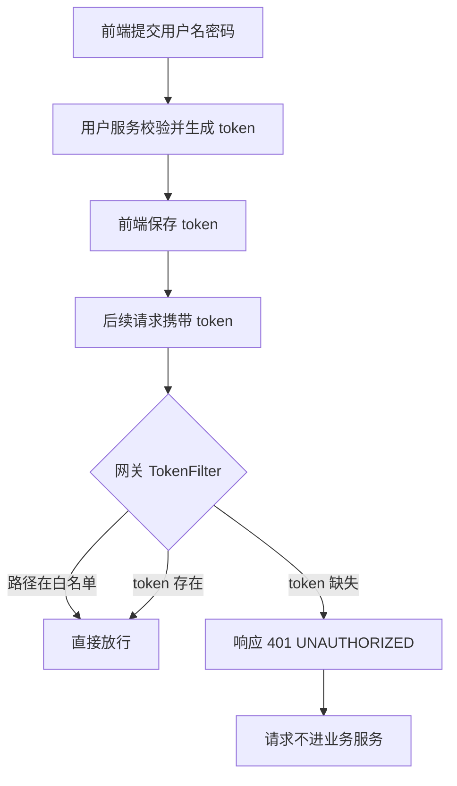

# 网关鉴权拦截：一个全局过滤器守住院子的大门

路由通了之后，新的问题立刻出现：8080 这个口子对全世界敞开，任何人都可以不带任何凭证直接调到用户服务、系统管理服务。给每个服务都加一遍鉴权代码，等于每个房间门口都派一个保安，重复且难维护。合理的做法是把验证收敛到网关：进院子先过门卫，拿不到凭证就别想进任何房间。

## 先给结论

- 鉴权放在网关层统一做，各业务服务不再重复校验，这是 API 网关的核心收益之一：易于认证、易于监控、减少客户端与微服务的交互次数。
- Spring Cloud Gateway 里用 `GlobalFilter` 加 `Ordered` 写一个全局过滤器，`getOrder` 返回负值（工程里是 -100），保证它在请求进入路由之前先执行。
- 白名单必须有：登录接口本身不能要求 token，否则鸡生蛋死循环，工程里精确放行 `/cold/sys/user/login`。
- 校验失败直接把响应状态码置为 401 UNAUTHORIZED 并终止转发，请求根本到不了业务服务。
- 课程版只验证 token 有无；token 是否真实存在、是否过期，属于它的进化方向。

## 鉴权为什么放在网关层

整个流程与现实中的访客登记高度相似：应用第一次调用后台接口时没有任何权限，先拿用户名密码去登录接口认证，认证通过后服务端发一个 token，相当于前台发给访客的临时公牌；此后前端每次请求都带着这个公牌，网关在每个入口验一下牌子，合法就放行，非法就拦下。

统一验证的价值算一笔账就清楚。一个应用的接口动辄几十上百个，如果每个服务各自验证用户名密码，等于把同一套认证逻辑复制 N 份，数据库连接、密码比对的开销也翻倍；收敛到网关之后，认证逻辑只写一遍，业务服务拿到的请求都已经是「过了门卫的」，只管做业务。登录换牌、进门验牌的完整链路如下。



图里的分叉点就是本节要写的 `TokenFilter`：它站在所有路由之前，路径命中白名单或者请求头里有 token，请求继续往下走；否则直接以 401 结束，业务服务对此毫无感知。

## TokenFilter：过滤器骨架与核心逻辑

在网关工程里新建一个 `common` 包，放两个类，`TokenFilter` 是其中之一。真实工程的完整实现如下：

```java
package com.study.coldchain.gateway.common;

import org.slf4j.Logger;
import org.slf4j.LoggerFactory;
import org.springframework.cloud.gateway.filter.GatewayFilterChain;
import org.springframework.cloud.gateway.filter.GlobalFilter;
import org.springframework.core.Ordered;
import org.springframework.http.HttpStatus;
import org.springframework.web.server.ServerWebExchange;
import reactor.core.publisher.Mono;

public class TokenFilter implements GlobalFilter, Ordered {
    Logger logger = LoggerFactory.getLogger(TokenFilter.class);

    @Override
    public Mono<Void> filter(ServerWebExchange exchange, GatewayFilterChain chain) {
        // 登录接口是白名单，不要求 token
        if (!exchange.getRequest().getPath().value().equals("/cold/sys/user/login")) {
            String token = exchange.getRequest().getHeaders().getFirst("token");
            if (token == null || token.isEmpty()) {
                logger.info("token为空...");
                exchange.getResponse().setStatusCode(HttpStatus.UNAUTHORIZED);
                return exchange.getResponse().setComplete();
            }
        }
        // 校验通过，把请求交给过滤链的下一环
        return chain.filter(exchange);
    }

    @Override
    public int getOrder() {
        return -100;
    }
}
```

逐段读。`GlobalFilter` 是全局过滤器接口，实现它的 Bean 会作用于经过网关的每一个请求，不用逐条路由去挂；`Ordered` 决定执行顺序，数值越小越靠前，`-100` 把鉴权压到过滤链的最前面，先做安检再做其他处理。`filter` 方法里先取请求路径，等于登录接口就跳过校验直接放行，这是白名单；其余请求从请求头里取名为 `token` 的头，取不到或者取到空串，就把响应状态码设为 `HttpStatus.UNAUTHORIZED`（401）并调用 `setComplete` 结束响应；校验通过的请求调用 `chain.filter(exchange)` 交给过滤链下一环，最终走到路由转发。

方法签名里的 `Mono<Void>` 是响应式编程的返回类型，Spring Cloud Gateway 基于 WebFlux，过滤器全链路都是非阻塞的，这里照着接口签名实现即可，暂时不必深入 Reactor 的细节。

## 把过滤器注册进容器

光有类还不够，过滤器必须成为 Spring 容器里的 Bean 才会被网关装配。另一个类 `GatewayConfig` 干的就是这件事：

```java
package com.study.coldchain.gateway.common;

import org.springframework.context.annotation.Bean;
import org.springframework.context.annotation.Configuration;

@Configuration
public class GatewayConfig {

    @Bean
    public TokenFilter tokenFilter() {
        return new TokenFilter();
    }
}
```

`@Configuration` 声明这是配置类，`@Bean` 让容器启动时创建 `TokenFilter` 实例。网关启动过程中扫描到这个实现了 `GlobalFilter` 的 Bean，自动把它加进全局过滤链。少了这一步，类写得再正确也不会执行，这是课程演示里最容易漏掉的一环。

## 与用户服务的 token 契约

过滤器只负责「进门查牌」，发牌的是用户服务。登录接口校验用户名密码通过后，用 `TokenGenerator` 生成一个随机 token，连同过期时间一起写入数据库的 token 表（默认 12 小时过期），再把 token 与有效期放进返回值交给前端；退出登录时按 token 删除记录。契约的关键约定是：前端把 token 放在请求头 `token` 字段里随每次请求发送，网关的 `getHeaders().getFirst("token")` 正是按这个名字取值，浏览器端通常再配合 Cookie 存放，发起请求时自动携带。

课程版过滤器只验证了「有没有带牌」，也就是说在请求头里塞一个随便的字符串也能过。这一步的完整进化路径课程讲解里也点明了：拿到 token 后去数据库查这条记录是否存在、过期时间是否还有效，或者把 token 挪到 Redis 并用它的 TTL 管理过期，校验效率更高。演示环节刻意停在「验证非空」，是为了把过滤器机制本身讲透。

验证过程：重启网关，先发一个不带 token 的请求，响应状态码变成 401，网关控制台打出「token为空...」的日志；再在请求头里加上 token 字段（值任意），请求放行，路由照常转发。两个现象对照，说明过滤器已在所有路由之前生效。

## 常见误区

- **把登录接口也拦下。** 错例是过滤器无条件取 token 校验。正解是登录是整个鉴权体系的起点，请求它时不可能有 token，必须在 filter 方法开头把登录路径放行，否则谁都无法登录。
- **只写了过滤器类，没注册 Bean。** 错例是以为类实现了 `GlobalFilter` 就自动生效。正解是用配置类的 `@Bean` 方法把实例交给容器，网关启动时才会把它装配进全局过滤链。
- **`getOrder` 随手返回一个大数。** 错例是不理解 Ordered 的语义，过滤器排到了路由转发之后。正解是数值越小优先级越高，鉴权这类前置校验用负值，确保在其他处理之前完成。
- **把「非空校验」当安全防线。** 错例是验证 token 非空就上线。正解是伪造一个随机串即可绕过，真实项目必须回查存储验证 token 的真实性与有效期，常见做法是放 Redis 用 TTL 管理过期。

## 面试可能被问到的问题

1. 面试官追问：「GlobalFilter 和 GatewayFilter 有什么区别？」
   答：`GatewayFilter` 是绑定到具体路由的过滤器，要在某条路由上显式引用才生效；`GlobalFilter` 是全局过滤器，注册成 Bean 后自动作用于所有经过网关的请求。像 token 校验这种对全部流量生效的逻辑，用 `GlobalFilter` 最合适，不用每条路由都挂一遍。
2. 面试官追问：「Ordered 接口在过滤器里起什么作用？」
   答：它决定过滤器在过滤链中的执行顺序，`getOrder` 返回值越小优先级越高。鉴权属于前置校验，工程里返回 -100，让它在大多数内置过滤器之前执行，非法请求在最早的环节就被拒绝，省掉后续所有处理。
3. 面试官追问：「为什么鉴权放在网关做，而不是每个服务自己校验？」
   答：鉴权是典型的横切关注点，每个服务各写一遍会有大量重复代码，认证开销也被放大 N 倍；收敛到网关后认证逻辑只维护一份，业务服务拿到的请求已经过验证，可以专注业务。服务内部如需更细的数据级权限，可以在网关认证的基础上再做一层，两者不冲突。
4. 面试官追问：「网关验完 token 非空就放行，安全上够吗？」
   答：不够。非空校验只能挡住完全不带凭证的请求，伪造的随机字符串一样能通过。生产做法是拿着 token 去查真实存储：数据库比对，或者放 Redis 校验存在性与 TTL；再进一步可以对 token 签名做验证。课程演示停在非空校验，是在演示过滤器机制，不是推荐的安全水位。
5. 面试官追问：「校验失败为什么返回 401 而不是别的状态码？」
   答：401 UNAUTHORIZED 的语义是「未认证」，即请求没有携带有效凭证，与 403 的「已认证但无权限」区分开。前端拿到 401 的标准动作是引导用户重新登录，拿到 403 才是提示无权访问，两者语义分开后，前端的处理逻辑才好写。

## 配套资料

- 代码：`materials/code/06/day2 微服务框架与基础服务/`，网关工程 `cold-gateway` 的 `TokenFilter.java`、`GatewayConfig.java`、`CorsConfig.java`，以及用户服务 `cold-user` 的登录 Controller 与 token 服务实现，均为真实随包文件。
- 说明：引用路径截至 `materials/code/06/` 的 day 目录层级；包名已改写为 `com.study.coldchain`；token 回查存储与 Redis 过期管理为按本课讲解方向补全的进阶示例，随包工程未实现。
