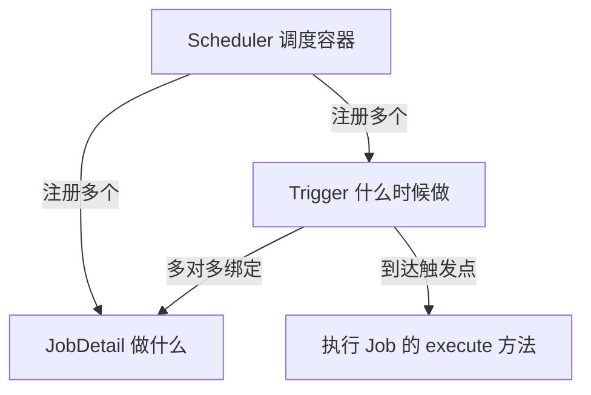

# 定时任务交给谁做：Quartz 调度框架入门

平台里总有一类活不适合等人来触发。冷链仓库的温湿度主机每 30 秒上报一次读数，模拟设备就得按同样的节奏发；有些统计要在每天凌晨跑。用 while 循环加 `Thread.sleep` 也能转起来，但改一次节奏就要改代码发版，服务一多各自为政，出了问题连下一次执行时间都说不清。这类需求的正规解法是任务调度框架，day2 用两节课把 Quartz 讲清楚，先立概念，再跑示例。

## 先给结论

- 任务调度指在给定时间点、给定时间间隔或给定执行次数下自动执行任务，它天然拆成两层：「什么时候做」交给调度框架，「做什么」是业务代码。
- Quartz 是完全由 Java 编写的开源作业调度框架，核心角色四个：Job、JobDetail、Trigger、Scheduler，作业与触发器之间是多对多关系。
- 与 Spring 的 @Scheduled 相比，Quartz 的触发规则可以外置存储、运行期修改，还支持事务与集群；单机小场景用 @Scheduled 更省事。
- 在冷链监控平台里，Quartz 驱动几十台模拟设备按各自节奏发报文，任务定义存放在 schedule_job 表，改一条记录就改一台设备的上报频率。

## 任务调度解决什么问题

城市公交就是一台现成的调度机器：调度中心决定什么时间、哪条线路、发几班车，车辆在线路上跑是具体的执行动作。前者是调度，后者是任务，两者分开，司机不需要懂排班算法，排班表改了也不影响驾驶动作。

程序世界里的分工一模一样，框架与业务各管一头：

**第一，调度框架只管时机。** 创建触发器、比对系统时间、到点把任务丢出去执行，协调资源是它唯一的职责。它不知道也不关心任务里写的是什么业务。

**第二，任务类只管业务。** 发一条设备报文、生成一张日结报表、清理一次过期 token，在框架眼里都是一段可执行代码，实现成什么样框架管不着。

两层分离带来一个直接好处：调整执行节奏不动业务代码，业务代码升级不影响调度配置。常见的分布式任务调度框架里，Quartz 资历最老、使用最广，Elastic-Job、XXL-Job、Saturn、TBSchedule 等方案思路各有侧重，但「触发配置」与「任务实现」分离这个内核是一致的。

## Quartz 的四个核心概念

Quartz 是一个完全由 Java 编写的开源作业调度框架，目的是让 Java 应用程序具备作业调度能力。开发者按时间间隔或时间点调度作业时，只需要关注业务内容本身的开发；框架在内部维护作业与触发器的多对多关系，多个作业可以关联不同的触发器，支持事务，部署在应用服务器里还能参与 XA 事务，也支持集群化运行。

它的概念模型围绕四个角色展开：

**Job 是要执行的具体内容。** 它是一个接口，只有一个方法，业务逻辑就写在方法体里：

```java
public interface Job {
    // 每次触发都会执行，业务逻辑写在这里
    void execute(JobExecutionContext context) throws JobExecutionException;
}
```

**JobDetail 是具体的可执行调度程序。** Job 只是个实现类，JobDetail 描述拿哪个类、带什么参数去执行，还包含这个任务调度的方案和策略。可以把它理解成「任务单」，Job 则是那个干活的人。

**Trigger 代表调度参数的配置。** 它回答「什么时候去调」：固定频率、cron 表达式，还是指定某个时刻触发。

**Scheduler 是调度容器。** 一个调度容器中可以注册多个 JobDetail 和 Trigger。当 Trigger 与 JobDetail 组合起来，就可以被 Scheduler 容器调度了。



图里 Trigger 与 JobDetail 之间是多对多：同一段任务可以挂多个触发节奏，同一个节奏也能驱动多个任务，这正是把「做什么」与「什么时候做」拆成两个角色的原因。

## 和 Spring 的 @Scheduled 差在哪

Spring 自带的 @Scheduled 注解同样能做定时任务，两者不是替代关系，而是适用规模不同：

| 维度 | @Scheduled | Quartz |
| --- | --- | --- |
| 规则位置 | 注解写死在代码里，改频率要发版 | 可存数据库，运行期修改 |
| 任务管理 | 只有开关 | 暂停、恢复、立即执行、删除 |
| 集群 | 多实例会重复执行 | 依托数据库支持集群与故障转移 |
| 上手成本 | 一个注解 | 要理解四个核心概念 |

单实例应用里每天跑一次的清理任务，@Scheduled 一行注解足够；任务一多、要按环境调频率、要暂停某几台设备的模拟又不停其他的，就该交给 Quartz。

## 在冷链监控平台里它做什么

平台要演示几十台温湿度设备同时上报，手上并没有那么多真实设备，于是用 Quartz 写了设备模拟服务：每台设备对应一个任务 Bean，任务内容是拼一条报文发给采集服务，每台设备的上报节奏以 cron 表达式存在 schedule_job 表里。

任务表对应的实体放在公共工程 cold-common，字段与表一一对应：

```java
@Data
@TableName("schedule_job")
public class ScheduleJobEntity implements Serializable {
    @TableId
    private Long jobId;             // 任务 id
    private String beanName;        // spring bean 名称，指向具体任务
    private String params;          // 任务参数，这里放设备编号
    @NotBlank(message = "cron表达式不能为空")
    private String cronExpression;  // cron 表达式，决定执行节奏
    private Integer status;         // 任务状态 0 正常 1 暂停
    private String remark;
    private Date createTime;
}
```

表里的记录长这样：设备 `M101001002` 对应任务 Bean `deviceM101001002`，cron 为 `0 0/1 * * * ?`，每分钟发一次；另一台配 `0/30 * * * * ?`，每 30 秒一次。想调某台设备的上报频率，更新一条记录的 cron 字段就行，这正是把触发规则从代码里挪出来的价值。每次执行还会写一条 schedule_job_log 日志，记录成败与耗时，模拟设备的上报情况一眼可查。

## 常见误区

- **把调度框架当业务容器。** 错例是在触发器配置里堆业务判断。正解是调度只管时机，业务全部收进 Job 的 execute 方法，两边职责一旦混淆，谁都动不了。
- **把 Job 当单例攒状态。** 错例是在 Job 实现类里放成员变量记上一次的执行结果。正解是每次触发都会新建 Job 实例，跨执行的状态要落库或走 JobDataMap 传递。
- **拿 @Scheduled 硬扛集群。** 错例是三个服务实例带同一个注解，任务每轮跑三次。正解是集群场景换 Quartz 或加分布式锁，避免重复执行。

## 面试可能被问到的问题

1. 面试官追问：「Quartz 的核心组件有哪些，分别负责什么？」
   答：Job 是任务实现接口，业务逻辑写在唯一的 execute 方法里；JobDetail 是可执行的任务定义，含调度方案与策略；Trigger 是触发配置，决定什么时候调；Scheduler 是调度容器，注册 JobDetail 与 Trigger 并在触发点执行任务。四者组合完成一次完整调度。
2. 面试官追问：「Quartz 和 Spring 的 @Scheduled 怎么选？」
   答：@Scheduled 适合单机、规则固定的简单定时，配置写在注解里，改频率要重新发布；Quartz 支持规则外置存储、运行期修改、暂停恢复以及基于数据库的集群部署。任务少且不集群用注解最省事，需要统一管理大量任务时用 Quartz。
3. 面试官追问：「Job 和 JobDetail 为什么要拆成两个概念？」
   答：Job 是实现类，只定义做什么；JobDetail 是任务定义，携带标识、参数与调度策略。拆开后同一个 Job 类可以派生多个 JobDetail，配不同参数与触发器并行运行，互不干扰，这是作业与触发器多对多关系的基础。
4. 面试官追问：「Quartz 有哪几种运行方式？」
   答：可以嵌入另一个独立式应用程序；可以在应用服务器或 servlet 容器内被实例化并参与 XA 事务；可以作为独立程序占用自己的 Java 虚拟机运行，也能通过 RMI 使用；还可以被实例化成独立的项目集群节点，借助负载均衡和故障转移执行作业。
5. 面试官追问：「你们平台里 Quartz 具体干什么用？」
   答：冷链监控平台的设备模拟服务用 Quartz 驱动几十台模拟设备，按各自节奏向采集服务发报文。每台设备对应一个任务 Bean，cron 存在 schedule_job 表，调频率只需更新记录；执行留痕到 schedule_job_log，方便核对模拟设备的上报情况。

## 配套资料

- 代码：`materials/code/06/day2 微服务框架与基础服务/`，内含 quartz-demo 演示工程与定时任务表脚本 `cold-jobs.sql`；公共工程 cold-common 的 ScheduleJobEntity 与 ScheduleJobLogEntity 位于 day1 目录，均为真实随包文件。
- 说明：`materials/docs/06/` 无讲义目录；引用路径截至 day 目录层级；包名与 groupId 已统一改写为 `com.study.coldchain`。
