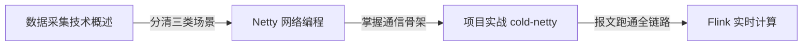
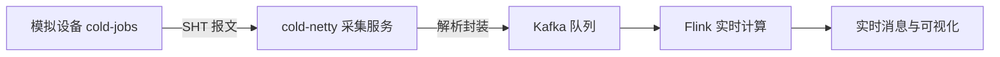

# 数据采集服务开篇：day3 要打通的设备上报链路

系统管理服务跑通之后，平台后台的底座已经齐了：注册中心、网关、用户服务、系统管理服务各就各位，页面能维护企业、仓库、主机与设备台账。但这个平台最核心的东西还没有着落：冷库里的温湿度数据一条都没进来，实时监控、告警、统计全都无从谈起。day3 整章围绕一个问题展开：设备的数据怎么上报、怎么接收、怎么交给后面的实时计算。开篇先把学习目标与技术点的映射摆清楚，后面每一课都能对号入座。

## 先给结论

- day3 分三段：数据采集技术全景、Netty 网络编程、项目实战数据采集服务 cold-netty，概念、技术、落地一条线。
- 数据采集分 ETL、大数据采集、物联网采集三类场景，冷链监控平台属于物联网采集，最大特点是设备主动上报而不是后台去拉。
- Netty 部分要吃透 I/O 模型、线程处理模型、核心组件，以及客户端与服务器端的完整开发步骤。
- 落地目标：cold-netty 服务监听 10010 端口收设备报文，解析封装后发 Kafka 队列，实时计算框架从队列消费，设备到平台的链路一次打通。

## 三段学习路径



这张图是 day3 的行进路线，三段内容层层递进，前一段给后一段铺路。

**第一段，数据采集技术概述。** 先把「数据采集」这个词在 ETL、大数据、物联网三个语境下的含义分清楚。不做这步区分，就说不清冷链平台为什么不用定时抽数，也说不清 Netty 在整个架构里占的位置。

**第二段，Netty 网络编程。** Netty 是服务器端通信层的开发框架，这一段覆盖四件事：I/O 模型的演进与取舍、事件驱动的线程处理模型、核心组件的职责，以及从零开发一个 Netty 客户端与服务器端的完整步骤。学完配一个客户端与服务器端的实例代码，把开发过程完整走一遍。

**第三段，项目实战。** 把 Netty 放回冷链监控平台：数据采集服务作为独立工程落地，设备提交的报文长什么样、服务器收到后做哪些处理，逐行对着真实工程讲。这一段的目标不是「会用 Netty」，而是领会物联网数据的采集与处理套路。

## 目标一：分清三类数据采集

同样是「数据采集」，三个场景里指的东西不一样。ETL 面向数仓与 BI 分析，关注抽取、清洗、转换、加载的流程；大数据采集面向日志、网络内容与数据库同步，关注海量数据的搬运；物联网采集面向设备，关注连接、报文与实时性。冷链监控平台的数据来源是仓库里的温湿度主机，属于第三类，但前两类的分层与解耦思想在后面的架构里照样用得上。具体概念下一课展开，这里先立好坐标。

## 目标二：吃透 Netty 的通信骨架

设备要发数据，平台得先有一个常驻的服务器端在监听，这就是 Netty 干的活。学 Netty 之前绕不开两个前置问题：操作系统层面的 I/O 模型怎么从阻塞走向多路复用，框架层面怎么用有限线程服务成千上万的连接。day3 把这两个问题拆成模型讲解加代码实践，demo 工程里准备了 IO、NIO、Netty 三种写法的对照实现，同一件事三种写法摆在一起，Netty 到底省掉了什么就看得见了。

day3 收官时，平台里会多出一个真实的采集服务工程 cold-netty，它的服务器端骨架先混个眼熟：

```java
@SpringBootApplication
@EnableDiscoveryClient
public class NettyServer implements CommandLineRunner {

    @Override
    public void run(String... args) throws Exception {
        //netty 辅助启动类，boss 组收连接，worker 组处理读写
        ServerBootstrap bootstrap = new ServerBootstrap();
        EventLoopGroup boss = new NioEventLoopGroup();
        EventLoopGroup worker = new NioEventLoopGroup();

        bootstrap.group(boss, worker);
        bootstrap.channel(NioServerSocketChannel.class);
        bootstrap.childHandler(new ChannelInitializer<SocketChannel>() {
            @Override
            protected void initChannel(SocketChannel ch) throws Exception {
                ch.pipeline().addLast(new ServerHandler());
            }
        });

        //绑定 10010 端口，启动服务
        ChannelFuture f = bootstrap.bind(10010).sync();
        f.channel().closeFuture().sync();
    }
}
```

boss 与 worker 两组线程、NioServerSocketChannel 通道类型、pipeline 里的业务处理器、bind 绑定端口，这些组件的分工就是第二段学习的主线，看到代码不再陌生，目标就算达成。

## 目标三：让设备报文跑通全链路

设备与平台之间要约定报文格式。平台采用 SHT 报文，一条真实样例如下：

```text
SHT|HE00120931|29|76|1|null|null|20190802125717|SH5lb1.2.1R
```

竖线分隔各字段，依次是协议头、设备编号、温度、湿度、状态、经度、纬度、采集时间与固件版本。采集服务收到后按竖线拆字段、封装成消息实体、序列化成 JSON 发进 Kafka，之后的计算与存储就与设备无关了。



这条链路是 day3 也是整个项目的数据主干：设备侧的模拟任务由 Quartz 驱动，采集服务只管收与转发，实时计算只管消费队列，谁也不等谁，排查问题时沿着箭头逐段看日志即可。

## 常见误区

- **把数据采集只当成爬虫。** 错例是一提采集就想到抓网页。正解是按场景分三类，设备上报类采集的核心是连接管理与报文协议，与爬虫几乎没有交集。
- **认为 Netty 是 HTTP 框架。** 错例是拿写接口的思路理解采集服务。正解是设备报文走原生 TCP，Netty 处理的是字节流与连接事件，HTTP 只是它顺带能支持的协议之一。
- **采集逻辑写进业务服务。** 错例是让系统管理服务顺带监听端口收报文。正解是采集与底层通信独立成系统，报文协议变化只影响采集服务，业务服务完全无感。
- **数据不过队列直接入库。** 错例是收到报文直接写数据库。正解是中间加 Kafka，既让采集与计算解耦，又能在流量突增时起到削峰作用。

## 面试可能被问到的问题

1. 面试官追问：「冷链监控平台为什么要单独做一个数据采集服务？」
   答：设备通信用的是原生 TCP 与自定义报文，与业务接口技术栈不同；独立成服务后，协议解析、连接管理集中在一处，协议变化只改这个服务，业务服务零感知，还能按设备连接数独立扩容。
2. 面试官追问：「物联网数据采集和传统 ETL 的本质区别是什么？」
   答：传统 ETL 是采集方主动从数据源拉数据，物联网采集是设备主动把数据推给服务端。推的模式要求平台常驻监听、即时解析转发，架构上以连接与报文为中心，而不是以表与 SQL 为中心。
3. 面试官追问：「Netty 解决了什么问题？」
   答：原生 NIO 的 Selector、ByteBuffer 与线程管理写起来繁琐且易错，Netty 封装出事件驱动的骨架：启动类、线程组、通道、处理器各司其职，开发者只写业务处理器，网络细节由框架托底。
4. 面试官追问：「采集服务收到报文之后做了什么？」
   答：把 ByteBuf 转成字符串，按竖线拆出设备编号与温湿度等字段，封装成消息实体并序列化为 JSON，发送到 Kafka 的设备报文主题，同时向设备回送应答；后续实时计算从队列消费，与设备侧彻底解耦。

## 配套资料

- 代码：`materials/code/06/day3 数据采集服务/`，cold-netty 采集服务工程的 NettyServer、ServerHandler，nettydemo 演示工程含 IO、NIO、Netty 三种实现的对照，均为真实随包文件。
- 说明：引用路径截至 day 目录层级；包名与 groupId 已统一改写为 `com.study.coldchain`；`materials/docs/06/` 无讲义目录。
